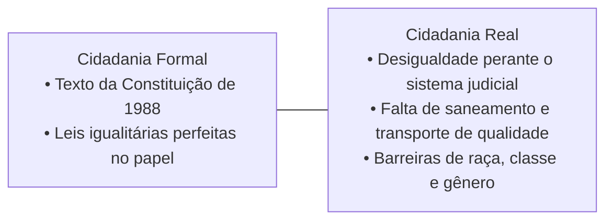

# 4 - Aprofundando o Tema: Cidadania Formal vs Cidadania Real

> **Tema:** O Abismo entre a Letra da Lei e a Vida Social no Brasil  
> **Referência:** José Murilo de Carvalho (*Cidadãos do Brasil*) e Wanderley Guilherme dos Santos

---

## ⚖️ Os "Estadanos" e a Cidadania Concedida

O historiador José Murilo de Carvalho, em seu clássico *Cidadania no Brasil: O Longo Caminho*, cunhou termos instigantes para descrever a nossa realidade:

1. **O "Estadano":** O indivíduo que depende quase exclusivamente do Estado paternalista para receber favores e benefícios, em vez de se perceber como sujeito autônomo portador de direitos universais.
2. **A Fratura dos Direitos Civis:** No Brasil, os direitos políticos (votar) e sociais (benefícios previdenciários e assistenciais) avançaram mais rapidamente do que os **direitos civis básicos** (segurança pública imparcial, justiça célere para todos e proteção física contra a violência policial nas favelas).

