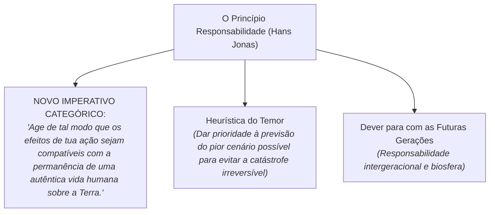

# Semana 5 - Ética, Ciência, Tecnologia e o Princípio da Responsabilidade

> **Disciplina:** Ética, Cidadania e Sociedade (SOC100)  
> **Carga Horária:** 40 horas  
> **Bimestre:** 2026S2B1 - Univesp

---

Olá, estudante!

Boas-vindas à **Semana 5** da disciplina **Ética, Cidadania e Sociedade (SOC100)**!

Nesta semana, examinaremos os impactos éticos mais prementes do nosso tempo: a relação entre **Ciência, Tecnologia, Sociedade e Meio Ambiente**.

Durante séculos, sustentou-se a tese positivista da "neutralidade da ciência", segundo a qual o conhecimento técnico seria axiologicamente neutro e apenas seu uso político poderia ser julgado. A era atômica, a crise climática global e o surgimento da Inteligência Artificial desconstruíram definitivamente esse mito: a ciência e a técnica são práticas sociais repletas de valores, intencionalidades e consequências existenciais.

Estudaremos a obra-prima do filósofo **Hans Jonas**, *O Princípio Responsabilidade: Ensaio de uma Ética para a Civilização Tecnológica*, que propõe um novo imperativo ético voltado para a salvaguarda das futuras gerações e a preservação da vida no planeta Terra.

---

## 🎯 Objetivos de aprendizagem

Ao final desta semana, você deverá ser capaz de:

- Desconstruir criticamente o mito da neutralidade da ciência e da tecnologia;
- Compreender a ética da responsabilidade formulada por **Hans Jonas** (*O Princípio Responsabilidade*);
- Analisar a reformulação do Imperativo Categórico kantiano para a era tecnológica (*Heurística do Temor*);
- Discutir os princípios da **Bioética** (Autonomia, Beneficência, Não-Maleficência e Justiça) e da ética algorítmica;
- Refletir sobre o compromisso ético dos profissionais de ciência e tecnologia com o desenvolvimento sustentável.

---

## 🌍 O Novo Imperativo Ético de Hans Jonas

---

## 🧩 Desafio da Semana: A Mineração de Dados Pessoais e a Ética dos Algoritmos

Considere o caso de uma grande empresa de tecnologia que desenvolve um sistema de IA para triagem automatizada de concessão de crédito financeiro. O algoritmo é treinado com dados históricos dos últimos 20 anos e passa a negar sistematicamente empréstimos a moradores de determinadas periferias e bairros vulneráveis, mesmo quando os indivíduos possuem renda comprovada.

**Questões para Reflexão:**
1. Por que o argumento de que "a tecnologia é neutra e apenas executa cálculos matemáticos objetivos" é falacioso nesse caso?
2. Como o **Princípio da Responsabilidade** de Hans Jonas e os princípios de **Não-Maleficência e Justiça** da Bioética devem orientar os engenheiros que projetaram o algoritmo?
3. Quais medidas práticas de governança e transparência algorítmica deveriam ser implementadas para corrigir os vieses discriminatórios?

---

## 🎥 Material-base: Videoaulas

### 🎬 Videoaula 9 - A Ciência é Neutra? Tecnologia e Sociedade
* **Docente Responsável:** Prof. Dr. Sílvio Gallo / Equipe Univesp
* **Tema:** Desconstrução da neutralidade axiológica da técnica, determinismo tecnológico e tecnociência.
* **Resumo:** A aula debate como os projetos de inovação tecnológica são orientados por escolhas econômicas e políticas, exigindo controle democrático e ético.

### 🎬 Videoaula 10 - Hans Jonas e a Ética para a Civilização Tecnológica
* **Docente Responsável:** Equipe Univesp
* **Tema:** *O Princípio Responsabilidade*, a vulnerabilidade da biosfera e a heurística do temor.
* **Resumo:** Apresentação da ética de Hans Jonas como resposta à capacidade sem precedentes que a técnica moderna tem de destruir a própria continuidade da vida humana no planeta.

---

## 📚 Leituras Recomendadas

* **Texto-base 1:** *O Princípio Responsabilidade: Ensaio de uma Ética para a Civilização Tecnológica* (Hans Jonas, Editora Vozes). Ver resumo em [`1-Texto-base.md`](file:///home/henrique/Modelos/Univesp/2026S2B1/SOC100-Etica-Cidadania-e-Sociedade/Semana-5/1-Texto-base.md).
* **Texto-base 2:** *Princípios de Bioética Biomédica* (Tom Beauchamp e James Childress). Ver resumo em [`2-Texto-base.md`](file:///home/henrique/Modelos/Univesp/2026S2B1/SOC100-Etica-Cidadania-e-Sociedade/Semana-5/2-Texto-base.md).
