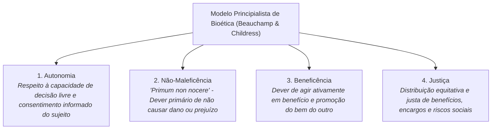

# 2 - Texto-base: Os Quatro Princípios da Bioética (Beauchamp & Childress)

> **Obra:** *Principles of Biomedical Ethics* (O Modelo Principialista)  
> **Autores:** Tom L. Beauchamp e James F. Childress  
> **Editora:** Oxford University Press

---

## 📖 Os Quatro Princípios Cardeais da Bioética

Desenvolvido para enfrentar os dilemas éticos surgidos na medicina experimental, na biotecnologia e nos sistemas algorítmicos:

---

## 💻 Aplicação à Ética Algorítmica e Inteligência Artificial

1. **Autonomia:** O usuário deve ser informado de que está interagindo com uma IA e ter o direito de não ser submetido a decisões exclusivamente automatizadas que afetem sua vida jurídica ou financeira (*LGPD - Art. 20*).
2. **Não-Maleficência:** Algoritmos não podem amplificar discursos de ódio, assédio ou gerar exclusão material por falhas de projeto.
3. **Justiça (Equidade / Fairness):** O treinamento de modelos não pode perpetuar ou agravar discriminações históricas de raça, gênero ou classe social.
