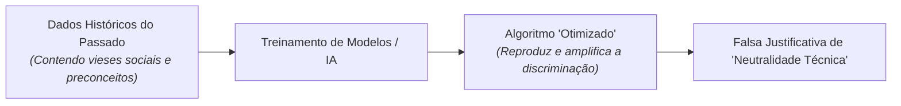

# 4 - Aprofundando o Tema: Ética, Algoritmos e Discriminação Sistêmica

> **Tema:** O Mito da Neutralidade Matemática nos Algoritmos de IA  
> **Autoras de Referência:** Cathy O'Neil (*Algoritmos de Destruição em Massa*) e Safiya Noble (*Algoritmos da Opressão*)

---

## 💻 Algoritmos Não São Neutros: O Espelho dos Dados Históricos

Muitos desenvolvedores acreditam ingenuamente que, por ser código matemático, um sistema automatizado é inerentemente justo e desprovido de preconceitos humanos.

No entanto, a matemática dos sistemas de *Machine Learning* baseia-se em **dados de treinamento do passado**:
- Se os dados históricos dos últimos 20 anos refletem um mercado de trabalho com disparidade salarial de gênero ou um sistema bancário que negava crédito a bairros periféricos, o algoritmo aprenderá esse padrão discriminatório e o reproduzirá de forma automatizada e em escala industrial.
- Como adverte a matemática **Cathy O'Neil**, os algoritmos funcionam como *"opiniões codificadas em matemática"*.

---

## 🛡️ As Diretrizes de IA Ética (UNESCO e União Europeia)

1. **Explicabilidade (*Explainability*):** Nenhum sistema crítico de crédito, saúde ou justiça criminal pode operar como uma "caixa-preta" (*black-box*) incompreensível; as razões da decisão devem ser auditáveis.
2. **Supervisão Humana (*Human-in-the-loop*):** As decisões automatizadas de alto risco devem ter revisão humana qualificada obrigatória.
3. **Auditoria de Vieses (*Fairness Auditing*):** Testes regulares nos modelos para garantir que grupos minoritários não sejam desproporcionalmente prejudicados.
