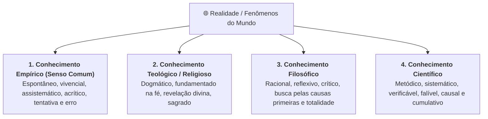

# 🎥 Videoaula 1 — Senso Comum e Ciência

> **Disciplina:** Projetos e Métodos para a Produção do Conhecimento (`INT100`)  
> **Semana 1:** Senso Comum e Ciência  
> **Docente da Aula:** Profª Darlene Ferreira  
> **Link da Aula:** [Assistir no YouTube](https://www.youtube.com/watch?v=n8S-Yja9wWo)  

---

## 📌 Visão Geral da Videoaula

A aula aborda a gênese do conhecimento humano, diferenciando as formas como o ser humano compreende, interpreta e interage com a realidade. São discutidas as quatro matrizes fundamentais do saber: **empírico (senso comum)**, **teológico (religioso)**, **filosófico** e **científico**, destacando-se como a pesquisa científica constrói explicações rigorosas, falseáveis e metodologicamente estruturadas.

---

## 🧠 Os Quatro Níveis de Conhecimento

### 1. Conhecimento Empírico (Senso Comum / Vulgar)
* **Origem:** Adquirido no cotidiano através do contato direto com o meio social e natural.
* **Características:**
  * Baseado em experiências práticas, tradições orais e intuições.
  * Assistemático (não segue um protocolo pré-determinado).
  * Subjetivo e ametódico (depende das impressões sensoriais individuais).
  * Desenvolvido pelo mecanismo de tentativa, erro e acerto.

> [!WARNING]
> ### ⚠️ Errata Oficial da Univesp (Slide 11 da Videoaula)
> A definição de conhecimento empírico do slide 11 da videoaula foi retificada pela coordenação para seguir com exatidão a definição clássica de Cervo, Bervian e Silva:
> 
> *"O conhecimento empírico, erroneamente chamado vulgar ou de senso comum, é aquele que é adquirido pela própria pessoa na sua relação com o meio ambiente ou com o meio social, obtido por meio de interação contínua na forma de ensaios e tentativas que resultam em erros e em acertos."* (CERVO; BERVIAN; SILVA, 2007, p. 6).

---

### 2. Conhecimento Religioso / Teológico
* **Origem:** Revelação divina expressa em textos sagrados, doutrinas ou tradições espirituais.
* **Características:**
  * **Fundamentação na Fé:** Suas verdades são aceitas sem exigência de comprovação empírica ou laboratorial.
  * **Dogmático e Sagrado:** Não sujeito a refutações empíricas; repousa na autoridade da transcendência.
  * **Inquestionável:** Acolhido por crença interna e adesão moral/espiritual.

---

### 3. Conhecimento Filosófico
* **Origem:** Uso da razão pura, da lógica e da reflexão crítica sobre a totalidade da existência, os princípios éticos, ontológicos e epistemológicos.
* **Características:**
  * **Racional e Especulativo:** Não requer experimentação laboratorial física, mas sim rigor lógico-argumentativo.
  * **Holístico e Crítico:** Questiona os fundamentos, os pressupostos e os limites de todos os outros saberes (inclusive da própria ciência).
  * **Sistemático:** Organiza argumentos de forma coerente e dedutiva.

---

### 4. Conhecimento Científico
* **Origem:** Investigação sistemática dos fatos através do método científico.
* **Características:**
  * **Metódico e Sistemático:** Segue procedimentos rigorosos, padronizados e replicáveis.
  * **Verificável e Falseável:** Suas hipóteses devem ser passíveis de teste, validação ou refutação perante evidências concretas.
  * **Causal e Explicativo:** Busca as causas, leis e padrões que regem os fenômenos.
  * **Falível e Provisório:** Não produz dogmas eternos; toda teoria científica é válida até que surjam evidências ou teorias mais completas.
  * **Objetivo:** Procura minimizar subjetividades e vieses por meio do rigor instrumental e analítico.

---

## 📊 Matriz Comparativa dos Tipos de Conhecimento

| Dimensão | Empírico (Senso Comum) | Religioso (Teológico) | Filosófico | Científico |
| :--- | :--- | :--- | :--- | :--- |
| **Fonte / Origem** | Experiência cotidiana e sensorial | Revelação divina e fé | Razão pura e reflexão crítica | Investigação metódica e empírica |
| **Postura Crítica** | Acrítico / Espontâneo | Dogmático / Inquestionável | Altamente reflexivo / Crítico | Crítico / Verificável / Falseável |
| **Método** | Ametódico (tentativa e erro) | Hermenêutica de textos sagrados | Lógico-dedutivo / Dialético | **Método Científico** (Hipotético-dedutivo, indutivo, experimental) |
| **Sistematização** | Assistemático / Fragmentado | Sistemático (Doutrinas) | Sistemático (Sistemas filosóficos) | **Altamente Sistemático e Cumulativo** |
| **Validade** | Particular e contextual | Absoluta / Sobrenatural | Universal pela razão | Contingente, provisória e refutável |

---

## 🔬 A Centralidade do Método na Pesquisa Científica

A videoaula destaca que o que torna um trabalho verdadeiramente científico não é apenas o assunto ou a descoberta final, mas sim o **caminho percorrido (o método)**:
1. **Transparência e Reprodutibilidade:** Outros pesquisadores devem ser capazes de repetir o procedimento e verificar a consistência dos resultados.
2. **Neutralidade e Controle de Vieses:** O método serve como freio intelectual contra o viés de confirmação e as armadilhas do senso comum.
3. **Formulação do Problema:** Transformar uma dúvida cotidiana em um problema delimitado, objetivo e teoricamente fundamentado.
