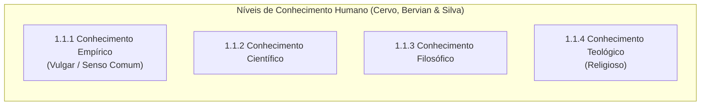

# 📖 Texto-base — Metodologia Científica: O Conhecimento e seus Níveis

> **Referência:** CERVO, Amado L.; BERVIAN, Pedro A.; SILVA, Roberto da. **Metodologia Científica**. 6. ed. São Paulo: Pearson Prentice Hall, 2007. (Capítulo 1, seções 1.1 a 1.1.4).  
> **Link na Biblioteca Virtual:** [Plataforma Pearson / Univesp](https://plataforma.bvirtual.com.br/Leitor/Publicacao/341/pdf/15?code=l7lQl8aetVB7nCzGQxLM3LmWgVaD9i4HLga1ilTsvvSYnOtCYFOL0FlnTsNYX7lKmLnFe855aIt13PhWeaZ9YQ==)  

---

## 📌 1. O Fenômeno do Conhecimento (Seção 1.1)

O conhecimento é o ato ou efeito de conhecer; é a relação dialética que se estabelece entre o **sujeito cognoscente** (aquele que tem a capacidade de apreender e pensar) e o **objeto cognoscível** (a realidade, coisa ou fenômeno a ser conhecido).

Ao interagir com o meio físico e sociocultural, o ser humano desenvolve diferentes modos de apreensão da realidade, resultando em quatro níveis fundamentais de conhecimento:

---

## 🔹 1.1.1 Conhecimento Empírico (Vulgar ou Senso Comum)

### Definição
> *"O conhecimento empírico, erroneamente chamado vulgar ou de senso comum, é aquele que é adquirido pela própria pessoa na sua relação com o meio ambiente ou com o meio social, obtido por meio de interação contínua na forma de ensaios e tentativas que resultam em erros e em acertos."* (p. 6)

### Características Estruturais
1. **Superficial:** Apreende o fato conforme ele se manifesta exteriormente aos sentidos, sem indagar as leis profundas ou os mecanismos ocultos que o regem.
2. **Sensitivo / Vivencial:** Fortemente condicionado pelas vivências cotidianas, pelos sentimentos, crenças e percepções subjetivas do observador.
3. **Subjetivo:** Depende da perspectiva pessoal e do contexto sociocultural imediato de quem observa.
4. **Assistemático:** Não integra um sistema coerente e articulado de ideias; organiza-se de maneira dispersa e fragmentada.
5. **Ametódico:** Não se apoia em regras prévias de controle instrumental, validação estatística ou rigor formal.

---

## 🔹 1.1.2 Conhecimento Científico

### Definição
O conhecimento científico ultrapassa a esfera da mera constatação fenomênica para atingir as **causas**, as **leis** e as **relações de causalidade** que governam os objetos e os processos da natureza e da sociedade.

### Características Estruturais
1. **Real / Factual:** Lida com dados e ocorrências concretas da realidade empírica, buscando explicações pautadas em evidências observáveis.
2. **Contingente:** O valor de verdade de suas proposições é verificado e validado pela experiência e pelo confronto com o real, e não pela pura abstração mental.
3. **Sistemático:** Constitui um corpo ordenado e unificado de enunciados e teorias logicamente integradas entre si.
4. **Verificável / Testável:** Todas as suas hipóteses devem ser passíveis de demonstração, replicação e teste experimental ou observacional.
5. **Falível e Provisório (Aproximadamente Exato):** A ciência não produz dogmas absolutos nem verdades eternas. Toda formulação científica é mantida até que novas observações, experimentos ou paradigmas demonstrem limites ou inconsistências na teoria vigente.
6. **Metódico:** É planejado e executado conforme procedimentos rigorosos, padronizados e reprodutíveis (Método Científico).

---

## 🔹 1.1.3 Conhecimento Filosófico

### Definição
O conhecimento filosófico distingue-se por seu caráter eminentemente **reflexivo, crítico e racional**. Em vez de focar em um objeto particular e delimitado (como fazem as ciências empíricas), a filosofia investiga as **causas primeiras**, os **fundamentos últimos da existência**, as regras da lógica, a moral e a epistemologia.

### Características Estruturais
1. **Racional e Especulativo:** Opera com conceitos puros, juízos e deduções lógicas, dispensando a experimentação de laboratório.
2. **Sistemático:** Estrutura enunciados em sistemas lógicos consistentes e coerentes.
3. **Não-experimental:** Suas conclusões não repousam em testes empíricos imediatos, mas na solidez e consistência de sua argumentação racional.
4. **Holístico / Totalizante:** Busca compreender o todo da realidade e da condição humana, integrando as partes no panorama global.
5. **Crítico / Radical:** Interroga os fundamentos das certezas cotidianas e examina criticamente os próprios pressupostos metodológicos das ciências.

---

## 🔹 1.1.4 Conhecimento Teológico (Religioso)

### Definição
O conhecimento teológico apoia-se na **fé** e na **revelação divina**, expressa nas escrituras sagradas, nos dogmas e na tradição de uma fé.

### Características Estruturais
1. **Valorativo e Apriorístico:** As premissas são aceitas com base na autoridade divina e na fé, prescindindo de demonstração científica.
2. **Não-verificável pelo método científico:** Trata de realidades sobrenaturais, transcendentes e espirituais, que estão fora do alcance do escopo instrumental e experimental.
3. **Dogmático e Sagrado:** Suas doutrinas e dogmas são considerados infalíveis, imutáveis e absolutos no âmbito da crença confessional.
4. **Sistemático:** Organiza-se em corpos doutrinários, teologias sistemáticas e tratados confessionais coerentes internamente.

---

## 📊 Matriz Síntese de Cervo, Bervian e Silva (2007)

| Conhecimento | Objeto | Método | Validade / Certeza | Postura perante o Erro |
| :--- | :--- | :--- | :--- | :--- |
| **Empírico (Senso Comum)** | Fatos cotidianos imediatos | Ensaio, erro e acerto (ametódico) | Subjetiva e situacional | Conformismo / Hábito |
| **Científico** | Fatos, leis e relações causais | Método científico rigoroso | Verificável, objetiva e contingente | **Autocorreção constante (falibilidade)** |
| **Filosófico** | Princípios primeiros e totalidade | Lógica, dedução e reflexão crítica | Racional e conceitualmente fundamentada | Crítica e refutação argumentativa |
| **Teológico** | Mistérios divinos e revelação | Fé e exegese das escrituras | Absoluta e sagrada na esfera da fé | Inviolabilidade dos dogmas |
