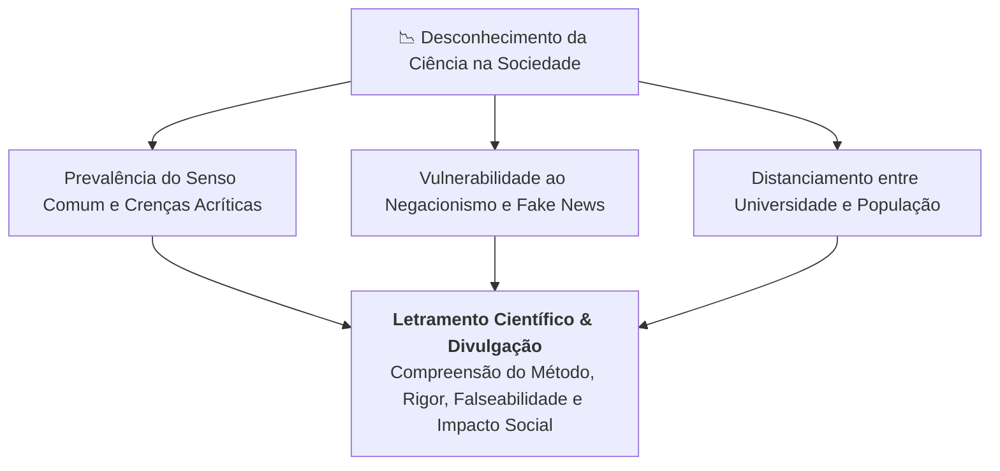

# 🔍 Aprofundando o Tema — Semana 1

> **Disciplina:** Projetos e Métodos para a Produção do Conhecimento (`INT100`)  
> **Tema da Semana 1:** Senso Comum e Ciência  

---

## 📚 1. Material de Apoio Bibliográfico

* **Referência:** PESSÔA, Vera Lúcia Salazar. *Manual para elaboração de trabalhos acadêmicos: material para fins didáticos* (páginas 4 e 5).
* **Link Direto do PDF:** [Acessar Manual Univesp (PDF)](https://assets.univesp.br/disciplinas/INT100/pdf/s1_material_de_apoio_manual_para_elaboracao_de_trabalhos_academiscos_2020.pdf)

### 💡 Síntese dos Conceitos Centrais (Págs. 4 e 5)
* **A Transição para a Vida Acadêmica:** No ensino superior, o estudante deixa de ser um mero receptor passivo de conteúdos para se tornar um agente ativo na produção e sistematização do conhecimento.
* **A Disciplina Intelectual e o Rigor:** A metodologia científica não é mera burocracia de normas, mas um instrumento formativo que organiza o raciocínio lógico, a delimitação de problemas e o tratamento crítico das fontes.
* **Autoria e Ética:** A produção acadêmica exige a clara distinção entre a assimilação do saber existente (revisão de literatura devidamente referenciada) e as contribuições originais do autor.

---

## 🎥 2. Vídeo de Apoio — O Desconhecimento da Ciência no Brasil

* **Programa:** *Panorama* | Jornalismo TV Cultura  
* **Link:** [Assistir no YouTube](https://www.youtube.com/watch?v=PM3g5UxutK4)  

### 🧠 Tópicos de Discussão e Análise Crítica
1. **A Percepção Pública da Ciência no Brasil:**
   * Pesquisas mostram que uma parcela expressiva da população desconhece onde e como a ciência é desenvolvida no país (mais de 90% da pesquisa nacional é produzida em universidades públicas).
   * O público frequentemente confunde o conhecimento empírico/senso comum com conclusões científicas consolidadas.

2. **Riscos da Falta de Letramento Científico:**
   * A ausência de compreensão sobre o funcionamento do método científico (testes, revisões por pares, evidências controladas) favorece o avanço de pseudociências, tratamentos ineficazes e teorias da conspiração.
   * Quando o cidadão compreende que a ciência é **falível e autocorretiva**, ele entende que mudanças de recomendações científicas não são "fraqueza", mas sim a aplicação rigorosa do método diante de novos dados.

3. **O Papel Social do Engenheiro e do Cientista:**
   * O pesquisador tem o dever ético de comunicar suas descobertas com clareza, transparência e responsabilidade social, estreitando a ponte entre a academia e a sociedade.
