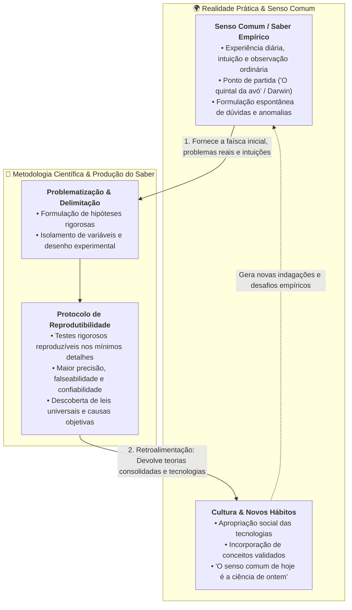

# 💬 Fórum Temático — Semana 1 (INT100)

> **Disciplina:** Projetos e Métodos para a Produção do Conhecimento (`INT100-EC-2026S2B2-T001`)  
> **Tema da Semana 1:** Senso Comum e Ciência  
> **Docente Responsável:** Profª Dra. Graziella Ribeiro Soares Moura  
> **Objeto de Discussão:** Desafio da Semana — A Relação e a Retroalimentação entre Senso Comum e Conhecimento Científico  

---

## 💡 Proposta do Desafio do Fórum

### 📄 Enunciado
> *A ideia trazida pelo Prof. Dr. Miguel Nicolelis no vídeo "O quintal da minha avó" está sustentada no princípio de que qualquer um pode fazer ciência e de que as grandes questões de pesquisa estão presentes no nosso dia a dia.*  
> 
> *Link:* [O quintal da minha avó | Miguel Nicolelis](https://www.youtube.com/watch?v=a2QV8eUSU6o)  
> 
> *As notícias veiculadas diariamente em jornais, redes de televisão e redes sociais trazem diversas possibilidades para levantarmos temas para pesquisa. Ao ingressar na Universidade, você é chamado a desenvolver um raciocínio crítico e, para tal, deve estar atento ao que acontece no mundo.*  
> 
> **Questões Disparadoras:**
> 1. *Considerando que muito do que se realiza em Ciência tem origem em questões e problemas reais, como você avalia a relação entre o que é senso comum e o que é conhecimento científico?*
> 2. *Há uma retroalimentação entre esses dois tipos de conhecimento?*
> 3. *Você concorda que o senso comum é um tipo de conhecimento? Justifique sua resposta.*

---

## 🔬 Fundamentação Teórica e Epistemológica

> [!IMPORTANT]
> ### 🎯 Ponto Central de Rigor Epistemológico:
> O conhecimento científico destaca-se por testar hipóteses sob condições rigorosas e controladas, garantindo que os experimentos e conceitos sejam **reproduzíveis nos seus mínimos detalhes**, com **precisão e confiabilidade** infinitamente superiores às impressões subjetivas do senso comum. Contudo, **esse rigor de verificação não impede que a faísca inicial da investigação parta de uma observação comum do cotidiano**. O método científico não cria a realidade do nada; ele aprofunda, testa e valida com reprodutibilidade aquilo que o senso comum apenas intui.

---

## 🧠 Análise Estruturada das Questões

### 1. Relação entre Senso Comum e Conhecimento Científico
* O **senso comum** (conhecimento empírico/vulgar) é subjetivo, assistemático e acumulado espontaneamente no dia a dia. Ele responde ao "como as coisas parecem ser" para finalidades imediatas.
* O **conhecimento científico** busca testar conceitos por meio de métodos padronizados para torná-los **reproduzíveis nos mínimos detalhes**, alcançando um grau muito superior de **precisão, confiabilidade e generalização** (Cervo, Bervian e Silva, 2007).
* **A Relação:** Não se trata de mundos isolados, mas de uma **relação dialética**:
  - *Gênese Empírica:* A ciência não rejeita o senso comum como ponto de partida; muitas das maiores investigações científicas (da gravidade de Newton à seleção natural de Darwin e à neurociência de Nicolelis) nasceram de observações corriqueiras do cotidiano.
  - *Ruptura e Superação Metodológica:* O diferencial da ciência está na transição da intuição para o teste controlado: isolam-se variáveis e documenta-se o procedimento com tal exatidão que qualquer outro cientista, em qualquer lugar, possa reproduzir o experimento e confrontar os resultados.

### 2. A Retroalimentação (*Feedback Dialético*) entre os Dois Saberes
* **Sim, existe uma retroalimentação contínua e bidirecional:**
  1. **Do Senso Comum para a Ciência ($\text{SC} \to \text{Ciência}$):** O senso comum atua como a fonte inesgotável de indagações e problemas concretos. A curiosidade observada no *"quintal da avó"* gera a hipótese inicial que a ciência formaliza.
  2. **Da Ciência para o Senso Comum ($\text{Ciência} \to \text{SC}$):** Os conceitos testados, comprovados e transformados em tecnologia voltam à sociedade. O rigor científico de ontem (como a assepsia de mãos, a conservação de alimentos, o uso da eletricidade ou o funcionamento de redes digitais) é gradualmente assimilado e passa a compor o senso comum de hoje.

### 3. O Senso Comum é um Tipo de Conhecimento?
* **Sim, concordo categoricamente.**
* **Justificativa:** 
  - O senso comum é conhecimento legítimo porque consiste na apreensão funcional da realidade pelo ser humano através da experiência acumulada.
  - Foi esse saber prático que permitiu à humanidade prosperar por milênios antes da invenção do método cartesiano e experimental.
  - A diferença primordial entre o senso comum e a ciência não é a legitimidade de sua existência, mas o **critério de verdade, o grau de precisão e a exigência de reprodutibilidade experimental**.

---

## 📝 Sugestão de Postagem para o Fórum Temático da Univesp (Formato Redação — 3 Parágrafos)

> **Título do Tópico:** Senso Comum e Ciência: Reprodutibilidade, Ponto de Partida e Retroalimentação
>
> Olá a todos, professora Graziella e colegas!
>
> A relação entre o senso comum e o conhecimento científico não é de oposição, mas de origem compartilhada e elevação do rigor metodológico. Como ilustrado pelo Prof. Miguel Nicolelis em *"O quintal da minha avó"*, as grandes indagações da ciência frequentemente nascem de observações cotidianas e da curiosidade do senso comum. A diferença fundamental é que a ciência submete essas intuições a métodos rigorosos e controlados, tornando seus conceitos reproduzíveis nos mínimos detalhes, com um nível de precisão e confiabilidade muito superior ao saber empírico ordinário, sem que isso invalide o fato de o senso comum ser o ponto de partida de grandes descobertas.
>
> Além disso, existe uma clara retroalimentação entre essas duas formas de saber. Se por um lado o senso comum abastece a pesquisa acadêmica com problemas reais, demandas sociais e anomalias práticas, por outro, os avanços e tecnologias validados pela ciência retornam à sociedade e são progressivamente assimilados pela cultura popular. Com o passar do tempo, o conhecimento científico de ontem transforma-se no senso comum de hoje — como ocorreu com práticas de higiene, vacinação e o uso de recursos digitais.
>
> Por fim, considero indiscutível que o senso comum é um tipo legítimo de conhecimento. Trata-se do saber construído pela experiência prática e acumulado por gerações, tendo sido o grande responsável pela sobrevivência e desenvolvimento da humanidade muito antes da formalização do método cartesiano e experimental. Sua distinção em relação à ciência reside na exigência de sistematicidade, controle de variáveis e reprodutibilidade, e não no fato de ser ou não um saber genuíno.
>
> Um abraço e bons estudos a todos!

---

## 📚 Referências Bibliográficas

* CERVO, Amado Luiz; BERVIAN, Pedro Alcino; SILVA, Roberto da. *Metodologia Científica*. 6. ed. São Paulo: Pearson Prentice Hall, 2007.
* CHALMERS, Alan F. *O que é ciência afinal?*. São Paulo: Brasiliense, 1993.
* NICOLELIS, Miguel. *O quintal da minha avó*. TV Rádio Big Bang / YouTube, 2021.
* POPPER, Karl. *A lógica da pesquisa científica*. São Paulo: Cultrix, 1972.
