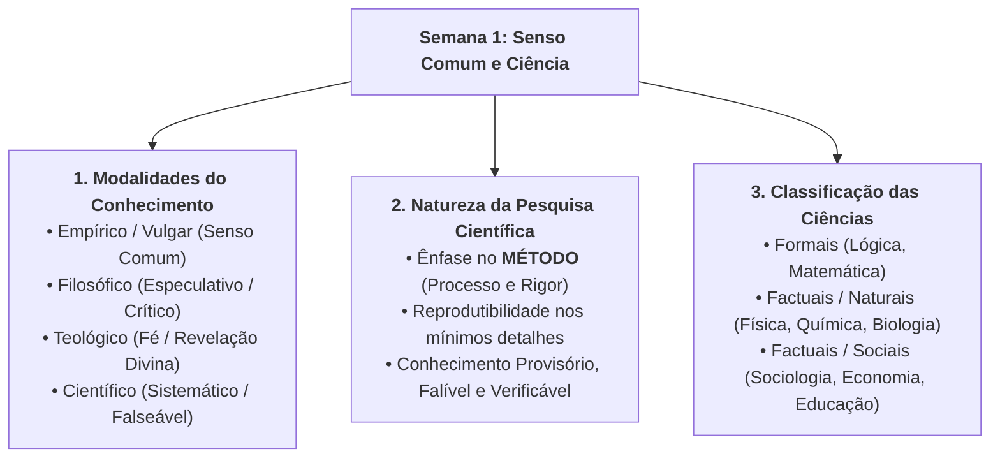

# 📌 Em Síntese — Semana 1 (INT100)

> **Disciplina:** Projetos e Métodos para a Produção do Conhecimento (`INT100-EC-2026S2B2-T001`)  
> **Tema da Semana 1:** Senso Comum e Ciência  
> **Docente Responsável:** Profª Dra. Graziella Ribeiro Soares Moura  
> **Período:** 28/09/2026 a 11/10/2026  
> **Status:** 🟢 Semana 1 Concluída com Sucesso (10,0 / 10,0)  

---

## 🎯 Síntese e Consolidação dos Conteúdos da Semana

A ciência é o grande motor de transformação da sociedade humana. Ao longo desta primeira semana, compreendemos que fazer pesquisa científica não significa isolar-se em laboratórios herméticos, mas sim exercitar uma **curiosidade metódica**, formulando perguntas rigorosas sobre os fenômenos cotidianos e aplicando procedimentos sistemáticos para investigá-los.

---

## 🏛️ 1. As Quatro Formas de Conhecer o Mundo

| Tipo de Conhecimento | Objeto / Fonte | Método / Validação | Característica Principal |
| :--- | :--- | :--- | :--- |
| **Empírico (Senso Comum)** | Experiência cotidiana direta | Espontâneo, tentativa e erro | Subjetivo, acrítico, assistemático, prático |
| **Filosófico** | Realidade total, essência das coisas | Racional, reflexão crítica e lógica | Especulativo, não experimental, dedutivo |
| **Teológico (Religioso)** | Fé, sagrado, verdades reveladas | Tradição dogmática e textos sagrados | Infalível (pela fé), incontestável, transcendental |
| **Científico** | Fenômenos reais, fatos empíricos | **Método Científico Experimental** | Sistemático, metódico, falseável, reprodutível |

---

## 🔬 2. O Primado do Método na Pesquisa Científica

> [!IMPORTANT]
> ### 💡 A Ciência como Processo e Método:
> A pesquisa científica difere fundamentalmente de outras produções humanas porque seu valor reside prioritariamente no **rigor do método**, e não apenas no resultado final.  
> Uma conclusão científica só é válida porque:
> 1. É obtida por meio de procedimentos documentados e **reproduzíveis nos seus mínimos detalhes**;
> 2. Suas variáveis são controladas e delimitadas no tempo e no espaço;
> 3. Suas hipóteses estão abertas ao falseamento, à contestação por pares e à revisão contínua.

---

## ✅ Autoavaliação de Metas e Competências da Semana 1

Verifique as metas alcançadas nesta primeira etapa:

- [x] **Apreendi as diferenças entre o conhecimento banal (senso comum) e o conhecimento científico:** Compreendi que o senso comum é assistemático e imediato, enquanto a ciência exige controle metódico, reprodutibilidade e fundamentação causal.
- [x] **Compreendi que a pesquisa científica é produtora de conhecimento e que enfatiza o método, e não o resultado:** Entendi que a validade de uma descoberta científica decorre da solidez dos passos metodológicos aplicados.
- [x] **Entendi o significado da ciência hoje:** Reconheci o papel da ciência como motor de desenvolvimento social, tecnológico e humano, além de entender a dialética de retroalimentação entre ciência e sociedade.
- [x] **Exercitei a leitura crítica e o olhar investigativo:** Realizei o exercício de identificação de ideias centrais e palavras-chave em textos acadêmicos e de divulgação científica (experimentos de Darwin).
- [x] **Participei do Fórum Temático e Atividade Avaliativa:** Gabarito 10,0/10,0 consolidado e debate sobre *"O quintal da minha avó"* (Prof. Miguel Nicolelis) estruturado.

---

## 🔮 Conexão com a Semana 2: O que vem a seguir?

Na **Semana 2**, mergulharemos nos alicerces operacionais da investigação acadêmica:
* **Tema:** *Fundamentos da metodologia científica e técnicas de pesquisa*.
* **Tópicos Principais:**
  * Métodos de abordagem: Indutivo, Dedutivo, Hipotético-Dedutivo e Dialético.
  * Técnicas de coleta de dados e instrumentos de pesquisa: pesquisa bibliográfica, documental, experimental e de campo (estudos de caso, questionários e entrevistas).
  * Critérios para formulação de problemas e objetivos científicos no projeto de pesquisa.

---

## 📚 Navegação Rápida — Materiais da Semana 1 (INT100)

* [0-Inicio.md](file:///home/henrique/Modelos/Univesp/2026S2B2/INT100-Projetos-e-Metodos-para-a-Producao-do-Conhecimento/Semana-1/0-Inicio.md) — Apresentação, Objetivos e Desafio da Semana
* [1-Videoaulas.md](file:///home/henrique/Modelos/Univesp/2026S2B2/INT100-Projetos-e-Metodos-para-a-Producao-do-Conhecimento/Semana-1/1-Videoaulas.md) — Videoaula 1 (Profª Darlene Ferreira) e Errata Oficial
* [2-Texto-base.md](file:///home/henrique/Modelos/Univesp/2026S2B2/INT100-Projetos-e-Metodos-para-a-Producao-do-Conhecimento/Semana-1/2-Texto-base.md) — Cervo, Bervian e Silva (Os 4 Níveis do Conhecimento)
* [3-Aprofundando-o-tema.md](file:///home/henrique/Modelos/Univesp/2026S2B2/INT100-Projetos-e-Metodos-para-a-Producao-do-Conhecimento/Semana-1/3-Aprofundando-o-tema.md) — Manual de Vera Pessôa e TV Cultura (Letramento Científico)
* [4.1-Exercicio-de-apoio.md](file:///home/henrique/Modelos/Univesp/2026S2B2/INT100-Projetos-e-Metodos-para-a-Producao-do-Conhecimento/Semana-1/4.1-Exercicio-de-apoio.md) — Leitura Crítica e Experimentos de Darwin
* [4.2-Forum-tematico.md](file:///home/henrique/Modelos/Univesp/2026S2B2/INT100-Projetos-e-Metodos-para-a-Producao-do-Conhecimento/Semana-1/4.2-Forum-tematico.md) — Resolução do Fórum (Miguel Nicolelis, Reprodutibilidade e Retroalimentação)
* [5-Atividade-avaliativa.md](file:///home/henrique/Modelos/Univesp/2026S2B2/INT100-Projetos-e-Metodos-para-a-Producao-do-Conhecimento/Semana-1/5-Atividade-avaliativa.md) — Gabarito e Justificativas Oficiais (Nota 10,0 / 10,0)
