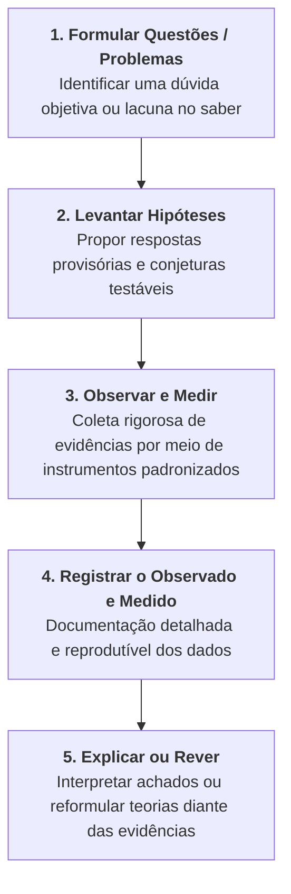

# 📌 Semana 2 — Início & Apresentação da Semana

> **Disciplina:** Projetos e Métodos para a Produção do Conhecimento (`INT100-EC-2026S2B2-T001`)  
> **Tema da Semana 2:** Fundamentos da Metodologia Científica e Técnicas de Pesquisa  
> **Docente Responsável:** Profª Dra. Graziella Ribeiro Soares Moura  
> **Período:** 05/10/2026 a 18/10/2026  

---

## 👩‍🏫 Mensagem da Professora & Contextualização

Olá, estudante!

Na última semana, você iniciou a disciplina tratando das diversas formas de conhecimento e de como a ciência é a produtora do conhecimento científico, balizado pelas distintas formas de se fazer pesquisa.

Nesta semana, você vai avançar nessa discussão e o conteúdo agora será dirigido para o **entendimento dos fundamentos e das técnicas de pesquisa**. Um raciocínio dirigido para a construção de um **espírito crítico e observador** é o princípio básico do pensamento científico. Você vai desenvolver formas de ver a realidade, o cotidiano, seguindo princípios filosóficos e teóricos que embasam os fundamentos e a metodologia científica.

É importante ampliar, através dos estudos dos métodos científicos, o rigor nos estudos ao longo de sua formação. A pesquisa e a reflexão fazem parte da vida universitária. Fazer uma leitura atenta, analisando as ideias do autor, estudar documentos e elaborar trabalhos científicos são práticas comuns a um estudante universitário.

Para além das práticas que envolvem um trabalho científico, a disposição para pesquisa requer a **busca de soluções sérias, com adequação dos métodos aos problemas enfrentados**. A prática da pesquisa deve ter **racionalidade, objetividade e senso crítico**.

A metodologia de pesquisa é definida pelo caminho e pela prática que se escolheu para tratar a realidade. Ela vai incluir as **concepções teóricas, as técnicas e a criatividade do pesquisador**. Concepções teóricas e técnicas estão diretamente relacionadas à ciência praticada pelo pesquisador. A biologia, a sociologia e a física, entre outras ciências, constituíram aportes teóricos e técnicos distintos ao longo da história de sua formação e desenvolvimento.

---

## 🔬 Fundamentos Comuns a Todas as Ciências

Contudo, existem fundamentos universais comuns a todas as ciências que se exprimem nos seguintes procedimentos estruturais:

1. **Formular questões / perguntas / problemas:** Delimitar com clareza o que se quer responder.
2. **Levantar hipóteses / possíveis respostas:** Elaborar explicações provisórias falseáveis.
3. **Observar e medir:** Empregar instrumentos precisos e métricas objetivas.
4. **Registrar o observado e medido:** Assegurar a reprodutibilidade dos dados coletados.
5. **Explicar o que foi encontrado ou rever o que já foi produzido:** Confrontar teorias vigentes perante novas evidências empíricas.

---

## 🎯 Objetivos de Aprendizagem

Ao final desta semana, você deverá ser capaz de:

* [ ] **Compreender** a concepção de ciência e sua dinâmica contemporânea.
* [ ] **Refletir** criticamente sobre o que é a pesquisa científica e sua importância universitária.
* [ ] **Discutir** os fundamentos epistemológicos e as técnicas operacionais de pesquisa.
* [ ] **Identificar** as bases atitudinais e conceituais do fazer científico (postura, método e técnicas).

---

## 💡 Desafio da Semana: Busca do Estado da Arte (5 Fontes & Resumos)

### 📌 Enunciado
> *Prosseguindo com o desafio de escrever um projeto de pesquisa, na semana anterior você exercitou a prática da seletividade, escolhendo e justificando um tema para estudar.*  
>
> *Você agora vai fazer uma busca do que existe registrado sobre o tema selecionado: buscar livremente na internet o que se discute ou discutiu sobre seu tema. Não se trata de nenhum bicho de sete cabeças, mas é uma tarefa que exige dedicação.*  
>
> *Você deverá registrar **cinco indicações de reportagens, filmes, vídeos, artigos, livros etc.** Em seguida, deve produzir um **resumo de cinco linhas sobre o conteúdo**.*

---

### 📚 Proposta Pronta para o Desafio (Tema: *Engenharia de Software, Algoritmos e Sistemas Inteligentes Aplicados à Saúde e Radiologia*)

#### 1. 📖 Livro: *Metodologia Científica* (Cervo, Bervian e Silva, 2007)
* **Referência:** CERVO, A. L.; BERVIAN, P. A.; SILVA, R. da. *Metodologia Científica*. 6. ed. São Paulo: Pearson Prentice Hall, 2007.
* **Resumo de 5 linhas:**  
  A obra estabelece os alicerces teóricos e operacionais do método científico, diferenciando os quatro níveis de conhecimento humano. Detalha a importância da formação de uma postura crítica, honesta e antidogmática no pesquisador contemporâneo. Explora os métodos dedutivo, indutivo e hipotético-dedutivo, além de catalogar as principais técnicas de coleta de dados. É indispensável para estruturar com rigor qualquer projeto de pesquisa acadêmico. Serve como baliza metodológica para garantir a replicabilidade e consistência formal do trabalho.

#### 2. 📄 Artigo Científico: *Deep Learning in Medical Image Analysis* (Litjens et al., 2017)
* **Referência:** LITJENS, G. et al. A survey on deep learning in medical image analysis. *Medical Image Analysis*, v. 42, p. 60-88, 2017.
* **Resumo de 5 linhas:**  
  O artigo faz uma revisão sistemática abrangente sobre a aplicação de redes neurais profundas na análise e processamento de imagens médicas e radiográficas. Examina as principais arquiteturas computacionais utilizadas para classificação de patologias, segmentação anatômica e detecção de padrões diagnósticos. Discute as limitações metodológicas relativas à escassez de anotações clínicas rigorosas e padronização dos dados de entrada. Enfatiza a necessidade de reprodutibilidade experimental e validação cruzada rigorosa nos modelos de visão computacional. Demonstra o impacto da intersecção entre Engenharia da Computação e Ciências da Saúde.

#### 3. 🎬 Vídeo / Palestra: *O quintal da minha avó e a gênese da ciência* (Dr. Miguel Nicolelis)
* **Referência:** NICOLELIS, M. *O quintal da minha avó*. Canal TV Rádio Big Bang, 2021. Disponível em: [YouTube](https://www.youtube.com/watch?v=a2QV8eUSU6o).
* **Resumo de 5 linhas:**  
  O neurocientista Miguel Nicolelis reflete sobre como as grandes descobertas da ciência nascem de perguntas cotidianas e da observação atenta do ambiente. Destaca que o método científico é a ferramenta que transforma a curiosidade ordinária em conhecimento rigoroso e reproduzível. Ressalta a centralidade da interdisciplinaridade e da formulação de hipóteses audaciosas diante de problemas complexos. Alerta para a importância de manter a humildade intelectual e o compromisso ético na investigação acadêmica. Inspira pesquisadores iniciantes a valorizarem o senso de observação como ponto de partida da pesquisa.

#### 4. 📰 Reportagem / Divulgação: *Inteligência Artificial e Diagnóstico por Imagem: Realidades e Desafios Éticos* (MIT Technology Review)
* **Referência:** MIT TECHNOLOGY REVIEW. *How Artificial Intelligence is Transforming Radiology and Medical Diagnosis*. MIT Tech Review, 2023.
* **Resumo de 5 linhas:**  
  A reportagem investiga o panorama atual da integração de ferramentas automatizadas de software e visão computacional nos fluxos de trabalho de radiologia. Analisa os ganhos de produtividade e precisão técnica, ao mesmo tempo em que alerta para os riscos de vieses em bases de dados incompletas. Aponta a necessidade de auditoria algorítmica constante e conformidade com normas regulatórias de proteção de dados e bioética. Destaca o papel dos engenheiros de software na construção de sistemas transparentes e explicáveis. Conclui que a tecnologia amplia a capacidade técnica humana, mas não substitui o rigor metodológico.

#### 5. 🎥 Documentário / Vídeo Educativo: *The Imitation Game & The Birth of Computer Science* (BBC / Alan Turing)
* **Referência:** BBC HORIZON. *Alan Turing: The Enigma and the Foundations of Computing*. BBC Documentary Series, 2012.
* **Resumo de 5 linhas:**  
  O documentário traça o percurso científico de Alan Turing na formalização dos conceitos de computabilidade, algoritmos e testes de inteligência de máquinas. Apresenta como a formulação hipotético-dedutiva e a modelagem lógico-matemática permitiram quebrar a criptografia militar e fundar a Ciência da Computação moderna. Evidencia a relevância da postura científica inovadora ao confrontar paradigmas tradicionais sob severa validação empírica. Destaca o papel dos experimentos e do pensamento formal na resolução de problemas práticos de escala mundial. Serve como paradigma histórico de rigor lógico e impacto transformador da engenharia.

---

## 🎬 Revisitando Conhecimentos: Vídeos da Semana

Nesta semana, a reflexão gira em torno dos fundamentos da metodologia científica e as técnicas de pesquisa. Observe os procedimentos e etapas apresentados nos vídeos:

* 🎥 **Vídeo 1:** [O que é Método Científico?](https://www.youtube.com/watch?v=dGnd9vF_s2A)  
  * *Foco:* A estrutura do método científico tradicional: observação, formulação do problema, levantamento de hipóteses, experimentação e conclusão.
* 🎥 **Vídeo 2:** [Como a Ciência Funciona](https://www.youtube.com/watch?v=EbhNfd3tQtY)  
  * *Foco:* A dinamicidade da comunidade científica, o processo de revisão por pares (*peer review*), a falseabilidade e a correção contínua das teorias perante novas evidências.

---

## 🗺️ Orientação de Estudos da Semana

Para que você possa aproveitar melhor os estudos da semana:

1. **Assista às videoaulas:** *“Fundamentos da metodologia científica e técnicas de pesquisa - Partes 1 e 2”* para compreender as operações científicas universais:
   * **Observação:** Atenta e sistemática.
   * **Descrição:** Exata e sem distorções subjetivas.
   * **Comparação:** Confronto entre padrões e casos de controle.
   * **Análise:** Decomposição do todo em partes constituintes.
   * **Síntese:** Recomposição integradora e generalização fundamentada.
2. **Leia o trecho do Capítulo 1 do texto-base *Metodologia Científica* (Cervo, Bervian e Silva, 2007):** Para compreender a **formação da postura científica**.
3. **Leia o trecho do Capítulo 3 do texto-base *Metodologia Científica*:** Para aprofundar **métodos e técnicas de pesquisa**.
4. **Explore o Recurso Educacional Aberto (REA):** *“Estratégias de leitura acadêmica”* para praticar técnicas de fichamento, leitura sintópica e análise crítica de textos.

---

## 🧠 Para Refletir

> *"Os métodos e técnicas de pesquisa são amplamente divulgados nas universidades e institutos de pesquisa. As inovações tecnológicas trouxeram mais agilidade e ampliaram o espectro territorial de ação das ciências, expandindo o debate entre os pesquisadores. Entretanto, os fundamentos básicos do fazer científico devem ser mantidos, conforme lembra o pesquisador Miguel Nicolelis."*
