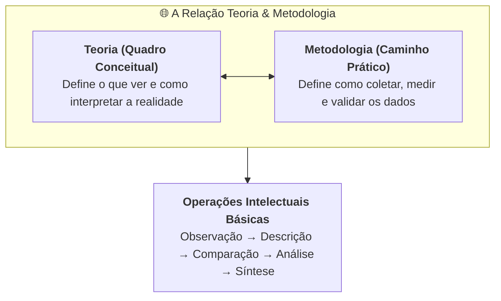
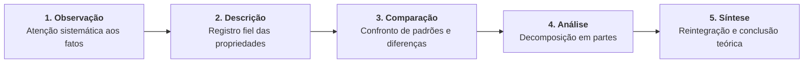
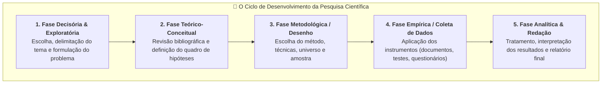

# 🎥 Videoaulas — Semana 2 (INT100)

> **Disciplina:** Projetos e Métodos para a Produção do Conhecimento (`INT100-EC-2026S2B2-T001`)  
> **Tema da Semana 2:** Fundamentos da Metodologia Científica e Técnicas de Pesquisa  
> **Docente das Aulas:** Profª Darlene Ferreira  
> **Período:** 05/10/2026 a 18/10/2026  

---

## 📑 Sumário das Videoaulas

1. [**Videoaula 2:** Fundamentos da Metodologia Científica e Técnicas de Pesquisa (Parte 1)](#-videoaula-2--fundamentos-da-metodologia-científica-e-técnicas-de-pesquisa-parte-1)
2. [**Videoaula 3:** Fundamentos da Metodologia Científica e Técnicas de Pesquisa (Parte 2)](#-videoaula-3--fundamentos-da-metodologia-científica-e-técnicas-de-pesquisa-parte-2)
3. [**Quadro Síntese: As Operações Científicas e as Etapas da Pesquisa**](#-quadro-síntese-operações-científicas-vs-etapas-da-pesquisa)

---

## 🎬 Videoaula 2 — Fundamentos da Metodologia Científica e Técnicas de Pesquisa (Parte 1)

> **Docente:** Profª Darlene Ferreira  
> **Link da Aula:** [Assistir no YouTube](https://www.youtube.com/watch?v=XzaCGqqSaY8)  
> **Sinopse Oficial:** A professora Darlene Ferreira trata dos fundamentos da metodologia científica, atendo-se também às técnicas de pesquisa. Discute a relação entre teoria e metodologia, avançando no processo de desenvolvimento da pesquisa.

---

### 1. A Relação entre Teoria e Metodologia

* **Não existe metodologia neutra ou desvinculada de teoria:** A escolha dos métodos e instrumentos de pesquisa está diretamente subordinada ao referencial teórico e à visão de mundo (paradigma epistemológico) adotada pelo pesquisador.
* **A Teoria orienta o olhar:** A teoria indica quais variáveis são relevantes, quais perguntas merecem ser formuladas e como os dados coletados devem ser compreendidos.
* **A Metodologia testa e oxigena a Teoria:** O percurso metodológico confronta a teoria com as evidências empíricas da realidade, permitindo ratificá-la, refutá-la ou expandi-la.

---

### 2. As Cinco Operações Científicas Universais

Em qualquer ramo da ciência (seja nas ciências exatas, biológicas ou humanas), o raciocínio investigativo apoia-se em cinco operações mentais e procedimentais fundamentais:

1. **Observação Científica:**
   * Diferente da observação espontânea do cotidiano, a observação científica é **intencional, planejada, sistemática e orientada** por um problema claro de pesquisa.
   * Exige controle de instrumentos e descarte de impressões subjetivas.
2. **Descrição:**
   * Consiste em relatar com fidelidade, rigor vocabular e exatidão matemática/qualitativa as características, comportamentos e contextos do fenômeno observado.
3. **Comparação:**
   * Confronto metódico entre diferentes fenômenos, grupos de controle, variáveis ou séries históricas para identificar regularidades, anomalias e relações de causa e efeito.
4. **Análise:**
   * Decomposição mental ou experimental do objeto complexo em seus elementos mais simples, examinando a função e o peso de cada componente.
5. **Síntese:**
   * Processo inverso e integrador: reúne as partes analisadas em uma totalidade compreensiva, formulando leis gerais, modelos conceituais ou conclusões teóricas consistentes.

---

### 3. A Formação da Postura Científica

A professora Darlene reforça que a pesquisa científica exige uma postura atitudinal rigorosa do universitário:
* **Espírito de Curiosidade e Inquietação Intelectual:** Não se conformar com explicações fáceis ou respostas prontas do senso comum.
* **Humildade Perante os Dados:** Capacidade de aceitar evidências mesmo quando contrariam a intuição inicial ou as preferências ideológicas do pesquisador.
* **Rigor e Honestidade Intelectual:** Proibição do falseamento ou omissão de dados; citação rigorosa de todos os autores utilizados.

---

## 🎬 Videoaula 3 — Fundamentos da Metodologia Científica e Técnicas de Pesquisa (Parte 2)

> **Docente:** Profª Darlene Ferreira  
> **Link da Aula:** [Assistir no YouTube](https://www.youtube.com/watch?v=CVA3I2inBAE)  
> **Sinopse Oficial:** A professora Darlene Ferreira continua a tratar dos fundamentos da metodologia científica, discutindo a relação entre teoria e metodologia e avançando no processo de desenvolvimento da pesquisa.

---

### 1. Distinção Crucial: Método vs. Técnicas

A videoaula estabelece a distinção hierárquica entre a estratégia do pensamento e os instrumentos de coleta:

* **O Método (Nível Estratégico / Epistemológico):**
  * É a forma geral de abordagem racional da realidade.
  * *Exemplos:* Método Indutivo (da observação à generalização), Método Dedutivo (do princípio geral à dedução necessária), Método Hipotético-Dedutivo (problema $\to$ conjectura $\to$ testes severos de falseamento).
* **As Técnicas (Nível Operacional / Instrumental):**
  * São as ferramentas e procedimentos práticos empregados para obter e manipular dados concretos.
  * *Exemplos:* Fichamento bibliográfico, análise documental, questionários de escala Likert, entrevistas gravadas, ensaios de desempenho de código em tempo de execução.

---

### 2. O Processo de Desenvolvimento da Pesquisa Passo a Passo

A aula detalha como um trabalho acadêmico ou projeto de pesquisa se desenvolve na prática:

#### Etapa 1: Escolha e Delimitação do Tema
* O tema deve ser relevante, passível de investigação no tempo disponível e suficientemente delimitado no tempo e no espaço.

#### Etapa 2: Formulação do Problema de Pesquisa
* O problema deve ser expresso em forma de **pergunta clara, precisa, objetiva e empiricamente testável** (não formulado como juízo moral ou opinião pessoal).

#### Etapa 3: Levantamento de Hipóteses
* Respostas provisórias que orientam a busca por dados. Toda hipótese deve ser **falseável** (passível de teste e eventual refutação).

#### Etapa 4: Escolha das Técnicas de Coleta de Dados
* **Pesquisa Bibliográfica e Documental:** Análise crítica de fontes primárias e secundárias.
* **Observação Direta / Ensaios:** Registro controlado de variáveis e medições.
* **Instrumentos de Campo:** Questionários, formulários e roteiros de entrevista.

#### Etapa 5: Análise, Interpretação e Comunicação
* Os dados brutos são organizados em tabelas, gráficos ou categorias conceituais, sendo confrontados com a literatura para responder à pergunta inicial.

---

## 📊 Quadro Síntese: Operações Científicas vs. Etapas da Pesquisa

| Operação Mental (Parte 1) | Papel no Método Científico | Etapa Prática da Pesquisa (Parte 2) |
| :--- | :--- | :--- |
| **1. Observação** | Identificar fenômenos e anomalias na realidade | Escolha do tema e levantamento de dados de campo |
| **2. Descrição** | Caracterizar detalhadamente variáveis e contextos | Caracterização da amostra e relato dos procedimentos |
| **3. Comparação** | Testar regularidades frente a grupos de controle | Teste de hipóteses e comparação com a literatura |
| **4. Análise** | Decompor dados brutos em categorias e métricas | Análise estatística, qualitativa ou algorítmica |
| **5. Síntese** | Integrar achados e gerar novas teorias ou produtos | Conclusão, discussão de limites e redação final |

---

## 💡 Principais Conclusões das Videoaulas 2 e 3

1. **Rigor e Método:** Fazer ciência é um processo disciplinado que transforma a curiosidade inicial em conhecimento comprovado e reprodutível.
2. **Subordinação Instrumental:** As técnicas de pesquisa nunca são um fim em si mesmas; elas servem ao método e respondem às exigências conceituais do problema de pesquisa.
3. **Transparência Acadêmica:** Todo percurso metodológico deve ser descrito com tamanha clareza que qualquer outro pesquisador possa replicar a investigação e verificar os resultados obtidos.
