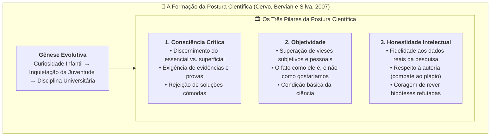

# 📖 Texto-base — Metodologia Científica: A Formação da Postura Científica

> **Disciplina:** Projetos e Métodos para a Produção do Conhecimento (`INT100-EC-2026S2B2-T001`)  
> **Tema da Semana 2:** Fundamentos da Metodologia Científica e Técnicas de Pesquisa  
> **Referência:** CERVO, Amado L.; BERVIAN, Pedro A.; SILVA, Roberto da. **Metodologia Científica**. 6. ed. São Paulo: Pearson Prentice Hall, 2007. (Capítulo 1, Seção 1.3: *A formação da postura científica*, p. 24 do leitor digital).  
> **Link na Biblioteca Virtual (Pearson / Univesp):** [Acessar Seção 1.3 no Leitor Digital (PDF p. 24)](https://plataforma.bvirtual.com.br/Leitor/Publicacao/341/pdf/24?code=TE4Jo7LcxCfulPXfeN1shkxkRvFXfAxPQ+FqBB6KPJFImdP3Rid1cg46mFnAOrxGmiSxyXLC/LMUT4mheQ1XIg==)  

---

## 🗺️ Visão Conceitual da Seção 1.3

---

## 📌 1. A Natureza da Postura Científica

Para Cervo, Bervian e Silva, a ciência não se reduz ao domínio técnico de instrumentos ou à memorização mecânica de teorias. Fazer ciência exige, antes de tudo, uma **atitude interior do pesquisador perante a realidade e perante o conhecimento**.

A postura científica:
* **Não é inata:** Nenhum indivíduo nasce com espírito científico pronto; trata-se de uma disposição forjada mediante esforço deliberado, reflexão e prática contínua ao longo da formação universitária.
* **Origem e Desenvolvimento:** Encontra seu ponto de partida na **curiosidade natural e espontânea da infância**, evolui por meio das inquietações investigativas da adolescência e consolida-se na maturidade acadêmica sob o método rigoroso.
* **Superação do Senso Comum:** Enquanto o senso comum contenta-se com impressões superficiais e explicações imediatas, a postura científica busca compreender as causas profundas e as leis que regem os fenômenos.

---

## 🏛️ 2. Os Três Pilares Fundamentais

Cervo, Bervian e Silva estruturam a formação da postura científica sobre três pilares indissociáveis:

### 🔹 2.1 Consciência Crítica
A consciência crítica é o motor do discernimento e do aprimoramento do julgamento racional:
* **Capacidade de Discernimento:** Saber distinguir o que é **essencial** do que é **acidental/superficial**; separar o que é argumento principal do que é detalhe secundário.
* **Sentido Positivo da Crítica:** A crítica científica não é mero ceticismo negativo ou postura destrutiva; é uma tomada de posição rigorosa que impede a aceitação passiva do que é fácil ou consagrado pela tradição.
* **Exigência de Demonstração:** O pesquisador de espírito crítico só admite como válido aquilo que é suscetível de **prova, teste empírico e argumentação demonstrável**, recusando apelos à autoridade dogmática (*magister dixit*).

---

### 🔹 2.2 Objetividade
A objetividade é a **condição preliminar e indispensável** de toda investigação científica:
* **Descentramento do Sujeito:** O pesquisador precisa libertar-se de juízos prévios, preferências ideológicas, paixões partidárias e condicionamentos psicológicos ou socioculturais.
* **Primado do Real:** A ciência não investiga o que o cientista *gostaria que fosse* ou o que ele *imagina que seja*, mas sim **aquilo que a realidade e as evidências factuais demonstram concretamente**.
* **Controle Metódico:** A objetividade não surge espontaneamente; ela é assegurada pelo rigor do método, pela padronização dos instrumentos de medição e pelo controle de variáveis.

---

### 🔹 2.3 Honestidade Intelectual (Dimensão Ética)
A integridade moral é tão decisiva para a ciência quanto a competência técnica:
* **Fidelidade Escrupulosa aos Fatos:** Proibição inegociável de inventar, manipular, adulterar ou selecionar apenas os dados que confirmem a hipótese estimada do autor (*cherry-picking*).
* **Respeito à Autoria e Propriedade Intelectual:** Reconhecimento transparente e citação precisa de todas as ideias, textos e códigos de outros pesquisadores, combatendo rigorosamente todas as formas de plágio.
* **Coragem perante o Erro e Humildade:** Disposição corajosa de abandonar uma conjectura querida quando as evidências empíricas demonstrarem que ela está incorreta, aceitando a falibilidade inerente ao saber humano.

---

## 🔮 3. Duas Posturas Humanas perante o "Mistério"

Cervo et al. destacam que, diante do desconhecido e dos mistérios da natureza e da sociedade, o ser humano pode adotar duas posições fundamentais:

| Postura | Fundamento | Caminho Metodológico | Natureza da Resposta |
| :--- | :--- | :--- | :--- |
| **Postura de Aceitação Passiva / Fé** | Crença na autoridade de quem diz ter desvendado o mistério | Revelação, tradição sagrada ou autoridade externa | Conhecimento dogmático e transcendente (Teológico) |
| **Postura Investigativa e Crítica** | Esforço pessoal e coletivo da inteligência racional | Observação, experimentação, dúvida metódica e demonstração | Conhecimento aproximadamente exato, falseável e provisório (**Científico**) |

---

## 🎯 Aplicação no Contexto da Engenharia de Computação

No campo da Engenharia de Computação e do desenvolvimento tecnológico, a Seção 1.3 de Cervo et al. traduz-se em práticas profissionais diretas:

1. **Consciência Crítica nos Algoritmos:** Não aceitar resultados de modelos de Inteligência Artificial ou bibliotecas prontas como "caixas pretas mágicas"; auditar métricas de acurácia, investigar limites operacionais e buscar explicabilidade algorítmica.
2. **Objetividade na Engenharia de Software:** Testar sistemas sob condições reais e adversas de estresse e carga, sem assumir que "se rodou no ambiente local, está pronto para produção".
3. **Honestidade e Ética Digital:** Respeitar licenças de código aberto (*open source*), proteger a privacidade e segurança de dados de usuários e relatar com transparência falhas de segurança e limitações de software.

---

## 📊 Síntese dos Conceitos-Chave da Seção 1.3

| Conceito | Definição Conforme Cervo, Bervian e Silva | O que evitar |
| :--- | :--- | :--- |
| **Postura Científica** | Disposição racional adquirida para interrogar a realidade com método e rigor. | Ingenuidade e passividade intelectual. |
| **Consciência Crítica** | Capacidade de julgamento que distingue o essencial do supérfluo e exige evidências. | Aceitação cega por costume ou conveniência. |
| **Objetividade** | Olhar que descreve os fatos como são, independente dos desejos do observador. | Projeção subjetiva e viés de confirmação. |
| **Honestidade Intelectual** | Compromisso ético incondicional com a verdade factual e autoria das fontes. | Plágio, fraude e omissão de resultados adversos. |
