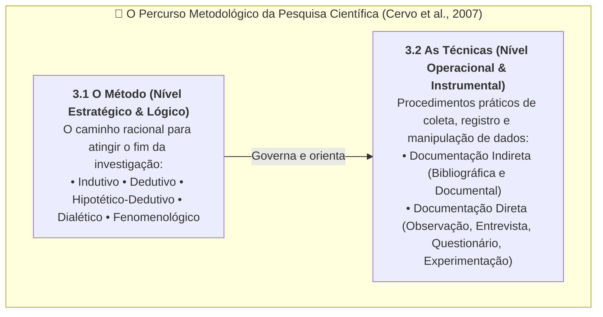
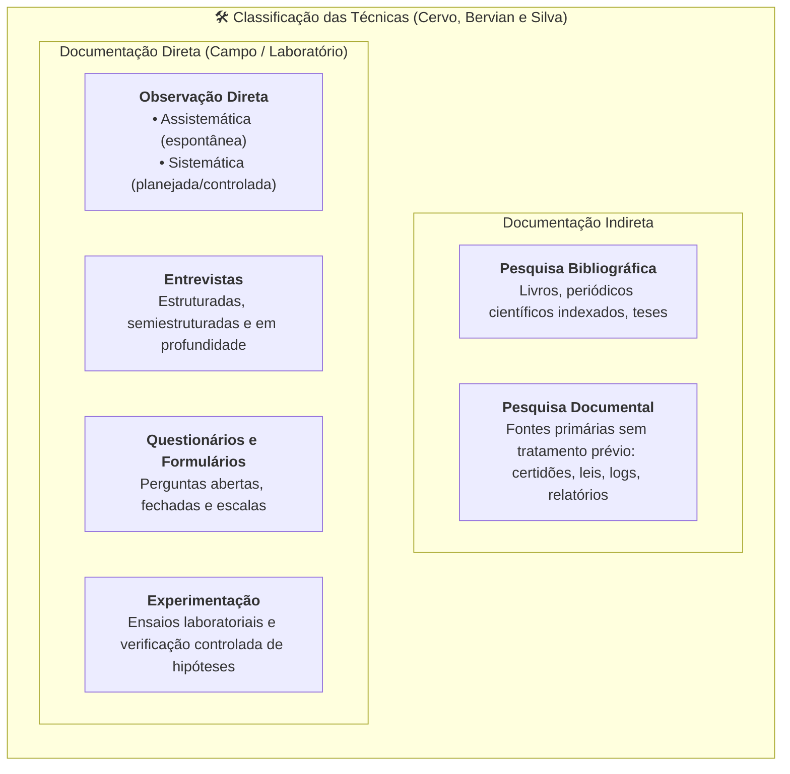

# 📖 Texto-base — Metodologia Científica: O Método e as Técnicas

> **Disciplina:** Projetos e Métodos para a Produção do Conhecimento (`INT100-EC-2026S2B2-T001`)  
> **Tema da Semana 2:** Fundamentos da Metodologia Científica e Técnicas de Pesquisa  
> **Referência:** CERVO, Amado L.; BERVIAN, Pedro A.; SILVA, Roberto da. **Metodologia Científica**. 6. ed. São Paulo: Pearson Prentice Hall, 2007. (Capítulo 3, Seções 3.1 e 3.2: *O método* e *As técnicas*, p. 38 do leitor digital).  
> **Link na Biblioteca Virtual (Pearson / Univesp):** [Acessar Seções 3.1 e 3.2 no Leitor Digital (PDF p. 38)](https://plataforma.bvirtual.com.br/Leitor/Publicacao/341/pdf/38?code=OtcheBGnRQ728Sro9fxaV1XZwmGxSF9gcvUNdFT4LNA5j1PnZST+jW4HMLRBM+0lNAQKkr/Z3nnhXRTrKbkfdA==)  

---

## 🗺️ Visão Integrada: Método vs. Técnicas

---

## 📌 1. A Seção 3.1 — O Método Científico

### 1.1 Conceito e Natureza do Método
O termo método procede do grego *meta* (ao longo de, em direção a) e *hodos* (caminho). Constitui o trajeto lógico, ordenado e sistemático percorrido pela inteligência humana para alcançar a verdade objetiva ou aproximadamente exata.

> *"Toda investigação nasce de algum problema observado ou sentido, de tal modo que não pode prosseguir a menos que se faça uma seleção da matéria a ser tratada. Essa seleção requer uma hipótese ou pressuposição que vai orientar e, ao mesmo tempo, delimitar o assunto a ser investigado. [...] Todo método depende do objetivo da investigação."* (Cervo, Bervian e Silva, 2007, p. 29/38).

### 1.2 Os Grandes Métodos Gerais do Pensamento

Cervo, Bervian e Silva detalham as matrizes clássicas de raciocínio científico:

| Método Geral | Origem Filosófica | Movimento Lógico | Características e Limitações |
| :--- | :--- | :--- | :--- |
| **Indutivo** | Francis Bacon | **Do particular ao geral** | Parte da observação de múltiplos fatos particulares para inferir uma lei universal. *Limitação:* Não confere certeza lógica absoluta (problema da indução). |
| **Dedutivo** | René Descartes | **Do geral ao particular** | Parte de princípios gerais (axiomas, leis) e deduz conclusões necessárias sobre casos particulares por rigor do silogismo formal. |
| **Hipotético-Dedutivo** | Karl Popper | **Problema $\to$ Conjectura $\to$ Dedução $\to$ Teste** | Diante de um problema, formula-se uma hipótese testável; deduzem-se consequências e submete-se a severos testes de **falseabilidade**. |
| **Dialético** | Hegel / Marx | **Tese $\longleftrightarrow$ Antítese $\longrightarrow$ Síntese** | Enxerga os fenômenos em constante transformação histórica, movidos por contradições internas intrínsecas à realidade. |
| **Fenomenológico** | Edmund Husserl | **Descrição da essência** | Busca apreender e descrever as coisas como se manifestam na consciência, suspendendo julgamentos prévios (*epoché*). |

---

## 📌 2. A Seção 3.2 — As Técnicas de Pesquisa

### 2.1 Distinção Crucial entre Método e Técnica
* **Método:** Plano macro e epistemológico; o modo fundamental de estruturar o raciocínio e a prova.
* **Técnica:** Plano micro e operacional; os recursos práticos, ferramentas materiais e protocolos de coleta e análise de dados.

> *"As técnicas são a parte prática do método; são os instrumentos e recursos de que se serve o pesquisador na coleta de dados e na execução de sua investigação."* (Cervo et al., 2007).

---

### 2.2 Classificação das Técnicas de Coleta

#### A) Documentação Indireta
1. **Pesquisa Bibliográfica:**
   * Levantamento e análise da produção científica já publicada.
   * Utiliza técnicas de fichamento: fichamento bibliográfico, de resumo e analítico/crítico.
2. **Pesquisa Documental:**
   * Análise de documentos que não sofreram interpretação teórica prévia (documentos históricos, bases de dados estatísticas brutas, arquivos empresariais, relatórios de auditoria).

#### B) Documentação Direta
1. **Observação:**
   * **Assistemática (Espontânea):** Não estruturada previamente, recolhe impressões imediatas do ambiente.
   * **Sistemática (Controlada):** Realizada com objetivos claros, instrumentos padronizados de medição e registros objetivos.
2. **Entrevista:** Diálogo planejado entre pesquisador e informante (padronizada ou livre).
3. **Questionário:** Instrumento preenchido pelo próprio respondente, composto por perguntas fechadas, abertas ou de múltipla escolha.
4. **Experimentação:** Procedimento deliberado no qual o pesquisador manipula variáveis independentes e observa os efeitos sobre variáveis dependentes sob controle rigoroso.

---

## 🎯 Aplicação no Contexto da Engenharia de Computação

* **Dedução:** Demonstração formal de corretude de algoritmos e lógica booleana de circuitos digitais.
* **Indução:** Treinamento de redes neurais e modelos preditivos em aprendizado de máquina a partir de grandes volumes de dados amostrais.
* **Método Hipotético-Dedutivo:** Testes de software (TDD), engenharia de desempenho e depuração (*debugging*) de falhas.
* **Técnicas Experimentais:** Execução de testes de estresse (*stress testing*), medição de latência e *benchmarks* computacionais comparativos.
