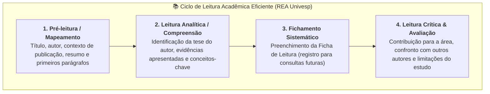

# 📖 Material-base — Estratégias de Leitura Acadêmica (REA Univesp)

> **Disciplina:** Projetos e Métodos para a Produção do Conhecimento (`INT100-EC-2026S2B2-T001`)  
> **Tema da Semana 2:** Fundamentos da Metodologia Científica e Técnicas de Pesquisa  
> **Link do Recurso Interativo (REA):** [Estratégias de Leitura Acadêmica — Univesp](https://apps.univesp.br/estrategias-de-leitura-academica/)  
> **Vídeo do Recurso no YouTube:** [Assistir Vídeo Explicativo (Univesp)](https://www.youtube.com/watch?v=pxJ5wFcuwBg)  
> **Resumo Oficial para Download (PDF):** [Salvar Resumo das Estratégias (Google Drive)](https://drive.google.com/file/d/18bl8YvoYb8PhkcKHWJ8VEQS7QUYdawa_/view)  

---

## 🗺️ Visão Geral do Recurso

A leitura de textos científicos e acadêmicos possui particularidades que exigem métodos específicos. Diferente da leitura de lazer ou da navegação casual na internet, a **leitura acadêmica é ativa, intencional, esquemática e crítica**.

---

## 📋 A Ficha de Leitura Acadêmica (Modelo Oficial Univesp)

A ferramenta central disponibilizada pelo REA é a **Ficha de Leitura**, estruturada em quatro blocos reflexivos:

### 1. Texto como um Todo
* **Título:** Título completo do artigo, livro ou documento.
* **Autor:** Nome e credenciais acadêmicas de quem produziu a obra.
* **Publicação:** Veículo de publicação (periódico, editora, conferência, ano e volume).
* **Assunto:** O tema central abordado pelo texto.
* **Recursos:** Fontes de dados apresentadas pelo autor (livros consultados, documentos históricos, ensaios experimentais, entrevistas, dados censitários).

---

### 2. Objetivos e Estrutura
* **Teses / Objetivos:** A ideia central defendida pelo autor; o problema que ele buscou solucionar.
* **Evidências:** O suporte empírico e lógico que sustenta a tese (dados estatísticos, demonstrações matemáticas, resultados de testes ou argumentação teórica).

---

### 3. Leitura e Compreensão Textual
* **Palavras e Conceitos Desconhecidos:** Registro dos termos técnicos, jargões da área ou conceitos filosóficos que demandam pesquisa em glossários, dicionários e literatura especializada.

---

### 4. Crítica e Avaliação do Texto
* **Contribuição:** Como o texto se conecta ao seu contexto acadêmico, ao seu projeto de pesquisa ou à prática na Engenharia.
* **Outras Interpretações:** Pontes estabelecidas com outros autores e correntes teóricas já conhecidas (concordâncias e divergências conceituais).
* **Problemas e Limitações:** Ressalvas metodológicas justificadas (ex.: amostra restrita a determinado contexto, premissas teóricas não testadas ou limitações operacionais).

---

## 💡 Modelo de Aplicação Prática da Ficha na Engenharia de Computação

Exemplo de preenchimento da ficha para um artigo da área:

| Campo | Preenchimento Exemplo |
| :--- | :--- |
| **Título** | *Deep Residual Learning for Image Recognition* |
| **Autor** | Kaiming He, Xiangyu Zhang, Shaoqing Ren, Jian Sun (Microsoft Research) |
| **Publicação** | IEEE Conference on Computer Vision and Pattern Recognition (CVPR), 2016 |
| **Assunto** | Treinamento de redes neurais residuais profundas (ResNet) para visão computacional |
| **Recursos** | Experimentos empíricos nos conjuntos de dados ImageNet e CIFAR-10 |
| **Tese / Objetivo** | Demonstrar que conexões de atalho (*residual connections*) solucionam o problema da degradação de gradiente em redes muito profundas |
| **Evidências** | Redução da taxa de erro para 3,57% no ImageNet, superando arquiteturas convolucionais clássicas |
| **Conceitos Novos** | *Vanishing gradient*, *skip connections*, *bottleneck architecture* |
| **Contribuição** | Base arquitetural para modelos de segmentação e diagnóstico em radiologia digital |
| **Limitações** | Alto custo computacional de treinamento e necessidade de aceleradores gráficos dedicados (GPUs) |
