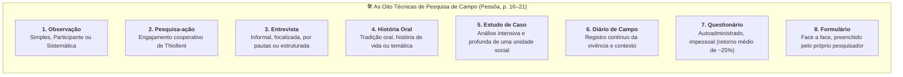
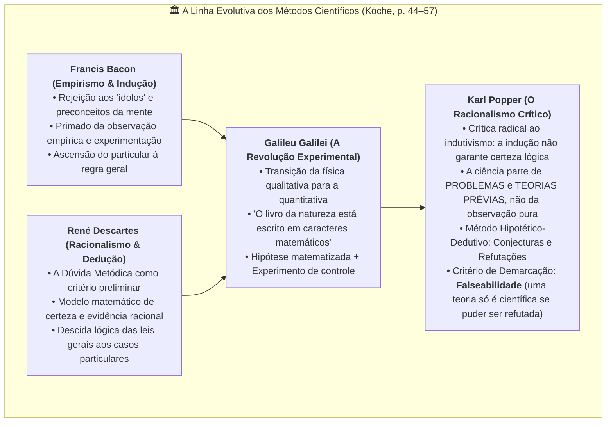

# 🔍 Aprofundando o Tema — Semana 2 (INT100)

> **Disciplina:** Projetos e Métodos para a Produção do Conhecimento (`INT100-EC-2026S2B2-T001`)  
> **Tema da Semana 2:** Fundamentos da Metodologia Científica e Técnicas de Pesquisa  

---

## 🗺️ Visão Integrada dos Materiais de Aprofundamento

```mermaid
flowchart TD
    subgraph Aprofundamento["📚 Leituras Complementares de Aprofundamento"]
        subgraph Parte1["1. Instrumentação Prática & Coleta de Dados"]
            PES["<b>Manual de Trabalhos Acadêmicos (p. 13–21)</b><br><i>Vera Lúcia Salazar Pessôa</i><br>• Documentação Indireta (Documental vs. Bibliográfica)<br>• Documentação Direta (Laboratório vs. Campo)<br>• As 8 Técnicas de Campo (Observação, Questionário, Formulário, etc.)"]
        end
        
        subgraph Parte2["2. Epistemologia & Evolução Histórica dos Métodos"]
            KOC["<b>Fundamentos de Metodologia Científica (p. 44–57)</b><br><i>José Carlos Köche</i><br>• Bacon: Método Indutivo & Empirismo<br>• Descartes: Método Dedutivo & Racionalismo<br>• Galileu: Medição Quantitativa & Experimento<br>• Popper: Método Hipotético-Dedutivo & Falseabilidade"]
        end
    end
```

---

## 📌 1. Técnicas de Pesquisa e Instrumentação (Vera Lúcia Salazar Pessôa, p. 13–21)

* **Referência:** PESSÔA, Vera Lúcia Salazar. *Manual para elaboração de trabalhos acadêmicos: material para fins didáticos*. Uberlândia: UFU, 2020. (Capítulo 4: *Técnicas de Pesquisa*, p. 13–21).
* **Arquivo Local:** [`s1_material_de_apoio_manual_para_elaboracao_de_trabalhos_academiscos_2020.pdf`](file:///home/henrique/Modelos/Univesp/2026S2B2/INT100-Projetos-e-Metodos-para-a-Producao-do-Conhecimento/Semana-2/s1_material_de_apoio_manual_para_elaboracao_de_trabalhos_academiscos_2020.pdf)

> *"As técnicas de pesquisa estão relacionadas à coleta de dados (parte prática da pesquisa). Portanto, as técnicas são conjuntos de normas usadas especificamente em cada área das ciências, podendo-se afirmar que a técnica é a instrumentação específica da coleta de dados."* (ANDRADE apud PESSÔA, 2020, p. 13).

Pessôa divide as técnicas em dois grandes eixos procedimentais:

---

### 1.1 Documentação Indireta (Levantamento Preliminar)

A documentação indireta constitui a fase inicial de qualquer investigação e abrange:

1. **Pesquisa Documental (Fontes Primárias):**
   * Coleta de documentos que não receberam tratamento analítico prévio de pesquisadores.
   * *Arquivos Públicos:* Documentos oficiais (leis, decretos, relatórios governamentais, alvarás) e documentos jurídicos (certidões, escrituras, inventários cartorários).
   * *Arquivos Particulares:* Registros institucionais privados, correspondências, diários pessoais.
   * *Fontes Estatísticas:* Bases consolidadas de dados demográficos e econômicos (IBGE, IPEA, Fundação Seade).
   * *Outras Fontes:* Iconografia, mapas, fotografias históricas e vestígios materiais.
2. **Pesquisa Bibliográfica (Fontes Secundárias):**
   * Contato com a literatura científica já publicada (livros, artigos em periódicos indexados, dissertações e teses).
   * *Fases da Pesquisa Bibliográfica:*
     1. **Identificação:** Reconhecimento e levantamento preliminar do acervo disponível sobre o tema.
     2. **Localização:** Busca física ou digital das obras selecionadas.
     3. **Compilação:** Reunião metódica e organização do material relevante.
     4. **Fichamento:** Elaboração de fichas bibliográficas para catalogação e citação futura.
3. **Pesquisa na Internet:**
   * Utilização sistemática de repositórios digitais, bibliotecas virtuais (SciELO, IEEE Xplore, Google Acadêmico), exigindo rigor crítico na checagem de veracidade e indexação das fontes.

---

### 1.2 Documentação Direta (Pesquisa de Campo e Laboratório)

Realizada no próprio local onde o fenômeno ocorre ou em recintos fechados sob controle estrito:

1. **Pesquisa de Laboratório:**
   * Investigação em ambiente artificial ou controlado, com instrumental específico e isolamento preciso de variáveis. Procedimento mais complexo, porém de máxima exatidão métrica.
2. **Pesquisa de Campo:**
   * Levantamento de dados no ambiente real onde se manifesta o problema. Compreende oito técnicas operacionais essenciais:

* **Diferença Crucial entre Questionário e Formulário:**
  * **Questionário:** Instrumento preenchido pelo próprio informante, sem a presença do pesquisador. Garante total anonimato e impessoalidade, mas apresenta taxa média de devolução de cerca de 25%.
  * **Formulário:** Contato direto (*face a face*) entre pesquisador e informante, sendo preenchido pelo próprio investigador. Permite esclarecer dúvidas imediatas, ajustar a linguagem ao nível do entrevistado e abordar questões de maior complexidade conceitual.

---

## 📌 2. Teoria da Ciência e Métodos Históricos (José Carlos Köche, p. 44–57)

* **Referência:** KÖCHE, José Carlos. **Fundamentos de metodologia científica: teoria da ciência e iniciação à pesquisa**. Petrópolis: Vozes, 2011. (Capítulo 2: *Ciência e método: uma visão histórica*, p. 44–57 do leitor digital).
* **Link na Biblioteca Virtual (Pearson / Univesp):** [Acessar Köche p. 44 no Leitor Digital](https://plataforma.bvirtual.com.br/Leitor/Publicacao/54223/pdf/44?code=02Pkly6zenJAtgP1VhLNRoKbO8LcsvScFRN0ULhPthEj//F0qW0pdzVvkcNul3ThhKHSBlIqD1p+ZEHGNnASww==)

Köche analisa a formação epistemológica da ciência moderna, reconstruindo o debate entre empirismo, racionalismo e falseacionismo:

---

### 2.1 Francis Bacon e a Lógica Indutiva
* Bacon inaugura a crítica à escolástica medieval, denunciando as ilusões mentais que distorcem o julgamento humano (os *ídolos* da tribo, da caverna, do foro e do teatro).
* Propõe que o conhecimento seguro deve partir da **coleta paciente e metódica de observações particulares**, organizadas em tábuas de presença, ausência e graus, para inferir gradativamente axiomas gerais.

---

### 2.2 René Descartes e o Método Dedutivo Cartesiano
* Em oposição à pura sensação corporal (que pode enganar), Descartes estabelece a **razão como critério primeiro de verdade**.
* Formula as quatro regras fundamentais do método em seu *Discurso sobre o Método*:
  1. *Evidência:* Jamais acolher coisa alguma como verdadeira sem que a razão a conceba clara e distintamente.
  2. *Análise:* Decompor cada dificuldade em tantas partes quantas forem necessárias para melhor resolvê-la.
  3. *Síntese:* Conduzir por ordem os pensamentos, partindo dos objetos mais simples aos mais complexos.
  4. *Enumeração:* Realizar revisões e verificações tão completas que garantam que nada foi omitido.

---

### 2.3 Galileu Galilei e o Nascimento da Ciência Moderna
* Galileu sintetiza empirismo e racionalismo ao introduzir a **matematização dos fenômenos físicos**.
* A realidade deixa de ser interpretada por essências teleológicas (Aristóteles) e passa a ser explicada por **relações funcionais mensuráveis** (tempo, espaço, velocidade, massa). O experimento galileano é uma pergunta controlada que se faz à natureza sob linguagem geométrica e matemática.

---

### 2.4 Karl Popper e o Método Hipotético-Dedutivo
Köche dedica especial atenção à ruptura epistemológica empreendida por Karl Popper contra o positivismo lógico e a indução:

1. **A Crítica da Indução (O Problema de Hume):**
   * Nenhum número de observações de cisnes brancos autoriza a conclusão lógica de que "todos os cisnes são brancos", pois basta a observação de um único cisne negro para falsear a proposição. A indução não fornece fundamentação lógica necessária para as leis universais.
2. **A Ciência não parte de Observações Neutras:**
   * O cientista nunca observa o mundo de forma "neutra" ou desinteressada; todo olhar observacional já está impregnado de teorias prévias, expectativas e preconceitos teóricos. A ciência parte de **problemas** gerados pelo conflito entre teorias vigentes e novas evidências.
3. **O Ciclo Popperiano de Conjecturas e Refutações:**
   $$\text{Problema } (P_1) \longrightarrow \text{Teoria Conjectural Provisória } (TT) \longrightarrow \text{Eliminação de Erros por Testes Severos } (EE) \longrightarrow \text{Novo Problema } (P_2)$$
4. **O Critério de Falseabilidade:**
   * Uma teoria que explica "tudo" e não pode ser desafiada por nenhum dado empírico concebível não é científica (é dogma ou pseudociência). Uma teoria é tanto mais científica quanto mais aberta estiver a testes rigorosos que possam demonstrar sua eventual falsidade.

---

## 🎯 Síntese Comparativa Aplicada à Engenharia de Computação

| Filósofo / Teórico | Princípio Central | Aplicação em Engenharia de Computação e Software |
| :--- | :--- | :--- |
| **Francis Bacon** | Indução empírica a partir de grandes volumes de observações | Mineração de dados (*Data Mining*) e inferência estatística em Aprendizado de Máquina. |
| **René Descartes** | Dedução axiomática, decomposição modular e verificação | Prova formal de algoritmos, lógica matemática de circuitos e arquitetura de compiladores. |
| **Galileu Galilei** | Medição experimental quantitativa e controle instrumental | *Profiling* de desempenho, análise de latência e testes de carga em sistemas distribuídos. |
| **Karl Popper** | Conjecturas testáveis e falseabilidade metódica | Desenvolvimento Orientado a Testes (*TDD*): criar testes automatizados desenhados para quebrar o código e eliminar erros. |
| **Vera Pessôa** | Rigor na coleta direta (campo) e indireta (documentos) | Engenharia de Requisitos: uso de questionários com usuários, entrevistas com clientes e análise documental de regras de negócio. |
