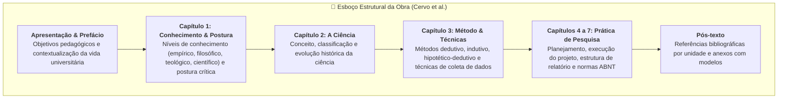
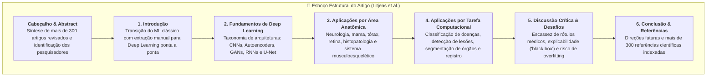

# ✍️ Exercício de Apoio — Semana 2

> **Disciplina:** Projetos e Métodos para a Produção do Conhecimento (`INT100-EC-2026S2B2-T001`)  
> **Tema da Semana 2:** Fundamentos da Metodologia Científica e Técnicas de Pesquisa  
> **Atividade:** Exercício de Apoio — Como ler um texto (Estratégias de Leitura Acadêmica / REA Univesp)  
> **Tema de Pesquisa do Aluno:** *Engenharia de Software, Algoritmos e Sistemas Inteligentes Aplicados à Saúde e Radiologia*  
> **Vídeo-Base do REA:** [Como Ler um Texto — Estratégias de Leitura Acadêmica (Univesp)](https://www.youtube.com/watch?v=pxJ5wFcuwBg&t=165s)  

---

## 🎯 Proposta da Atividade

A partir das técnicas de **leitura ativa, inspecional e analítica** apresentadas no Recurso Educacional Aberto (REA) da Univesp, selecionamos **dois textos textuais de referência** entre as cinco fontes catalogadas no *Desafio do Estado da Arte* desta semana para responder às questões orientadoras:

1. **Texto 1 (Livro-Base Epistemológico):** *Metodologia Científica* (CERVO, A. L.; BERVIAN, P. A.; SILVA, R. da, 2007).
2. **Texto 2 (Artigo Científico de Revisão Sistemática):** *Deep Learning in Medical Image Analysis* (LITJENS, G. et al., 2017).

---

## 📖 Texto 1: *Metodologia Científica* (Cervo, Bervian e Silva, 2007)

* **Referência Completa:** CERVO, Amado Luiz; BERVIAN, Pedro Alcino; SILVA, Roberto da. *Metodologia Científica*. 6. ed. São Paulo: Pearson Prentice Hall, 2007.
* **Gênero Textual:** Livro Didático-Científico / Manual Universitário.

### 1. Qual seu objetivo para leitura desse texto?
Obter a fundamentação epistemológica e metodológica necessária para planejar e executar projetos de pesquisa rigorosos em Engenharia de Computação. A meta é internalizar os critérios formais de objetividade, falseabilidade e honestidade intelectual, além de dominar os métodos de abordagem (dedutivo, indutivo, hipotético-dedutivo) e as técnicas padronizadas de coleta e documentação científica.

### 2. Capte o esboço da obra (exame inicial)
*Como a obra está organizada?*
A obra é estruturada didaticamente em capítulos progressivos, com clara hierarquia visual:
* **Elementos Pré-textuais:** Sumário detalhado com subtítulos decimais, facilitando a consulta temática; apresentação que define o leitor universitário como interlocutor direto.
* **Parte Teórico-Epistemológica (Capítulos 1 e 2):** Inicia com a diferenciação das quatro formas de conhecimento e consolida a definição de ciência e a importância da formação de uma atitude antidogmática e investigativa.
* **Parte Metodológica (Capítulo 3):** Disseca os métodos científicos (indutivo, dedutivo, hipotético-dedutivo e dialético) e as técnicas instrumentais (documentação, observação direta, entrevistas, questionários e formulários).
* **Parte Operacional e Aplicada (Capítulos 4 a 7):** Aborda passo a passo as etapas de elaboração de um projeto de pesquisa, redação de trabalhos acadêmicos (monografias, artigos, relatórios) e aplicação prática das normas da ABNT.
* **Elementos Pós-textuais:** Referências bibliográficas ao término de cada capítulo e anexos contendo tabelas-modelo e roteiros operacionais.

### 3. Acompanhe o pensamento do autor (o desenvolvimento)
*O autor: informa; explica; analisa; discute; demonstra?*
Os autores transitam de forma integrada por diferentes operações textuais:
* **Informa:** Apresenta a evolução histórica do método científico e as diretrizes normativas estabelecidas para a produção acadêmica no Brasil.
* **Explica:** Esclarece com precisão didática os conceitos fundamentais de rigor, validade, reprodutibilidade e neutralidade científica.
* **Analisa:** Decompõe a atitude científica em seus componentes fundamentais (espírito crítico, amor à verdade, imparcialidade e humildade intelectual) e disseca as etapas constitutivas do método indutivo e dedutivo.
* **Discute:** Problematiza as limitações do senso comum frente à complexidade da realidade e debate as vantagens e desvantagens de cada técnica de pesquisa de campo.
* **Demonstra:** Evidencia que a ciência não é um acervo de verdades absolutas, mas sim um processo metódico, disciplinado e autocorretivo de aproximação progressiva da verdade.

### 4. Capte o raciocínio do autor, a proposição (objetivo) do autor
*Qual é o objetivo dele ao produzir a obra?*
A proposição central dos autores é **instrumentalizar estudantes e pesquisadores com o ferramental lógico, reflexivo e operacional indispensável para a produção autônoma de conhecimento científico**. O objetivo da obra é desmistificar o fazer acadêmico, demonstrando que a pesquisa rigorosa não decorre de genialidade inata, mas do aprendizado disciplinado de um método estruturado fundamentado na racionalidade, na ética e na objetividade.

### 5. Perguntas importantes quando se lê:
* **Sobre o que é o texto?** Teoria do conhecimento, fundamentos do método científico e técnicas operacionais para planejamento e execução de trabalhos acadêmicos.
* **Sobre quem é o texto?** Sobre o pesquisador, o estudante universitário e a comunidade científica em processo de investigação.
* **Quando?** 6ª edição publicada em 2007 (consolidando décadas de tradição didática iniciada na década de 1970).
* **Onde?** No contexto do ensino superior brasileiro, publicado pela Pearson Prentice Hall em São Paulo.
* **Quais?** Os 4 níveis de conhecimento (empírico, filosófico, teológico, científico), os métodos de abordagem (indutivo, dedutivo, hipotético-dedutivo) e as técnicas de pesquisa (observação, questionário, entrevista, documentação).
* **Por quê?** Porque a formação universitária exige a superação do pensamento intuitivo e acrítico por meio da adoção de procedimentos formais que garantam a validade e a replicabilidade dos resultados.
* **Para quê?** Para capacitar o futuro graduado a formular perguntas pertinentes, elaborar hipóteses testáveis, coletar dados com imparcialidade e redigir relatórios técnicos dentro dos padrões normativos vigentes.

---

## 📄 Texto 2: *Deep Learning in Medical Image Analysis* (Litjens et al., 2017)

* **Referência Completa:** LITJENS, Geert et al. A survey on deep learning in medical image analysis. *Medical Image Analysis*, v. 42, p. 60–88, 2017.
* **Gênero Textual:** Artigo Científico / Revisão Sistemática da Literatura (*Survey Paper*).

### 1. Qual seu objetivo para leitura desse texto?
Mapear o estado da arte na interseção entre Engenharia de Computação e Medicina Diagnóstica, compreendendo as principais arquiteturas neurais convolucionais (CNNs, U-Net) utilizadas para triagem e segmentação automática de patologias em imagens médicas, além de identificar os desafios metodológicos de validação estatística e generalização dos modelos.

### 2. Capte o esboço da obra (exame inicial)
*Como a obra está organizada?*
O artigo segue a estrutura rigorosa de um *survey* de alto impacto indexado no periódico *Medical Image Analysis* (Elsevier):
* **Identificação e Metadados:** Título conciso e descritivo; autoria multidisciplinar envolvendo cientistas da computação e médicos radiologistas (Radboud University Medical Center e centros parceiros); *Abstract* estruturado quantificando mais de 300 trabalhos revisados.
* **Introdução:** Apresenta o problema histórico da dependência de *feature engineering* manual na visão computacional tradicional e justifica a revolução do aprendizado profundo a partir de 2012 com redes profundas.
* **Seção de Fundamentos Técnicos:** Apresenta a taxonomia das arquiteturas de redes neurais profundas (CNNs padrão, redes totalmente convolucionais / FCNs, U-Net para segmentação biomédica, autoencoders e modelos generativos).
* **Seções Temáticas Divididas por Campo Clínico e Tarefa:** Estruturação matricial que analisa aplicações em neuroimagem, mamografia, radiologia torácica, imagens de retina e patologia digital, categorizadas pelas tarefas de classificação de lesões, detecção anatômica, segmentação e registro de imagens.
* **Discussão Crítica e Desafios Abertos:** Seção aprofundada sobre as barreiras técnicas à translação clínica: necessidade de grandes bases anotadas por especialistas, risco de vazamento de dados (*data leakage*), falta de reprodutibilidade e opacidade na explicabilidade algorítmica.
* **Conclusões e Referências:** Resumo dos marcos alcançados e extensiva lista com mais de 300 referências bibliográficas internacionais.

### 3. Acompanhe o pensamento do autor (o desenvolvimento)
*O autor: informa; explica; analisa; discute; demonstra?*
O artigo constrói uma linha de argumentação científica rigorosa:
* **Informa:** Traz estatísticas detalhadas sobre o volume crescente de publicações e competições científicas (desafios Grand Challenge) que impulsionaram o aprendizado profundo na medicina.
* **Explica:** Detalha os mecanismos matemáticos de aprendizado de representação em camadas hierárquicas e as adaptações arquiteturais (como conexões residuais e atalhos na U-Net) necessárias para processar exames tomográficos e histológicos tridimensionais.
* **Analisa:** Compara o desempenho quantitativo de diferentes algoritmos reportados na literatura utilizando métricas padronizadas (sensibilidade, especificidade, curva ROC/AUC e coeficiente Dice).
* **Discute:** Pontua com senso crítico a diferença entre obter uma alta acurácia em um conjunto de teste estático de laboratório e implementar um sistema confiável em ambiente hospitalar com dados ruidosos de diferentes fabricantes de aparelhos radiológicos.
* **Demonstra:** Evidencia com farta literatura empírica que o aprendizado profundo superou com consistência os métodos tradicionais de aprendizado supervisionado em tarefas complexas de diagnóstico por imagem, mas prova que a ausência de protocolos de validação cruzada externa ainda impede sua homologação clínica generalizada.

### 4. Capte o raciocínio do autor, a proposição (objetivo) do autor
*Qual é o objetivo dele ao produzir a obra?*
A proposição central dos autores é **fornecer uma revisão crítica abrangente e uma taxonomia padronizada dos primeiros cinco anos de aplicação do *deep learning* na medicina diagnóstica**. O objetivo é orientar pesquisadores de Ciência da Computação e Medicina sobre quais arquiteturas são mais adequadas para cada tarefa diagnóstica, alertando para os riscos metodológicos de falsas conclusões decorrentes de má divisão de dados e delineando as diretrizes necessárias para que modelos computacionais alcancem validação clínica segura.

### 5. Perguntas importantes quando se lê:
* **Sobre o que é o texto?** Aplicação de redes neurais artificiais profundas (*deep learning*) no processamento, reconhecimento de padrões e segmentação de imagens médicas.
* **Sobre quem é o texto?** Pesquisadores de visão computacional, engenheiros biomédicos, radiologistas, patologistas e equipes hospitalares.
* **Quando?** Publicado em dezembro de 2017, consolidando a fase de expansão explosiva do aprendizado profundo iniciada em 2012.
* **Onde?** Conduzido na Holanda e Alemanha (Radboud University / Diagnostic Image Analysis Group) e divulgado globalmente pelo periódico internacional *Medical Image Analysis*.
* **Quais?**
  * *Modalidades de exame:* Ressonância Magnética (RM), Tomografia Computadorizada (TC), Raios-X, Mamografia, Ultrassonografia e lâminas digitais de Histopatologia.
  * *Arquiteturas abordadas:* Convolucionais clássicas (AlexNet, VGG, ResNet), U-Net para segmentação semântica, Autoencoders e Redes Adversariais Generativas (GANs).
  * *Métricas de validação:* Curva ROC, Área sob a Curva (AUC), Coeficiente de Similaridade Dice e F1-Score.
* **Por quê?** Porque a análise radiológica humana enfrenta sobrecarga crescente de exames, risco de fadiga e variabilidade diagnóstica entre especialistas, tornando imperativo o desenvolvimento de sistemas automatizados de auxílio à decisão clínica.
* **Para quê?** Para orientar a comunidade científica mundial no desenvolvimento de algoritmos mais confiáveis, estabelecer padrões metodológicos de avaliação e acelerar a criação de soluções tecnológicas com real impacto na saúde pública.

---

## 📊 Matriz Comparativa de Leitura Analítica

| Critério de Análise | Texto 1: *Metodologia Científica* (Cervo et al.) | Texto 2: *Deep Learning in Medical Image Analysis* (Litjens et al.) |
| :--- | :--- | :--- |
| **Gênero Textual** | Livro Didático / Tratado Metodológico Universitário | Artigo Científico / Revisão Sistemática (*Survey*) |
| **Público-Alvo Principal** | Graduandos, pós-graduandos e professores universitários | Pesquisadores, cientistas de dados e engenheiros biomédicos |
| **Abordagem Predominante** | Normativa, formativa, epistemológica e conceitual | Empírica, sistemática, quantitativa e taxonômica |
| **Nível de Leitura no REA** | Leitura formativa e estrutural de manuais de método | Leitura sintópica e especializada de periódicos indexados |
| **Contribuição para o Projeto** | Fornece as diretrizes de rigor ético e desenho experimental | Fornece o estado da arte e lacunas abertas na literatura técnica |
