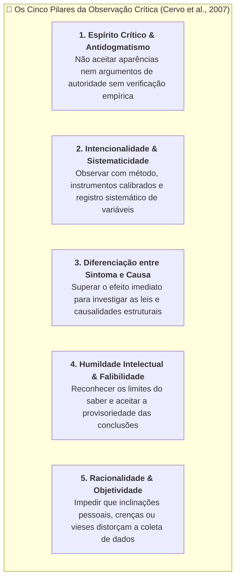

# 💬 Fórum Temático — Semana 2 (INT100)

> **Disciplina:** Projetos e Métodos para a Produção do Conhecimento (`INT100-EC-2026S2B2-T001`)  
> **Tema da Semana 2:** Fundamentos da Metodologia Científica e Técnicas de Pesquisa  
> **Docente Responsável:** Profª Dra. Graziella Ribeiro Soares Moura  
> **Título do Fórum:** *Espírito crítico e observador: base do pensamento científico*  
> **Tema de Pesquisa do Aluno:** *Engenharia de Software, Algoritmos e Sistemas Inteligentes Aplicados à Saúde e Radiologia*  

---

## 💡 Proposta do Fórum e Desafio Integrado

### 📄 Enunciado Oficial da Univesp
> *O debate proposto na primeira semana nos levou a discutir a relação entre senso comum e ciência. Vamos agora discutir como construir um espírito crítico e observador segundo o pensamento científico. Tudo começa pelos fundamentos da ciência, nos quais se busca, em primeiro lugar, a identificação do problema ou questão de pesquisa. A boa formulação da questão é essencial, sendo assim, observar criticamente também é importante.*  
> 
> *Isso exposto, procure indicar quais seriam as características do ato de observar de forma crítica. O que é, segundo seu ponto de vista, estar atento aos problemas? Cite alguns exemplos.*  

---

## 🔬 Fundamentação Teórica: A Formação da Postura Científica

A observação no método científico não se confunde com o simples registro passivo e sensorial do mundo circundante. De acordo com Cervo, Bervian e Silva (2007, Seção 1.3), a **postura científica** é um hábito mental construído, composto por atitudes intelectuais e morais indispensáveis:

---

## 🧠 Análise Estruturada das Questões do Fórum

### 1. Quais são as características do ato de observar de forma crítica?
1. **Intencionalidade e foco investigativo:** A observação científica é guiada por uma questão deliberada. Não se olha a esmo; busca-se responder a uma dúvida sistematicamente delimitada.
2. **Suspensão de juízos precipitados (*Epoché* metodológica):** Recusa em aceitar a primeira impressão intuitiva ou o senso comum como verdade conclusiva.
3. **Atenção aos detalhes e às anomalias:** Capacidade de notar discrepâncias, padrões atípicos e exceções que normalmente são ignorados pela rotina diária.
4. **Isolamento e controle de variáveis:** Esforço analítico para distinguir fatores causais reais de meras coincidências ou correlações espúrias.
5. **Registro metódico e documentado:** Garantir que o observado seja anotado de forma exata e reprodutível, permitindo que outros pesquisadores auditem as evidências.

---

### 2. O que é, segundo nosso ponto de vista, "estar atento aos problemas"?
Estar atento aos problemas é **desenvolver sensibilidade epistemológica diante da realidade**, enxergando nela não um conjunto estático de certezas dadas, mas um campo contínuo de lacunas, ineficiências e perguntas em aberto. 

Na perspectiva do pesquisador universitário e do futuro engenheiro, estar atento aos problemas significa:
* Não normalizar aquilo que causa desperdício, sofrimento, erro sistemático ou injustiça no cotidiano;
* Perceber o descompasso entre o que a teoria prevê e o que a prática manifesta;
* Converter um mero incômodo cotidiano ou falha técnica em um **problema intelectualmente formulado e investigável por meio de hipóteses testáveis**.

---

### 3. Exemplos Concretos de Observação Crítica

#### Exemplo 1: No Âmbito da Engenharia de Computação e IA Médica (Tema da Pesquisa)
* *Observação ingênua:* Um algoritmo de visão computacional treinado para detectar pneumonia em radiografias alcança 98% de acurácia nos testes. Conclui-se apressadamente que o sistema está pronto para substituir o radiologista.
* *Observação crítica:* O pesquisador examina detalhadamente os mapas de ativação do modelo (*Grad-CAM*) e descobre que a rede não estava analisando as lesões pulmonares, mas sim o marcador metálico ("D" ou "E") que os aparelhos de um hospital específico colocavam apenas nos pacientes mais graves (o chamado efeito *Clever Hans* ou viés de atalho). O espírito crítico desmonta a ilusão de acurácia e formula a verdadeira questão científica: como mitigar vieses de domínio e garantir validação externa multicêntrica em modelos de saúde.

#### Exemplo 2: No Âmbito do Desenvolvimento de Software e Infraestrutura
* *Observação ingênua:* Um sistema apresenta lentidão nos horários de pico e a equipe conclui: *"o servidor precisa de mais memória"*.
* *Observação crítica:* Analisam-se métricas de telemetria, logs de execução e perfilamento de código (*profiling*), descobrindo que o problema real decorre de concorrência mal gerenciada no banco de dados e consultas não indexadas (*N+1 queries*), e não da capacidade bruta de hardware.

#### Exemplo 3: No Âmbito do Cotidiano e da Educação (Dialogando com a colega Loredana)
* *Observação ingênua:* Alunos tiram notas baixas em uma disciplina e assume-se que *"eles não se dedicaram"*.
* *Observação crítica:* Investiga-se a carga horária extraclasse, a clareza dos enunciados avaliativos, a adequação da linguagem instrucional e o suporte socioemocional, transformando a queixa empírica em um diagnóstico pedagógico estruturado.

---

## 💡 Articulação com o Desafio da Semana: O Estado da Arte

Para transformar a observação crítica em um projeto formal, o pesquisador precisa realizar a busca do **Estado da Arte** (conforme exercitado no Desafio de INT100):

| Fonte Catalogada no Desafio | Contribuição para o Espírito Crítico e Observador |
| :--- | :--- |
| **📖 Livro:** *Metodologia Científica* (Cervo et al., 2007) | Estabelece os fundamentos teóricos da postura crítica, objetividade e técnicas padronizadas de coleta de dados. |
| **📄 Artigo:** *Deep Learning in Medical Image Analysis* (Litjens et al., 2017) | Demonstra como a literatura internacional audita criticamente mais de 300 algoritmos, apontando riscos de sobreajuste e falsas evidências. |
| **🎬 Vídeo:** *O quintal da minha avó* (Dr. Miguel Nicolelis) | Exemplifica como o olhar curioso para o cotidiano ordinário é o berço das maiores indagações da ciência moderna. |
| **📰 Reportagem:** *IA e Diagnóstico por Imagem* (MIT Tech Review, 2023) | Problematiza os impactos éticos e regulatórios da automação tecnológica nos hospitais. |
| **🎥 Documentário:** *Alan Turing: The Enigma* (BBC Horizon, 2012) | Ilustra a capacidade de observar padrões criptográficos complexos e traduzi-los em formulações lógico-matemáticas inovadoras. |

---

## 📝 Textos Prontos para Postagem no Fórum da Univesp

### Opção 1: Postagem Autônoma Principal (Recomendada para Publicação de Topo)

> **Título do Tópico:** O Espírito Crítico como Postura Científica: Da Observação Cotidiana ao Rigor da Engenharia
>
> Olá, professora Graziella e colegas!
>
> Ao refletirmos sobre o espírito crítico e observador, é essencial ressaltar que a observação científica não se resume a um ato passivo de olhar a realidade. Conforme ensinam Cervo, Bervian e Silva (2007), a observação científica caracteriza-se por sua intencionalidade, sistematicidade e capacidade de suspender juízos prévios. Observar criticamente significa ir além das impressões imediatas do senso comum para investigar causas estruturais, controlando variáveis e registrando evidências com método e humildade intelectual, ciente da provisoriedade do saber científico.
>
> Sob essa ótica, estar atento aos problemas significa cultivar uma sensibilidade investigativa que não naturaliza falhas, lacunas ou anomalias do cotidiano. Em vez de aceitar explicações fáceis ou preconcebidas, o observador crítico transforma um incômodo empírico em uma questão de pesquisa formalmente estruturada. No âmbito da Engenharia de Computação e da Inteligência Artificial aplicada à Saúde — área que selecionei para o projeto da disciplina —, esse espírito é vital. Por exemplo, ao avaliar um modelo de IA médica com alta taxa de acerto, o olhar ingênuo aceitaria o resultado de imediato; já o olhar crítico audita os dados e investiga se o algoritmo não está apenas identificando marcas nos exames em vez de patologias reais (o efeito de atalho algorítmico). Da mesma forma, na engenharia de software, culpar a falta de servidores por lentidões sem auditar gargalos no código é uma falha de observação crítica.
>
> No desafio desta semana, ao realizar o levantamento bibliográfico do estado da arte (consultando desde obras de método como Cervo et al. até revisões sistemáticas como a de Litjens et al., 2017 sobre imagens médicas e as lições do Prof. Nicolelis), percebi com clareza que toda grande inovação nasce exatamente desse encontro: uma observação curiosa e atenta da realidade, lapidada pelo rigor metodológico e pelo compromisso ético com a verdade.
>
> Um abraço e excelentes estudos a todos!

---

### Opção 2: Réplica Construtiva (Dialogando Diretamente com a Colega Loredana)

> **Re: S2 - Fórum temático**
>
> Olá, Loredana! Excelente contribuição!
>
> Concordo plenamente quando você destaca que observar de forma crítica exige *"a humildade de nem sempre crer que está correto"* e a paciência de investigar múltiplos fatores antes de tirar conclusões precipitadas. Seu exemplo sobre o rendimento dos estudantes ilustra com perfeição a diferença entre o julgamento apressado do senso comum e a formulação de um verdadeiro problema de pesquisa.
>
> Na Engenharia e nas ciências exatas enfrentamos esse mesmo desafio: diante de uma falha de software ou de um modelo de Inteligência Artificial médica que apresenta resultados atípicos, a observação ingênua costuma buscar explicações superficiais. A postura crítica, como bem sistematizam Cervo, Bervian e Silva (2007), exige decompor o problema em partes, auditar os dados de entrada e confrontar hipóteses sem dogmatismo. Estar atento aos problemas é justamente não aceitar a obviedade aparente e manter a curiosidade ativa em busca das causas reais.
>
> Parabéns pela clareza na reflexão!
