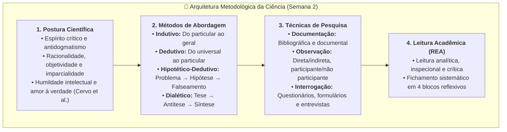

# 📌 Em Síntese — Semana 2 (INT100)

> **Disciplina:** Projetos e Métodos para a Produção do Conhecimento (`INT100-EC-2026S2B2-T001`)  
> **Tema da Semana 2:** Fundamentos da Metodologia Científica e Técnicas de Pesquisa  
> **Docente Responsável:** Profª Dra. Graziella Ribeiro Soares Moura  
> **Período:** 05/10/2026 a 18/10/2026  
> **Status:** 🟢 **Semana 2 Concluída com Sucesso (10,0 / 10,0)**  

---

## 🎯 Síntese e Consolidação dos Conteúdos da Semana

Ao concluir os estudos desta segunda semana, consolidamos o entendimento de que a ciência é essencialmente um processo guiado por **rigor metódico, postura crítica e adequação técnica**. O pesquisador não é um mero acumulador de informações, mas um observador atento da realidade capaz de formular problemas precisos, levantar hipóteses falseáveis e selecionar métodos adequados para testá-las.

---

## 🏛️ 1. As Dimensões do Fazer Científico

### A. A Formação da Postura Científica (Cervo, Bervian e Silva, Seção 1.3)
A atitude científica constitui um hábito intelectual construído sobre duas ordens de preceitos:
* **Aspecto Intelectual:** Busca constante de evidências objetivas, recusa de argumentos de autoridade (*magister dixit*), senso de dúvida metódica e exigência de demonstração lógica e empírica.
* **Aspecto Ético/Moral:** Honestidade intelectual (reconhecimento de fontes e dados reais sem manipulação), desapego de vaidades teóricas e humildade diante da provisoriedade e falibilidade de qualquer conclusão.

---

### B. Métodos de Abordagem vs. Métodos de Procedimento (Cervo et al. e Köche)
* **Métodos de Abordagem (Filosófico-Epistemológicos):**
  * **Método Dedutivo:** Parte de premissas universais verdadeiras para deduzir conclusões necessárias particulares (silogismo clássico).
  * **Método Indutivo:** Parte de observações de casos particulares convergentes para inferir uma proposição geral provável.
  * **Método Hipotético-Dedutivo (Popper):** Perante uma anomalia teórica, formula-se uma hipótese e deduzem-se consequências passíveis de falseamento experimental severo.
  * **Método Dialético:** Analisa a realidade em constante devir histórico por meio das contradições internas dos fenômenos.
* **Métodos de Procedimento (Operacionais):** Método histórico, comparativo, monográfico, estatístico, funcionalista e estruturalista.

---

### C. Classificação das Pesquisas e Técnicas de Coleta (Pessôa e Köche)

| Critério de Classificação | Tipos de Pesquisa | Técnicas e Instrumentos Principais |
| :--- | :--- | :--- |
| **Quanto aos Objetivos** | • Exploratória • Descritiva • Explicativa | Levantamento bibliográfico, entrevistas em profundidade, estudos de caso e testes empíricos |
| **Quanto aos Procedimentos** | • Bibliográfica e Documental • Experimental • De Campo / Levantamento (*Survey*) | Fichas de leitura, equipamentos calibrados, ensaios controlados, questionários e formulários |
| **Quanto à Abordagem** | • Quantitativa (métricas e estatística) • Qualitativa (significados e interpretações) • Mista (Quanti-Quali) | Análise multivariada, escalas Likert, análise de conteúdo e observação participante |

---

## ✅ Autoavaliação de Metas e Competências da Semana 2

Verifique se você atingiu integralmente as metas de aprendizagem estabelecidas pela coordenação pedagógica da Univesp:

- [x] **Compreendi a concepção de ciência:** Entendi que a ciência contemporânea é uma construção social e racional dinâmica, cuja validade assenta-se na reprodutibilidade dos métodos, na honestidade intelectual e na falseabilidade contínua de suas teorias.
- [x] **Refleti sobre o que é a pesquisa científica:** Reconheci que pesquisar não é memorizar informações nem executar procedimentos mecânicos, mas sim investigar problemas reais delimitados no tempo e no espaço por meio de rigor metodológico e imaginação disciplinada.
- [x] **Discuti os fundamentos e as técnicas de pesquisa:** Diferenciei os métodos de abordagem (dedutivo, indutivo, hipotético-dedutivo) e dominei a aplicação das técnicas de coleta (documentação, observação direta, questionários e entrevistas padronizadas).
- [x] **Identifiquei as bases do fazer científico:** Internalizei os pilares da postura científica (espírito crítico, objetividade, imparcialidade e humildade intelectual), compreendendo o papel do observador atento.
- [x] **Apliquei as estratégias de leitura acadêmica do REA:** Concluí o Exercício de Apoio (4.1) elaborando a análise inspecional e analítica de duas obras de referência (*Cervo et al.* e *Litjens et al.*).
- [x] **Desenvolvi o Desafio e participei do Fórum Temático:** Realizei o levantamento bibliográfico de 5 fontes do Estado da Arte e publiquei reflexão fundamentada no Fórum Temático (4.2).
- [x] **Consolidei a Atividade Avaliativa com nota máxima:** Atividade avaliativa resolvida com 100% de acerto (10,0 / 10,0).

---

## 🔮 Conexão com a Semana 3: O que vem a seguir?

Na **Semana 3**, avançaremos para a divulgação e a integridade da prática investigativa:
* **Tema:** *Comunicação científica: rigor e ética em pesquisa*.
* **Tópicos Centrais:**
  * O papel da comunicação e da linguagem na validação comunitária do saber científico.
  * O processo de revisão por pares (*peer review*) e a circulação em periódicos indexados.
  * Rigor ético, integridade acadêmica e prevenção de plágio e fraudes científicas.
  * Normas e padrões formais de citação e referência (ABNT / Vancouver / IEEE).

---

## 📚 Navegação Rápida — Materiais da Semana 2 (INT100)

* [**`0-Inicio.md`**](file:///home/henrique/Modelos/Univesp/2026S2B2/INT100-Projetos-e-Metodos-para-a-Producao-do-Conhecimento/Semana-2/0-Inicio.md) — Apresentação, Objetivos e Desafio do Estado da Arte (5 Fontes & Resumos)
* [**`1-Videoaulas.md`**](file:///home/henrique/Modelos/Univesp/2026S2B2/INT100-Projetos-e-Metodos-para-a-Producao-do-Conhecimento/Semana-2/1-Videoaulas.md) — Videoaulas da Semana: Postura Científica, O Método e As Técnicas
* [**`2.1-Texto-base-Metodologia-Cientifica-Secao-1.3-Cervo.md`**](file:///home/henrique/Modelos/Univesp/2026S2B2/INT100-Projetos-e-Metodos-para-a-Producao-do-Conhecimento/Semana-2/2.1-Texto-base-Metodologia-Cientifica-Secao-1.3-Cervo.md) — Síntese analítica de Cervo et al. (*A formação da postura científica*)
* [**`2.2-Texto-base-Metodologia-Cientifica-Secoes-3.1-3.2-Cervo.md`**](file:///home/henrique/Modelos/Univesp/2026S2B2/INT100-Projetos-e-Metodos-para-a-Producao-do-Conhecimento/Semana-2/2.2-Texto-base-Metodologia-Cientifica-Secoes-3.1-3.2-Cervo.md) — Síntese analítica de Cervo et al. (*O método* e *As técnicas*)
* [**`2.3-Material-base-REA-Estrategias-de-Leitura-Academica.md`**](file:///home/henrique/Modelos/Univesp/2026S2B2/INT100-Projetos-e-Metodos-para-a-Producao-do-Conhecimento/Semana-2/2.3-Material-base-REA-Estrategias-de-Leitura-Academica.md) — Síntese do REA Univesp e Modelo Oficial da Ficha de Leitura
* [**`3-Aprofundando-o-tema.md`**](file:///home/henrique/Modelos/Univesp/2026S2B2/INT100-Projetos-e-Metodos-para-a-Producao-do-Conhecimento/Semana-2/3-Aprofundando-o-tema.md) — Síntese de Pessôa (técnicas de coleta) e Köche (epistemologia e métodos)
* [**`4.1-Exercicio-de-apoio.md`**](file:///home/henrique/Modelos/Univesp/2026S2B2/INT100-Projetos-e-Metodos-para-a-Producao-do-Conhecimento/Semana-2/4.1-Exercicio-de-apoio.md) — Como ler um texto (Estratégias de leitura aplicadas a Cervo et al. e Litjens et al.)
* [**`4.2-Forum-tematico.md`**](file:///home/henrique/Modelos/Univesp/2026S2B2/INT100-Projetos-e-Metodos-para-a-Producao-do-Conhecimento/Semana-2/4.2-Forum-tematico.md) — Espírito crítico e observador: base do pensamento científico (+ Desafio integrado)
* [**`5-Atividade-avaliativa.md`**](file:///home/henrique/Modelos/Univesp/2026S2B2/INT100-Projetos-e-Metodos-para-a-Producao-do-Conhecimento/Semana-2/5-Atividade-avaliativa.md) — Questões avaliativas resolvidas com gabarito oficial (Nota 10,0 / 10,0)
* [**`6-Em-sintese.md`**](file:///home/henrique/Modelos/Univesp/2026S2B2/INT100-Projetos-e-Metodos-para-a-Producao-do-Conhecimento/Semana-2/6-Em-sintese.md) — Resumo executivo, arquitetura metodológica e autoavaliação
