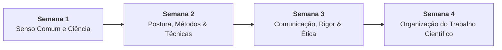

# 📚 Semana 2 — Fundamentos da Metodologia Científica e Técnicas de Pesquisa

> **Disciplina:** Projetos e Métodos para a Produção do Conhecimento (`INT100-EC-2026S2B2-T001`)  
> **Curso:** Bacharelado em Engenharia de Computação — Univesp  
> **Docente Responsável:** Profª Dra. Graziella Ribeiro Soares Moura  
> **Período:** 05/10/2026 a 18/10/2026  
> **Status:** 🟢 **100% CONCLUÍDO (Nota 10,0 / 10,0)**  

---

## 🗺️ Índice de Materiais e Atividades

| Arquivo | Descrição | Status |
| :--- | :--- | :---: |
| [**`0-Inicio.md`**](file:///home/henrique/Modelos/Univesp/2026S2B2/INT100-Projetos-e-Metodos-para-a-Producao-do-Conhecimento/Semana-2/0-Inicio.md) | Introdução, Objetivos de Aprendizagem, Roteiro e Desafio da Semana | 🟢 Pronto |
| [**`1-Videoaulas.md`**](file:///home/henrique/Modelos/Univesp/2026S2B2/INT100-Projetos-e-Metodos-para-a-Producao-do-Conhecimento/Semana-2/1-Videoaulas.md) | Resumo estruturado das videoaulas: Postura Científica, O Método e As Técnicas | 🟢 Pronto |
| [**`2.1-Texto-base-Metodologia-Cientifica-Secao-1.3-Cervo.md`**](file:///home/henrique/Modelos/Univesp/2026S2B2/INT100-Projetos-e-Metodos-para-a-Producao-do-Conhecimento/Semana-2/2.1-Texto-base-Metodologia-Cientifica-Secao-1.3-Cervo.md) | Síntese analítica de Cervo, Bervian e Silva (Seção 1.3: *A formação da postura científica*) | 🟢 Pronto |
| [**`2.2-Texto-base-Metodologia-Cientifica-Secoes-3.1-3.2-Cervo.md`**](file:///home/henrique/Modelos/Univesp/2026S2B2/INT100-Projetos-e-Metodos-para-a-Producao-do-Conhecimento/Semana-2/2.2-Texto-base-Metodologia-Cientifica-Secoes-3.1-3.2-Cervo.md) | Síntese analítica de Cervo, Bervian e Silva (Seções 3.1 a 3.2: *O método* e *As técnicas*) | 🟢 Pronto |
| [**`2.3-Material-base-REA-Estrategias-de-Leitura-Academica.md`**](file:///home/henrique/Modelos/Univesp/2026S2B2/INT100-Projetos-e-Metodos-para-a-Producao-do-Conhecimento/Semana-2/2.3-Material-base-REA-Estrategias-de-Leitura-Academica.md) | Síntese do REA Univesp: métodos de leitura acadêmica e modelo de Ficha de Leitura | 🟢 Pronto |
| [**`3-Aprofundando-o-tema.md`**](file:///home/henrique/Modelos/Univesp/2026S2B2/INT100-Projetos-e-Metodos-para-a-Producao-do-Conhecimento/Semana-2/3-Aprofundando-o-tema.md) | Síntese de Pessôa (p. 13–21: técnicas de coleta) e Köche (p. 44–57: epistemologia e métodos) | 🟢 Pronto |
| [**`4.1-Exercicio-de-apoio.md`**](file:///home/henrique/Modelos/Univesp/2026S2B2/INT100-Projetos-e-Metodos-para-a-Producao-do-Conhecimento/Semana-2/4.1-Exercicio-de-apoio.md) | Exercício de apoio — Como ler um texto (Estratégias do REA aplicadas a Cervo et al. e Litjens et al.) | 🟢 Pronto |
| [**`4.2-Forum-tematico.md`**](file:///home/henrique/Modelos/Univesp/2026S2B2/INT100-Projetos-e-Metodos-para-a-Producao-do-Conhecimento/Semana-2/4.2-Forum-tematico.md) | Proposta para o Fórum Temático da Semana 2 (Espírito crítico e observador + Desafio integrado) | 🟢 Pronto |
| [**`5-Atividade-avaliativa.md`**](file:///home/henrique/Modelos/Univesp/2026S2B2/INT100-Projetos-e-Metodos-para-a-Producao-do-Conhecimento/Semana-2/5-Atividade-avaliativa.md) | Questões avaliativas resolvidas com gabarito oficial (10,0 / 10,0) e justificativas | 🟢 Concluído (10/10) |
| [**`6-Em-sintese.md`**](file:///home/henrique/Modelos/Univesp/2026S2B2/INT100-Projetos-e-Metodos-para-a-Producao-do-Conhecimento/Semana-2/6-Em-sintese.md) | Resumo executivo, arquitetura metodológica e autoavaliação | 🟢 Pronto |

---

## 🧭 Relação com as Demais Semanas

