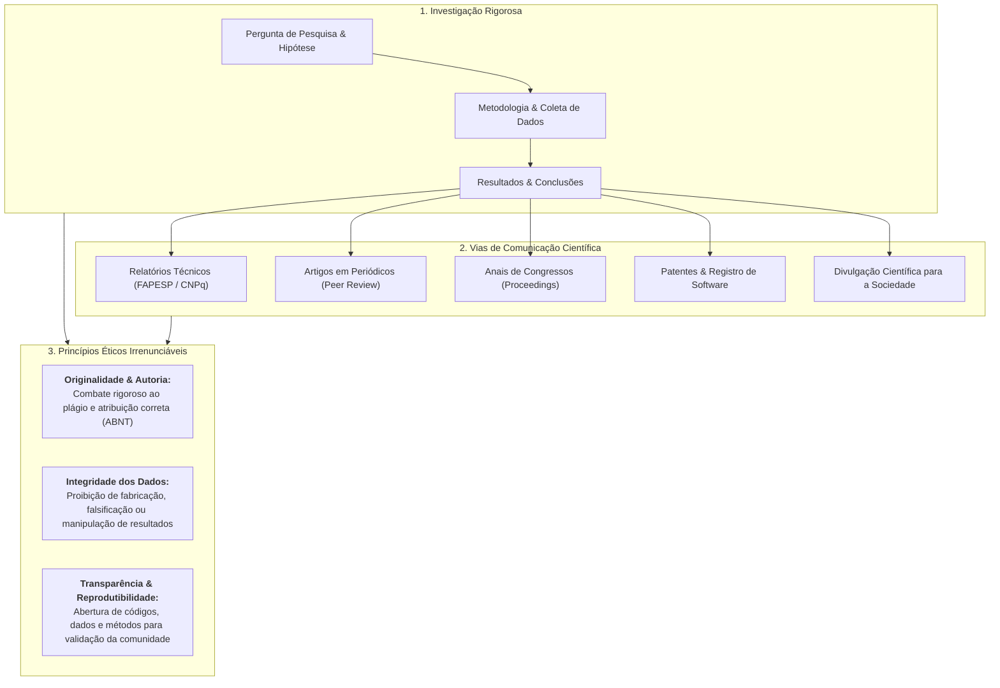
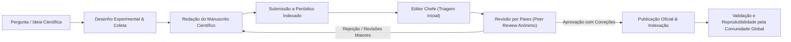

# 📌 Semana 3 — Início & Apresentação da Semana

> **Disciplina:** Projetos e Métodos para a Produção do Conhecimento (`INT100-EC-2026S2B2-T001`)  
> **Tema da Semana 3:** Comunicação Científica: Rigor e Ética em Pesquisa  
> **Docente Responsável:** Profª Dra. Graziella Ribeiro Soares Moura  
> **Período:** 12/10/2026 a 25/10/2026  

---

## 👩‍🏫 Mensagem da Professora & Contextualização

Olá, estudante!

Na última semana, o conteúdo e a discussão foram sobre os **fundamentos e as técnicas de pesquisa**.

Nesta semana, você continuará lembrando que o **espírito crítico** e a **observação** são a base do pensamento científico. Fazer ciência é saber fazer perguntas e buscar respostas para elas. É, antes de mais nada, produzir conhecimento sobre os temas mais diversos.

Suponha que você já fez uma boa pergunta para pesquisa e cumpriu com os fundamentos básicos esperados, chegando ao final com resultados interessantes. **E agora? É importante comunicar esse achado científico?**

É isso que será abordado esta semana: **a comunicação científica com rigor e ética**.

Umberto Eco escreveu um livro no qual procura responder *"Como se faz uma tese em Ciências Humanas"*. Uma das formas de se fazer essa tese, segundo a provocação irônica do autor, seria buscar em uma biblioteca internacional um trabalho já pronto, apossar-se dele, fazer as devidas mudanças — principalmente assumindo sua autoria — e entregá-lo para avaliação. Muito fácil, não? Muito cômodo? Contudo, isso é correto? O próprio Umberto Eco questiona a seriedade e a validade dessa prática, alertando para o crime acadêmico e moral do **plágio**.

Quando se desenvolve uma pesquisa, é fundamental torná-la pública. **E como se faz isso?**

Das formas mais distintas:
1. **Relatório Científico:** Encaminhado e avaliado diretamente pela instituição de fomento ou financiadora da pesquisa (ex.: FAPESP, CNPq, CAPES, empresas parceiras).
2. **Reuniões e Congressos Científicos:** Sob a forma de comunicação oral, apresentações em simpósios ou sessões de pôsteres.
3. **Divulgação Científica:** Comunicação em jornais, programas de TV, podcasts e canais acadêmicos na internet para a sociedade em geral.
4. **Propriedade Intelectual:** Registro de patentes de produtos, softwares, fórmulas, equações e modelos de utilidade.
5. **Publicações com Revisão por Pares (*Peer Review*):** Artigos em periódicos especializados (revistas indexadas), capítulos de livros temáticos ou livros completos.

No mundo da ciência, qualquer investigação séria inicia com o **levantamento bibliográfico**. Ele é a busca sistemática sobre o tema a ser trabalhado, realizada em bases de dados confiáveis, livros e periódicos. É o que se convencionou chamar de **"estado da arte"** sobre o assunto. Ao efetuar essa busca, você terá em mãos o conhecimento consolidado já produzido pela comunidade científica.

Até bem pouco tempo atrás, esse levantamento exigia deslocamento físico a bibliotecas universitárias e institutos de pesquisa no Brasil ou no exterior. Hoje, a internet trouxe imensa agilidade e democratização, mas também exige filtros rigorosos contra desinformação e fontes espúrias.

Além de coletar o material, é indispensável saber ler academicamente. Por isso, esta semana introduz as diretrizes fundamentais para **leitura analítica, fichamento, resumo e resenha**.

---

## 🔄 O Ciclo da Comunicação Científica e a Ética

---

## 🎯 Objetivos de Aprendizagem

Ao final desta semana, você deverá ser capaz de:

* [ ] **Entender** o funcionamento da produção e divulgação científica com rigor e ética.
* [ ] **Conhecer e preparar-se** para identificar as diferentes modalidades e veículos de comunicação científica.
* [ ] **Dominar técnicas de leitura acadêmica** e elaborar instrumentos de trabalho: **fichamento**, **resumo** e **resenha crítica**.

---

## 💡 Desafio da Semana: Busca Acadêmica Qualificada

### 📌 Enunciado Oficial
> *Prosseguindo com o desafio de escrever um projeto de pesquisa, na semana anterior você realizou uma busca do que existe registrado sobre o tema selecionado para estudar (busca livre na internet).*  
> 
> *Nesta semana iremos qualificar essa busca e direcioná-la para uma pesquisa acadêmica, buscando e referenciando livros, capítulos de livros e artigos científicos sobre o tema escolhido por vocês.*  
> 
> *A primeira atividade é definir para o seu tema até cinco palavras-chave, ou seja, termos ou palavras que dizem respeito, identificam, estão relacionadas ao tema.*  
> 
> *Com esse conjunto de palavras-chave você vai selecionar cinco publicações de tipos diferentes (livros, capítulos de livros, revistas científicas ou trabalhos publicados em anais de congressos) sobre o tema. A partir do levantamento, procure aplicar o que foi proposto no exercício da semana anterior.*

---

### 💻 Resolução Estruturada do Desafio (Foco: Engenharia de Computação)

Dando continuidade direta ao projeto iniciado nas Semanas 1 e 2, mantemos o tema de fronteira tecnológica:  
**Tema:** *Sistemas Inteligentes de Visão Computacional e Aprendizado Profundo Aplicados ao Auxílio Diagnóstico em Radiologia: Desafios de Confiabilidade, Explicabilidade e Bioética*.

#### 1. As 5 Palavras-Chave Selecionadas
Para direcionar buscas booleanas avançadas em bases acadêmicas (SciELO, IEEE Xplore, PubMed, Google Acadêmico e Periódicos CAPES), definiram-se as seguintes palavras-chave (com equivalentes em inglês):

1. **Visão Computacional** (*Computer Vision*)
2. **Aprendizado Profundo** (*Deep Learning*)
3. **Diagnóstico Radiológico por Imagem** (*Radiological Diagnostic Imaging*)
4. **Inteligência Artificial Explicável** (*Explainable AI - XAI*)
5. **Bioética e Proteção de Dados** (*Bioethics and Data Privacy*)

---

#### 2. Levantamento das 5 Publicações de Tipos Distintos (com Referências ABNT)

| Tipo de Publicação | Título da Obra | Autor(es) / Ano | Veículo / Editora |
| :--- | :--- | :--- | :--- |
| **1. Livro Completo** | *Deep Learning* | GOODFELLOW, I.; BENGIO, Y.; COURVILLE, A. (2016) | MIT Press |
| **2. Capítulo de Livro** | *Deep Learning in Medical Image Analysis* | SHEN, D.; WU, G.; SUK, H.-I. (2017) | In: *Medical Image Analysis for Machine Learning* (Springer) |
| **3. Artigo em Revista Científica** | *A Review on Deep Learning in Medical Image Analysis* | LITJENS, G. et al. (2017) | *Medical Image Analysis* (Elsevier, Qualis A1) |
| **4. Trabalho em Anais de Congresso** | *Grad-CAM: Visual Explanations from Deep Networks via Gradient-Based Localization* | SELVARAJU, R. R. et al. (2017) | *IEEE International Conference on Computer Vision (ICCV)* |
| **5. Relatório Técnico / Diretriz Normativa** | *Ethics and Governance of Artificial Intelligence for Health* | WORLD HEALTH ORGANIZATION - WHO (2021) | Relatório Técnico Institucional da OMS (Genebra) |

---

#### 3. Fichamento e Síntese de Conteúdo de Cada Fonte

1. **Livro (Goodfellow, Bengio & Courville, 2016):**
   * *Referência:* GOODFELLOW, Ian; BENGIO, Yoshua; COURVILLE, Aaron. **Deep Learning**. Cambridge: MIT Press, 2016.
   * *Síntese:* Obra de referência mundial em computação. Estabelece as bases matemáticas (álgebra linear, probabilidade e cálculo multivariável) das redes neurais convolucionais (CNNs), demonstrando como camadas profundas realizam extração hierárquica de características visuais a partir de tensores de imagens.

2. **Capítulo de Livro (Shen, Wu & Suk, 2017):**
   * *Referência:* SHEN, Dinggang; WU, Guorong; SUK, Heung-Il. Deep Learning in Medical Image Analysis. In: WU, Guorong (ed.). **Medical Image Analysis for Machine Learning**. London: Springer, 2017. p. 1-28.
   * *Síntese:* Foca na adaptação dos modelos clássicos de redes neurais para o domínio biomédico, discutindo os desafios de lidar com dados tridimensionais (tomografias e ressonâncias), ruído de aquisição e a escassez de anotações médicas especializadas (*ground truth*).

3. **Artigo em Periódico Especializado (Litjens et al., 2017):**
   * *Referência:* LITJENS, Geert et al. A survey on deep learning in medical image analysis. **Medical Image Analysis**, Amsterdam, v. 42, p. 60-88, 2017.
   * *Síntese:* Amplo levantamento do "estado da arte" cobrindo mais de 300 artigos. Classifica as aplicações por tarefa de engenharia (classificação, detecção de lesões, segmentação de órgãos) e modalidades de imagem (raio-X, RM, TC e ultrassom), apontando as métricas de sensibilidade, especificidade e a curva ROC como fundamentais para a avaliação de desempenho.

4. **Trabalho em Anais de Congresso (Selvaraju et al., 2017):**
   * *Referência:* SELVARAJU, Ramprasaath R. et al. Grad-CAM: Visual Explanations from Deep Networks via Gradient-Based Localization. In: **IEEE INTERNATIONAL CONFERENCE ON COMPUTER VISION (ICCV)**, 2017, Venice. Proceedings... Piscataway: IEEE, 2017. p. 618-626.
   * *Síntese:* Artigo seminal que soluciona o problema da "caixa-preta" em modelos de visão computacional. Introduz o método Grad-CAM, que utiliza os gradientes da última camada convolucional para gerar mapas de calor visuais, indicando exatamente em quais regiões da imagem o algoritmo se baseou para sugerir o diagnóstico.

5. **Relatório Técnico Normativo (Organização Mundial da Saúde, 2021):**
   * *Referência:* WORLD HEALTH ORGANIZATION (WHO). **Ethics and governance of artificial intelligence for health: WHO guidance**. Geneva: World Health Organization, 2021.
   * *Síntese:* Documento orientador sobre bioética e regulação. Define os 6 princípios reitores para a IA em saúde: (1) proteção da autonomia humana; (2) promoção do bem-estar e segurança pública; (3) garantia de transparência e explicabilidade; (4) fomento à responsabilidade e prestação de contas (*accountability*); (5) asseguramento de equidade e inclusão; e (6) promoção de sistemas sustentáveis e auditáveis.

---

## 📺 Revisitando Conhecimentos: Vídeo de Apoio

### 🎬 *"Como funciona a produção científica?"* — Prof. Dr. Miguel Nicolelis (TV Rádio Big Bang)
* **Link:** [YouTube - Assistir ao Vídeo](https://www.youtube.com/watch?v=EbhNfd3tQtY)
* **Palestrante:** Prof. Dr. Miguel Nicolelis (Médico e neurocientista pioneiro em interface cérebro-máquina, professor emérito da Universidade Duke).

### 🧠 Síntese dos Conceitos Abordados por Nicolelis
1. **A Natureza da Investigação Científica:** A ciência nasce da curiosidade humana disciplinada por métodos rigorosos. Uma hipótese só tem valor se puder ser testada experimentalmente sob condições controladas.
2. **O Processo Editorial e a Revisão por Pares (*Peer Review*):**
   * Ao redigir um artigo, os autores submetem o texto a uma revista especializada.
   * O editor envia o manuscrito para cientistas anônimos independentes (*referees* ou pareceristas) que sejam referências na área.
   * Os revisores realizam um escrutínio implacável: checam a consistência dos dados, a validade estatística, a adequação da metodologia e possíveis falhas experimentais antes de recomendar a publicação, revisão ou rejeição.
3. **Reprodutibilidade como Pilar da Verdade Científica:** Publicar um artigo não encerra o trabalho: a partir da divulgação pública, qualquer laboratório do mundo deve ser capaz de replicar o experimento e chegar aos mesmos resultados. Se não for reprodutível, a descoberta é invalidada.
4. **Ética, Integridade e Conflito de Interesses:** O rigor ético exige declarar fontes de financiamento e garantir que os dados não sofreram viés seletivo (*cherry-picking*). Fraudes mancham a reputação acadêmica e trazem prejuízos diretos à sociedade.
