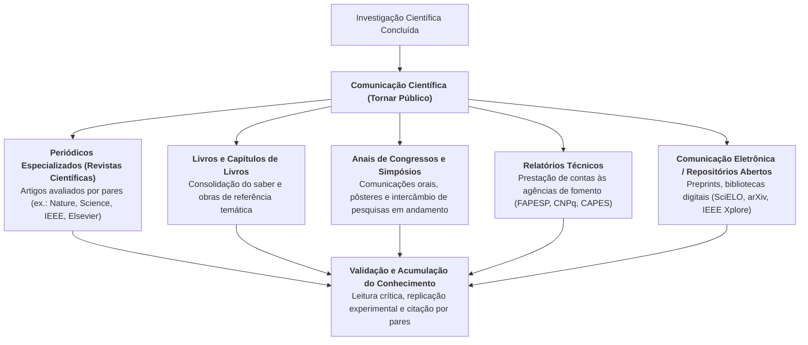
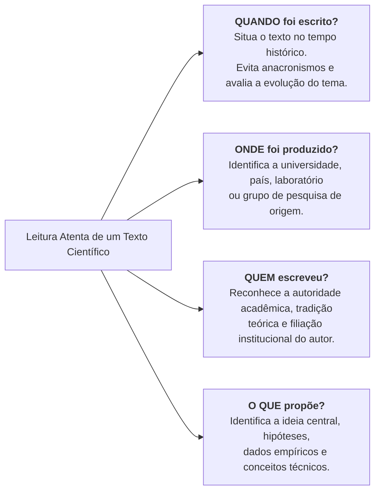
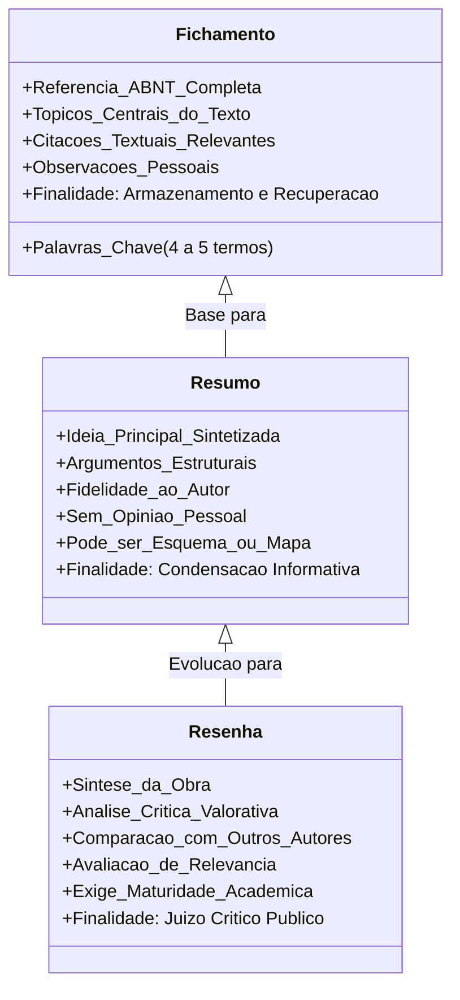

# 🎥 Videoaula 4 — A Comunicação Científica: Rigor e Ética em Pesquisa

> **Disciplina:** Projetos e Métodos para a Produção do Conhecimento (`INT100-EC-2026S2B2-T001`)  
> **Tema da Semana 3:** Comunicação Científica: Rigor e Ética em Pesquisa  
> **Docente da Aula:** Profª Darlene Ferreira  
> **Link Oficial:** [Assistir no YouTube (UNIVESP)](https://www.youtube.com/watch?v=9T9xRmp2Hes)  
> **Período Acadêmico:** 12/10/2026 a 25/10/2026  

---

## 📌 Visão Geral da Videoaula

Nesta videoaula, a professora **Darlene Ferreira** aprofunda os aspectos centrais da **comunicação científica**, demonstrando que a ciência só se concretiza plenamente quando os resultados obtidos por uma investigação rigorosa são **tornados públicos** para escrutínio da comunidade acadêmica e benefício da sociedade. 

A aula articula dois eixos fundamentais e interdependentes:
1. **A Dimensão Institucional e Ética da Comunicação Científica:** Canais de divulgação (periódicos, livros, anais de congressos e relatórios), a revolução da comunicação digital e a exigência inegociável de rigor ético (autoria, citações e combate ao plágio).
2. **O Ato de Estudar e as Técnicas de Leitura Acadêmica:** O processo ativo de estudo, as perguntas norteadoras na análise documental (*quando* e *onde* o texto foi produzido) e os três instrumentos fundamentais de registro e análise: **fichamento**, **resumo** e **resenha**.

---

## 🌐 1. O que é Comunicação Científica?

A comunicação científica é o processo formal pelo qual os pesquisadores submetem suas hipóteses, métodos, dados e conclusões ao conhecimento e julgamento da comunidade científica e do público geral.

### Principais Características da Comunicação Científica:
* **Finalidade Epistêmica:** Não basta descobrir ou inventar; é preciso comprovar e compartilhar os caminhos metodológicos adotados.
* **Fontes de Conhecimento Confiáveis:** Os periódicos científicos indexados constituem o repositório oficial da ciência acumulada, distinguindo-se de postagens opinativas ou fontes informais.
* **A Revolução Digital:** A dimensão virtual e as revistas eletrônicas aceleraram exponencialmente o fluxo de informações, permitindo que descobertas sejam acessadas globalmente em tempo real, ampliando a colaboração interdisciplinar e internacional.

---

## ⚖️ 2. Rigor e Ética em Pesquisa: O Compromisso da Ciência

A professora Darlene enfatiza que o avanço científico é inseparável da conduta ética. Fazer ciência com rigor exige:

1. **Reconhecimento da Autoria:** Atribuir com exatidão a autoria de ideias, conceitos, dados e formulações teóricas criadas por terceiros.
2. **Combate ao Plágio:** O plágio — seja integral, parcial ou conceitual — constitui fraude grave e crime acadêmico. A apropriação indevida desrespeita o esforço intelectual alheio e destrói a credibilidade do pesquisador.
3. **Integridade Metodológica:** Proibição de fabricar dados inexistentes, manipular gráficos para forçar conclusões ou ocultar resultados que contrariem a hipótese inicial (*cherry-picking*).
4. **Normas Técnicas de Citação (ABNT):** O emprego sistemático das normas de citação direta, citação indireta e notas de rodapé assegura a rastreabilidade das fontes consultadas.

---

## 📖 3. O Ato de Estudar e a Leitura Crítica de Textos Científicos

O estudo no ensino superior é definido como um **processo investigatório e ativo de aprendizagem**. Ele não é mera memorização passiva, mas sim a instrumentalização do estudante para realizar o salto do **senso comum** para a formulação de **juízos críticos e conceituais fundamentados**.

### 🔍 Perguntas Essenciais na Leitura de um Texto Acadêmico

Para compreender criticamente um documento, a professora destaca a necessidade de situá-lo contextualmente:

* **Cuidado com o critério temporal:** Um texto dos anos 1980 ou 1990 não deve ser sumariamente descartado como "ultrapassado"; ele pode ser a obra seminal que fundou o paradigma tecnológico vigente ou a teoria que ainda rege a disciplina.
* **Técnica de marcação progressiva:**
  * **1ª Leitura (Exploratória):** Leitura corrida para apreensão do todo, marcando pontos de interesse geral.
  * **2ª Leitura (Analítica / Valorativa):** Sublinhar com critério, destacando especificamente a **ideia principal**, os argumentos de sustentação, os conceitos-chave e os termos técnicos que enriquecerão o vocabulário profissional do estudante.

---

## 📝 4. As Três Formas de Registro e Análise: Fichamento, Resumo e Resenha

A videoaula estabelece uma distinção técnica rigorosa entre os três principais instrumentos de trabalho acadêmico:

### 📋 Quadro Comparativo e Estrutural

| Instrumento | O que é? | Elementos Obrigatórios | Há Juízo de Valor? | Onde é mais Utilizado? |
| :--- | :--- | :--- | :---: | :--- |
| **Fichamento** | Registro sistemático de dados extraídos de uma leitura para compor arquivo pessoal de pesquisa. | Cabeçalho com referência bibliográfica completa (ABNT), palavras-chave, citações diretas com página e anotações breves. | Apenas em notas marginais de trabalho | Em levantamentos bibliográficos, TCCs, teses e planilhas de estudo (Excel/Notion). |
| **Resumo** | Apresentação concisa e fidedigna dos pontos relevantes de um texto, sem omitir a tese central. | Ideia principal, metodologia, principais resultados e conclusões do autor original. | **Não.** Deve ser estritamente fiel ao pensamento do autor. | Em artigos científicos (Abstract), relatórios, propostas de congresso e sínteses de estudo. |
| **Resenha** | Análise crítica e valorativa de um livro ou artigo, orientando o leitor sobre o valor da obra. | Síntese do conteúdo, contextualização teórica do autor, exame crítico dos argumentos e comparação com a literatura da área. | **Sim.** Contém apreciação crítica fundamentada do resenhista. | Em periódicos acadêmicos (seção de resenhas), suplementos literários e avaliações curriculares. |

---

## 💻 5. Aplicação Prática na Engenharia de Computação

Como futuros engenheiros de computação, a aplicação dos ensinamentos da Videoaula 4 se desdobra em rotinas profissionais concretas:

1. **Fichamento em Planilhas Técnicas:** Ao pesquisar novos frameworks, algoritmos de inteligência artificial ou protocolos de segurança, organizar um fichamento digital (com título, autores, conferência de publicação, complexidade assintótica $O(n)$ e dataset utilizado) economiza dezenas de horas de retrabalho na concepção de sistemas.
2. **Resumos em Documentação de Software:** A habilidade de redigir resumos claros e objetivos é diretamente transposta para a redação de especificações técnicas de requisitos, resumos de projetos de arquitetura e relatórios de auditoria.
3. **Resenhas de Ferramentas e Paradigmas:** A elaboração de resenhas críticas capacita o engenheiro a comparar soluções concorrentes (ex.: comparar modelos de bancos de dados relacionais vs. NoSQL, ou paradigmas de concorrência em C++ vs. Rust) emitindo pareceres técnicos sólidos e fundamentados para tomadas de decisão corporativas.
4. **Ética em Inteligência Artificial e Dados:** A ética científica se traduz na prática computacional pelo respeito à Lei Geral de Proteção de Dados (LGPD), transparência em modelos de aprendizado de máquina, prevenção de vieses discriminatórios e auditoria de código-fonte aberto com atribuição correta de licenças de software livre (MIT, GPL, Apache).

---

## 🎯 Síntese dos Pontos-Chave para Avaliações

* **Comunicação científica** = O ato de tornar públicos e verificáveis os resultados da pesquisa.
* **Periódicos eletrônicos** = Meio contemporâneo predominante que dinamizou e globalizou a troca de conhecimentos entre pesquisadores.
* **Rigor e Ética** = Citações rigorosas, respeito aos direitos autorais e condenação total do plágio.
* **Perguntas de leitura** = Investigar sempre *quando* (contexto temporal) e *onde* (origem institucional/espacial) o documento foi produzido.
* **Fichamento** = Instrumento de arquivo que exige referência ABNT completa, palavras-chave e anotações.
* **Resumo** = Síntese fidedigna sem emissão de opinião pessoal.
* **Resenha** = Texto analítico e crítico que avalia o mérito e a contribuição da obra para a comunidade científica.
