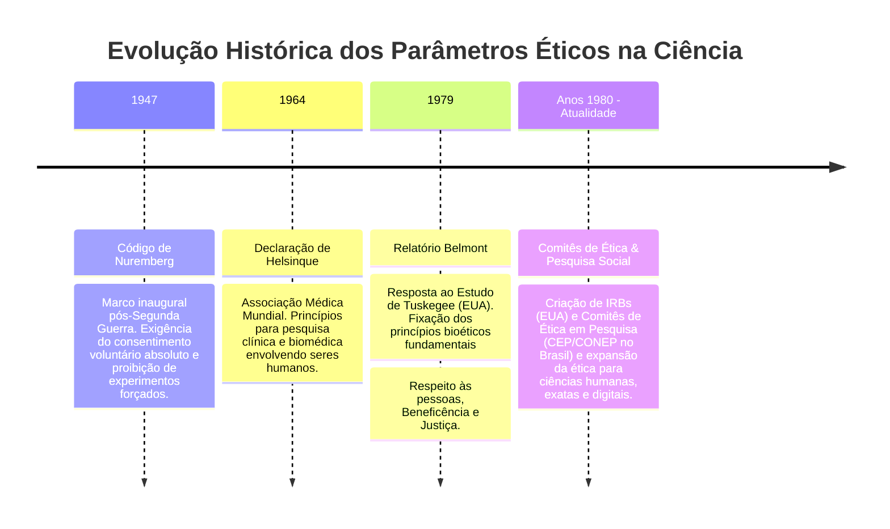
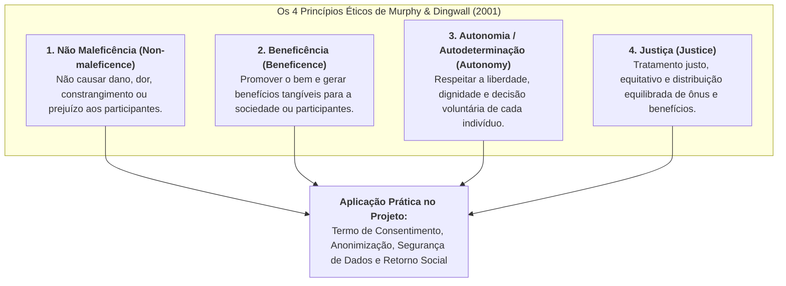
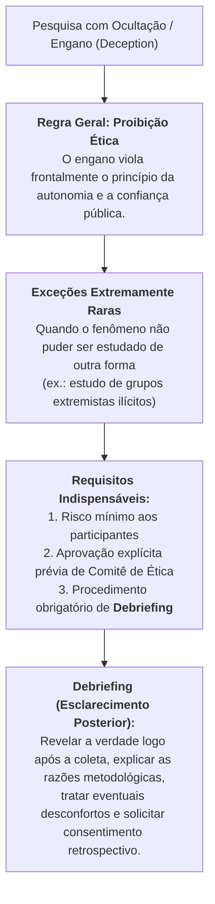

# 📖 Texto-base — Introdução à Metodologia de Pesquisa: Um Guia para Iniciantes

> **Obra:** *Introdução à Metodologia de Pesquisa: um guia para iniciantes*  
> **Autor:** Uwe Flick  
> **Capítulo Indicado:** Capítulo 12 — *Questões éticas na pesquisa social* (p. 207–220)  
> **Editora:** Penso (Porto Alegre, 2012 / 2013)  
> **Disciplina:** Projetos e Métodos para a Produção do Conhecimento (`INT100-EC-2026S2B2-T001`)  
> **Tema da Semana 3:** Comunicação Científica: Rigor e Ética em Pesquisa  

---

## 📌 Visão Geral do Capítulo 12

No **Capítulo 12**, o sociólogo e metodólogo alemão **Uwe Flick** aborda uma das dimensões mais críticas e complexas do fazer científico contemporâneo: **a ética na pesquisa**. O autor argumenta que a preocupação ética não é um mero protocolo burocrático a ser cumprido no início ou no fim de um projeto, mas uma **atitude reflexiva permanente** que atravessa todas as fases da investigação — desde a formulação do problema e a coleta de dados até a análise, publicação e compartilhamento dos resultados.

A pesquisa que envolve pessoas, dados comportamentais, registros institucionais ou impactos socioambientais interfere diretamente na realidade. Portanto, o pesquisador deve antecipar riscos, proteger os participantes contra qualquer forma de dano e agir com integridade, transparência e respeito à dignidade humana.

---

## 🏛️ 1. Origem Histórica e Institucionalização da Ética em Pesquisa

Flick contextualiza que as diretrizes éticas modernas não surgiram de forma abstrata, mas como resposta direta a graves abusos e violações dos direitos humanos praticados sob o pretexto de "progresso científico":

### O Desafio Específico das Ciências Sociais e Tecnológicas:
Embora muitos códigos tenham nascido no contexto biomédico, Flick adverte que as pesquisas sociais e tecnológicas enfrentam dilemas éticos particulares: invasão de privacidade, desconforto psicológico, estigmatização de grupos, uso indevido de dados pessoais e quebra de sigilo por meios computacionais.

---

## ⚖️ 2. Os Quatro Princípios Éticos Fundamentais (Murphy & Dingwall, 2001)

Uwe Flick adota e detalha a teoria baseada em princípios formulada por **Murphy e Dingwall (2001)**, que estabelece quatro pilares deontológicos universais para a condução de investigações:

### Detalhamento dos Princípios:

1. **Princípio da Não Maleficência (*Não Prejuízo*):**
   * O pesquisador tem a obrigação preliminar de avaliar todos os riscos potenciais (físicos, emocionais, profissionais, financeiros ou legais) e mitigá-los.
   * Se houver risco iminente de dano irreversível a um participante, a pesquisa deve ser imediatamente interrompida ou reformulada.
2. **Princípio da Beneficência:**
   * A pesquisa deve justificar sua realização pelo valor social e científico do conhecimento que pretende produzir.
   * Não basta "não prejudicar"; a pesquisa deve almejar contribuir para o avanço da ciência, melhoria de políticas públicas ou aprimoramento de tecnologias benéficas à coletividade.
3. **Princípio da Autonomia e Autodeterminação:**
   * Os participantes são agentes livres e autônomos, devendo ser tratados como parceiros da pesquisa e jamais como meros "objetos" passivos de coleta.
   * Exige que os indivíduos tenham capacidade cognitiva e liberdade para decidir se querem ou não participar, sem coação, suborno ou intimidação institucional.
4. **Princípio da Justiça:**
   * Distribuição equitativa dos ônus e dos ganhos da pesquisa.
   * Proíbe que grupos vulneráveis (como populações de baixa renda, presidiários ou pacientes debilitados) arquem com os riscos e desconfortos experimentais de investigações cujos benefícios econômicos se destinarão exclusivamente a elites sociais.

---

## 📄 3. O Consentimento Livre e Esclarecido (*Informed Consent*)

O **consentimento informado** é o instrumento jurídico e moral central em qualquer pesquisa envolvendo seres humanos. Flick destaca que ele não é apenas a assinatura mecânica de um papel, mas um **processo contínuo de diálogo e esclarecimento**.

### Elementos Obrigatórios do Termo de Consentimento:
1. **Esclarecimento Completo:** Explicação em linguagem clara, acessível e sem jargões sobre os objetivos da pesquisa, os métodos empregados, a duração prevista e as fontes de financiamento.
2. **Transparência sobre Riscos e Benefícios:** Descrição honesta de eventuais desconfortos, incômodos ou riscos, bem como dos benefícios diretos ou indiretos esperados.
3. **Voluntariedade Absoluta:** O indivíduo deve concordar livremente, sem receio de represálias caso recuse.
4. **Direito de Desistência / Retirada:** Garantia explícita de que o participante pode retirar sua autorização a qualquer momento do estudo, sem necessidade de justificativa e sem qualquer penalidade.
5. **Canais de Contato:** Dados de identificação e contato direto do pesquisador responsável e do Comitê de Ética em Pesquisa independente.

---

## 🔒 4. Privacidade, Confidencialidade e Anonimato

Uwe Flick dedica atenção minuciosa à proteção dos dados e das identidades dos pesquisados:

* **Privacidade:** O direito fundamental de cada indivíduo de preservar sua intimidade e decidir o que deseja ou não revelar de sua vida privada.
* **Confidencialidade:** O compromisso explícito do pesquisador de manter sob sigilo profissional todas as informações confidenciais a que teve acesso, não as repassando a terceiros.
* **Anonimização e Codificação:**
  * Substituição imediata dos nomes reais por pseudônimos ou códigos alfanuméricos em transcrições, tabelas e notas de campo.
  * Ocultação de detalhes contextuais (endereços, nomes de empresas, profissões raras) que permitam a reidentificação cruzada do indivíduo.
  * Armazenamento seguro de bases de dados sob criptografia, com controle rigoroso de acesso.

---

## 🎭 5. O Dilema do Engano na Pesquisa (*Deception*) e a Observação Disfarçada

Um dos pontos mais instigantes do Capítulo 12 é a discussão sobre pesquisas em que o pesquisador oculta sua verdadeira identidade ou os reais objetivos do estudo (como em certas observações participantes ou em famosos experimentos de psicologia social, como os de Stanley Milgram):

---

## 🌐 6. A Ética na Era Digital e Pesquisas na Internet

Flick atualiza a discussão metodológica para o ambiente das redes e plataformas digitais:

1. **A Falácia do "Dado Público":** O fato de uma postagem, comentário ou perfil estar acessível na internet (redes sociais, fóruns ou blogs) não autoriza automaticamente o pesquisador a utilizá-lo sem critérios éticos.
2. **Contexto e Expectativa de Privacidade:** Os usuários muitas vezes compartilham informações em grupos esperando que a audiência seja seus pares, e não pesquisadores acadêmicos.
3. **Risco de Rastreabilidade Digital:** Citações literais de postagens de redes sociais em artigos científicos podem ser facilmente localizadas por mecanismos de busca (Google), quebrando o anonimato prometido aos sujeitos. Recomenda-se a paráfrase sintética.

---

## 💻 7. Conexões e Implicações para a Engenharia de Computação

Para os profissionais e estudantes de Engenharia de Computação, as diretrizes de Uwe Flick aplicam-se diretamente às práticas tecnológicas modernas:

| Princípio de Flick | Aplicação na Engenharia de Computação |
| :--- | :--- |
| **Não Maleficência** | Testes exaustivos de software para evitar falhas em sistemas críticos (aeronáutica, medicina, veículos autônomos); prevenção de danos patrimoniais e físicos causados por bugs ou brechas de segurança cibernética. |
| **Autonomia** | Transparência em algoritmos e interfaces (*UX Design*); rejeição a padrões obscuros (*dark patterns*) desenhados para enganar o usuário; termos de uso e políticas de privacidade claros e inteligíveis. |
| **Confidencialidade / Anonimização** | Adoção rigorosa de *Privacy by Design* e conformidade com a LGPD (Lei Geral de Proteção de Dados); criptografia ponta a ponta; técnicas de privacidade diferencial em bases de dados analíticas. |
| **Justiça** | Auditoria de modelos de Aprendizado de Máquina (*Machine Learning*) para identificar e mitigar vieses algorítmicos discriminatórios (raça, gênero, renda) em sistemas automatizados de crédito, contratação ou segurança pública. |

---

## 🎯 Síntese dos Conceitos Essenciais para Provas e Trabalhos

* **Ética em pesquisa** = Atitude reflexiva contínua em todo o ciclo de investigação, e não mero formulário formal.
* **4 Princípios de Murphy e Dingwall** = Não maleficência (não causar dano), beneficência (gerar bem), autonomia (livre arbítrio) e justiça (equidade na distribuição de ônus e bônus).
* **Termo de Consentimento Livre e Esclarecido** = Documento que assegura informação clara, voluntariedade plena e o direito irrevogável de desistir a qualquer momento.
* **Engano / Observação encoberta** = Prática excepcionalíssima que exige justificativa extrema, aprovação em comitê e sessão obrigatória de *debriefing* (esclarecimento posterior).
* **Pesquisa na Internet** = Requer cuidado redobrado com a expectativa de privacidade e proteção contra a quebra de anonimato por ferramentas de busca.
