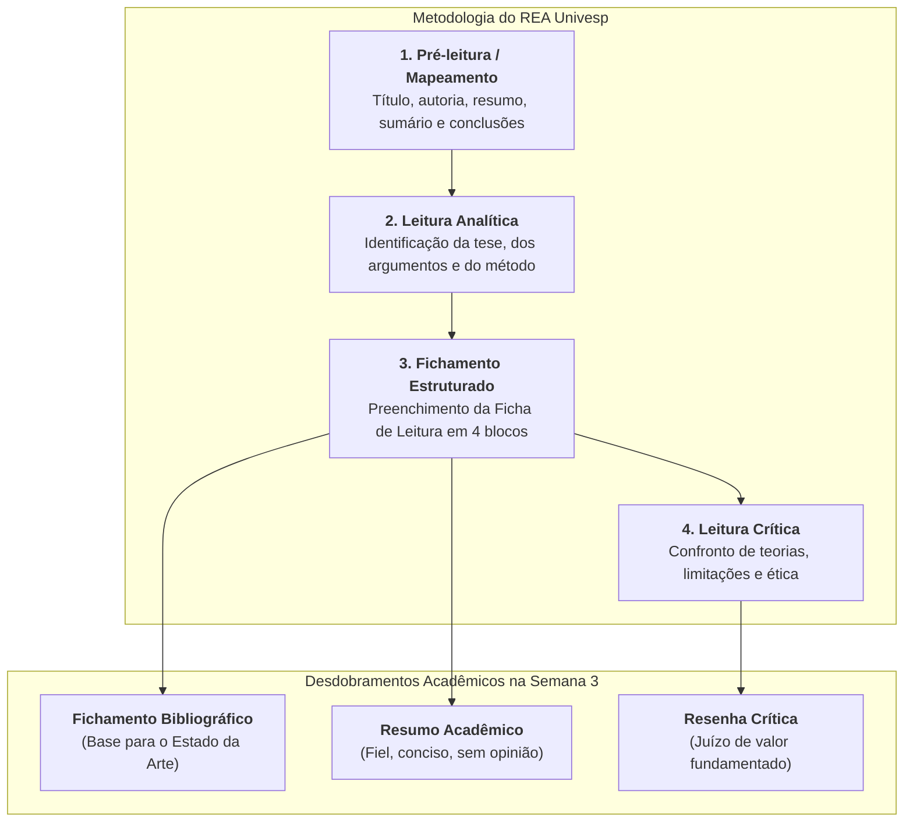

# 📖 Material de Apoio — Estratégias de Leitura Acadêmica (REA Univesp)

> **Disciplina:** Projetos e Métodos para a Produção do Conhecimento (`INT100-EC-2026S2B2-T001`)  
> **Tema da Semana 3:** Comunicação Científica: Rigor e Ética em Pesquisa  
> **Recurso Educacional Aberto (REA):** [Estratégias de Leitura Acadêmica — Univesp](https://apps.univesp.br/estrategias-de-leitura-academica/)  
> **Vídeo Explicativo no YouTube:** [Assistir no YouTube (Univesp)](https://www.youtube.com/watch?v=pxJ5wFcuwBg)  
> **Resumo Oficial em PDF:** [Download do Resumo das Estratégias (Google Drive)](https://drive.google.com/file/d/18bl8YvoYb8PhkcKHWJ8VEQS7QUYdawa_/view)  

---

## 📌 Contexto e Função do REA na Semana 3

Na **Semana 3**, o estudo das estratégias de leitura acadêmica atinge sua maturidade prática. Enquanto na semana anterior o foco era a postura científica, agora o REA é convocado como ferramenta indispensável para:
1. **Instrumentalizar o Levantamento Bibliográfico ("Estado da Arte"):** Permitir que o estudante processe rapidamente as 5 publicações selecionadas no **Desafio da Semana** sem se perder em volumes massivos de páginas.
2. **Operacionalizar os Três Registros Formais (Videoaula 4):** Fornecer a base estrutural para a elaboração técnica de **Fichamentos**, **Resumos** e **Resenhas Críticas**.
3. **Leitura Rigorosa do Texto-Base:** Analisar em profundidade o Capítulo 12 de Uwe Flick (*Questões éticas na pesquisa social*).



---

## 🧭 As Quatro Fases da Leitura Acadêmica Eficiente

A leitura no ambiente universitário não é linear nem passiva. O REA Univesp divide o processo em 4 passos metodológicos:

### 1. Pré-leitura (Mapeamento / *Skimming*)
* **Objetivo:** Ter uma visão panorâmica da obra antes de iniciar a leitura detalhada.
* **Onde olhar:** Título, subtítulo, credenciais do autor, data e veículo de publicação, resumo (*abstract*), introdução, títulos das seções e considerações finais.
* **Decisão estratégica:** Avaliar se o texto realmente responde à sua pergunta de pesquisa ou se deve ser descartado/arquivado.

### 2. Leitura Analítica (Compreensão da Arquitetura do Texto)
* **Objetivo:** Compreender a tese central defendida pelo autor e como ela é sustentada logicamente.
* **Técnica:** Identificar as palavras-chave, os conceitos teóricos desconhecidos e as evidências empíricas (dados, tabelas, gráficos, teoremas).
* **Marcação valorativa:** Sublinhar ou destacar apenas as ideias essenciais, evitando pintar parágrafos inteiros.

### 3. Fichamento (Registro Sistemático)
* **Objetivo:** Fixar o conteúdo e criar um repositório pessoal de consulta para evitar ter que reler a obra inteira no futuro.
* **Preenchimento:** Registrar os dados na **Ficha de Leitura Acadêmica** (em meio físico, digital ou planilha).

### 4. Leitura Crítica e Avaliação
* **Objetivo:** Situar a obra no debate acadêmico mais amplo.
* **Reflexão:** Quais são as contribuições da obra? Quais premissas foram assumidas? Existem limitações metodológicas ou vieses não declarados?

---

## 📋 A Ficha de Leitura Acadêmica (Os 4 Blocos Oficiais)

A ferramenta prática do REA organiza o fichamento em 4 blocos estruturais:

| Bloco | Elementos Analisados | Perguntas Norteadoras |
| :--- | :--- | :--- |
| **Bloco 1: Texto como um Todo** | Referência ABNT completa, autor, contexto, assunto e recursos | Quem produziu? Quando e onde foi publicado? Quais fontes e materiais foram utilizados? |
| **Bloco 2: Objetivos e Estrutura** | Tese principal, problema de pesquisa e evidências | Qual é a hipótese ou ideia central defendida? Quais dados, experimentos ou argumentos sustentam essa tese? |
| **Bloco 3: Vocabulário e Conceitos** | Termos técnicos, jargões e definições conceituais | Quais palavras ou conceitos desconhecidos foram identificados e demandaram busca em dicionários/glossários? |
| **Bloco 4: Crítica e Avaliação** | Contribuição, conexões teóricas e limitações | Qual a relevância da obra para o seu projeto? Há divergências com outros autores? Quais as fragilidades do texto? |

---

## 💡 Aplicação Prática: Ficha de Leitura do Texto-base da Semana 3 (Uwe Flick, Cap. 12)

Abaixo, demonstra-se a aplicação completa da metodologia do REA sobre o texto-base oficial da semana:

```markdown
### 📄 FICHA DE LEITURA ACADÊMICA — MODELO UNIVESP

#### BLOCO 1: O TEXTO COMO UM TODO
* **Título:** Questões éticas na pesquisa social (Capítulo 12)
* **Autor:** Uwe Flick (Professor de Métodos Qualitativos na Alice Salomon University of Applied Sciences, Berlim)
* **Publicação:** In: FLICK, Uwe. Introdução à Metodologia de Pesquisa: um guia para iniciantes. Porto Alegre: Penso, 2012. p. 207-220.
* **Assunto:** Ética na investigação científica, proteção dos sujeitos de pesquisa, consentimento informado e comitês de ética.
* **Recursos:** Revisão da literatura internacional, códigos de ética profissional, marcos históricos (Nuremberg, Belmont) e arcabouço de Murphy & Dingwall (2001).

---

#### BLOCO 2: OBJETIVOS E ESTRUTURA
* **Tese / Objetivos:** Demonstrar que a ética não é um obstáculo burocrático, mas uma dimensão estruturante de todo o projeto de pesquisa. A ciência social e tecnológica afeta vidas humanas e, portanto, o pesquisador tem a obrigação moral e metodológica de proteger a integridade, privacidade e autonomia dos participantes.
* **Evidências Apresentadas:**
  1. Análise comparativa dos códigos de ética de associações científicas internacionais.
  2. Demonstração dos 4 princípios fundamentais de Murphy e Dingwall: Não Maleficência, Beneficência, Autonomia e Justiça.
  3. Protocolos práticos para redação de Termos de Consentimento Livre e Esclarecido e procedimentos de debriefing em pesquisas com ocultação.

---

#### BLOCO 3: LEITURA E COMPREENSÃO TEXTUAL
* **Conceitos e Termos Técnicos Identificados:**
  * *Non-maleficence (Não Maleficência):* Princípio que impõe o dever de não causar dano intencional nem previsível.
  * *Informed Consent (Consentimento Informado):* Processo contínuo de esclarecimento voluntário sem coação.
  * *Deception (Engano / Ocultação):* Prática experimental de omitir a real hipótese aos sujeitos, exigindo posterior esclarecimento (*debriefing*).
  * *Institutional Review Boards (IRBs / Comitês de Ética):* Órgãos colegiados independentes de revisão ética prévia.

---

#### BLOCO 4: CRÍTICA E AVALIAÇÃO DO TEXTO
* **Contribuição para a Engenharia de Computação:** Fornece o alicerce moral para o desenvolvimento de software centrado no usuário, governança de dados (LGPD), proteção contra vazamentos de dados biométricos e auditoria ética de algoritmos de aprendizado de máquina.
* **Conexão com Outras Obras:** Converge diretamente com as diretrizes de bioética da OMS (2021) e com os alertas de Umberto Eco sobre a honestidade intelectual e o combate ao plágio.
* **Limitações / Pontos de Atenção:** A obra foca predominantemente em metodologias qualitativas de campo (entrevistas, observação). O leitor da área de tecnologia precisa transpor reflexivamente esses conceitos para o ambiente de inteligência artificial generativa, big data e cibersegurança.
```

---

## 💻 Integração com Ferramentas Digitais para Engenharia

Para o estudante de Engenharia de Computação, recomenda-se transpor a Ficha de Leitura do REA para ferramentas digitais escaláveis:
1. **Markdown e Obsidian / Logseq:** Armazenamento em arquivos de texto puro versionados via Git (como este repositório!), permitindo links bidirecionais entre conceitos, autores e disciplinas.
2. **Planilhas Digitais (Google Sheets / Excel):** Excelente para organizar tabelas de levantamento de "estado da arte" durante o TCC ou iniciação científica, facilitando filtros por ano, palavras-chave e tipo de veículo.
3. **Gerenciadores de Referências (Zotero / Mendeley):** Automatizam a importação de metadados de artigos (DOI, autores, revista) e a geração de citações nas normas da ABNT.
