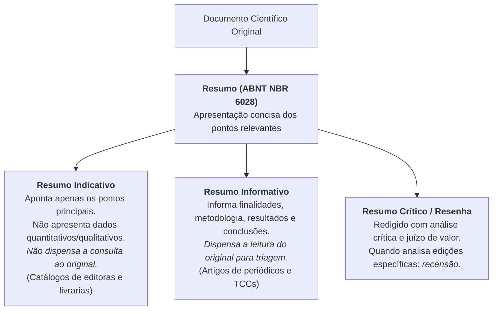
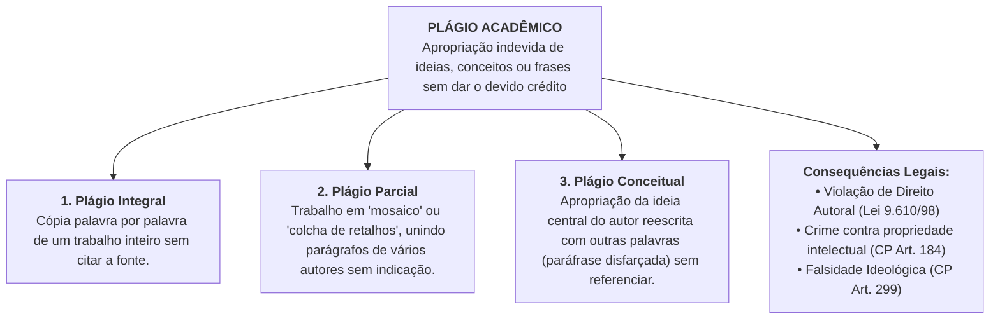
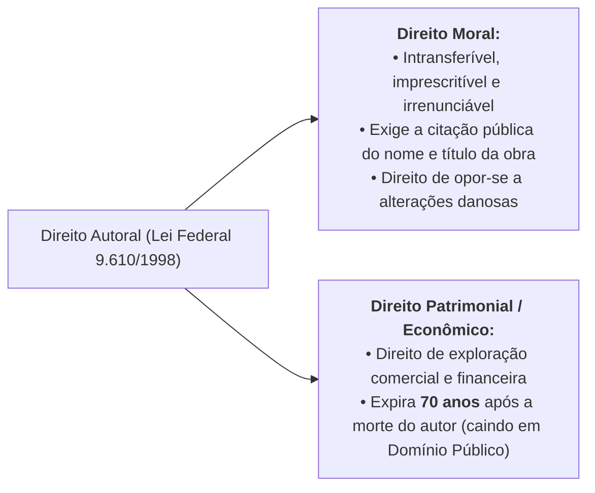

# 🔬 Aprofundando o Tema — Semana 3 (INT100)

> **Disciplina:** Projetos e Métodos para a Produção do Conhecimento (`INT100-EC-2026S2B2-T001`)  
> **Tema da Semana 3:** Comunicação Científica: Rigor e Ética em Pesquisa  
> **Materiais Oficiais de Aprofundamento:**
> 1. **Manual para elaboração de trabalhos acadêmicos (p. 6–9)** — Vera Lúcia Salazar Pessôa (UFU, 2020)
> 2. **Nem tudo que parece é: entenda o que é plágio** — Cartilha da Comissão de Avaliação de Casos de Autoria (UFF)  
> **Arquivos na pasta:** [`s1_material_de_apoio_manual_para_elaboracao_de_trabalhos_academiscos_2020.pdf`](file:///home/henrique/Modelos/Univesp/2026S2B2/INT100-Projetos-e-Metodos-para-a-Producao-do-Conhecimento/Semana-3/s1_material_de_apoio_manual_para_elaboracao_de_trabalhos_academiscos_2020.pdf) e [`s3_aprofundando_plagio.pdf`](file:///home/henrique/Modelos/Univesp/2026S2B2/INT100-Projetos-e-Metodos-para-a-Producao-do-Conhecimento/Semana-3/s3_aprofundando_plagio.pdf)  

---

## 📌 Visão Geral do Aprofundamento

Os dois materiais de aprofundamento da Semana 3 abordam as duas faces inseparáveis da comunicação científica:
1. **A Técnica e a Forma (Pessôa, p. 6–9):** Como redigir com rigor normativo (ABNT NBR 6028) os instrumentos essenciais de comunicação acadêmica — **Resumos** (indicativo, informativo e crítico) e **Resenhas** (exposição e juízo crítico conforme Severino).
2. **A Ética e a Legalidade (Cartilha da UFF):** O que caracteriza o **plágio acadêmico**, suas três modalidades (integral, parcial e conceitual), a tipificação civil e penal (Lei 9.610/98 e Código Penal), e os novos paradigmas de compartilhamento aberto (**Creative Commons** e *Copyleft*).

---

## 📄 Parte 1: Resumo, Sinopse e Resenha (Vera L. S. Pessôa, p. 6–9)

A professora Vera Lúcia Salazar Pessôa estabelece os padrões normativos fundamentados na **ABNT NBR 6028** e na metodologia de **Antônio Joaquim Severino (2000)**.

### 1. Regras de Estilo e Redação do Resumo (NBR 6028)
* **Estrutura interna:** Deve destacar o **objetivo**, o **método**, os **resultados** e as **conclusões** da pesquisa.
* **Formatação de parágrafo:** Deve ser composto por uma sequência de frases concisas e afirmativas em **parágrafo único** (não utilizar tópicos ou marcadores com hífens).
* **Voz e pessoa verbal:** Verbo na **voz ativa** e na **terceira pessoa do singular** (ex.: *"analisa-se"*, *"investigou-se"*, *"o artigo propõe"*).
* **Primeira frase:** Deve ser expressiva e esclarecer de imediato o tema central e o tipo de trabalho (estudo de caso, revisão bibliográfica, ensaio experimental).
* **Palavras-chave:** Devem figurar logo abaixo do resumo, antecedidas por `Palavras-chave:`, separadas entre si por **ponto** e finalizadas também por **ponto** (ex.: *Visão computacional. Aprendizado profundo. Radiologia.*).
* **O que evitar:** Fórmulas complexas, equações, contrações incomuns, símbolos obscuros e citações diretas extensas.

### 2. Extensão Padronizada do Resumo (Contagem de Palavras)

| Tipo de Documento | Extensão Exigida pela ABNT |
| :--- | :---: |
| **Trabalhos Acadêmicos (Teses, Dissertações, TCCs e Relatórios Técnicos)** | **150 a 500 palavras** |
| **Artigos de Periódicos Especializados (Revistas Científicas)** | **100 a 250 palavras** |
| **Indicações Breves (Notas Prévias, Catálogos e Editais)** | **50 a 100 palavras** |
| **Resumos Críticos (Resenhas)** | *Não sujeitos a limite estrito de palavras* |

---

### 3. Estrutura Lógico-Relacional da Resenha Acadêmica (Severino, 2000)

A resenha acadêmica não é um mero resumo, mas sim um trabalho analítico completo composto por 4 momentos:

1. **Cabeçalho:** Referência bibliográfica completa da publicação resenhada segundo as normas da ABNT.
2. **Informação sobre o autor:** Credenciais acadêmicas, linha de pesquisa e relevância na área (dispensável se for autor clássico universalmente consagrado).
3. **Exposição sintética do conteúdo:** Apresentação clara, objetiva e estruturada da tese do autor, acompanhando a evolução dos capítulos ou blocos temáticos.
4. **Comentário crítico:** Avaliação que o resenhista faz da obra lida:
   * **Aspectos positivos:** Originalidade, contribuição para a ciência, rigor empírico e clareza argumentativa.
   * **Aspectos negativos / Limitações:** Falhas conceituais, incoerências, amostras limitadas ou pressupostos não justificados.
   * **Regra de ouro de Severino:** *“As críticas devem ser dirigidas às ideias e posições do autor, nunca à sua pessoa ou às condições pessoais de existência.”*

---

## ⚖️ Parte 2: A Ética e o Combate ao Plágio (Cartilha da UFF)

A cartilha da Universidade Federal Fluminense (*Nem tudo que parece é: entenda o que é plágio*) desmistifica a falsa crença de que plágio é apenas a cópia literal integral de um trabalho.

### 1. Os Três Tipos de Plágio (Lécio Ramos / UFF)
1. **Plágio Integral:** Ocorre quando o estudante copia um artigo, TCC ou capítulo na íntegra e simplesmente coloca seu nome como autor.
2. **Plágio Parcial:** É a montagem de um "mosaico" textual com trechos de múltiplos autores recortados da internet ou livros, sem indicar que são citações de terceiros.
3. **Plágio Conceitual (O mais sutil e comum):** O estudante altera a redação das frases (parafraseia), mas utiliza toda a linha de raciocínio, estrutura teórica e descobertas do autor original **sem citar a fonte**, fazendo a ideia parecer genuinamente sua.

---

### 2. O Erro da "Colcha de Retalhos" e a Escrita Acadêmica Legítima
A cartilha da UFF alerta que **mesmo colocando a referência no final**, empilhar sucessivos parágrafos com citações literais (sem costura argumentativa própria) é um erro metodológico grave:
* O papel do estudante-pesquisador não é ser um compilador mecânico de frases alheias.
* O texto deve ser **autoral**: o estudante deve explicar com suas próprias palavras o que compreendeu dos autores, dialogar criticamente com eles, trazer exemplos da realidade e delimitar com precisão o que é reflexão própria e o que pertence aos autores citados.

---

### 3. Propriedade Intelectual e Direito Autoral na Legislação Brasileira

A proteção jurídica das criações intelectuais é regida por duas esferas:

* **Código Penal Brasileiro:**
  * **Art. 184:** Crime de violação de direito autoral (pena de detenção ou reclusão e multa).
  * **Art. 299:** Falsidade ideológica (omitir declaração ou inserir declaração falsa em documento para prejudicar direito ou criar obrigação).

---

### 4. O Movimento Creative Commons e o *Copyleft*

Em resposta ao modelo restritivo do *copyright* tradicional (*"Todos os direitos reservados"*), o jurista Lawrence Lessig (Universidade de Stanford, 2001) criou o **Creative Commons**, fundamentado na filosofia do *copyleft* (*"Alguns direitos reservados"*):

| Licença | Sigla | O que Permite e Exige? |
| :--- | :---: | :--- |
| **Atribuição** | **BY** | Permite distribuir, remixar e criar obras derivadas (inclusive comerciais), **desde que atribuído o crédito original**. É a mais aberta. |
| **Atribuição + Compartilha Igual** | **BY-SA** | Permite remixar e comercializar, mas exige que a obra derivada seja licenciada **sob os mesmos termos** (modelo das licenças de software livre como GPL). |
| **Atribuição + Sem Derivações** | **BY-ND** | Permite uso comercial e não comercial da obra original **completa e inalterada**, com citação do autor. Proíbe obras derivadas. |
| **Atribuição + Não Comercial** | **BY-NC** | Permite remixar e criar derivadas, **vedado qualquer uso comercial**. As derivadas não precisam ter a mesma licença. |
| **Atribuição + Não Comercial + Compartilha Igual** | **BY-NC-SA** | Permite criar obras derivadas **não comerciais**, exigindo que a nova criação mantenha a mesma licença Creative Commons. |
| **Atribuição + Não Comercial + Sem Derivações** | **BY-NC-ND** | **A mais restritiva de todas:** permite apenas o download e compartilhamento gratuito da obra inalterada com citação, sem fins comerciais nem modificações. |

---

## 💻 Conexões Diretas com a Engenharia de Computação

1. **Licenciamento de Software Livre vs. Plágio de Código:**  
   * O código-fonte de programas de computador é protegido pela Lei 9.610/98 e pela Lei de Software (Lei 9.609/98).  
   * Copiar algoritmos ou trechos de código do GitHub ou Stack Overflow sem respeitar as licenças (MIT, Apache, GPL) configura violação de direito autoral e plágio tecnológico.
2. **Engenharia de Prompt e IA Generativa:**  
   * Utilizar ferramentas de IA (como ChatGPT ou Copilot) para gerar códigos ou textos acadêmicos sem verificação, revisão crítica e declaração metodológica fere o rigor científico e pode configurar plágio automatizado por alucinação.
3. **Resumos Técnicos de Alta Eficiência:**  
   * A capacidade de condensar projetos de software complexos em resumos informativos de 150 a 250 palavras é exigida em chamadas de projetos de inovação tecnológica (FINEP, EMBRAPII, FAPESP PIPE).
