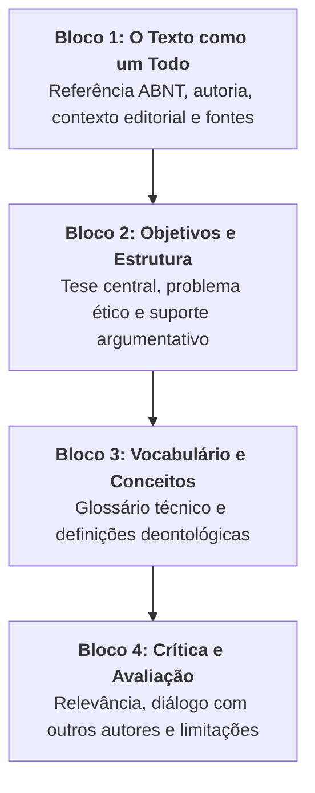

# 📝 Exercício de Apoio — Semana 3 (INT100)

> **Disciplina:** Projetos e Métodos para a Produção do Conhecimento (`INT100-EC-2026S2B2-T001`)  
> **Tema da Semana 3:** Comunicação Científica: Rigor e Ética em Pesquisa  
> **Objeto da Atividade:** Aplicação da Ficha de Leitura Acadêmica (REA Univesp) sobre o Capítulo 12 (*Questões éticas na pesquisa social*, p. 207–220) de **Uwe Flick**  
> **Status:** 🟢 **Concluído e Formatado**  

---

## 📌 Enunciado Oficial da Atividade

> *"Utilizando a ficha disponível no REA Estratégias de leitura acadêmica, execute a atividade ali proposta a partir da leitura do texto-base desta semana: capítulo 12 do livro Introdução à metodologia da pesquisa: um guia para iniciantes, de Uwe Flick."*

---

## 🧭 Metodologia Aplicada

Seguindo as diretrizes do **Recurso Educacional Aberto (REA) da Univesp** e as orientações da **Videoaula 4 (Profª Darlene Ferreira)**, este exercício desdobra-se em três etapas complementares:
1. **Preenchimento da Ficha de Leitura Acadêmica (4 Blocos Oficiais):** Instrumento sistemático de análise e arquivamento documental.
2. **Resumo Informativo Estruturado (ABNT NBR 6028):** Redação em parágrafo único, voz ativa, terceira pessoa e contagem de palavras padronizada.
3. **Resenha Crítica Acadêmica (Conforme Severino, 2000):** Exame analítico-valorativo com apreciação fundamentada do mérito teórico da obra para a Engenharia de Computação.

---

## 📋 1. Ficha de Leitura Acadêmica Preenchida (Modelo Oficial REA Univesp)

---

### 🔹 BLOCO 1: O Texto como um Todo
* **Referência Bibliográfica Completa (ABNT):**  
  FLICK, Uwe. Questões éticas na pesquisa social (Capítulo 12). In: FLICK, Uwe. **Introdução à metodologia de pesquisa: um guia para iniciantes**. Tradução: Joice Elias Costa. Porto Alegre: Penso, 2012. p. 207-220.
* **Autor e Credenciais:**  
  Uwe Flick é médico, sociólogo e psicólogo alemão, professor emérito de Métodos Qualitativos na Alice Salomon University of Applied Sciences (Berlim) e autor de dezenas de obras de referência mundial em epistemologia e metodologia científica.
* **Publicação e Contexto:**  
  Obra voltada a graduandos e pesquisadores iniciantes. O capítulo 12 integra a *Parte IV (Reflexão e Escrita)*, situando a ética como critério prévio e permanente da prática científica.
* **Assunto Central:**  
  A dimensão moral, regulatória e operacional da ética em investigações científicas com seres humanos: proteção da dignidade, consentimento informado, anonimato, comitês de ética e conduta em ambientes digitais.
* **Recursos e Fontes Utilizadas pelo Autor:**  
  Análise de códigos de ética internacionais (Associação Sociológica Alemã, Associação Britânica de Sociologia), marcos históricos biomédicos (Nuremberg, Declaração de Helsinque, Relatório Belmont) e o modelo bioético quadripartite de Murphy e Dingwall (2001).

---

### 🔹 BLOCO 2: Objetivos e Estrutura do Texto
* **Tese Central do Autor:**  
  A ética não é um obstáculo burocrático ou mero formulário administrativo, mas uma **postura reflexiva irrenunciável** que deve orientar todas as decisões do pesquisador. Toda investigação que interfere na vida de pessoas deve salvaguardar a autonomia dos sujeitos e garantir que os benefícios sociais superem categoricamente eventuais desconfortos experimentais.
* **Problema de Pesquisa Abordado:**  
  Como equilibrar o direito da ciência de investigar fenômenos sociais e psicológicos complexos com o dever absoluto de proteger a integridade física, moral e a privacidade dos participantes?
* **Evidências e Argumentos Estruturais Apresentados:**
  1. *O arcabouço de Murphy & Dingwall (2001):* Demonstração de que a conduta ética se ancora em quatro princípios: Não Maleficência, Beneficência, Autonomia e Justiça.
  2. *Grupos vulneráveis:* Análise da incapacidade legal/cognitiva de crianças ou pacientes com demência, exigindo consentimento de responsáveis legais.
  3. *Pesquisa com engano (deception):* Exame das condições restritivas em que a omissão temporária de hipóteses é tolerada para evitar viés de reatividade, exigindo aprovação prévia em comitês e sessão imediata de *debriefing*.
  4. *O papel dos Comitês de Ética (IRBs):* Mecanismo colegiado e independente que detém autoridade para aprovar, exigir adequações ou rejeitar projetos antes de sua execução.

---

### 🔹 BLOCO 3: Leitura, Vocabulário e Compreensão Textual
Glossário de termos técnicos essenciais analisados no capítulo:

* **Não Maleficência (*Non-maleficence*):** Obrigação deontológica de antecipar e mitigar qualquer forma de dano (físico, moral, financeiro ou jurídico) aos participantes.
* **Beneficência (*Beneficence*):** Diretriz de que a pesquisa deve produzir um saldo positivo de contribuições reais para o bem comum e avanço do saber.
* **Autonomia (*Autonomy*):** Respeito à capacidade de autodeterminação dos indivíduos, que devem decidir livremente sobre sua participação sem pressões institucionais ou financeiras.
* **Consentimento Livre e Esclarecido (*Informed Consent*):** Processo comunicativo transparente em que o participante é plenamente informado sobre objetivos, métodos, riscos, benefícios e garantia irrevogável de retirada sem penalidades.
* **Comitê de Ética em Pesquisa (CEP / IRB):** Colegiado interdisciplinar independente que avalia o mérito ético de projetos científicos.
* **Engano Metodológico (*Deception*):** Omissão ou dissimulação deliberada dos reais objetivos do estudo durante a coleta de dados, visando preservar a espontaneidade dos sujeitos.
* **Debriefing (Esclarecimento Posterior):** Sessão obrigatória realizada logo após o experimento disfarçado, onde o pesquisador revela a verdade, justifica a necessidade metodológica e acolhe eventuais desconfortos do participante.

---

### 🔹 BLOCO 4: Crítica e Avaliação do Texto
* **Contribuição da Obra para a Área:**  
  Desmistifica a ideia de que a ética em pesquisa é exclusiva da medicina ou biologia. Demonstra que cientistas sociais, educadores e cientistas da computação lidam rotineiramente com dados sensíveis e vulnerabilidades humanas.
* **Conexões Intertextuais:**  
  * Conecta-se diretamente com o livro *Como se faz uma tese* de Umberto Eco, ao reforçar que a integridade da autoria e o combate ao plágio são imperativos éticos.
  * Harmoniza-se com as diretrizes da Organização Mundial da Saúde (OMS, 2021) sobre a ética na inteligência artificial e processamento de dados biomédicos.
* **Limitações e Fragilidades Identificadas:**  
  O autor privilegia cenários clássicos de pesquisa presencial de campo (entrevistas qualitativas e observações participantes). O capítulo discute de forma apenas introdutória os dilemas modernos de coleta massiva de dados por algoritmos de *web scraping*, mineração de dados em redes sociais e termos de consentimento em ambientes digitais automatizados.

---

## 📄 2. Resumo Informativo Estruturado (Conforme ABNT NBR 6028)

Abaixo, apresenta-se o resumo da obra redigido estritamente segundo as exigências normativas da ABNT:

> **Referência:** FLICK, Uwe. Questões éticas na pesquisa social. In: FLICK, Uwe. **Introdução à metodologia de pesquisa**. Porto Alegre: Penso, 2012. p. 207-220.
>
> O capítulo analisa a centralidade da ética na prática da pesquisa empírica, caracterizando-a como um processo reflexivo permanente e indispensável à integridade científica. Fundamenta-se no arcabouço teórico de Murphy e Dingwall (2001), estruturado em quatro princípios universais: a não maleficência, a beneficência, o respeito à autonomia e a justiça na distribuição de ônus e benefícios. Examina detalhadamente as exigências do consentimento livre e esclarecido, demonstrando sua imprescindibilidade e os protocolos de proteção direcionados a grupos vulneráveis incapazes de consentir de forma autônoma. Discute o papel regulatório e formativo dos comitês de ética institucionais, habilitados a aprovar, emendar ou vetar investigações antes de sua execução. Aborda criticamente o dilema do engano e da observação disfarçada, delimitando-os como exceções metodológicas extremas que demandam aprovação colegiada e sessões obrigatórias de esclarecimento posterior (*debriefing*). Conclui destacando os novos desafios éticos suscitados pelo ambiente digital e pela pesquisa na internet, alertando que a acessibilidade pública de dados não isenta o pesquisador da preservação da privacidade e da dignidade dos sujeitos.
>
> **Palavras-chave:** Ética em pesquisa. Consentimento informado. Grupos vulneráveis. Comitês de ética. Metodologia científica.

---

## 📑 3. Resenha Crítica Acadêmica (Conforme Antônio Joaquim Severino, 2000)

### 📌 Cabeçalho
FLICK, Uwe. Questões éticas na pesquisa social (Capítulo 12). In: FLICK, Uwe. **Introdução à metodologia de pesquisa: um guia para iniciantes**. Porto Alegre: Penso, 2012. p. 207-220.

### 📌 Informações sobre o Autor
Uwe Flick é professor sênior de métodos qualitativos de pesquisa em Berlim, com ampla trajetória acadêmica na Europa e nos Estados Unidos. Sua produção bibliográfica é caracterizada pela clareza pedagógica e pela busca de rigor metodológico combinado à sensibilidade humana.

### 📌 Exposição do Conteúdo
No Capítulo 12, Flick desenvolve uma síntese concisa e profunda dos dilemas éticos que cercam a pesquisa com pessoas. O texto divide-se em seções lógicas: (a) a evolução histórica dos códigos de conduta a partir dos abusos cometidos no século XX; (b) a tradução operacional dos princípios de não maleficência, beneficência, autonomia e justiça; (c) o consentimento informado como processo e não como mera formalidade burocrática; (d) a salvaguarda de populações vulneráveis; (e) a excepcionalidade da pesquisa com engano e o imperativo do *debriefing*; e (f) as fronteiras éticas da pesquisa eletrônica.

O autor demonstra que nenhuma pergunta de pesquisa, por mais nobre ou inovadora que seja, justifica expor participantes a riscos desnecessários, humilhação ou quebra de confidencialidade. A ética é apresentada como a própria condição de validade da ciência.

### 📌 Comentário Crítico e Avaliação
A grande virtude do texto de Uwe Flick reside em sua capacidade de afastar o moralismo abstrato e oferecer critérios operacionais claros para o pesquisador em formação. A adoção dos princípios de Murphy e Dingwall confere sobriedade e aplicabilidade prática ao capítulo.

Para os estudantes de **Engenharia de Computação**, a leitura revela-se extraordinariamente atual. Na era dos algoritmos de aprendizado profundo (*Deep Learning*) e da inteligência artificial aplicada ao diagnóstico médico e à vigilância, as fronteiras da ética deslocaram-se do laboratório físico para os códigos e servidores digitais. O princípio da não maleficência se traduz na segurança cibernética e no combate aos vieses algorítmicos discriminatórios; a autonomia se manifesta na explicabilidade dos modelos (*Explainable AI*); e a confidencialidade exige o cumprimento rigoroso da Lei Geral de Proteção de Dados (LGPD).

Em termos de limitações, o texto de Flick ressente-se de não aprofundar os impactos dos grandes modelos computacionais e da governança automatizada de dados, lacuna compreensível pela data de sua edição original. Não obstante, seus fundamentos permanecem intocados: a ciência só é verdadeiramente humana quando pautada pela honestidade, pelo rigor metodológico e pela intransigente defesa da dignidade de todos os seres envolvidos.
