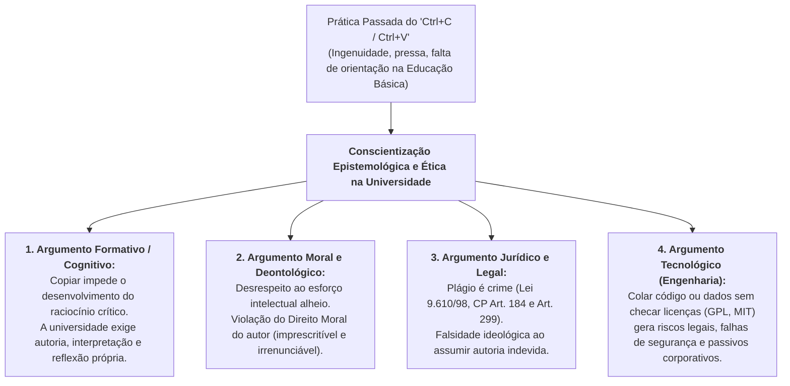

# 💬 Fórum Temático — Semana 3 (INT100)

> **Disciplina:** Projetos e Métodos para a Produção do Conhecimento (`INT100-EC-2026S2B2-T001`)  
> **Tema da Semana 3:** Comunicação Científica: Rigor e Ética em Pesquisa  
> **Título do Fórum:** *"A cópia, sem indicar a fonte, é um erro!"*  
> **Status:** 🟢 **Modelos Prontos para Postagem no AVA**  

---

## 📌 Enunciado Oficial do Fórum

> *"Para desafio:*  
> *Vamos nessa semana debater algo que é uma prática comum, mas desrespeitosa, não ética, o uso do “control C/control V” sem critério. Procure identificar: quantas vezes você praticou isso? para quais situações? por quais razões?*  
> *Agora, diante do que você aprendeu nesta semana, pense: foi correto? Você entende que na vida acadêmica isso não poderá acontecer? Reflita e apresente argumentos que validem o título do nosso fórum: a cópia, sem indicar a fonte, é um erro!"*

---

## 🧠 Mapa Conceitual da Discussão

---

## 📝 Modelos Prontos de Postagem para o AVA

Abaixo estão opções completas para a sua postagem principal. A **Opção 1** é a mais recomendada, pois articula uma postura honesta de amadurecimento com a realidade do curso de **Engenharia de Computação**.

---

### 📌 Opção 1 (Recomendada — Reflexiva, Pessoal e com Foco em Engenharia)
*(Texto puro, pronto para copiar e colar no AVA)*

> **Título:** Da Reprodução Mecânica à Autoria Acadêmica: Por que o "Copiar e Colar" sem Fonte é Inadmissível
>
> Olá, professora Graziella, mediadores e colegas de turma!
>
> Ao refletir honestamente sobre a provocação deste fórum, admito que, durante a educação básica e nos primeiros contatos com a internet anos atrás, o uso do "Ctrl+C / Ctrl+V" era uma prática quase automática. Muitas vezes recorríamos a isso por pressa, pela ilusão de que a internet era uma "terra sem dono" onde tudo estava disponível para livre apropriação e, principalmente, pela ausência de um letramento acadêmico que nos ensinasse a diferença entre compilar informações e construir conhecimento.
>
> Olhando retrospectivamente à luz do que estudamos esta semana com a professora Darlene, o livro de Uwe Flick e a cartilha da UFF, fica cristalino que essa prática **não foi correta** e que, no ambiente universitário e profissional da Engenharia, ela é **totalmente inadmissível**.
>
> Apresento quatro argumentos centrais que validam o título *"A cópia, sem indicar a fonte, é um erro!"*:
>
> 1. **Bloqueio do Desenvolvimento Intelectual:** A cópia mecânica nos impede de realizar o salto do senso comum para o pensamento científico. Quem apenas cola trechos de terceiros não aprende a sintetizar, não desenvolve vocabulário técnico e não adquire espírito crítico.
> 2. **Desrespeito ao Direito Moral do Autor:** Conforme a Lei 9.610/98 e a ética universal da ciência, o reconhecimento da autoria é um direito moral imprescritível. Apropriar-se de ideias alheias — seja por plágio integral, parcial ou conceitual (paráfrase sem citação) — é uma fraude que invisibiliza o esforço de quem pesquisou.
> 3. **Consequências Legais e Profissionais:** O plágio é tipificado como crime no Código Penal Brasileiro (Art. 184 — violação autoral; Art. 299 — falsidade ideológica). Na vida profissional de um engenheiro, assinar um laudo, projeto ou código alheio acarreta sanções cíveis, criminais e cassação do registro no CREA.
> 4. **Risco Tecnológico no Desenvolvimento de Software:** Na Engenharia de Computação, o hábito negligente de "copiar e colar" trechos de código de repositórios (GitHub, Stack Overflow) sem verificar licenças de código aberto (GPL, MIT, Apache) gera passivos jurídicos milionários para empresas e introduz vulnerabilidades críticas de segurança em sistemas computacionais.
>
> Aprender a citar (conforme a ABNT) e a expressar ideias com as próprias palavras não engessa a escrita; pelo contrário, dá legitimidade e autoridade científica ao nosso trabalho.
>
> Um abraço e excelentes reflexões a todos!

---

### 📌 Opção 2 (Mais Sintética e Direta)

> **Título:** A Ética da Pesquisa: Por que a Cópia sem Fonte Destrói a Credibilidade Científica
>
> Olá, professora e colegas!
>
> É comum que muitos estudantes, antes de ingressarem no ensino superior, tenham praticado o "Ctrl+C / Ctrl+V" em trabalhos escolares, motivados pela facilidade da busca digital e pela falta de orientação metodológica.
>
> No entanto, ao compreendermos os fundamentos da comunicação científica nesta semana, fica evidente que **a cópia sem indicação da fonte é um erro gravíssimo**, por três razões fundamentais:
>
> • **Ética e Honestidade Intelectual:** Todo conhecimento novo nasce apoiado em conhecimentos prévios ("nos ombros de gigantes"). Ocultar a fonte é apropriação indevida e violação dos direitos autorais (Lei 9.610/98).
> • **Fraude Acadêmica:** O plágio (seja ele integral, em mosaico ou conceitual) anula o propósito da universidade, que é avaliar a capacidade de raciocínio, análise e escrita do próprio estudante.
> • **Rastreabilidade da Ciência:** A ciência exige reprodutibilidade e verificação. Se não citamos a fonte exata, impedimos que outros pesquisadores chequem os dados e validem os argumentos.
>
> A citação correta e a paráfrase fundamentada demonstram maturidade, honestidade e respeito à comunidade científica.
>
> Bons estudos a todos!

---

### 📌 Modelos de Réplica para Interação com Colegas

#### Modelo A:
> Olá, [Nome do Colega]!  
> Concordo plenamente com a sua colocação. Você tocou em um ponto fundamental: a transição da escola para a universidade exige essa mudança de postura. O "copiar e colar" muitas vezes decorria de uma falsa sensação de produtividade. Na vida universitária, percebemos que o verdadeiro valor de um trabalho acadêmico está na nossa capacidade de interpretar o autor e articular as ideias com senso crítico. Excelente contribuição!

#### Modelo B:
> Olá, [Nome do Colega]!  
> Muito pertinente sua reflexão. Como você bem destacou, dar crédito aos autores originais não enfraquece o nosso texto; pelo contrário, fortalece nossa argumentação, pois demonstra que realizamos um levantamento bibliográfico sério e que nossas afirmações têm respaldo na literatura científica reconhecida. Parabéns pela clareza!
