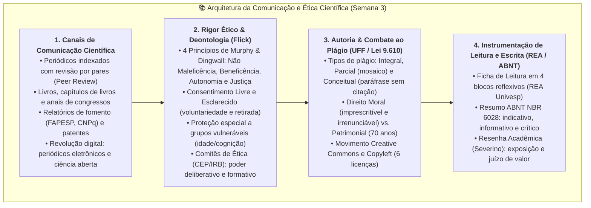
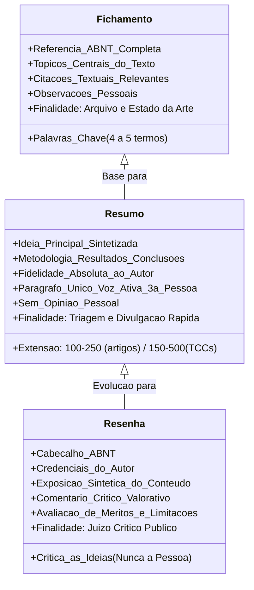

# 📌 Em Síntese — Semana 3 (INT100)

> **Disciplina:** Projetos e Métodos para a Produção do Conhecimento (`INT100-EC-2026S2B2-T001`)  
> **Tema da Semana 3:** Comunicação Científica: Rigor e Ética em Pesquisa  
> **Docente Responsável:** Profª Dra. Graziella Ribeiro Soares Moura  
> **Período:** 12/10/2026 a 25/10/2026  
> **Status:** 🟢 **Semana 3 Concluída com Sucesso (Nota 10,0 / 10,0)**  

---

## 🎯 Síntese e Consolidação dos Conteúdos da Semana

Ao concluir a terceira semana de estudos de INT100, consolidamos o entendimento de que a ciência é essencialmente um patrimônio público e dialógico: uma investigação rigorosa só atinge sua plenitude quando seus métodos, dados e conclusões são **comunicados com clareza, transparência e estrito rigor ético** para a validação da comunidade acadêmica e o avanço da sociedade.

Apreendemos a transição indispensável da postura de mero compilador para a de **pesquisador-autor**, dominando a distinção técnica entre **fichamentos**, **resumos** e **resenhas**, bem como a compreensão inegociável de que a apropriação indevida de ideias alheias (plágio) é uma fraude moral, epistemológica e jurídica.

---

## 🏛️ 1. O Tripé da Produção e Comunicação Científica

### A. O Ciclo Editorial e a Revisão por Pares (*Peer Review*)
Como demonstrado pelo neurocientista Miguel Nicolelis e pela professora Darlene Ferreira:
1. **Submissão e Triagem:** O manuscrito é submetido a uma revista científica indexada e passa pela avaliação do editor-chefe.
2. **Avaliação Cega por Pares (*Blind Peer Review*):** Cientistas independentes da mesma área avaliam anonimamente o rigor estatístico, a originalidade, a metodologia e a solidez teórica.
3. **Reprodutibilidade:** Publicar é fornecer todas as coordenadas para que qualquer outro cientista no mundo possa replicar o experimento e validar os resultados.

---

### B. O Arcabouço Ético Fundamental (Uwe Flick & Murphy & Dingwall)

| Princípio | Significado Epistemológico | Aplicação Prática no Projeto |
| :--- | :--- | :--- |
| **Não Maleficência** | Obrigação ativa de prever e impedir qualquer dano físico, moral, financeiro ou jurídico. | Anonimização de dados, controle de riscos e suspensão imediata de testes danosos. |
| **Beneficência** | A pesquisa deve justificar-se por um saldo positivo de contribuições reais para a sociedade. | Relevância social do tema e devolução dos achados à comunidade estudada. |
| **Autonomia** | Respeito à liberdade, dignidade e livre arbítrio dos participantes (tratados como sujeitos). | Termo de Consentimento Livre e Esclarecido (TCLE) com garantia de desistência sem penalidades. |
| **Justiça** | Distribuição equitativa de ônus e benefícios da investigação. | Proteção contra a exploração de grupos vulneráveis (crianças, idosos, populações hospitalizadas). |

---

### C. Instrumentos Acadêmicos de Registro: Fichamento, Resumo e Resenha

---

## ⚖️ 2. A Proteção da Autoria: Legislação e Creative Commons

* **Lei Federal nº 9.610/1998 (Direitos Autorais):**
  * **Direito Moral:** Intransferível, irrenunciável e imprescritível. Assegura a menção de nome e obra, oposição a alterações que prejudiquem a reputação e manutenção de ineditismo.
  * **Direito Patrimonial / Econômico:** Expira 70 anos após a morte do autor, quando a obra ingressa em Domínio Público.
* **Tipificação Penal:**
  * **Art. 184 do Código Penal:** Crime de violação de direito autoral.
  * **Art. 299 do Código Penal:** Falsidade ideológica (fazer passar por sua uma obra ou ideia criada por outrem).
* **Creative Commons:** Alternativa ao *copyright* estrito, permitindo ao autor conceder direitos modulares ao público (*BY*, *BY-SA*, *BY-ND*, *BY-NC*, *BY-NC-SA*, *BY-NC-ND*).

---

## ✅ Autoavaliação de Metas e Competências da Semana 3

Verifique o atingimento das metas de aprendizagem oficiais estabelecidas no AVA para a Semana 3:

* [x] **Entendi o funcionamento da produção e divulgação científica.**  
  *(Compreensão do ciclo de publicação, canais formais, periódicos indexados, avaliação cega por pares e o papel da reprodutibilidade científica).*
* [x] **Conheci e apreendi como identificar as formas de comunicação científica.**  
  *(Diferenciação clara entre relatórios de fomento, artigos científicos, anais de congressos, patentes de inovação e divulgação científica em meios digitais).*
* [x] **Aprendi a ler um texto e elaborar fichamento, resumo e resenha.**  
  *(Aplicação dos 4 blocos da Ficha de Leitura do REA ao Capítulo 12 de Uwe Flick, redação de resumo normativo pela ABNT NBR 6028 e resenha crítica segundo Severino).*

---

## 🧭 Conexão com a Próxima Semana (Semana 4)

Na **Semana 4**, avançaremos para a **Organização do Trabalho Científico**:
* Normas técnicas fundamentais da ABNT para projetos e monografias.
* Formatação de elementos pré-textuais, textuais e pós-textuais.
* Regras de citação direta, citação indireta e sistemas de chamada (autor-data e numérico).
* Leitura e revisão bibliográfica aprofundada conforme Uwe Flick.
