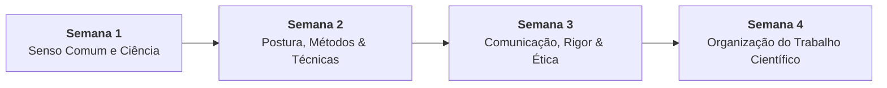

# 📚 Semana 3 — Comunicação Científica: Rigor e Ética em Pesquisa

> **Disciplina:** Projetos e Métodos para a Produção do Conhecimento (`INT100-EC-2026S2B2-T001`)  
> **Curso:** Bacharelado em Engenharia de Computação — Univesp  
> **Docente Responsável:** Profª Dra. Graziella Ribeiro Soares Moura  
> **Período:** 12/10/2026 a 25/10/2026  
> **Status:** 🟢 **100% CONCLUÍDO (Nota 10,0 / 10,0)**  

---

## 🗺️ Índice de Materiais e Atividades

| Arquivo | Descrição | Status |
| :--- | :--- | :---: |
| [**`0-Inicio.md`**](file:///home/henrique/Modelos/Univesp/2026S2B2/INT100-Projetos-e-Metodos-para-a-Producao-do-Conhecimento/Semana-3/0-Inicio.md) | Introdução, Objetivos de Aprendizagem, Ciclo da Comunicação, Desafio Acadêmico (5 palavras-chave e 5 fontes ABNT) e Vídeo de Nicolelis | 🟢 Pronto |
| [**`1-Videoaulas.md`**](file:///home/henrique/Modelos/Univesp/2026S2B2/INT100-Projetos-e-Metodos-para-a-Producao-do-Conhecimento/Semana-3/1-Videoaulas.md) | Síntese da Videoaula 4 (Profª Darlene Ferreira): canais científicos, rigor, ética, leitura crítica, Fichamento, Resumo e Resenha | 🟢 Pronto |
| [**`2-Texto-base-Introducao-Metodologia-Pesquisa-Flick-Cap12.md`**](file:///home/henrique/Modelos/Univesp/2026S2B2/INT100-Projetos-e-Metodos-para-a-Producao-do-Conhecimento/Semana-3/2-Texto-base-Introducao-Metodologia-Pesquisa-Flick-Cap12.md) | Síntese do Capítulo 12 (*Questões éticas na pesquisa social*, p. 207–220) de Uwe Flick: princípios de Murphy & Dingwall, consentimento informado e privacidade | 🟢 Pronto |
| [**`3-Material-de-apoio-REA-Estrategias-de-Leitura-Academica.md`**](file:///home/henrique/Modelos/Univesp/2026S2B2/INT100-Projetos-e-Metodos-para-a-Producao-do-Conhecimento/Semana-3/3-Material-de-apoio-REA-Estrategias-de-Leitura-Academica.md) | Métodos de leitura acadêmica, modelo oficial da Ficha de Leitura (4 blocos) e aplicação completa ao texto de Uwe Flick | 🟢 Pronto |
| [**`4-Aprofundando-o-tema.md`**](file:///home/henrique/Modelos/Univesp/2026S2B2/INT100-Projetos-e-Metodos-para-a-Producao-do-Conhecimento/Semana-3/4-Aprofundando-o-tema.md) | Síntese normativa: Resumo e Resenha (Pessôa, p. 6–9) + Tipos de Plágio, Lei de Direitos Autorais e Creative Commons (Cartilha UFF) | 🟢 Pronto |
| [**`4.1-Exercicio-de-apoio.md`**](file:///home/henrique/Modelos/Univesp/2026S2B2/INT100-Projetos-e-Metodos-para-a-Producao-do-Conhecimento/Semana-3/4.1-Exercicio-de-apoio.md) | Aplicação prática da Ficha de Leitura do REA ao Cap. 12 de Uwe Flick (4 blocos), Resumo ABNT NBR 6028 e Resenha Crítica | 🟢 Pronto |
| [**`4.2-Forum-tematico.md`**](file:///home/henrique/Modelos/Univesp/2026S2B2/INT100-Projetos-e-Metodos-para-a-Producao-do-Conhecimento/Semana-3/4.2-Forum-tematico.md) | Enunciado, reflexão sobre "Ctrl+C / Ctrl+V", argumentos éticos e modelos prontos de postagem e réplica no AVA | 🟢 Pronto |
| [**`5-Atividade-avaliativa.md`**](file:///home/henrique/Modelos/Univesp/2026S2B2/INT100-Projetos-e-Metodos-para-a-Producao-do-Conhecimento/Semana-3/5-Atividade-avaliativa.md) | Resolução analítica completa das 4 questões avaliativas com gabarito oficial fundamentado | 🟢 **Concluído (10,0 / 10,0)** |
| [**`6-Em-sintese.md`**](file:///home/henrique/Modelos/Univesp/2026S2B2/INT100-Projetos-e-Metodos-para-a-Producao-do-Conhecimento/Semana-3/6-Em-sintese.md) | Resumo executivo, arquitetura conceitual da comunicação científica, autoavaliação oficial do AVA e transição para Semana 4 | 🟢 Pronto |

---

## 🧭 Relação com as Demais Semanas

