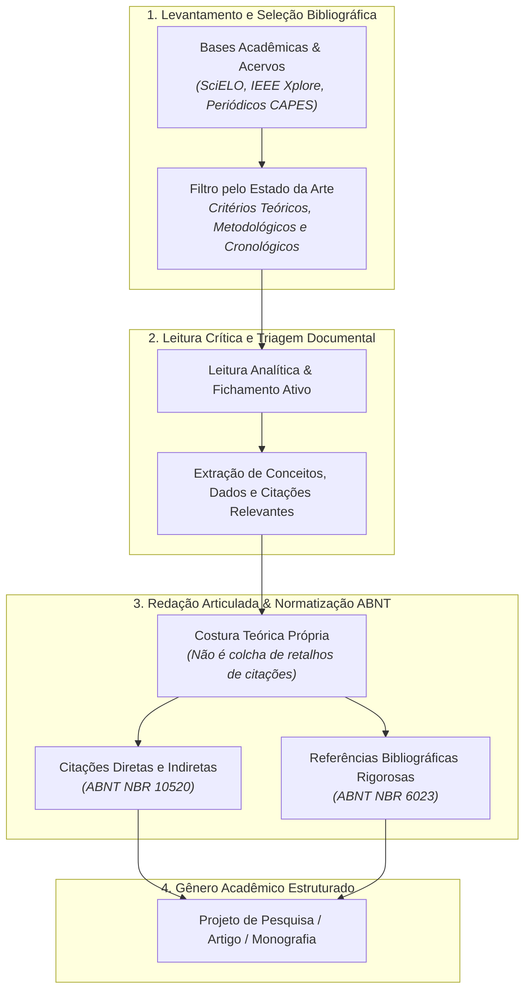

# 📌 Semana 4 — Início & Apresentação da Semana

> **Disciplina:** Projetos e Métodos para a Produção do Conhecimento (`INT100-EC-2026S2B2-T001`)  
> **Tema da Semana 4:** Organização de Trabalho Científico  
> **Docente Responsável:** Profª Dra. Graziella Ribeiro Soares Moura  
> **Período:** 19/10/2026 a 01/11/2026  
> **Status:** 🟢 **Documentação Oficial e Resoluções Estruturadas**  

---

## 👩‍🏫 Mensagem da Professora & Contextualização

Olá, estudante!

Na última semana, você estudou as diferentes formas de se fazer a **comunicação científica**, ou seja, como os resultados das pesquisas desenvolvidas são registrados e tornados públicos.

Você também entendeu o quanto é significativo ter **rigor e ética** no desenvolvimento do trabalho científico. Além disso, começou a ver algumas práticas e formas para divulgação científica, aprendendo a elaborar **resumos, resenhas e fichamentos**.

É claro que, ao se tratar de trabalho científico, **a leitura — o ato de ler — é o pontapé inicial da pesquisa**. Essa leitura permite identificar quais são os princípios básicos que podem ser aplicados em sua pesquisa, já que eles variam conforme o tema, a ênfase, o período histórico e o momento paradigmático que vive a área e a ciência em questão. Direcionamentos filosóficos, técnicos e teóricos demarcam o andamento do conhecimento científico em um dado momento. A ciência e suas áreas correspondentes sofrem alterações através dos anos e essas mudanças são detectadas por meio da consulta bibliográfica, na qual buscamos o **estado da arte** sobre o tema escolhido.

Esta semana é dedicada ao **processo de organização do trabalho científico**, na qual você entenderá questões ligadas à atitude científica trabalhando com os tipos de trabalhos científicos, suas fontes de informação disponíveis em acervos bibliográficos (bibliotecas) e na rede/internet. Você também aprenderá as distintas formas de fazer referências e citações de trabalhos científicos e apreender o que é uma referência e uma citação.

Como visto anteriormente, a comunicação científica é muito importante para o desenvolvimento do conhecimento e ela se dá de formas distintas. Quando se fala em organização do trabalho científico, a fase de levantamento e leitura das publicações ou a chamada **revisão bibliográfica** é de grande importância. Ela permite uma comparação dos documentos científicos (artigos, comunicações, entrevistas etc.) sobre o tema pesquisado. 

Efetuam-se, então, escolhas que resultam da comparação entre o material levantado, destacando aqueles que melhor se adequam ao tema e estão acordados com a postura teórica, filosófica e técnica do pesquisador:
* **Trata-se de um texto organizado**, destacando as ideias que fortalecem a forma que você escolheu para desenvolver sua pesquisa.
* **Não é emendar citações dos documentos ou frases dos autores.**
* **É construir uma redação coerente que articula o seu tema com a literatura.**

Ao lidar com a bibliografia a ser utilizada na pesquisa, o respeito às ideias encontradas nos textos levantados é fundamental. Para isso, há formas distintas de se referenciar esses textos e autores. Nesta semana, você conhecerá as regras existentes para referenciar a bibliografia, ou seja, o material levantado (livros, capítulos de livros, artigos de periódicos, comunicações em congressos etc.), que apoiará teoricamente, filosoficamente ou tecnicamente a pesquisa a ser realizada.

---

## 🔄 Fluxo de Organização do Trabalho Científico

---

## 🎯 Objetivos de Aprendizagem

Ao final desta semana, você deverá ser capaz de:

* [ ] **Identificar e distinguir** os diferentes tipos de trabalhos científicos (artigos, ensaios, relatórios técnicos, comunicações, monografias e dissertações/teses).
* [ ] **Identificar e aprender como referenciá-los e citá-los** conforme as normas técnicas vigentes (ABNT NBR 6023 e NBR 10520).
* [ ] **Identificar os conteúdos específicos** e a estrutura de cada tipo de trabalho científico (elementos pré-textuais, textuais e pós-textuais).
* [ ] **Aprender a reescrever um texto** (técnicas de paráfrase acadêmica, sintetização e reescrita autoral evitando o plágio).

---

## 💡 Desafio da Semana: Da Bibliografia à Redação Preliminar

### 📌 Enunciado Oficial do AVA
> *Prosseguindo com nosso desafio de escrever um projeto de pesquisa, na semana anterior você efetuou uma busca bibliográfica com padrão de pesquisa acadêmica, referenciando livros, capítulos de livros e artigos científicos sobre o tema escolhido por vocês.*  
> 
> *Nesta semana iremos tratar das diferenças existentes entre esse material, passível de uso como bibliografia, e aprender como fazer referências e citações.*  
> 
> *1. Das cinco referências levantadas, selecione três, conforme critérios tratados na videoaula.*  
> *2. Faça a leitura dos textos e selecione palavras-chave, frases e trechos que considerar importantes para o entendimento das ideias do autor.*  
> *3. Em seguida, faça a referência correta de cada um deles e inicie uma redação preliminar de um projeto, articulando e citando os trechos destacados.*  

---

### 💻 Resolução Estruturada do Desafio (Foco: Engenharia de Computação)

Mantendo a coerência e evolução da pesquisa das semanas anteriores:  
**Tema Geral:** *Sistemas Inteligentes de Visão Computacional e Aprendizado Profundo Aplicados ao Auxílio Diagnóstico em Radiologia: Desafios de Confiabilidade, Explicabilidade e Bioética*.

#### 1. Seleção das 3 Obras Estratégicas (Triagem Metodológica)
Dentre as cinco referências consolidadas na Semana 3, selecionamos três de naturezas distintas para compor o núcleo do referencial teórico:
1. **Artigo em Periódico Especializado:** Litjens et al. (2017) — Fornece a taxonomia de visão computacional na medicina e o estado da arte das Redes Neurais Convolucionais (CNNs).
2. **Trabalho em Anais de Congresso Internacional:** Selvaraju et al. (2017) — Apresenta a técnica Grad-CAM para explicabilidade algorítmica (*XAI*).
3. **Diretriz Normativa / Relatório Técnico Institucional:** World Health Organization - WHO (2021) — Estabelece a governança bioética e salvaguardas para implantação clínica.

---

#### 2. Fichamento, Palavras-Chave e Trechos Selecionados

| Obra Selecionada | Palavras-Chave | Trechos / Ideias-Chave Selecionadas |
| :--- | :--- | :--- |
| **LITJENS et al. (2017)** Periódico *Medical Image Analysis* | Redes Convolucionais; Sensibilidade Diagnóstica; Ruído de Imagem; Imagens Biomédicas. | *"Deep learning algorithms, in particular convolutional networks, have rapidly become a methodology of choice for analyzing medical images."* (p. 60). Destaca que a dependência excessiva de grandes bases anotadas (*ground truth*) e a sensibilidade a ruídos nos sensores representam gargalos críticos. |
| **SELVARAJU et al. (2017)** Congresso *IEEE ICCV* | Inteligência Artificial Explicável; Grad-CAM; Mapas de Saliência; Auditoria de Redes. | *"We make CNN-based models more transparent by producing visual explanations [...] highlighting the important regions in the image for predicting the concept."* (p. 618). O mapa de calor gerado pelo gradiente permite que especialistas verifiquem se o modelo não está aprendendo correlações espúrias nos artefatos da radiografia. |
| **WORLD HEALTH ORGANIZATION (2021)** Relatório Técnico OMS | Bioética Médica; Autonomia Humana; Auditoria Algorítmica; Responsabilidade (*Accountability*). | *"AI systems should not infringe on human autonomy. AI technologies must be designed to assist, not replace, clinical decision-making, ensuring that humans remain ultimately responsible for medical decisions."* (p. 26). |

---

#### 3. Referências Normatizadas (ABNT NBR 6023:2018)

* LITJENS, Geert et al. A survey on deep learning in medical image analysis. **Medical Image Analysis**, Amsterdam, v. 42, p. 60-88, Dec. 2017. DOI: `10.1016/j.media.2017.07.005`.
* SELVARAJU, Ramprasaath R. et al. Grad-CAM: visual explanations from deep networks via gradient-based localization. In: **IEEE INTERNATIONAL CONFERENCE ON COMPUTER VISION (ICCV)**, 2017, Venice. **Proceedings [...]** Piscataway: IEEE, 2017. p. 618-626. DOI: `10.1109/ICCV.2017.74`.
* WORLD HEALTH ORGANIZATION (WHO). **Ethics and governance of artificial intelligence for health: WHO guidance**. Geneva: World Health Organization, 2021. 150 p. Disponível em: https://www.who.int/publications/i/item/9789240029200. Acesso em: 22 out. 2026.

---

#### 4. Redação Preliminar Articulada do Projeto (Com Citações ABNT NBR 10520)

Abaixo apresenta-se o rascunho introdutório do projeto de pesquisa, demonstrando como costurar as ideias dos autores com a tese do estudante de Engenharia de Computação, utilizando **citação indireta (paráfrase)**, **citação direta curta** e **citação direta longa (em destaque)**:

> ### 1. INTRODUÇÃO E FUNDAMENTAÇÃO TEÓRICA
> 
> A integração de modelos conexionistas ao fluxo de trabalho clínico provocou transformações significativas no diagnóstico por imagem. Conforme apontam Litjens et al. (2017), os algoritmos de aprendizado profundo, com ênfase nas arquiteturas convolucionais profundas (CNNs), consolidaram-se como a metodologia predominante para o processamento e segmentação de exames de tomografia computadorizada e radiografia digital. Não obstante essa acurácia matemática impressionante, o emprego prático desses sistemas em hospitais esbarra na natureza opaca dos pesos sinápticos, frequentemente rotulados como estruturas de "caixa-preta".
> 
> Para contornar essa limitação e viabilizar a rastreabilidade diagnóstica, técnicas de explicabilidade visual têm sido integradas às arquiteturas de classificação. Segundo Selvaraju et al. (2017, p. 618), a formulação do método Grad-CAM permite tornar modelos neurais "mais transparentes ao produzir explicações visuais [...] destacando as regiões da imagem fundamentais para a previsão", possibilitando ao médico radiologista aferir se a rede focou em patologias pulmonares reais ou em ruídos técnicos do chassi radiográfico.
> 
> No entanto, o desenvolvimento de ferramentas computacionais em saúde transcende a validação de acurácia técnica e exige conformidade irrestrita com princípios éticos. A Organização Mundial da Saúde (2021) enfatiza que os sistemas inteligentes devem ser concebidos como auxiliares cognitivos, e não como substitutos do discernimento humano. Nesse sentido, destaca o documento normativo:
> 
> <blockquote>
> Os sistemas de inteligência artificial não devem infringir a autonomia humana. As tecnologias de IA devem ser projetadas para auxiliar, e não substituir, a tomada de decisão clínica, assegurando que os seres humanos permaneçam, em última instância, responsáveis por todas as deliberações médicas diagnósticas e terapêuticas. (WORLD HEALTH ORGANIZATION, 2021, p. 26).
> </blockquote>
> 
> Diante desse cenário interdisciplinar, este projeto propõe o desenvolvimento de um protótipo de software que integra redes neurais convolucionais com módulos explicáveis Grad-CAM, associado a uma interface de auditoria que assegure a primazia e a decisão final do médico operador, alinhando a eficiência da Engenharia de Computação aos padrões bioéticos internacionais.

---

## 🧭 Orientação de Estudos da Semana

Para cumprir com excelência o itinerário pedagógico da Semana 4:

1. 🎥 **Videoaula Oficial:** Assistir à aula *Organização de trabalho científico* para compreender o fluxo estrutural de monografias, projetos e artigos.
2. 📖 **Texto-Base:** Ler o **Capítulo 3** (*Leitura e revisão da literatura*, p. 42–60) de **Uwe Flick** (*Introdução à metodologia da pesquisa: um guia para iniciantes*).
3. 📐 **Normas ABNT / Manual UNESP:** Acessar o manual *Normas para trabalhos acadêmicos* da UNESP e dominar as regras de citação direta, indireta e referências (NBR 6023 e NBR 10520).
4. ✍️ **Recurso Educacional Aberto (REA):** Explorar o REA *Reescrita acadêmica* da Univesp, praticando a paráfrase legítima e a transformação de resumos em sínteses críticas.

---

## 💭 Para Refletir

> *"O levantamento bibliográfico é uma das partes mais importantes quando se trata de desenvolver uma pesquisa. Assim como para um médico saber nos indicar o melhor medicamento para o problema que enfrentamos, um pesquisador deve sempre saber indicar trabalhos, referências bibliográficas mais adequadas a um tema determinado."*  
> — **Profª Dra. Graziella Ribeiro Soares Moura**

### 🔬 Comentário Analítico para a Computação:
Na Engenharia e na Ciência da Computação, a metáfora da prescrição médica ganha contornos evidentes: um engenheiro de software que projeta um sistema de alta criticidade sem conhecer a literatura de algoritmos concorrentes corre o risco de prescrever soluções obsoletas, inseguras ou ineficientes. Dominar o levantamento bibliográfico é a garantia de que não reinventaremos a roda — e de que cada linha de código ou arquitetura proposta estará assentada sobre as melhores práticas já testadas e validadas pela comunidade científica global.
