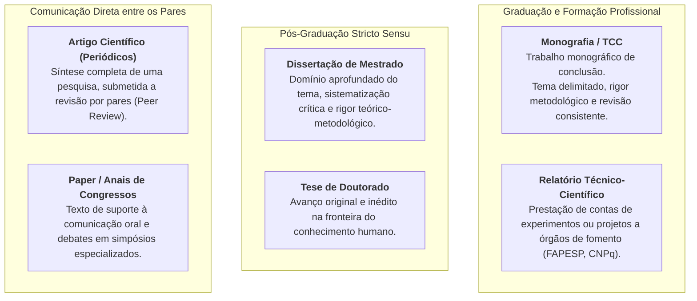
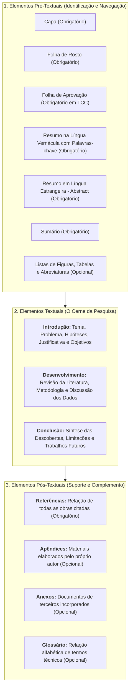
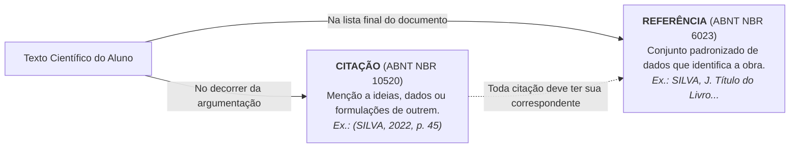

# 🎥 Videoaula 5 — Organização de Trabalho Científico

> **Disciplina:** Projetos e Métodos para a Produção do Conhecimento (`INT100-EC-2026S2B2-T001`)  
> **Tema da Semana 4:** Organização de Trabalho Científico  
> **Link Oficial:** [Assistir no YouTube (UNIVESP)](https://www.youtube.com/watch?v=rfw05ZbBYLc)  
> **Docente da Aula:** Profª Darlene Ferreira / Profª Dra. Graziella R. S. Moura  
> **Período Acadêmico:** 19/10/2026 a 01/11/2026  

---

## 📌 Visão Geral da Videoaula

Nesta videoaula, aprofunda-se a **organização do trabalho científico**, compreendendo as etapas fundamentais que conduzem da concepção de uma ideia investigativa à estruturação formal de um documento acadêmico de alta relevância.

A aula aborda três grandes eixos interdependentes:
1. **Tipologia dos Trabalhos Científicos e seus Conteúdos Específicos:** Diferenciação entre monografias (TCCs), dissertações, teses, artigos científicos (periódicos e conferências), relatórios técnico-científicos e comunicações.
2. **A Arquitetura Estrutural Tripartite (Normas ABNT):** A anatomia padronizada de trabalhos acadêmicos dividida em elementos **pré-textuais**, **textuais** e **pós-textuais**.
3. **A Distinção Conceitual e Normativa entre Citações e Referências:** Regras de citação direta (curta e longa com recuo de 4 cm), citação indireta (paráfrase), citação de citação (*apud*) e a construção da lista de referências ao final da obra (NBR 10520 e NBR 6023).

---

## 🏗️ 1. Tipologia dos Trabalhos Científicos

A produção do conhecimento científico expressa-se por meio de diversos gêneros textuais, cada qual com finalidades, profundidades e públicos-alvo específicos:

### 📋 Quadro Comparativo dos Gêneros Acadêmicos

| Tipo de Trabalho | Finalidade Principal | Grau de Ineditismo | Estrutura Típica |
| :--- | :--- | :---: | :--- |
| **Monografia (TCC)** | Conclusão de curso superior (Graduação/Especialização). | Sistematização crítica sobre tema delimitado. | Completa (capa, elementos pré, texto e pós-textuais). |
| **Dissertação** | Obtenção do título de Mestre. | Sistematização metodológica aprofundada. | Monográfica extensa com banca examinadora. |
| **Tese** | Obtenção do título de Doutor. | **Obrigatório:** contribuição original e inédita. | Monográfica exaustiva com defesa pública. |
| **Artigo de Periódico** | Disseminação rápida e indexada em bases científicas. | Resultados originais ou revisões sistemáticas. | Artigo padronizado (6 a 25 páginas, NBR 6022). |
| **Paper de Congresso** | Discussão de pesquisas em andamento ou protótipos. | Resultados preliminares ou estudos de caso. | Artigo conciso publicado em anais (*proceedings*). |
| **Relatório Técnico** | Comunicação de projetos financiados ou industriais. | Avaliação de metas, cronograma e entregáveis. | Foco em metodologia, protótipos e resultados (NBR 10719). |

---

## 🏛️ 2. Estrutura Canônica de Trabalhos Acadêmicos (ABNT NBR 14724)

Todo trabalho científico rigoroso obedece à estrutura tripartite padronizada, dividida em três blocos essenciais:

### 💡 Regra Fundamental da Redação Textual:
A revisão bibliográfica no desenvolvimento **não é uma colcha de retalhos** de citações copiadas e coladas. É uma construção autoral e argumentativa na qual o pesquisador conversa criticamente com os autores de referência, confrontando convergências e divergências conceituais.

---

## ⚖️ 3. A Diferença Fundamental: Citação versus Referência

Uma das distinções mais enfatizadas na videoaula é a fronteira técnica e funcional entre o ato de **citar** e o ato de **referenciar**:

### 🔹 1. Citação (ABNT NBR 10520)
É a incorporação no texto de uma informação extraída de outra fonte, cumprindo a função de dar suporte teórico, ilustrar hipóteses ou justificar escolhas técnicas.
* **Citação Indireta (Paráfrase):** Reprodução livre das ideias do autor com as palavras do pesquisador. Não usa aspas e a indicação de página é opcional.
  * *Exemplo:* De acordo com Litjens et al. (2017), o aprendizado profundo revolucionou a detecção de anomalias em imagens médicas.
* **Citação Direta Curta (até 3 linhas):** Transcrição textual idêntica incorporada ao próprio parágrafo, delimitada por **aspas duplas**, com autor, ano e página obrigatória.
  * *Exemplo:* Como assevera Flick (2012, p. 42), “de forma geral, você deve começar sua pesquisa lendo”.
* **Citação Direta Longa (mais de 3 linhas):** Destacada em parágrafo isolado com **recuo de 4 cm da margem esquerda**, tamanho de fonte menor (normalmente tamanho 10 ou 11), espaçamento entrelinhas simples e **sem aspas**.
* **Citação de Citação (*apud*):** Utilizada quando não se teve acesso direto à obra primária, citando o autor original seguido da expressão latina *apud* ("citado por") e do autor efetivamente consultado.

### 🔹 2. Referência (ABNT NBR 6023)
É a listagem bibliográfica disposta ao término do trabalho, ordenada alfabeticamente pelo sobrenome do primeiro autor, permitindo que qualquer leitor localize e acesse os documentos originais consultados.
* Devem conter elementos essenciais: autor(es), título em destaque (negrito ou itálico), edição, local de publicação, editora, data e, quando eletrônico, URL e data de acesso.

---

## 💻 4. Aplicação Prática na Engenharia de Computação

No exercício da Engenharia de Computação, a organização rigorosa do trabalho científico manifesta-se em diversas frentes:

1. **Elaboração de TCCs e Relatórios de Iniciação Científica (PIBIC):**
   * Estruturação correta da monografia garante o enquadramento nas normas acadêmicas exigidas pelas comissões de graduação e agências de fomento (FAPESP/CNPq).
2. **Redação de Papers para Congressos de Computação (SBC, IEEE, ACM):**
   * Congressos de ponta exigem modelos rigorosos (*templates* LaTeX de coluna dupla), onde a distinção precisa entre citações indiretas e referências no sistema numérico ou autor-data define a aceitação ou rejeição do artigo na fase de *peer review*.
3. **Documentação Técnica e Projetos de Software:**
   * Especificações de Arquitetura de Software (IEEE 1016 / ISO/IEC 42010) e relatórios de auditoria exigem separação cristalina entre referências normativas (normas ISO, RFCs do IETF, manuais de frameworks) e citações técnicas de requisitos.
4. **Patentes e Registros de Programas de Computador no INPI:**
   * O relatório descritivo de patente exige levantamento exaustivo do estado da técnica com referências inequívocas a tecnologias anteriores para comprovar atividade inventiva e novidade.

---

## 🎯 Síntese dos Conceitos Essenciais para Provas e Quizzes

* **Ponto de partida da pesquisa:** Leitura e revisão criteriosa da literatura para mapear o estado da arte.
* **Monografia vs. Artigo vs. Relatório:** A monografia trata de tema delimitado em profundidade monográfica; o artigo é síntese concisa para revistas; o relatório presta contas de projetos/experimentos.
* **Elementos Tripartites:** Pré-textuais (apresentação), Textuais (introdução, desenvolvimento, conclusão) e Pós-textuais (referências, apêndices e anexos).
* **Citação Direta Curta:** Até 3 linhas, no corpo do texto, entre aspas duplas, com indicação de página.
* **Citação Direta Longa:** Mais de 3 linhas, parágrafo próprio, recuo de 4 cm da margem esquerda, fonte reduzida, sem aspas.
* **Citação Indireta (Paráfrase):** Texto autoral fiel às ideias da fonte, sem aspas, com autor e ano (página opcional).
* **Citação vs. Referência:** Citação é a menção pontual no texto; referência é a listagem padronizada no final do trabalho.
