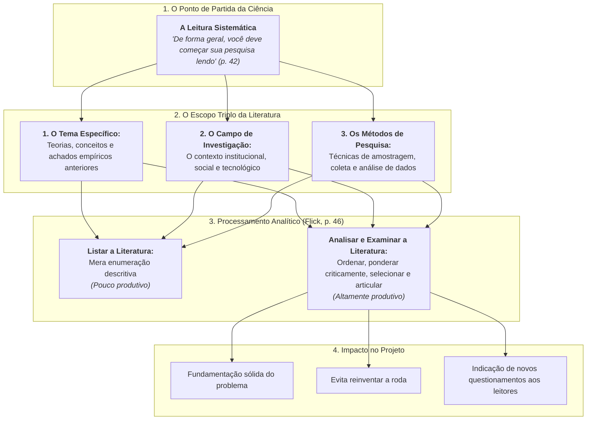
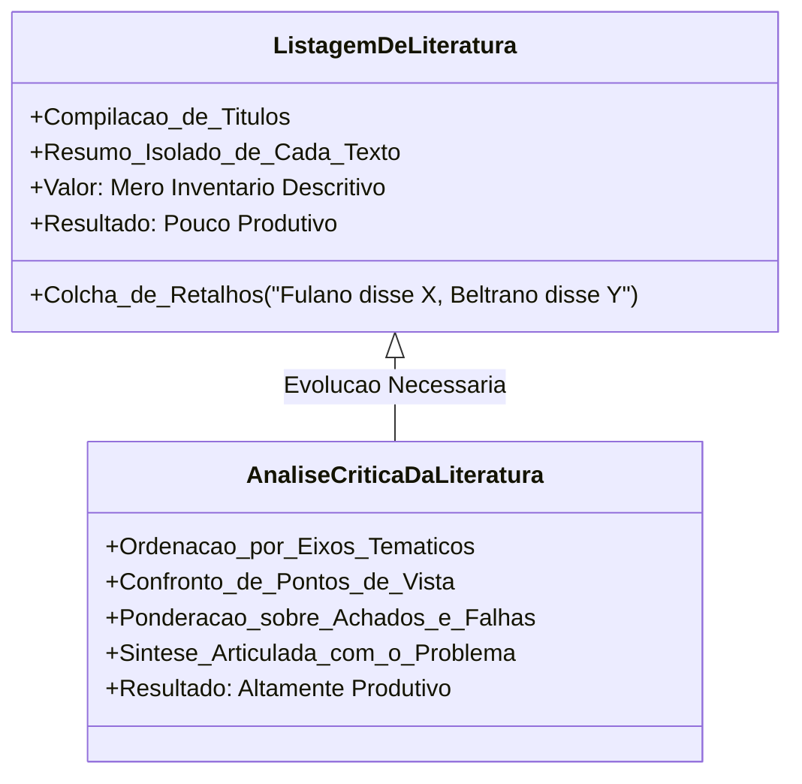

# 📖 Texto-base — Leitura e Revisão da Literatura (Uwe Flick, Cap. 3)

> **Disciplina:** Projetos e Métodos para a Produção do Conhecimento (`INT100-EC-2026S2B2-T001`)  
> **Tema da Semana 4:** Organização de Trabalho Científico  
> **Obra de Referência:** FLICK, Uwe. **Introdução à metodologia de pesquisa: um guia para iniciantes**. Porto Alegre: Penso, 2012.  
> **Capítulo Estudado:** Capítulo 3 — *Leitura e revisão da literatura* (p. 41–51)  
> **Acesso Digital:** [Minha Biblioteca UNIVESP](https://app.minhabiblioteca.com.br/home/activate/9788565848138/pageid/40)  
> **Período:** 19/10/2026 a 01/11/2026  

---

## 📌 Contextualização e Visão Geral da Obra

No Capítulo 3 de sua obra seminal voltada para pesquisadores iniciantes, o sociólogo e metodólogo alemão **Uwe Flick** desmistifica a ideia de que a pesquisa começa pela coleta de dados empíricos no campo ou no laboratório. 

Para Flick, **o pontapé inicial indiscutível de qualquer investigação científica é o ato de ler**. A revisão da literatura não é uma etapa burocrática ou um mero protocolo acadêmico: ela constitui o alicerce epistemológico que situa o pesquisador diante do que a comunidade científica global já descobriu, validou, refutou ou deixou como lacuna inexplorada.

---

## 🔍 1. Por Onde Começar? A Leitura como Alicerce (p. 41–42)

> *“De forma geral, você deve começar sua pesquisa lendo. Você deve procurar, encontrar e ler o que já foi publicado acerca do seu tema, do campo de sua pesquisa e dos métodos que você quer aplicar em seu estudo.”*  
> — **Uwe Flick (2012, p. 42)**

### 💡 Desmistificando Três Erros Comuns:
Ao analisar a citação clássica de Flick, é crucial superar equívocos frequentes cometidos por estudantes em início de carreira:

1. **A Necessidade Inegociável da Leitura:** É indispensável ler e compreender o arcabouço teórico que rege a pesquisa social e tecnológica. Não há como formular um problema relevante ou propor uma solução inovadora sem compreender o que já existe consolidado na área.
2. **O Mito de "Ler Tudo":** A recomendação de Flick **não significa** que o pesquisador deva ler exaustivamente tudo o que a humanidade já produziu sobre o tema em todas as línguas e épocas. Essa pretensão paralisaria o projeto. A revisão de literatura é um processo **seletivo, focado e delimitado** por critérios claros de relevância temporal, metodológica e conceitual.
3. **Universalidade Metodológica (Qualitativa e Quantitativa):** Ao contrário do preconceito de que pesquisas qualitativas seriam "livres de teoria prévia", Flick enfatiza que **tanto estudos qualitativos quanto quantitativos exigem fundamentação sólida** nos conhecimentos existentes para construir hipóteses consistentes ou desenhar roteiros de investigação válidos.

---

## 📚 2. O Escopo da Revisão: O que é "Literatura"? (p. 42–45)

Flick alarga o conceito de literatura para além do livro didático convencional. O pesquisador deve operar uma busca multifacetada em:
* **Livros e Manuais Temáticos:** Obras de síntese que organizam os paradigmas conceituais de uma área.
* **Artigos em Periódicos Indexados (*Journals*):** O principal veículo de ponta, onde circulam as descobertas recentes escrutinadas pelo crivo da avaliação por pares (*peer review*).
* **Anais de Congressos e Simpósios (*Proceedings*):** Onde surgem as primeiras comunicações de protótipos e pesquisas em andamento.
* **Relatórios Técnicos e Documentos Oficiais:** Diretrizes regulatórias emitidas por governos ou agências multilaterais (ex.: normas ABNT, ISO, relatórios da OMS ou IEEE).

### As Três Dimensões da Busca Bibliográfica:
O pesquisador não busca apenas textos que falem estritamente do seu recorte temático. O levantamento divide-se em:
1. **Literatura sobre o Tema:** Quem são os autores clássicos e contemporâneos? Quais são as teses em disputa?
2. **Literatura sobre o Campo Empírico:** Quais são as características socioculturais, geográficas ou técnicas do ambiente onde a pesquisa será implantada?
3. **Literatura sobre Métodos:** Quais instrumentos metodológicos foram empregados com sucesso em problemas semelhantes? Quais foram as dificuldades de validação relatadas por outros cientistas?

---

## ⚖️ 3. Maneiras de Usar a Literatura: Listar versus Analisar (p. 46–48)

Um dos pontos mais cobrados e cruciais do Capítulo 3 de Flick é a diferenciação entre **apenas listar** a literatura e **analisá-la criticamente**:

> *“Há várias maneiras de usar a literatura que você encontrou. Em primeiro lugar, devemos distinguir entre, de um lado, listar a literatura e, de outro, examiná-la ou analisá-la...”*  
> — **Uwe Flick (2012, p. 46)**

### 📋 Diferença Prática na Construção do Texto:
* **Listar a literatura (pouco produtivo):** O estudante elabora uma sequência estéril de parágrafos desconexos: *"Autor A estudou redes convolucionais em 2018. Autor B estudou segmentação em 2019. Autor C analisou radiografias em 2020."* Não há diálogo, comparação ou avaliação crítica.
* **Analisar criticamente (altamente produtivo):** O pesquisador ordena o material por eixos lógicos, agrupando autores que convergem, identificando controvérsias e destacando lacunas:
  * *Com os achados de sua análise, o pesquisador inclui de maneira sintética quais obras foram examinadas e apresenta conclusões fundamentadas.*
  * *Essas conclusões devem permitir que os leitores compreendam o estado da arte e elaborem seus próprios questionamentos críticos e novos planos de pesquisa.*

---

## 📂 4. Tipologia das Fontes: Primárias versus Secundárias (p. 48–49)

Flick e os manuais de metodologia estabelecem a separação epistemológica entre dados primários e fontes secundárias:

| Tipo de Fonte | Definição Epistemológica | Exemplos Concretos |
| :--- | :--- | :--- |
| **Fontes Primárias** | Documentos originais, dados brutos e registros de primeira mão, não submetidos a interpretações teóricas prévias de terceiros. | • Certidões de nascimento e atestados de óbito. • Documentos históricos originais e diários. • Logs brutos de servidores e medições de sensores físicos. • Imagens médicas brutas (arquivos DICOM). • Transcrições integrais de entrevistas de campo. |
| **Fontes Secundárias** | Obras que compilam, analisam, interpretam, sintetizam ou comentam dados já coletados e publicados por outros pesquisadores. | • Livros didáticos com resumos de teorias. • Artigos de revisão sistemática (*surveys*). • Manuais e enciclopédias acadêmicas. • Noticiários científicos e resenhas críticas. |

> [!IMPORTANT]
> **Atenção para Avaliações e Quizzes:**  
> Certidões de nascimento e atestados de óbito são **fontes primárias** (documentos brutos emitidos pelo cartório/estado). Livros didáticos que compilam teorias de outrem são **fontes secundárias**.

---

## 🛡️ 5. Ética, Plágio e Documentação Sistemática (p. 49–51)

Flick adverte enfaticamente que a pesquisa bibliográfica exige **higiene metodológica e integridade ética** desde o primeiro dia:

1. **Rastreabilidade Imediata:** Ao ler um trecho interessante, anote imediatamente a referência completa, incluindo autor, ano e número exato da página. Tentar recuperar de onde saiu uma frase semanas depois é a principal causa de plágio involuntário.
2. **A Paráfrase Legítima:** Reescrever o pensamento de um autor exige compreendê-lo profundamente para expressá-lo em novas estruturas sintáticas autorais, mantendo sempre a menção explícita à autoria original.
3. **Checklist de Flick para Revisão de Literatura:**
   * [x] Delimitei as palavras-chave que cobrem o tema, o contexto e o método?
   * [x] Utilizei bases de dados acadêmicas confiáveis com mecanismos de busca avançada?
   * [x] Ordenei o material por eixos conceituais em vez de empilhar resumos isolados?
   * [x] Confrontei os limites e limitações dos estudos empíricos anteriores?
   * [x] Demonstrei onde minha pesquisa se insere no diálogo científico contemporâneo?

---

## 💻 6. Conexões Diretas com a Engenharia de Computação

Para o engenheiro de computação, os ensinamentos de Uwe Flick no Capítulo 3 traduzem-se em práticas profissionais essenciais:

1. **Revisão Sistemática de Literatura (RSL) em Engenharia de Software:**  
   Metodologias modernas da computação (como o protocolo de Kitchenham e Charters) baseiam-se nos exatos princípios descritos por Flick: definir strings de busca booleanas (`AND`, `OR`), critérios de inclusão/exclusão em bases como IEEE Xplore, ACM Digital Library e Scopus, e extração sistemática de métricas para não apenas listar algoritmos, mas analisar sua complexidade computacional ($O(n \log n)$ vs $O(n^2)$) e taxa de erro.
2. **Distinção entre Benchmarks Brutos (Fontes Primárias) e Relatórios Técnicos (Fontes Secundárias):**  
   Os datasets brutos de imagens biomédicas (ex.: NIH ChestX-ray14) representam fontes primárias; os artigos que comparam a acurácia de modelos sobre essa base são fontes secundárias. O engenheiro precisa saber auditar ambos.
3. **Justificativa de Inovação em Projetos de Engenharia:**  
   Nenhum projeto de TCC ou solicitação de financiamento (ex.: PIPE FAPESP) é aprovado sem que o proponente demonstre que analisou o estado da arte e comprovou que sua proposta supera as limitações das tecnologias concorrentes existentes no mercado e na academia.
