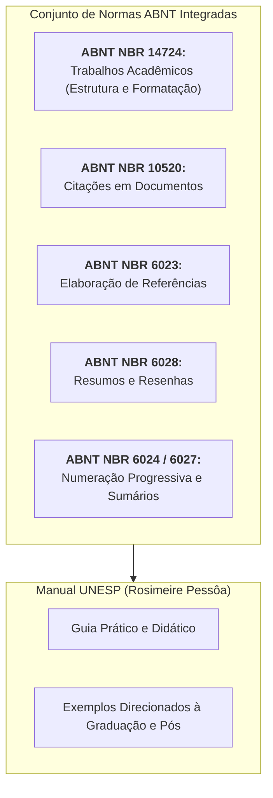
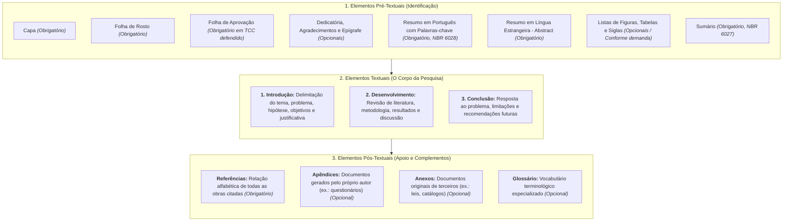

# 📐 Material-base — Normas para Trabalhos Acadêmicos (UNESP / ABNT)

> **Disciplina:** Projetos e Métodos para a Produção do Conhecimento (`INT100-EC-2026S2B2-T001`)  
> **Tema da Semana 4:** Organização de Trabalho Científico  
> **Instituição:** Universidade Estadual Paulista "Júlio de Mesquita Filho" (UNIVESP / UNESP)  
> **Coordenação Editorial:** Rosimeire de Oliveira Pessôa (Diretoria Técnica de Biblioteca e Documentação — IB/RC UNESP)  
> **Link Oficial:** [Biblioteca UNESP — Aprenda com a Biblioteca (Normas ABNT)](https://ib.rc.unesp.br/#!/biblioteca/aprenda-com-a-biblioteca/normas-abnt/)  
> **Documento Local:** [`s1_material_de_apoio_manual_para_elaboracao_de_trabalhos_academiscos_2020.pdf`](file:///home/henrique/Modelos/Univesp/2026S2B2/INT100-Projetos-e-Metodos-para-a-Producao-do-Conhecimento/Semana-4/s1_material_de_apoio_manual_para_elaboracao_de_trabalhos_academiscos_2020.pdf)  
> **Período:** 19/10/2026 a 01/11/2026  

---

## 📌 Apresentação do Manual da UNESP

O *Manual para Elaboração de Trabalhos Acadêmicos* da **UNESP** constitui a diretriz oficial adotada nos cursos de graduação da instituição e no consórcio com a UNIVESP para normalização técnica da produção científica. 

O material consolida as exigências da Associação Brasileira de Normas Técnicas (**ABNT**), proporcionando ao estudante e pesquisador um guia prático para formatação física, estruturação de monografias, execução de citações e compilação de referências bibliográficas.

---

## 📄 1. Apresentação Gráfica e Formatação Física (NBR 14724)

Para assegurar a legibilidade e a padronização estética internacional, todo documento acadêmico deve obedecer às seguintes especificações tipográficas:

| Item de Formatação | Padrão Exigido pela Norma / Manual UNESP | Observações Especiais |
| :--- | :--- | :--- |
| **Formato do Papel** | A4 (21,0 cm $\times$ 29,7 cm), cor branca | Impressão no anverso (frente) ou anverso/verso. |
| **Margem Esquerda e Superior** | **3,0 cm** | Espaço reservado para encadernação e cabeçalho. |
| **Margem Direita e Inferior** | **2,0 cm** | Espaço de respiro da mancha gráfica. |
| **Tipografia (Fonte)** | **Times New Roman** ou **Arial** | Manter a mesma fonte em todo o documento. |
| **Tamanho da Fonte** | **12 pt** para o texto principal | **10 pt ou 11 pt** para citações longas, notas de rodapé, paginação e legendas. |
| **Espaçamento Entrelinhas** | **1,5 linhas** no corpo do texto | **Simples** em citações diretas longas, notas, referências, legendas e tabelas. |
| **Recuo de Parágrafo** | **1,25 cm** (ou 1 tabulação padrão) | Primeira linha de cada parágrafo regular. |
| **Alinhamento do Texto** | **Justificado** (com hifenização correta) | Referências ao final são alinhadas à **esquerda**. |
| **Numeração das Folhas** | Canto superior direito, a **2 cm** da borda | Conta-se a partir da folha de rosto; imprime-se **apenas a partir da Introdução**. |

---

## 🏛️ 2. Estrutura Tripartite de Trabalhos Acadêmicos

A NBR 14724 estabelece a partição do trabalho monográfico em três blocos funcionais:

---

## ✍️ 3. Regras Canônicas de Citação (ABNT NBR 10520)

> *"A citação é a menção de uma informação extraída de outra fonte."* (ABNT NBR 10520, p. 1).

O manual da UNESP divide as citações em três modalidades operacionais indispensáveis:

### 🔹 1. Citação Direta
É a reprodução textual e literal das palavras exatas do autor consultado. Divide-se obrigatoriamente por critério de extensão:

1. **Citação Direta Curta (até 3 linhas de extensão):**
   * Deve ser inserida no fluxo normal do parágrafo.
   * Obrigatoriamente delimitada por **aspas duplas** (`"..."`).
   * Requer indicação de: Sobrenome do autor, ano e **número exato da página**.
   * *Exemplo no texto:* De acordo com Silva e Miranda Costa (2000, p. 79), “essa legislação ganha os seus primeiros contornos em 1907, através do decreto do governo federal”.
   * *Exemplo entre parênteses:* “[...] na sociedade moderna, qualquer cooperativa de produção, desde que prospere, desde que expanda, tende a transformar-se numa empresa capitalista.” (KAUTSKY, 1972, p. 123-124).

2. **Citação Direta Longa (mais de 3 linhas de extensão):**
   * Deve formar um parágrafo isolado e independente.
   * **Recuo fixo de 4,0 cm** a partir da margem esquerda do texto.
   * **Sem aspas** no início ou no fim.
   * **Tamanho de fonte reduzido** (10 pt ou 11 pt).
   * **Espaçamento entrelinhas simples**.
   * *Exemplo Prático:*
     

     O objetivo deste programa foi contribuir para o aumento da produção e produtividade agrícola no mundo, através do desenvolvimento de experiências no campo da genética vegetal para a criação e multiplicação de sementes adequadas às condições dos diferentes solos e climas e resistentes às doenças e pragas, bem como a descoberta e aplicação de técnicas agrícolas ou tratos culturais mais modernos e eficientes. (BRUM, 1988, p. 44).
     

---

### 🔹 2. Citação Indireta (Paráfrase Acadêmica)
É a reprodução livre e autoral do conteúdo de outro autor, sem transcrição literal de suas frases. O pesquisador absorve o conceito e o reescreve com suas próprias palavras e estilo sintático.
* **Não usa aspas nem recuo de margem.**
* A menção ao autor e ao ano é **obrigatória**; a indicação de página é **opcional**, embora recomendada quando se parafraseia um argumento muito pontual de uma obra extensa.
* *Exemplo 1 (autor na sentença):* Conforme aponta Flick (2012), a investigação científica torna-se estéril se o pesquisador limitar-se a produzir inventários desconexos de textos em vez de analisá-los criticamente.
* *Exemplo 2 (autor entre parênteses ao final):* A expansão agrícola intensiva demandou a articulação de programas governamentais e inovações em infraestrutura regional (NABUCO; LEMOS, 1986).

---

### 🔹 3. Citação de Citação (*apud*)
Emprega-se quando o pesquisador cita uma ideia contida em uma obra à qual **não teve acesso direto**, mas que foi citada pelo autor que ele está lendo.
* Utiliza-se a palavra latina ***apud*** (que significa "junto a", "perto de", "citado por").
* **Estrutura de chamada:** `Autor Original (ano original apud Autor Consultado, ano consultado, página)`.
* *Exemplo:* Pardinas (1977 apud LAKATOS; MARCONI, 1992, p. 79) entende o conhecimento científico como aquele voltado para a descoberta de soluções explicativas antes desconhecidas.
* > [!CAUTION]
  > **Recomendação Acadêmica:** O uso de *apud* deve ser evitado ao máximo na graduação e na pós-graduação, reservando-se apenas a documentos históricos esgotados, obras raras em bibliotecas estrangeiras ou manuscritos não digitalizados. Sempre que possível, o pesquisador deve buscar a fonte primária original!

---

### 🛠️ 4. Recursos Gráficos e Técnicos em Citações

| Recurso Técnico | Notação Gráfica | Quando e Como Utilizar |
| :--- | :---: | :--- |
| **Supressão de Texto** | `[...]` | Indica corte ou omissão de trechos irrelevantes no interior da citação direta sem alterar o sentido do autor. |
| **Interpolação / Acréscimo** | `[texto explicativo]` | Inserção de uma palavra ou esclarecimento feito pelo próprio pesquisador para dar sentido sintático ao trecho citado. |
| **Ênfase do Pesquisador** | `(grifo nosso)` | Quando o pesquisador coloca em negrito ou itálico uma palavra ou frase da citação para destacá-la. |
| **Ênfase Original da Obra** | `(grifo do autor)` | Quando o destaque já existia no texto original consultado. |
| **Incorreção no Original** | `[sic]` | Termo latino que significa "assim mesmo". Usado para demonstrar que um erro gramatical ou factual já constava no texto de origem e não foi cometido por quem cita. |
| **Informação Verbal** | *(informação verbal)* | Usado para palestras, aulas ou entrevistas informais. Os detalhes do evento devem constar exclusivamente em **nota de rodapé**. |

---

## 📚 4. Modelos Oficiais de Referências (ABNT NBR 6023:2018)

A lista de referências ao término do trabalho deve ser disposta em **ordem alfabética rigorosa**, com **alinhamento à esquerda**, **espaçamento simples** e separada entre si por um espaço simples em branco. O elemento em destaque (título) deve adotar uniformemente o **negrito** ou o *itálico*.

### 1. Livro no Todo:
> SOBRENOME, Nome do Autor. **Título da obra em destaque**: subtítulo sem destaque. Número da edição (se não for a 1ª). Local de publicação (cidade): Editora, ano de publicação. Total de páginas ou volumes.

* *Exemplo:*  
  FLICK, Uwe. **Introdução à metodologia de pesquisa**: um guia para iniciantes. Porto Alegre: Penso, 2012. 256 p.

---

### 2. Capítulo de Livro com Autoria Própria:
> SOBRENOME, Nome do Autor do Capítulo. Título do capítulo sem destaque. In: SOBRENOME, Nome do Organizador/Editor (org. ou ed.). **Título da obra principal em destaque**: subtítulo. Cidade: Editora, ano. Intervalo de páginas do capítulo.

* *Exemplo:*  
  SHEN, Dinggang; WU, Guorong; SUK, Heung-Il. Deep learning in medical image analysis. In: WU, Guorong (ed.). **Medical image analysis for machine learning**. London: Springer, 2017. p. 1-28.

---

### 3. Artigo em Revista Científica / Periódico Indexado:
> SOBRENOME, Nome do Autor do Artigo. Título do artigo sem destaque. **Título do Periódico em Destaque**, Local de publicação, volume (v.), número ou fascículo (n.), páginas inicial e final (p.), mês abreviado ano. Identificador DOI (se houver).

* *Exemplo:*  
  LITJENS, Geert et al. A survey on deep learning in medical image analysis. **Medical Image Analysis**, Amsterdam, v. 42, p. 60-88, Dec. 2017. DOI: 10.1016/j.media.2017.07.005.

---

### 4. Trabalho Publicado em Anais de Congressos e Conferências:
> SOBRENOME, Nome do Autor. Título do trabalho sem destaque. In: NOME DO EVENTO EM CAIXA ALTA, número do evento, ano, cidade de realização. **Anais ou Proceedings [...]** Local de publicação: Editora, ano de publicação. Intervalo de páginas.

* *Exemplo:*  
  SELVARAJU, Ramprasaath R. et al. Grad-CAM: visual explanations from deep networks via gradient-based localization. In: IEEE INTERNATIONAL CONFERENCE ON COMPUTER VISION (ICCV), 2017, Venice. **Proceedings [...]** Piscataway: IEEE, 2017. p. 618-626.

---

### 5. Documentos Eletrônicos e Relatórios Institucionais:
> NOME DA INSTITUIÇÃO RESPONSÁVEL. **Título do documento em destaque**: subtítulo. Local: Órgão emissor, ano. Quantidade de páginas. Disponível em: `<URL>`. Acesso em: dia mês abreviado ano.

* *Exemplo:*  
  WORLD HEALTH ORGANIZATION (WHO). **Ethics and governance of artificial intelligence for health**: WHO guidance. Geneva: WHO, 2021. 150 p. Disponível em: https://www.who.int/publications/i/item/9789240029200. Acesso em: 22 out. 2026.

---

## 🏛️ 5. Guia Rápido de Expressões Latinas de Citação (UNESP, Seção 11)

Nos sistemas de chamada em notas de rodapé, os manuais acadêmicos admitem expressões latinas consagradas para evitar repetições desnecessárias:

* ***apud*** ("junto de", "citado por"): Indica citação indireta de segunda mão.
* ***et al.*** (*et alii* — "e outros"): Utilizado quando a obra possui 4 ou mais autores (obrigatório em referências na NBR antiga; opcional e facultativo na NBR 6023:2018, mas amplamente padronizado em periódicos científicos).
* ***Idem*** ou ***Id.*** ("o mesmo"): Refere-se ao mesmo autor citado na nota imediatamente anterior.
* ***Ibidem*** ou ***Ibid.*** ("no mesmo lugar"): Refere-se ao mesmo autor e à mesma obra já citada na nota imediatamente anterior, variando apenas a página.
* ***Opus citatum*** ou ***op. cit.*** ("na obra citada"): Refere-se a uma obra do autor já citada anteriormente na mesma página, quando houver notas intercaladas.
* ***Passim*** ("aqui e ali", "em vários passos"): Indica que a ideia comentada está diluída e dispersa ao longo de todo o livro ou capítulo, sem uma página pontual.
* ***Loco citato*** ou ***loc. cit.*** ("no lugar citado"): Refere-se à mesma obra e à mesma página já mencionada anteriormente.
* ***Cf.*** (*confer* — "confronte", "compare"): Utilizado para sugerir confronto ou consulta complementar com outros autores.

---

## 💻 6. Aplicação Prática para Engenharia de Computação

Para o estudante de Engenharia de Computação da UNIVESP:

1. **Templates LaTeX / Overleaf (`abnTeX2`):**  
   Na computação, monografias e relatórios são frequentemente redigidos em LaTeX utilizando a classe `abntex2`. O pacote cuida automaticamente da margem de 3cm/2cm, paginação no topo à direita e formatação do arquivo BibTeX (`.bib`) segundo as normas da ABNT e do manual da UNESP.
2. **Identificadores Digitais (DOI e URLs):**  
   Artigos de computação em conferências IEEE, ACM e repositórios arXiv possuem identificadores DOI (*Digital Object Identifier*). Ao referenciar conforme a NBR 6023:2018, a inclusão do link resolvido do DOI (`https://doi.org/...`) é a garantia da reprodutibilidade digital do trabalho.
3. **Software e Códigos Abertos:**  
   Programas de computador e bibliotecas GitHub também possuem normas próprias de citação e referência pela ABNT NBR 6023 (autor, título do repositório, versão do commit, ano e link de acesso), assegurando atribuição correta e respeito às licenças de código aberto (GPL, Apache, MIT).
