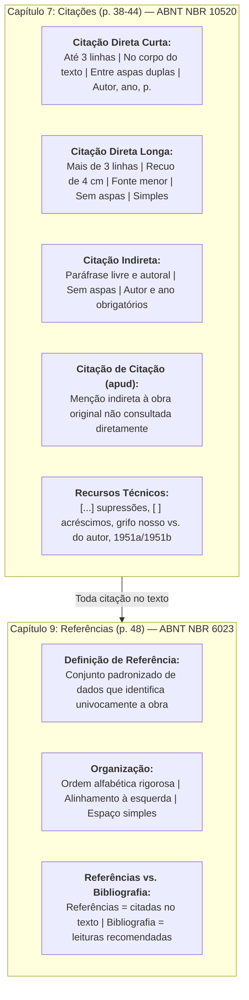
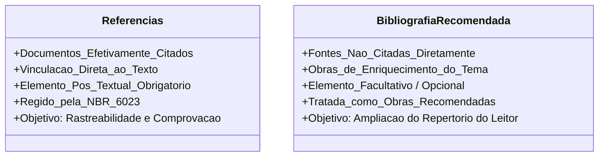

# 📖 Aprofundando o Tema — Citações e Referências (Pessôa, Cap. 7 e 9)

> **Disciplina:** Projetos e Métodos para a Produção do Conhecimento (`INT100-EC-2026S2B2-T001`)  
> **Tema da Semana 4:** Organização de Trabalho Científico  
> **Obra de Referência:** PESSÔA, Vera Lúcia Salazar. **Manual para elaboração de trabalhos acadêmicos: material para fins didáticos**. Rio Claro: UNESP, 2020.  
> **Capítulos Estudados:** Capítulo 7 (*Citações*, p. 38–44) e Capítulo 9 (*Referências nos trabalhos acadêmicos*, p. 48)  
> **Arquivo Local na Pasta:** [`s1_material_de_apoio_manual_para_elaboracao_de_trabalhos_academiscos_2020.pdf`](file:///home/henrique/Modelos/Univesp/2026S2B2/INT100-Projetos-e-Metodos-para-a-Producao-do-Conhecimento/Semana-4/s1_material_de_apoio_manual_para_elaboracao_de_trabalhos_academiscos_2020.pdf)  
> **Período:** 19/10/2026 a 01/11/2026  

---

## 📌 Visão Geral do Material

Neste aprofundamento temático, a professora **Vera Lúcia Salazar Pessôa** sistematiza as diretrizes técnicas e operacionais para a incorporação de ideias alheias e a construção da lista bibliográfica em pesquisas acadêmicas.

O estudo das páginas 38 a 44 (Capítulo 7) e da página 48 (Capítulo 9) fornece a fundamentação normativa (ABNT NBR 10520 e NBR 6023) para que o pesquisador mantenha o mais alto padrão de rigor metodológico, rastreabilidade e integridade ética.

---

## ✍️ 1. Capítulo 7 — Citações no Trabalho Acadêmico (p. 38–44)

> *“A citação é a menção de uma informação extraída de outra fonte.”* (ABNT NBR 10520:2002, p. 1).

As citações são imprescindíveis em trabalhos científicos para comprovar teses, situar o estado da arte e permitir o diálogo crítico com outros pesquisadores.

### 🔹 1.1 Tipos de Citações e Modos de Apresentação
1. **Citação Direta:** Transcrição textual idêntica e fiel de parte da obra do autor consultado.
   * **Até três linhas:** Permanece inserida na mancha do parágrafo, delimitada obrigatoriamente por **aspas duplas** (`"..."`). Aspas simples (`'...'`) são reservadas exclusivamente para indicar uma citação já existente no interior do trecho copiado.
   * **Com mais de três linhas:** Destacada em parágrafo próprio, com **recuo de 4,0 cm da margem esquerda**, entrelinhas **simples**, tamanho de letra menor que a do texto (tamanho 10 pt ou 11 pt) e **sem nenhuma aspa**.
2. **Citação Indireta:** Transcrição livre e autoral em que o pesquisador reproduz a ideia, argumento ou tese do autor com seu próprio vocabulário sintático (paráfrase). Não utiliza aspas e a indicação de página é facultativa.
3. **Citação de Citação (*apud*):** Transcrição de um autor primário ao qual não se teve acesso físico ou digital direto, valendo-se da intermediação do autor consultado.
4. **Respostas de Entrevistas / História Oral:** Transcrições de relatos de campo que devem ser destacadas graficamente (itálico com ou sem aspas, inseridas no texto ou em recuo de 4 cm).

---

### 🔹 1.2 Regras de Chamada e Formatação (Pessôa, p. 38–39)

* **Chamada inserida na frase / sentença:** O sobrenome do autor vem em letras maiúsculas e minúsculas (*Title Case*):  
  *Exemplo:* De acordo com Silva e Miranda Costa (2000, p. 79), o cooperativismo no Brasil ganhou seus primeiros contornos em 1907.
* **Chamada entre parênteses ao final do trecho:** O sobrenome do autor vem obrigatoriamente em **LETRAS MAIÚSCULAS (Caixa Alta)**:  
  *Exemplo:* “[...] na sociedade moderna, qualquer cooperativa de produção, desde que prospere, desde que expanda, tende a transformar-se numa empresa capitalista.” (KAUTSKY, 1972, p. 123-124).
* **Indicação de Volume ou Tomo:** Quando a obra possuir múltiplos volumes, a indicação abreviada antecede a página:  
  *Exemplo:* `(CASTELLS, 1999, v. 2, p. 143)`.

---

### 🔹 1.3 Recursos Técnicos e Casos Especiais em Citações (Pessôa, p. 42–44)

Pessôa detalha minuciosamente como proceder em situações editoriais complexas:

1. **Supressões:** Omissão de palavras ou períodos no interior da citação que não alterem o sentido original devem ser sinalizadas por reticências entre colchetes: `[...]`.
2. **Interpolações, Acréscimos ou Comentários:** Palavras inseridas pelo pesquisador para esclarecer o contexto sintático devem vir entre colchetes: `[ ]`.
3. **Ênfase ou Destaque (Grifos):**
   * Se o destaque (negrito ou itálico) foi inserido pelo próprio pesquisador: usar a expressão `(grifo nosso)` ou `(grifos nossos)` após a indicação da página.
   * Se o destaque já constava originalmente no livro do autor: usar a expressão `(grifo do autor)`.
4. **Informação Verbal:** Dados obtidos por meio de palestras, aulas magnas, comunicações orais em simpósios ou conversas informais devem ser acompanhados da expressão `(informação verbal)` no texto, devendo os detalhes (nome do evento, data e local) constar **exclusivamente em nota de rodapé**.
5. **Trabalhos em Fase de Elaboração:** Quando se cita um manuscrito inédito a ser lançado por uma editora, deve-se indicar a expressão `(em fase de elaboração)` em nota de rodapé.
6. **Autores com Mesmo Sobrenome e Mesmo Ano de Publicação:**
   * Acrescentam-se as iniciais de seus prenomes: `(SILVA, M., 1930)` e `(SILVA, L., 1930)`.
   * Se persistir a coincidência de iniciais, escrevem-se os prenomes por extenso: `(RIOS, Carlos, 1929)` e `(RIOS, Ciro, 1929)`.
7. **Mesmo Autor com Múltiplas Publicações no Mesmo Ano:**
   * Distinguem-se pelo acréscimo de letras minúsculas após o ano, sem espacejamento: `(OLIVEIRA, 1951a)` e `(OLIVEIRA, 1951b)`.

---

## 📚 2. Capítulo 9 — Referências nos Trabalhos Acadêmicos (p. 48)

No Capítulo 9, Vera Lúcia Pessôa estabelece os fundamentos da referenciação bibliográfica regida pela **ABNT NBR 6023 (atualizada em 2018)**:

### 🔹 2.1 O que são as Referências?
> *"As referências correspondem à lista, em ordem alfabética, das fontes (documentos, artigos, livros, documentos eletrônicos, CD-ROM, vídeos...) empregadas pelo autor na elaboração de seu trabalho. É um conjunto padronizado de elementos descritivos que permite a identificação dos documentos consultados para elaboração da publicação."* (PESSÔA, 2020, p. 48).

* **Exigência de Totalidade:** Na listagem de referências deve constar **a totalidade dos documentos citados no texto**. Não pode haver citação sem referência correspondente, nem referência na lista que não tenha sido citada na parte textual.
* **Supressão do termo "Bibliográficas":** A norma e o manual orientam utilizar simplesmente o título **REFERÊNCIAS** (e não "Referências Bibliográficas"), tendo em vista a diversidade de fontes não impressas (arquivos digitais, softwares, bases de dados, podcasts e vídeos online).

---

### 🔹 2.2 Distinção Epistemológica: Referências versus Bibliografia

Um ponto fundamental esclarecido por Pessôa na página 48 é a diferença entre **Referências** e **Bibliografia (Obras Recomendadas)**:

| Critério de Comparação | REFERÊNCIAS (NBR 6023) | BIBLIOGRAFIA / OBRAS RECOMENDADAS |
| :--- | :--- | :--- |
| **Obrigatoriedade** | **Obrigatória** (único elemento pós-textual indispensável). | **Opcional** (utilizada a critério do autor/editor). |
| **Vínculo com o Texto** | Toda obra citada no corpo do trabalho **deve** constar na lista. | Agrupa obras lidas para contextualização, mas que **não** foram citadas no texto. |
| **Finalidade** | Identificação e conferência imediata das fontes citadas. | Fornecer sugestões de leitura complementar para aprofundamento do leitor. |
| **Normatização** | Ordem alfabética, alinhamento à esquerda, espaçamento simples. | Mesmas regras técnicas da ABNT para padronização gráfica. |

---

## 💻 3. Aplicação e Exemplos Práticos na Engenharia de Computação

Para demonstrar a perfeita conformidade com as orientações de Vera Lúcia Pessôa (Cap. 7 e 9), aplicamos as normas em casos concretos da Engenharia de Computação:

### Caso 1: Citação Direta Curta (com supressão e grifo)
> De acordo com Tanenbaum e Bos (2016, p. 88, grifo nosso), o escalonador do sistema operacional deve garantir que “nenhum processo execute indefinidamente enquanto outros esperam [...] **assegurando justiça distributiva** no acesso aos núcleos de processamento”.

### Caso 2: Citação Direta Longa (mais de 3 linhas — recuo de 4 cm)

A computação gráfica moderna depende intrinsecamente de pipelines programáveis nas unidades de processamento gráfico (GPUs). Ao analisar essa arquitetura, Akenine-Möller et al. (2018, p. 24) observam que a transição de funções fixas para estágios de shaders totalmente customizáveis permitiu que modelos matemáticos de iluminação global e traçado de raios em tempo real deixassem de ser meras abstrações teóricas para se tornarem a base operacional dos motores de renderização contemporâneos.

### Caso 3: Múltiplas obras do mesmo autor no mesmo ano (1951a/1951b)
> A teoria dos autômatos celulares e a modelagem matemática da autorreprodução em máquinas digitais foram consolidadas nas publicações seminais de von Neumann (1951a; 1951b), demonstrando a convergência entre lógica booleana e biologia computacional.

### Caso 4: Referências Padronizadas (ABNT NBR 6023:2018)
* AKENINE-MÖLLER, Tomas et al. **Real-time rendering**. 4. ed. Boca Raton: CRC Press, 2018. 1178 p.
* TANENBAUM, Andrew S.; BOS, Herbert. **Sistemas operacionais modernos**. 4. ed. São Paulo: Pearson, 2016. 864 p.
* VON NEUMANN, John. The general and logical theory of automata. In: JEFFRESS, L. A. (ed.). **Cerebral mechanisms in behavior**. New York: John Wiley & Sons, 1951a. p. 1-41.
* VON NEUMANN, John. **Theory and organization of complicated automata**. Urbana: University of Illinois Press, 1951b. 128 p.
