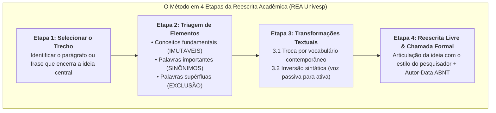

# ✍️ Material-base — Reescrita Acadêmica (REA Univesp)

> **Disciplina:** Projetos e Métodos para a Produção do Conhecimento (`INT100-EC-2026S2B2-T001`)  
> **Tema da Semana 4:** Organização de Trabalho Científico  
> **Recurso Educacional Aberto:** *Reescrita Acadêmica* (Univesp)  
> **Docente Responsável:** Prof. Dr. João Candido Fernandes  
> **Design Instrucional:** Alfredo Salvador Vieira Coelho  
> **Acesso Interativo:** [REA Univesp — Reescrita Acadêmica](https://apps.univesp.br/reescrita-academica/)  
> **Código-Fonte / Licença:** [GitHub (Licença MIT)](https://github.com/univesp/reescrita-academica)  
> **Período:** 19/10/2026 a 01/11/2026  

---

## 📌 Apresentação do Recurso e Fundamentação Epistemológica

O conhecimento humano contemporâneo é o resultado acumulado de séculos de perguntas refeitas, respostas problematizadas e conceitos reelaborados. O método científico funda-se no **diálogo permanente entre pesquisadores**, que, em um trabalho acadêmico, opera-se pela fundamentação ou pelo questionamento de conceitos formulados por outros autores.

Ao apresentar os resultados de sua investigação, o estudante deve obrigatoriamente indicar quais ideias de terceiros lhe serviram de inspiração, suporte ou contraponto crítico. Contudo:
* **Nem sempre é desejável ou cabível reproduzir palavra por palavra** o que o autor escreveu (o que geraria uma colcha de retalhos de citações diretas longas).
* A habilidade de **reescrever (parafrasear academicamente)** é o instrumento essencial que demonstra a real compreensão do texto lido e confere fluidez e estilo autoral ao trabalho.
* **Atenção Ética Inegociável:** Reescrita não elimina a obrigação da autoria! Citar a ideia de alguém por meio de paráfrase sem atribuir o crédito ao autor original (autor e ano) **constitui plágio conceitual**.

---

## 🪜 O Passo a Passo Oficial do REA Univesp

A metodologia desenvolvida pela equipe pedagógica da UNIVESP estrutura o processo de paráfrase em quatro etapas progressivas:

### 🔹 Etapa 1: Selecionar um Trecho
Escolhe-se um fragmento relevante de uma obra clássica ou contemporânea.  
*Exemplo Oficial do REA (Irving M. Copi, 1978, p. 47):*
> *"Mais de uma pessoa foi ouvida dizendo: 'Fulano de tal me perguntou como eu estava. Que hipócrita! Se ele não se preocupa no mínimo como estou!'. Tais comentários revelam uma falta de compreensão dos complexos propósitos para os quais a linguagem é usada. Isto também se manifesta na deplorável conduta do sujeito cacete que, quando se lhe pergunta como está, passa logo a descrever seu estado de saúde – usualmente com grande extensão e copiosos detalhes. Contudo, as pessoas, quase sempre, nas festas, não falam para se instruírem mutuamente. E a pergunta comum 'Como está você?' é uma saudação amistosa, não um pedido de informações clínicas."*  
> (COPI, Irving M. **Introdução à lógica**. 2. ed. São Paulo: Mestre Jou, 1978. p. 47).

---

### 🔹 Etapa 2: Identificar o que Pode e o que Não Pode ser Mudado
Antes de reescrever, realiza-se uma radiografia analítica do vocabulário:
1. **Conceitos Técnicos:** **NÃO PODEM** ser alterados. Se o autor discute *"propósitos da linguagem"*, *"função fática"* ou *"complexidade algorítmica"*, esses termos nucleares devem ser mantidos para não desvirtuar a precisão científica.
2. **Palavras Importantes:** **PODEM** ser substituídas por sinônimos precisos (ex.: *deplorável* $\rightarrow$ *inconveniente / inadequada*; *instruírem* $\rightarrow$ *ensinarem*).
3. **Palavras Supérfluas / Prolixas:** **DEVEM** ser excluídas para conferir concisão acadêmica (ex.: eliminar *"de tal"*, *"no mínimo"*, *"usualmente com grande extensão e copiosos detalhes"*).

---

### 🔹 Etapa 3: Fazer as Alterações Necessárias (Mecanismos de Transformação)

#### 3.1. Troca por Sinônimos:
Substituem-se expressões arcaicas, coloquiais ou excessivamente adjetivadas:
> *"Mais de uma pessoa foi ouvida dizendo: 'Fulano me perguntou como eu estava. Que falso! Se ele não está nem um pouco preocupado como estou!'. Esses comentários revelam uma falta de compreensão dos objetivos da linguagem. Isto também se manifesta no comportamento do sujeito chato que, quando se lhe pergunta como está, passa logo a descrever seu estado de saúde – com muitos detalhes. Contudo, as pessoas, nas festas, não falam para ensinarem umas às outras. E a pergunta 'Como está você?' é um cumprimento, não um pedido de informações."* (adaptado de COPI, 1978, p. 47).

#### 3.2. Mudança na Estrutura e Ordem Sintática das Orações:
* Inversão da ordem entre orações subordinadas e coordenadas.
* **Transposição de voz passiva para voz ativa:** A expressão passiva *"Mais de uma pessoa foi ouvida dizendo"* converte-se na forma ativa e elegante: *"Ouviu-se mais de uma pessoa dizer"* ou *"Muitos costumam afirmar"*.
* Reorganização dos complementos verbais para dinamizar a leitura.

---

### 🔹 Etapa 4: Reescrever Livremente (Paráfrase Autoral Plena)
Nesta fase final, o pesquisador abandona o molde frasal do texto original e redige um parágrafo inteiramente novo, fluído e maduro, incorporando a ideia central ao seu próprio texto com a chamada formal de citação indireta (ABNT NBR 10520):

> Ao examinar as convenções sociais da linguagem, Copi (1978, p. 47) elucida que saudações cotidianas como "Tudo bem?" cumprem uma função estritamente de cortesia e aproximação interpessoal, e não uma demanda informativa real. Para o autor, julgar tal conduta como hipocrisia ou detalhar minuciosamente sintomas clínicos em um diálogo informal reflete uma incompreensão básica das funções comunicativas da língua.

* **Referência ao final do trabalho (NBR 6023):**  
  COPI, Irving M. **Introdução à lógica**. 2. ed. São Paulo: Mestre Jou, 1978. 488 p.

---

## 💻 Aplicação Prática: Exercício de Reescrita para Engenharia de Computação

Aplicando o método em 4 etapas do REA Univesp a um trecho técnico de computação:

### 1. Trecho Original Selecionado (Goodfellow, Bengio & Courville, 2016, p. 326):
> *"Convolutional networks are simply neural networks that use convolution in place of general matrix multiplication in at least one of their layers. For computer vision tasks, processing an image with fully connected layers is computationally intractable due to the immense number of parameters, which invariably leads to overfitting and extreme memory bandwidth consumption."*

### 2. Triagem de Vocabulário:
* **Conceitos Imutáveis:** *Redes convolucionais*, *multiplicação de matrizes*, *camadas densamente conectadas / totalmente conectadas*, *sobreajuste (overfitting)*, *largura de banda de memória*.
* **Palavras a Substituir por Sinônimos:** *simply* $\rightarrow$ *estruturam-se como*; *invariably leads* $\rightarrow$ *desencadeia invariavelmente / resulta em*; *computationally intractable* $\rightarrow$ *inviável computacionalmente*.
* **Supressões:** Adjetivos redundantes e conectivos de ênfase informal.

### 3. Transformação Sintática:
* Conversão da oração passiva *"processing an image [...] is computationally intractable"* para a forma diretaativa.
* Reordenação das consequências matemáticas antes da conclusão arquitetural.

### 4. Reescrita Livre Final com Citação ABNT:
> No projeto de sistemas de visão computacional, Goodfellow, Bengio e Courville (2016, p. 326) demonstram que o emprego de camadas lineares totalmente conectadas torna-se impraticável devido à explosão combinatória de parâmetros livres na matriz de pesos, induzindo o modelo ao sobreajuste (*overfitting*). Por essa razão, a substituição da multiplicação matricial convencional pelo operador matemático de convolução viabiliza o treinamento escalável ao preservar a coerência espacial dos pixels com consumo reduzido de memória.

---

## 🎯 Síntese dos Ganhos Metodológicos da Reescrita

1. **Eliminação do "Ctrl+C / Ctrl+V":** Transforma o ato passivo de copiar em um exercício mental ativo de interpretação, síntese e redação própria.
2. **Fluidez Argumentativa:** Permite que o projeto de pesquisa mantenha a voz do estudante de engenharia em todo o texto, em vez de alternar abruptamente entre estilos díspares de diferentes autores.
3. **Segurança Antiplágio:** Ao dominar a reescrita estrutural com menção autor-data imediata, o pesquisador blinda seu trabalho contra o plágio acidental e garante integridade acadêmica total.
