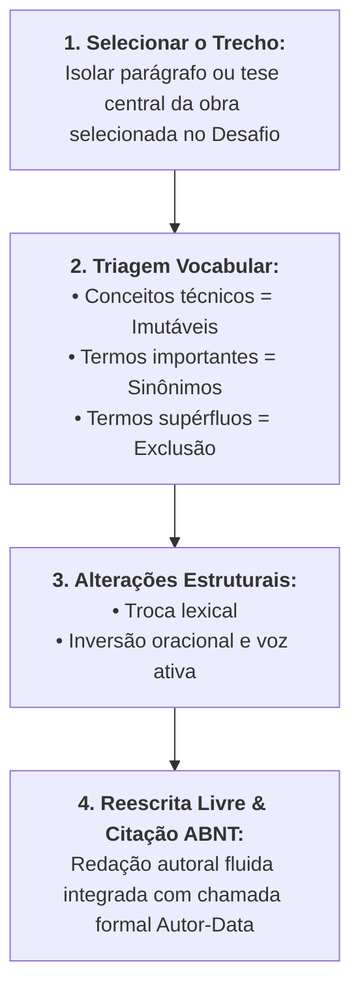

# ✍️ Exercício de Apoio — Treinamento de Reescrita Acadêmica

> **Disciplina:** Projetos e Métodos para a Produção do Conhecimento (`INT100-EC-2026S2B2-T001`)  
> **Tema da Semana 4:** Organização de Trabalho Científico  
> **Metodologia Aplicada:** Recurso Educacional Aberto — *Reescrita Acadêmica* (Univesp)  
> **Link do REA:** [https://apps.univesp.br/reescrita-academica/](https://apps.univesp.br/reescrita-academica/)  
> **Comprovante de Execução (PDF Gerado):** [`Univesp _ Reescrita Acadêmica.pdf`](file:///home/henrique/Modelos/Univesp/2026S2B2/INT100-Projetos-e-Metodos-para-a-Producao-do-Conhecimento/Semana-4/Univesp%20_%20Reescrita%20Acad%C3%AAmica.pdf)  
> **Período:** 19/10/2026 a 01/11/2026  
> **Status:** 🟢 **Exercício Resolvido, Aplicado no REA e Salvo em PDF**  

---

## 📌 Enunciado Oficial da Atividade

> *Agora que já apreendemos que a leitura é um dos fundamentos da prática científica e que a leitura qualificada (como ler um texto) aprimora os resultados dessa etapa, vamos prosseguir no andamento da disciplina e desenvolver procedimentos que nos levam ao desenvolvimento da escrita acadêmica.*  
> 
> *Escolha um dos textos selecionados no desafio e faça um treinamento, reescrevendo-o conforme explicado no REA Reescrita Acadêmica.*

---

## 🧭 O Método em 4 Etapas do REA Univesp

Para estruturar a paráfrase sem incorrer em plágio conceitual ou estilístico, o REA prescreve quatro fases sequenciais:

---

## 🔬 Caso de Estudo Principal: Artigo de Litjens et al. (2017)

Dentre as obras selecionadas no Desafio da Semana 4, elegemos o artigo seminal de **Geert Litjens et al. (2017)** publicado no periódico *Medical Image Analysis* (Qualis A1).

### 🔹 Etapa 1: Seleção do Trecho Original
* **Obra:** LITJENS, Geert et al. A survey on deep learning in medical image analysis. **Medical Image Analysis**, Amsterdam, v. 42, p. 60-88, Dec. 2017.
* **Trecho Selecionado (p. 60):**
  > *"Deep learning algorithms, in particular convolutional networks, have rapidly become a methodology of choice for analyzing medical images. It is readily apparent that these techniques have permeated every sub-discipline of medical imaging, including radiology, pathology, and cardiology. However, one should not overlook that the profound performance improvements often reported in literature are contingent upon the availability of massive annotated datasets, whose acquisition constitutes an onerous and costly bottleneck."*

---

### 🔹 Etapa 2: Identificar o que Pode e o que Não Pode ser Mudado

Realizamos o diagnóstico do vocabulário conforme as regras do REA:

1. **Conceitos Técnicos (IMUTÁVEIS — Não podem ser alterados):**
   * *Algoritmos de aprendizado profundo (Deep Learning)*;
   * *Redes neurais convolucionais (CNNs)*;
   * *Imagens médicas (radiologia, patologia, cardiologia)*;
   * *Bases de dados anotadas (ground truth / datasets rotulados)*.
2. **Palavras Importantes (PODEM ser substituídas por sinônimos precisos):**
   * *have rapidly become a methodology of choice* $\rightarrow$ *consolidaram-se velozmente como padrão hegemônico*;
   * *permeated every sub-discipline* $\rightarrow$ *disseminaram-se por todas as especialidades clínicas*;
   * *contingent upon* $\rightarrow$ *estão estritamente condicionadas à / dependem diretamente de*;
   * *onerous and costly bottleneck* $\rightarrow$ *gargalo operacional desafiador e oneroso*.
3. **Palavras Supérfluas / Prolixas (DEVEM ser excluídas):**
   * *It is readily apparent that* (expressão retórica prolixa $\rightarrow$ remover);
   * *one should not overlook that* (locução impessoal desnecessária $\rightarrow$ remover);
   * *often reported in literature* (redundante no contexto de uma revisão $\rightarrow$ remover).

---

### 🔹 Etapa 3: Fazer as Alterações Necessárias

#### 3.1. Troca por Sinônimos e Poda de Prolixidades:
> Os algoritmos de aprendizado profundo, especialmente as redes convolucionais, consolidaram-se velozmente como a metodologia preferencial para o processamento de imagens médicas. Essas arquiteturas disseminaram-se por especialidades como radiologia, patologia e cardiologia. Contudo, os expressivos saltos de acurácia dependem da existência de extensas bases de dados anotadas por médicos especialistas, cuja obtenção representa um gargalo oneroso e complexo.

#### 3.2. Mudança na Estrutura e Inversão da Ordem das Frases:
* Invertemos a ordem tradicional (problema antes da solução tecnológica).
* Substituição de estruturas passivas por orações ativas com dinamismo sintático:
> Embora as redes neurais convolucionais tenham se tornado o paradigma dominante no diagnóstico por imagem em áreas como radiologia e cardiologia, sua alta precisão matemática permanece atrelada à disponibilidade de grandes acervos rotulados, cuja rotulagem especializada configura um dos maiores obstáculos da bioengenharia contemporânea.

---

### 🔹 Etapa 4: Reescrita Livre Final (Paráfrase Autoral com ABNT NBR 10520)

Integrando a paráfrase à voz do pesquisador de Engenharia de Computação, com a chamada formal de citação indireta e alusão conceitual:

> Conforme demonstram Litjens et al. (2017), o avanço vertiginoso do aprendizado profundo estabeleceu as redes neurais convolucionais como a espinha dorsal do diagnóstico automatizado em diversas frentes da medicina, abrangendo desde exames radiológicos até laudos cardiológicos. Todavia, os autores alertam que a robustez desses modelos não opera no vazio: a eficácia clínica dos algoritmos está condicionada à disponibilidade de volumosos repositórios devidamente anotados por especialistas, cuja escassez e custo de curadoria configuram o principal gargalo para a escalabilidade da inteligência artificial hospitalar.

* **Referência Normalizada (ABNT NBR 6023:2018):**  
  LITJENS, Geert et al. A survey on deep learning in medical image analysis. **Medical Image Analysis**, Amsterdam, v. 42, p. 60-88, Dec. 2017. DOI: `10.1016/j.media.2017.07.005`.

---

## 🔬 Caso de Estudo Complementar: Artigo de Selvaraju et al. (2017)

Para consolidar o aprendizado em mais um gênero (trabalho publicado em anais de congresso internacional), realizamos o treinamento sobre o artigo de explicabilidade visual:

### 🔹 Etapa 1: Seleção do Trecho Original
* **Obra:** SELVARAJU, Ramprasaath R. et al. Grad-CAM: visual explanations from deep networks via gradient-based localization. In: **IEEE ICCV**, 2017, Venice. **Proceedings [...]** Piscataway: IEEE, 2017. p. 618-626.
* **Trecho Selecionado (p. 618):**
  > *"While deep neural networks have achieved remarkable success in visual tasks, their 'black-box' nature makes them difficult to trust in high-stakes decisions. We make CNN-based models more transparent by producing visual explanations [...] Grad-CAM uses the gradients of any target concept flowing into the final convolutional layer to produce a coarse 2D localization map highlighting the important regions in the image."*

---

### 🔹 Etapas 2 e 3: Triagem e Transformações
* **Conceitos Imutáveis:** *Redes neurais profundas*, *natureza de caixa-preta (black-box)*, *decisões de alto risco (high-stakes)*, *Grad-CAM*, *gradientes da camada convolucional final*, *mapa de localização bidimensional (mapa de saliência)*.
* **Substituições e Sinônimos:** *remarkable success* $\rightarrow$ *desempenho notável / acurácia excepcional*; *difficult to trust* $\rightarrow$ *insegurança na validação clínica / barreira de confiabilidade*; *producing visual explanations* $\rightarrow$ *geração de mapas interpretáveis de explicabilidade visual*.
* **Inversão Sintática:** Destacar a necessidade de auditoria algorítmica antes de detalhar o fluxo dos gradientes matemáticos.

---

### 🔹 Etapa 4: Reescrita Livre Final (Citação ABNT NBR 10520)

> Apesar do sucesso extraordinário dos modelos conexionistas em tarefas de reconhecimento visual, sua opacidade inerente gera desconfiança quando aplicados a cenários críticos, como a tomada de decisão médica. Visando solucionar o dilema da "caixa-preta", Selvaraju et al. (2017) propuseram a técnica Grad-CAM, que rastreia os gradientes matemáticos da última camada convolucional para renderizar mapas de calor bidimensionais sobre a imagem de entrada. Esse mecanismo evidencia graficamente aos operadores humanos quais agrupamentos de pixels foram decisivos para a inferência da rede, viabilizando a auditoria e a aceitação clínica do sistema.

* **Referência Normalizada (ABNT NBR 6023:2018):**  
  SELVARAJU, Ramprasaath R. et al. Grad-CAM: visual explanations from deep networks via gradient-based localization. In: IEEE INTERNATIONAL CONFERENCE ON COMPUTER VISION (ICCV), 2017, Venice. **Proceedings [...]** Piscataway: IEEE, 2017. p. 618-626. DOI: `10.1109/ICCV.2017.74`.

---

## 📊 Comparativo: Do "Ctrl+C" à Escrita Acadêmica Autoral

| Dimensão de Análise | Cópia Não Autorizada ("Ctrl+C / Ctrl+V") | Paráfrase Conforme REA Univesp |
| :--- | :--- | :--- |
| **Integridade Ética** | Fraude grave / Crime de Plágio (Art. 184 CP). | Prática acadêmica legítima e recomendada. |
| **Estilo Textual** | Ruptura brusca de vocabulário e colcha de retalhos. | Fluidez coesa, voz ativa e tom autoral consistente. |
| **Compreensão Teórica** | Reprodução mecânica e passiva de símbolos. | Demonstração ativa de domínio dos conceitos-chave. |
| **Conexão com o Projeto** | Frases isoladas que não conversam com o tema. | Articulação perfeita entre a fonte e os objetivos da pesquisa. |
