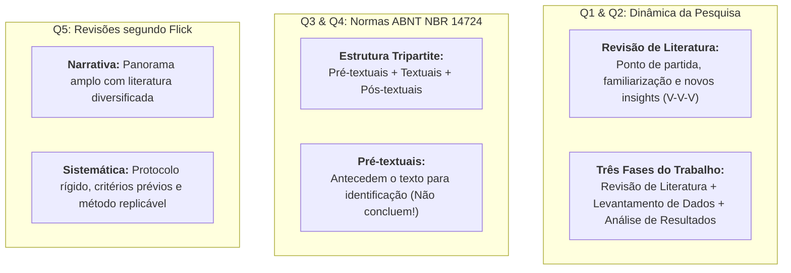

# 📝 Atividade Avaliativa da Semana 4 — Gabarito Oficial (10,0 / 10,0)

> **Disciplina:** Projetos e Métodos para a Produção do Conhecimento (`INT100-EC-2026S2B2-T001`)  
> **Tema da Semana 4:** Organização de Trabalho Científico  
> **Docente Responsável:** Profª Dra. Graziella Ribeiro Soares Moura  
> **Período de Realização:** 19/10/2026 a 01/11/2026  
> **Valor Total:** 10,00 pontos (5 questões de 2,00 pontos cada)  
> **Nota Obtida:** 🟢 **10,00 / 10,00 (100% de Aproveitamento)**  

---

## 📌 Visão Geral das Questões e Desempenho

| Questão | Tema Central | Alternativa Correta | Pontuação |
| :---: | :--- | :---: | :---: |
| **Questão 1** | Importância e funções da revisão de literatura (V/F) | **e** (V - V - V) | 2,00 / 2,00 |
| **Questão 2** | As três fases canônicas do trabalho científico | **d** (I, III, IV) | 2,00 / 2,00 |
| **Questão 3** | Elementos pré-textuais segundo a ABNT NBR 14724 (Asserção-Razão) | **e** (1ª Falsa, 2ª Verdadeira) | 2,00 / 2,00 |
| **Questão 4** | Estrutura tripartite do trabalho acadêmico (NBR 14724/2011) | **e** (Elementos pré, textuais e pós) | 2,00 / 2,00 |
| **Questão 5** | Tipos de artigos de revisão segundo Uwe Flick (Narrativa vs. Sistemática) | **e** (I, II e III) | 2,00 / 2,00 |
| **TOTAL** | **Aproveitamento Pleno** | — | **10,00 / 10,00** |

---

## 🎯 Resolução Analítica Questão por Questão

---

### 🔹 Questão 1 — Funções e Importância da Revisão de Literatura

#### 📋 Enunciado Oficial
O artigo científico é um instrumento de materialização da pesquisa científica, que visa a análise e compreensão de uma temática, sendo que o primeiro momento do desenvolvimento desse estudo aprofundado ocorre com a revisão de literatura. A revisão de literatura direcionará todo o andamento da pesquisa, delimitando os métodos, teorias e a temática analisada.

Com relação à revisão de literatura, identifique se são verdadeiras (V) ou falsas (F) as afirmativas a seguir:

* **I.** A revisão da literatura permite que o pesquisador compreenda e se familiarize com a temática selecionada.
* **II.** A revisão da literatura pode ser iniciada com a realização de pesquisa e leitura sobre o objeto estudado.
* **III.** A revisão da literatura possibilita o desenvolvimento de novos *insights* e de revisão ao conhecimento já estabelecido.

Assinale a alternativa que apresenta a sequência correta:
* a) V - V - F.
* b) V - F - F.
* c) F - F - F.
* d) F - F - V.
* **e) V - V - V.**

---

#### 💡 Justificativa e Fundamentação Teórica
* **Afirmativa I (Verdadeira):** Como assevera Uwe Flick (2012, p. 41-42), o contato inicial com o acervo existente permite ao pesquisador situar-se criticamente, compreendendo os conceitos fundamentais, as correntes teóricas predominantes e o vocabulário técnico da área.
* **Afirmativa II (Verdadeira):** O ponto de partida factual da investigação científica é a busca e leitura sistemática sobre o objeto de estudo em livros, periódicos e bases de dados abertas e especializadas.
* **Afirmativa III (Verdadeira):** A leitura atenta não é passiva; ela revela lacunas, inconsistências e contradições entre estudos anteriores, permitindo ao cientista formular novos *insights*, hipóteses originais e revisar criticamente teorias outrora tidas como incontestáveis.

✅ **Gabarito Oficial: Alternativa e (V - V - V)**

---

### 🔹 Questão 2 — As Três Fases Estruturais do Trabalho Científico

#### 📋 Enunciado Oficial
As três fases do trabalho científico são:

* **I.** a análise dos resultados;
* **II.** a participação em congressos científicos;
* **III.** a revisão da literatura;
* **IV.** o levantamento de dados;
* **V.** a rotina e o exercício da criatividade.

Selecione a alternativa com as afirmativas verdadeiras:
* a) I, II, III, IV, V.
* b) I, III, V.
* c) III.
* **d) I, III, IV.**
* e) II, IV.

---

#### 💡 Justificativa e Fundamentação Teórica
O desenvolvimento do método científico estrutura-se classicamente em três etapas operacionais interdependentes:
1. **Revisão da literatura (III):** Levantamento do estado da arte e fundamentação teórica;
2. **Levantamento de dados (IV):** Coleta empírica, observação, ensaios laboratoriais ou aplicação de instrumentos de medição;
3. **Análise dos resultados (I):** Tratamento quantitativo/qualitativo dos dados coletados, interpretação e formulação das conclusões.

*As demais opções:* A "participação em congressos científicos" (II) constitui fase posterior de divulgação e comunicação científica dos resultados; a "rotina e o exercício da criatividade" (V) expressa traços da atitude ou postura do pesquisador, e não uma fase procedimental da investigação.

✅ **Gabarito Oficial: Alternativa d (I, III, IV)**

---

### 🔹 Questão 3 — Elementos Pré-Textuais (ABNT NBR 14724)

#### 📋 Enunciado Oficial
A estrutura do trabalho acadêmico, segundo a ABNT 14724/2011, é formada por uma ordem dos elementos que compõem esses trabalhos.

> **Asserção I:** Os elementos pré-textuais concluem o texto  
> **PORQUE**  
> **Asserção II:** disponibilizam as informações para identificação e utilização do trabalho.

Analisando as afirmações acima, relacionadas pela conjunção “porque”, conclui-se que:
* a) as duas afirmações são verdadeiras, mas a segunda não justifica a primeira.
* b) a primeira afirmação é verdadeira e a segunda é falsa.
* c) As duas afirmações são falsas.
* d) as duas afirmações são verdadeiras e a segunda justifica a primeira.
* **e) a primeira afirmação é falsa e a segunda é verdadeira.**

---

#### 💡 Justificativa e Fundamentação Teórica
* **A primeira asserção é FALSA:** Os elementos pré-textuais **antecedem** o texto; eles abrem a obra acadêmica. A parte que conclui o trabalho são os elementos pós-textuais (e a própria conclusão/considerações finais dentro da parte textual).
* **A segunda asserção é VERDADEIRA:** A finalidade canônica dos elementos pré-textuais (capa, folha de rosto, resumo na língua vernácula, abstract, sumário, listas) é exatamente disponibilizar os dados formais para identificação institucional e de autoria, bem como guiar a consulta e navegação do leitor.

✅ **Gabarito Oficial: Alternativa e (a primeira afirmação é falsa e a segunda é verdadeira)**

---

### 🔹 Questão 4 — Estruturação do Trabalho Acadêmico (ABNT NBR 14724/2011)

#### 📋 Enunciado Oficial
Segundo a norma ABNT 14724/2011, como é estruturado o trabalho acadêmico?
* a) Resumo, introdução, metodologia científica, conclusão.
* b) Introdução, elementos textuais e conclusão.
* c) Elementos pré-textuais, elementos textuais e elementos pós-textuais e referência bibliográfica.
* d) Introdução, metodologia científica e referência bibliográfica.
* **e) Elementos pré-textuais, elementos textuais e elementos pós-textuais.**

---

#### 💡 Justificativa e Fundamentação Teórica
A ABNT NBR 14724:2011 estabelece na seção 4 ("Estrutura") que qualquer trabalho acadêmico (seja monografia de graduação, dissertação de mestrado ou tese de doutorado) compõe-se categoricamente de três grandes blocos:
1. **Elementos pré-textuais** (abertura, identificação e sumários);
2. **Elementos textuais** (introdução, desenvolvimento e conclusão);
3. **Elementos pós-textuais** (referências, apêndices, anexos e glossários).

*Observação sobre a pegadinha da alternativa c:* As referências bibliográficas já estão contidas e subsumidas como elemento pós-textual obrigatório, sendo incorreto listá-las como um quarto bloco separado da divisão canônica.

✅ **Gabarito Oficial: Alternativa e (Elementos pré-textuais, elementos textuais e elementos pós-textuais)**

---

### 🔹 Questão 5 — Artigos de Revisão Narrativa versus Sistemática (Uwe Flick)

#### 📋 Enunciado Oficial
Flick (2012, p. 43) afirma que “entre os artigos científicos, podemos distinguir entre artigos que relatam resultados de uma pesquisa pela primeira vez [...] e artigos de revisão”, e entre “os artigos de revisão, podemos também distinguir entre revisões narrativas e sistemáticas”.  
*(FLICK, U. Introdução à metodologia da pesquisa: um guia para iniciantes. Porto Alegre: Penso, 2012).*

Sobre revisões narrativas e sistemáticas, avalie as afirmativas a seguir:

* **I.** Uma revisão narrativa visa apresentar um panorama geral sobre o tema, e por isso utiliza vários tipos de literatura.
* **II.** A revisão sistemática segue um modelo predeterminado pelo pesquisador; tal modelo tem critérios específicos a serem desenvolvidos.
* **III.** Em pesquisa de revisão sistemática, são definidos métodos de busca que possam ser replicáveis e avaliados.

Está correto o que se afirma em:
* a) II e III, apenas.
* b) I e III, apenas.
* c) II, apenas.
* d) I, apenas.
* **e) I, II e III.**

---

#### 💡 Justificativa e Fundamentação Teórica
* **Afirmativa I (Correta):** As revisões narrativas (ou tradicionais) possuem caráter amplo e panorâmico, buscando contextualizar um domínio do conhecimento por meio da análise integrada de livros, artigos seminais, ensaios teóricos e relatórios.
* **Afirmativa II (Correta):** As revisões sistemáticas exigem o delineamento prévio de um protocolo de pesquisa com critérios explícitos de inclusão e exclusão de trabalhos, definindo recorte temporal, idiomas, palavras-chave e bases consultadas.
* **Afirmativa III (Correta):** A marca distintiva da revisão sistemática na ciência contemporânea é a transparência e reprodutibilidade: o método de busca deve ser detalhado de tal modo que qualquer outro pesquisador possa replicá-lo e verificar rigorosamente os mesmos achados.

✅ **Gabarito Oficial: Alternativa e (I, II e III)**

---

## 📊 Síntese para Fixação

