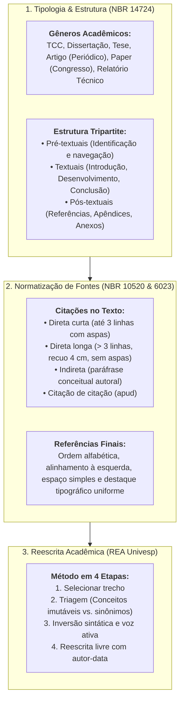

# 🎯 Semana 4 — Em Síntese: Consolidação de Competências

> **Disciplina:** Projetos e Métodos para a Produção do Conhecimento (`INT100-EC-2026S2B2-T001`)  
> **Tema da Semana 4:** Organização de Trabalho Científico  
> **Docente Responsável:** Profª Dra. Graziella Ribeiro Soares Moura  
> **Período:** 19/10/2026 a 01/11/2026  
> **Status:** 🟢 **Semana 4 Concluída com Êxito (10,0 / 10,0)**  

---

## 👩‍🏫 Mensagem Oficial de Fechamento do AVA

Ao terminar o conteúdo desta semana, depois de ler e refletir, você é capaz de:
* **Diferenciar os tipos de trabalhos científicos** (monografias, dissertações, teses, artigos de periódicos, relatórios técnicos e comunicações em congressos).
* **Apreender as normas e procedimentos** de como escolher, referenciar e citar a bibliografia que apoia teoricamente o trabalho (ABNT NBR 10520 e NBR 6023).
* **Identificar os conteúdos específicos** de cada gênero acadêmico e sua estrutura tripartite canônica (elementos pré-textuais, textuais e pós-textuais).
* **Reescrever, quando necessário, um texto acadêmico**, aplicando técnicas de paráfrase autoral com integridade ética e combate ao plágio.

---

## 🗺️ Arquitetura Metodológica da Semana 4

---

## 📊 Matriz de Conceitos e Distinções Fundamentais

| Conceito / Elemento | Definição Canônica | Regra Normativa / Operacional |
| :--- | :--- | :--- |
| **Revisão de Literatura** | Ponto de partida obrigatório da pesquisa (Uwe Flick). | Permite familiarização, contextualização, mapeamento de lacunas e novos *insights*. Não é listar, mas **analisar criticamente**. |
| **Fontes Primárias** | Documentos originais e dados brutos em primeira mão. | Certidões civis, dados brutos de sensores, logs de sistemas, imagens médicas DICOM e entrevistas de campo. |
| **Fontes Secundárias** | Obras que compilam, sintetizam ou comentam estudos alheios. | Livros didáticos, resenhas de teorias, manuais e artigos de revisão (*surveys*). |
| **Citação Direta Curta** | Transcrição literal de até 3 linhas. | No corpo do texto, entre aspas duplas, com indicação obrigatória de página: `(SILVA, 2020, p. 15)`. |
| **Citação Direta Longa** | Transcrição literal com mais de 3 linhas. | Parágrafo isolado, recuo de 4,0 cm da margem esquerda, fonte reduzida (10 pt/11 pt), entrelinhas simples e **sem aspas**. |
| **Citação Indireta** | Paráfrase livre e autoral do pensamento do autor. | Sem aspas nem recuo; menção obrigatória de autor e ano (página facultativa). |
| **Referências vs. Bibliografia** | Distinção entre fontes citadas e recomendadas. | **Referências:** Obras citadas no texto (NBR 6023). **Bibliografia:** Leituras recomendadas de aprofundamento. |

---

## ✅ Autoavaliação de Metas e Competências da Semana 4

Verifique o atingimento das metas oficiais estabelecidas para a Semana 4:

* [x] **Identifiquei e distingui os diferentes tipos de trabalhos científicos.**  
  *(Compreensão das finalidades e peculiaridades de monografias, dissertações, teses, artigos para periódicos com revisão por pares e relatórios de fomento).*
* [x] **Aprendi como citar e referenciar fontes bibliográficas.**  
  *(Domínio prático da ABNT NBR 10520 para citações diretas curtas, diretas longas e indiretas, e da NBR 6023:2018 para elaboração da listagem bibliográfica final).*
* [x] **Reconheci a estrutura canônica tripartite de trabalhos acadêmicos.**  
  *(Identificação clara da função dos elementos pré-textuais, textuais e pós-textuais segundo a ABNT NBR 14724/2011).*
* [x] **Pratiquei as etapas da reescrita acadêmica e superei a colcha de retalhos.**  
  *(Aplicação do método em 4 etapas do REA Univesp sobre artigos científicos da Engenharia de Computação, com comprovante gerado em PDF).*
* [x] **Atingi nota máxima na avaliação semanal.**  
  *(Desempenho de 10,00 / 10,00 pontos na Atividade Avaliativa da Semana 4).*

---

## 🧭 Conexão com a Próxima Semana (Semana 5)

Na **Semana 5**, avançaremos para as **Bases de Dados Científicos: características, procedimentos e fontes de pesquisas quantitativas e qualitativas**:
* Estratégias avançadas de mineração bibliográfica em bases nacionais e internacionais (SciELO, Periódicos CAPES, IEEE Xplore, PubMed e Web of Science).
* Construção de equações de busca com operadores booleanos (`AND`, `OR`, `NOT`).
* Distinção metodológica e procedimental entre abordagens de pesquisa **quantitativas** (mensuração numérica, inferência estatística) e **qualitativas** (análise de conteúdo, hermenêutica e história oral).
