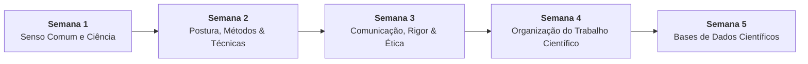

# 📚 Semana 4 — Organização de Trabalho Científico

> **Disciplina:** Projetos e Métodos para a Produção do Conhecimento (`INT100-EC-2026S2B2-T001`)  
> **Curso:** Bacharelado em Engenharia de Computação — Univesp  
> **Docente Responsável:** Profª Dra. Graziella Ribeiro Soares Moura  
> **Período:** 19/10/2026 a 01/11/2026  
> **Status:** 🟢 **100% CONCLUÍDO (Nota 10,0 / 10,0)**  

---

## 🗺️ Índice de Materiais e Atividades

| Arquivo | Descrição | Status |
| :--- | :--- | :---: |
| [**`0-Inicio.md`**](file:///home/henrique/Modelos/Univesp/2026S2B2/INT100-Projetos-e-Metodos-para-a-Producao-do-Conhecimento/Semana-4/0-Inicio.md) | Introdução, Objetivos de Aprendizagem, Desafio Acadêmico (3 obras, ABNT e rascunho de projeto) e Reflexão | 🟢 Pronto |
| [**`1-Videoaulas.md`**](file:///home/henrique/Modelos/Univesp/2026S2B2/INT100-Projetos-e-Metodos-para-a-Producao-do-Conhecimento/Semana-4/1-Videoaulas.md) | Síntese estruturada da Videoaula 5: tipologia dos trabalhos científicos, estrutura tripartite ABNT e distinção entre citações e referências | 🟢 Pronto |
| [**`2-Texto-base-Introducao-Metodologia-Pesquisa-Flick-Cap3.md`**](file:///home/henrique/Modelos/Univesp/2026S2B2/INT100-Projetos-e-Metodos-para-a-Producao-do-Conhecimento/Semana-4/2-Texto-base-Introducao-Metodologia-Pesquisa-Flick-Cap3.md) | Síntese analítica do Cap. 3 (*Leitura e revisão da literatura*, p. 41–51) de Uwe Flick: ponto de partida, escopo, listar vs. analisar e fontes primárias/secundárias | 🟢 Pronto |
| [**`3-Material-base-Normas-ABNT-UNESP.md`**](file:///home/henrique/Modelos/Univesp/2026S2B2/INT100-Projetos-e-Metodos-para-a-Producao-do-Conhecimento/Semana-4/3-Material-base-Normas-ABNT-UNESP.md) | Manual UNESP (Pessôa): formatação física (NBR 14724), estrutura tripartite, regras de citação (NBR 10520), modelos de referências (NBR 6023) e termos latinos | 🟢 Pronto |
| [**`4-Material-base-REA-Reescrita-Academica.md`**](file:///home/henrique/Modelos/Univesp/2026S2B2/INT100-Projetos-e-Metodos-para-a-Producao-do-Conhecimento/Semana-4/4-Material-base-REA-Reescrita-Academica.md) | REA Univesp: método em 4 etapas para reescrita acadêmica, conceitos imutáveis vs. sinônimos, transformações sintáticas e aplicação prática em Computação | 🟢 Pronto |
| [**`4-Aprofundando-o-tema.md`**](file:///home/henrique/Modelos/Univesp/2026S2B2/INT100-Projetos-e-Metodos-para-a-Producao-do-Conhecimento/Semana-4/4-Aprofundando-o-tema.md) | Aprofundamento normativo (Pessôa): citações direta curta/longa, indireta, *apud*, regras de chamada, supressões e referências vs. bibliografia | 🟢 Pronto |
| [**`4.1-Exercicio-de-apoio.md`**](file:///home/henrique/Modelos/Univesp/2026S2B2/INT100-Projetos-e-Metodos-para-a-Producao-do-Conhecimento/Semana-4/4.1-Exercicio-de-apoio.md) | Treinamento prático de Reescrita Acadêmica em 4 etapas (Litjens et al., 2017) + Comprovante oficial em PDF ([`Univesp _ Reescrita Acadêmica.pdf`](file:///home/henrique/Modelos/Univesp/2026S2B2/INT100-Projetos-e-Metodos-para-a-Producao-do-Conhecimento/Semana-4/Univesp%20_%20Reescrita%20Acad%C3%AAmica.pdf)) | 🟢 Pronto |
| [**`4.2-Forum-tematico.md`**](file:///home/henrique/Modelos/Univesp/2026S2B2/INT100-Projetos-e-Metodos-para-a-Producao-do-Conhecimento/Semana-4/4.2-Forum-tematico.md) | Enunciado, articulação das 3 obras com ABNT, redação do projeto, dúvida metodológica e modelos de postagem/réplica para o AVA | 🟢 Pronto |
| [**`5-Atividade-avaliativa.md`**](file:///home/henrique/Modelos/Univesp/2026S2B2/INT100-Projetos-e-Metodos-para-a-Producao-do-Conhecimento/Semana-4/5-Atividade-avaliativa.md) | Resolução analítica completa das 5 questões avaliativas com gabarito oficial fundamentado | 🟢 **Concluído (10,0 / 10,0)** |
| [**`6-Em-sintese.md`**](file:///home/henrique/Modelos/Univesp/2026S2B2/INT100-Projetos-e-Metodos-para-a-Producao-do-Conhecimento/Semana-4/6-Em-sintese.md) | Resumo executivo, arquitetura metodológica, matriz de conceitos e autoavaliação de competências | 🟢 Pronto |

---

## 🧭 Relação com as Demais Semanas

