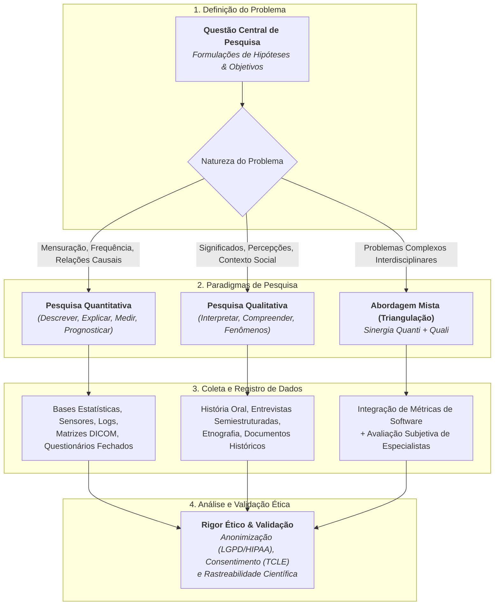
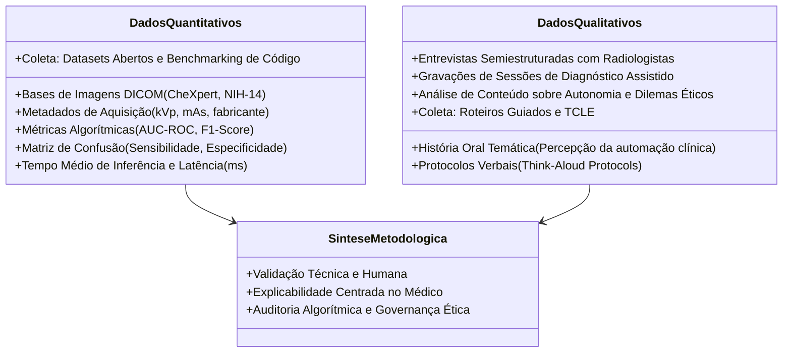

# 📌 Semana 5 — Início & Apresentação da Semana
### Base de Dados Científicos: Características, Procedimentos e Fontes de Pesquisas Quantitativas e Qualitativas

> **Disciplina:** Projetos e Métodos para a Produção do Conhecimento (`INT100-EC-2026S2B2-T001`)  
> **Curso:** Bacharelado em Engenharia de Computação — Univesp  
> **Docente Responsável:** Profª Dra. Graziella Ribeiro Soares Moura  
> **Período da Semana 5:** 26/10/2026 a 08/11/2026  
> **Status:** 🟢 **Documento Oficial de Abertura & Resolução do Desafio Estruturada**  

---

## 👩‍🏫 Mensagem da Professora & Contextualização da Semana

Olá, estudante!

Na última semana, você aprendeu mais sobre a organização do trabalho científico, conhecendo a atitude científica e identificando os tipos de trabalhos científicos, suas fontes e, principalmente, o levantamento bibliográfico como instrumento importante para detecção do **estado da arte** sobre o tema pesquisado.

Nesta semana, você refletirá sobre a **coleta de dados**, uma etapa crucial da pesquisa científica que demanda tempo, planejamento e rigor metódico. É nela que o pesquisador reúne as evidências empíricas e teóricas que corroborarão (comprovarão) ou refutarão a hipótese levantada para a investigação.

Essa etapa deriva de uma organização, com muito critério, das técnicas e instrumentos que serão adequados ao registro e análise dos dados colhidos, sempre em estrito acordo com o tipo de pesquisa que está sendo desenvolvida, ou seja, em acordo direto com o **problema investigado**.

Você verá que os dados coletados podem ser oriundos de:
* **Observações diretas ou participantes** em campo;
* **Levantamentos de informações bibliográficas e documentais**;
* **Bases estatísticas, censitárias e metadados estruturados**;
* **Experimentos controlados em laboratórios**;
* **Respostas obtidas em declarações de pessoas, empresas e instituições** (entrevistas, questionários, relatos orais).

O registro rigoroso das informações coletadas dar-se-á por meio de rol de comportamentos, relação padronizada de perguntas, questionários respondidos por escrito ou gravações audiovisuais. Todo esse material deve ser estritamente controlado, rastreado e registrado, permitindo a posterior análise e auditoria dos dados coligidos.

É possível diferenciar as pesquisas pelos tipos de dados coletados e pela natureza da análise que se fará deles:
1. **Pesquisas Quantitativas:** O pesquisador adota postura objetiva; descreve, explica e projeta prognósticos por meio de classificação, mensuração matemática/estatística e testes de hipóteses formais.
2. **Pesquisas Qualitativas:** O pesquisador compreende, interpreta e frequentemente participa do contexto, explorando significados, discursos, motivações subjetivas e nuances culturais.

Busca-se, desta forma, acolher, legitimar e formalizar o conhecimento da realidade por meio de técnicas eficazes e metodologicamente validadas.

---

## 🔄 Fluxo Metodológico: Da Questão Central à Coleta de Dados

---

## 🎯 Objetivos de Aprendizagem

Ao final desta semana, você deverá ser capaz de:

* [ ] **Identificar as principais características da coleta de dados** em projetos de pesquisa científica.
* [ ] **Apreender as fontes e técnicas de obtenção de dados quantitativos e qualitativos**, compreendendo suas distinções epistemológicas e operacionais.
* [ ] **Entender como tratar, estruturar e analisar dados quantitativos e qualitativos**, articulando ferramentas estatísticas e técnicas de análise de conteúdo / história oral.

---

## 💡 Desafio da Semana: Qualificação dos Dados do Projeto

### 📌 Enunciado Oficial do AVA
> *Prosseguindo com o desafio de escrever um projeto de pesquisa, na última semana você efetuou uma busca com padrão de pesquisa acadêmica, referenciando livros, capítulos de livros e artigos científicos sobre o tema escolhido por você.*  
> 
> *Nesta semana vamos avançar em nosso projeto e, a partir de uma questão central, problema a ser formulado, pensar quais tipos de dados, quantitativos (metadados) e qualitativos (a prática da história oral e suas características), são necessários para que a pesquisa se desenvolva.*  
> 
> *A primeira coisa é identificar a característica principal do problema levantado. Trata-se de uma questão que envolve características quantitativas ou qualitativas? O desafio é qualificar sua pesquisa, lembrando que um mesmo projeto pode requerer, em distintas fases, os dois tipos de dados.*  
> 
> *Imagine, hipoteticamente, o desenvolvimento de uma investigação sobre a história de uma empresa instalada em um pequeno município brasileiro que tem significado econômico como geradora de empregos, de impostos e que, no contexto nacional, torna esse local muito conhecido, tendo em vista as técnicas sustentáveis que utiliza em sua produção. Que aspectos envolvem essa instalação e organização?*  
> 
> *Temos aqui um conjunto distinto de dados que deverão ser coletados, a começar por conhecer a história de instalação da empresa neste local. Para isso, deve-se trabalhar com dados que são históricos e obtidos a partir de levantamento de documentos, registros em arquivos públicos, de entrevistas e questionários que serão respondidos por membros da empresa. Por outro lado, depois de investigações iniciais reconhece-se que a história de vida do fundador da empresa diz muito sobre seu padrão de funcionamento. Como conhecer essa história? Através da técnica da história oral, na qual o fundador relata toda sua trajetória de vida de forma livre, revisitando suas memórias. Além disso, pretende-se caracterizar a empresa considerando seus investimentos, produção, número de funcionários etc. É necessário ter acesso aos balancetes da empresa, relatórios etc.*  
> 
> *É importante ter muito claro qual é o problema levantado e o que é preciso ter em dados para responder a ele.*

---

### 💻 Resolução Estruturada do Desafio: Aplicação ao Projeto de Engenharia de Computação

Para garantir a coerência científica e a progressão contínua com as Semanas 1, 2, 3 e 4, aplicamos o desafio diretamente à nossa pesquisa:

* **Linha de Pesquisa:** Inteligência Artificial Aplicada à Engenharia Biomédica e Diagnóstico por Imagem.
* **Título do Projeto:** *Sistemas Inteligentes de Visão Computacional e Aprendizado Profundo Aplicados ao Auxílio Diagnóstico em Radiologia Pulmonar: Desafios de Explicabilidade Algorítmica (Grad-CAM), Confiabilidade Clínica e Governança Bioética*.

#### 1. Formulação da Questão Central (Problema de Pesquisa)
> *"Em que medida a integração de mapas visuais de explicabilidade (Grad-CAM) a redes neurais convolucionais é capaz de elevar a acurácia diagnóstica quantitativa e, simultaneamente, assegurar a confiabilidade qualitativa e a adesão ética de médicos radiologistas na detecção de patologias torácicas?"*

#### 2. Qualificação Epistemológica da Pesquisa: A Necessidade da Abordagem Mista (*Mixed Methods*)
O problema formulado exige uma **abordagem mista (triangulação metodológica)**, pois o desenvolvimento de software na Engenharia de Computação biomédica não pode limitar-se a métricas estatísticas abstratas desvinculadas da experiência do usuário especialista e das exigências bioéticas hospitalares:

#### 3. Detalhamento dos Dados e Instrumentos de Coleta

| Dimensão Metodológica | Tipo de Dado Coletado | Fontes de Pesquisa & Repositórios | Instrumentos e Técnicas de Coleta | Tratamento e Procedimentos de Análise |
| :--- | :--- | :--- | :--- | :--- |
| **Quantitativa** *(Computacional e Estatística)* | • Matrizes brutas de pixels radiográficos. • Metadados padronizados DICOM. • Métricas de performance: Sensibilidade, Especificidade, Curva ROC-AUC e tempo de latência de GPU. | • Repositórios científicos abertos (*Stanford CheXpert*, *NIH ChestX-ray14*). • Logs automatizados do pipeline em Python/PyTorch. | • Scripts de pré-processamento digital. • Normalização de histograma. • *Benchmarking* automatizado de testes cegos. | • Estatística inferencial e descritiva. • Testes de significância estatística (*t-Student*, ANOVA). • Cálculo de intervalos de confiança (95%). |
| **Qualitativa** *(Humana, Clínica e Bioética)* | • Discursos e relatos de radiologistas sobre a inteligibilidade visual dos mapas de calor. • Narrativas de história oral temática acerca da evolução da automação no setor hospitalar. • Impressões sobre a segurança na tomada de decisão. | • Médicos radiologistas e residentes de centros de diagnóstico por imagem. • Arquivos institucionais de associações médicas (ex.: Colégio Brasileiro de Radiologia). | • Roteiros de entrevistas semiestruturadas. • Gravação de áudio/vídeo sob Termo de Consentimento Livre e Esclarecido (TCLE). • Observação assistida da interação com a interface gráfica. | • Análise de Conteúdo categorial (Bardin / Gibbs). • Transcrição textual e codificação temática. • Triangulação qualitativa das hesitações e resistências à tecnologia. |

#### 4. Salvaguardas Éticas e de Governança
* **Dados Quantitativos:** Remoção completa de marcadores de identificação do paciente (*Protected Health Information* - PHI) em conformidade com a LGPD (Lei nº 13.709/2018) e o padrão internacional HIPAA.
* **Dados Qualitativos:** Submissão prévia do protocolo de pesquisa a Comitê de Ética em Pesquisa (CEP/CONEP), garantia do anonimato dos profissionais colaboradores e guarda criptografada dos registros de áudio e transcrições.

---

## 🔍 Revisitando Conhecimentos: Análise dos Casos Práticos de Apoio

Para fundamentar a compreensão dos paradigmas de pesquisa, analisamos os dois casos práticos propostos pela docente no AVA:

### 1. Pesquisa Qualitativa & Etnografia: *Papo com Pesquisa (Universidade FEEVALE)*
* **Objeto:** Conflitos ambientais na bacia hidrográfica do Rio dos Sinos (RS) — [Assistir no YouTube](https://www.youtube.com/watch?v=zEvrvNo8Tq0).
* **Técnica:** Etnografia e observação direta participante.
* **Lição Metodológica:** A pesquisa qualitativa mergulha no território para captar o que laudos físico-químicos isolados não revelam: a percepção de risco das comunidades ribeirinhas, as relações assimétricas de poder entre indústrias poluidoras e a população local e a memória coletiva sobre a degradação das águas. O pesquisador atua como instrumento de observação e escuta sensível.

### 2. Pesquisa Quantitativa & Estatística Pública: *Atlas Brasil do IDHM (IPEA / PNUD)*
* **Objeto:** Índice de Desenvolvimento Humano Municipal (IDHM) no Brasil — [Assistir no YouTube](https://www.youtube.com/watch?v=K7Cftgj250Y).
* **Técnica:** Mineração de dados censitários (Censo Demográfico do IBGE), padronização de variáveis e modelagem econométrica.
* **Lição Metodológica:** A pesquisa quantitativa permite agregar milhões de registros individuais em três dimensões universais (Longevidade, Educação e Renda). Oferece poder de comparabilidade temporal, mapeamento geoespacial das disparidades municipais e subsídios empíricos auditáveis para a formulação de políticas públicas baseadas em evidências.

---

## 📚 Roteiro de Estudos da Semana 5

Para cobrir a carga horária de 10 horas semanais e consolidar os conteúdos da Semana 5:

1. **Videoaulas Oficiais:**
   * Assistir à Videoaula: *Base de dados científicos: As pesquisas quantitativa e qualitativa* (Profª Dra. Graziella Moura).
2. **Textos e Leituras-Base:**
   * Ler o Capítulo 1 do livro *Análise de Dados Qualitativos* (Graham Gibbs, 2009): *A Natureza da Análise Qualitativa*.
   * Estudar os materiais institucionais do IBGE sobre documentação, tecnologia da informação e sistemas censitários.
3. **Vídeos Complementares de Aprofundamento:**
   * *George Brown* — Pesquisa Qualitativa e Quantitativa ([YouTube](https://youtu.be/hVNdfBKBkTc)).
   * *Professor Sebe (Editora Contexto)* — O que é História Oral? ([YouTube](https://youtu.be/rl8CDDXFmTE)).
4. **Fórum Temático & Atividade Avaliativa:**
   * Participar das discussões conceituais no Fórum da Semana 5.
   * Resolver o questionário da atividade avaliativa da Semana 5 no AVA.

---

## 💬 Para Refletir

> *"A coleta de dados é etapa importante no desenvolvimento da pesquisa desenvolvida segundo normas e procedimentos que envolvem rigor e ética. As informações numéricas, resultados de experimentos em humanos e animais, ideias, discursos e imagens de terceiros são fontes da pesquisa acadêmica. A notoriedade de uma pesquisa e seu pesquisador só são reconhecidos quando o respeito às fontes é garantido e praticado."*  
> — **Profª Dra. Graziella Ribeiro Soares Moura**
