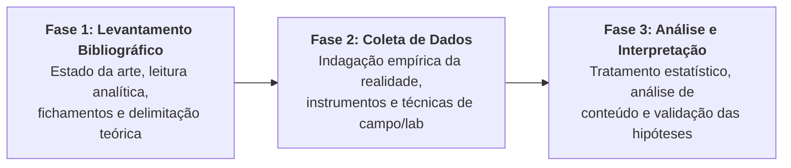
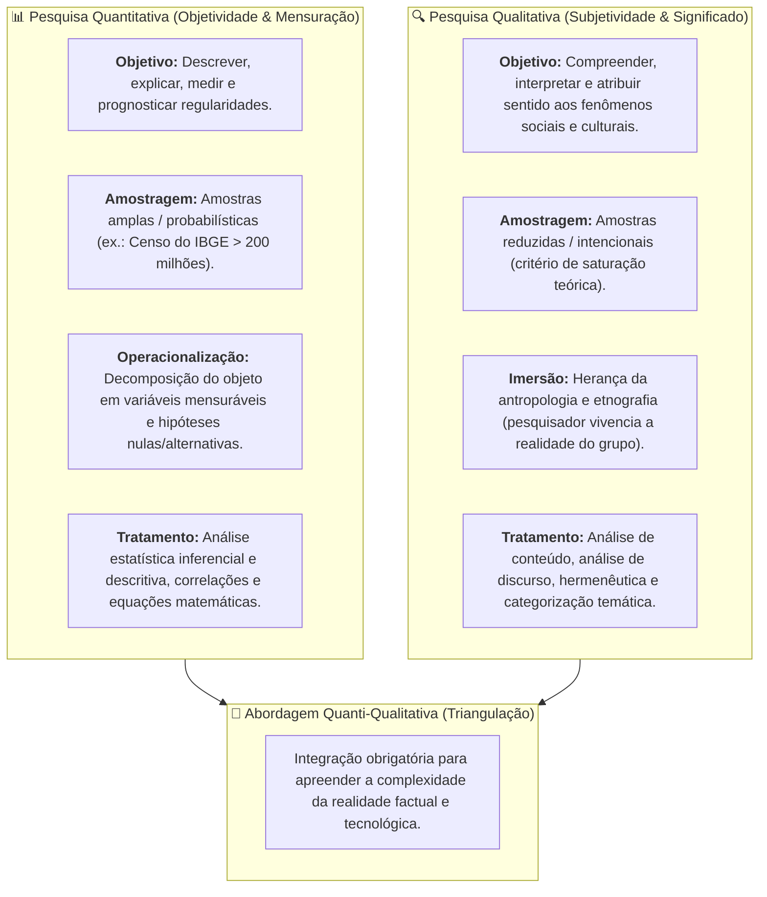
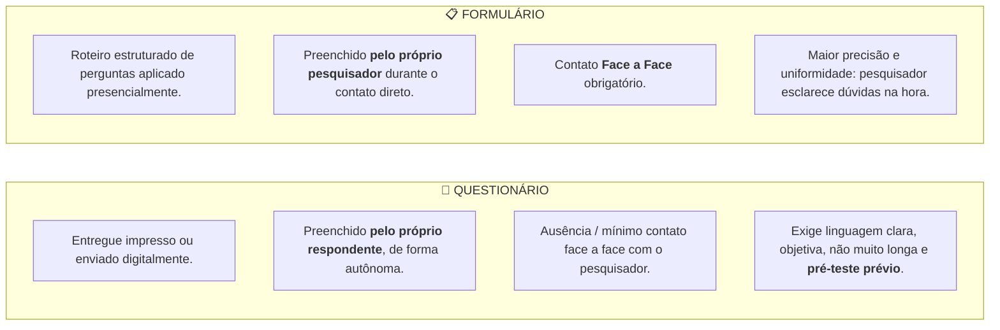
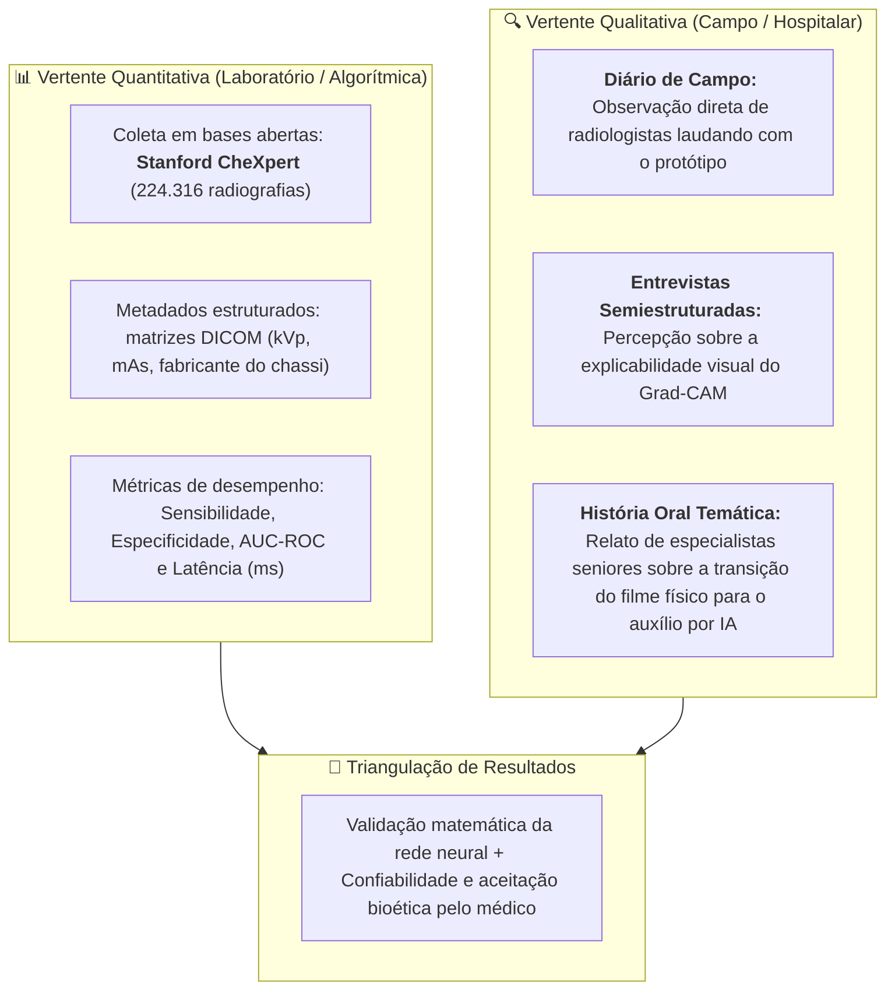

# 🎥 Videoaula 6 — Base de Dados Científicos: As Pesquisas Quantitativa e Qualitativa

> **Disciplina:** Projetos e Métodos para a Produção do Conhecimento (`INT100-EC-2026S2B2-T001`)  
> **Tema da Semana 5:** Base de Dados Científicos: Características, Procedimentos e Fontes de Pesquisas Quantitativas e Qualitativas  
> **Link Oficial:** [Assistir no YouTube (UNIVESP)](https://www.youtube.com/watch?v=JaXoD7Pzbew)  
> **Docente da Aula:** Profª Darlene Ferreira  
> **Período Acadêmico:** 26/10/2026 a 08/11/2026  
> **Status:** 🟢 **Síntese Analítica Completa & Mapeamento Conceitual**  

---

## 📌 Visão Geral da Videoaula

Na Videoaula 6, a **Profª Darlene Ferreira** conduz uma imersão sistemática sobre a **coleta de dados**, situada como a segunda grande fase do ciclo da investigação científica. A aula estabelece as bases epistemológicas, as diferenças operacionais e os procedimentos práticos que distinguem e integram as abordagens **quantitativa** e **qualitativa**.

A exposição organiza-se em quatro eixos fundamentais:
1. **O Lugar da Coleta no Ciclo da Pesquisa Científica:** Transição da revisão da literatura para a indagação empírica da realidade (pesquisa de campo versus pesquisa de laboratório).
2. **A Pesquisa Quantitativa:** Princípios de objetividade, mensuração matemática, operacionalização em variáveis, tratamento estatístico formal e trabalho com amostras censitárias/amplas.
3. **A Pesquisa Qualitativa:** Imersão no campo, apreensão de significados subjetivos, valores, crenças e símbolos, raízes etnográficas e trabalho com amostras reduzidas.
4. **Instrumentos e Técnicas de Coleta de Dados:** O contraste conceitual indispensável entre **questionário** e **formulário**, o uso do **diário de campo**, a **história oral**, as **entrevistas** e a superação da dicotomia pela abordagem mista (**quanti-qualitativa**).

---

## 🔄 1. O Lugar da Coleta no Ciclo da Investigação

A pesquisa científica desenvolve-se em três macroetapas sequenciais e interdependentes:

Na **Fase 2**, o pesquisador confronta suas perguntas e hipóteses com a realidade factual. A escolha dos instrumentos de coleta é estritamente subordinada a dois fatores:
* O **tipo de informação necessária** para responder à questão central;
* A **natureza ontológica do objeto, fato ou fenômeno** investigado.

### Modalidades Gerais de Coleta
* **Pesquisa de Campo:** Conduzida no ambiente natural onde os fenômenos ocorrem (sociedade, comunidades, mercados, espaços rurais, hospitais). Privilegia a observação das interações espontâneas.
* **Pesquisa de Laboratório:** Conduzida em ambiente artificialmente controlado. O pesquisador manipula variáveis independentes e mensura com precisão instrumental as respostas de variáveis dependentes em experimentos reprodutíveis.

---

## ⚖️ 2. Paradigmas de Pesquisa: Quantitativo versus Qualitativo

Historicamente, a pesquisa qualitativa sofreu resistências positivistas sob a alegação de "falta de sistematização rígida". No entanto, a ciência contemporânea reconhece que a realidade é intrinsecamente complexa, exigindo diferentes lentes de observação:

### 📋 Quadro Comparativo dos Paradigmas

| Dimensão Metodológica | Pesquisa Quantitativa | Pesquisa Qualitativa |
| :--- | :--- | :--- |
| **Foco Central** | Mensuração numérica, frequência, causa e efeito. | Significados, valores, motivos, crenças e representações. |
| **Postura do Pesquisador** | Neutro, observador externo distante do objeto. | Imerso, interativo, instrumento direto de escuta e apreensão. |
| **Dimensão da Amostra** | Ampla, estatisticamente representativa do universo. | Reduzida, focada na profundidade dos casos selecionados. |
| **Estrutura dos Instrumentos** | Altamente estruturados, rígidos e padronizados. | Semiestruturados ou abertos, flexíveis e adaptativos. |
| **Forma dos Dados** | Números, matrizes, métricas, tabelas e gráficos. | Palavras, relatos orais, transcrições, imagens e diários. |
| **Critério de Validação** | Confiabilidade estatística, replicabilidade e significância ($p$-valor). | Autenticidade, reflexividade, contextualização e coerência interna. |

---

## 🛠️ 3. Instrumentos e Técnicas de Coleta de Dados

A professora detalha o arsenal metodológico à disposição do pesquisador, com especial destaque para a diferenciação conceitual entre ferramentas clássicas:

### 1. Observação Científica & Diário de Campo
* **Observação Metódica:** Uso deliberado e sistemático dos sentidos humanos (visão, audição) para registrar fatos no momento exato em que ocorrem.
* **Diário de Campo:** Caderno físico ou digital de anotações no qual o pesquisador registra dia a dia as impressões da imersão, detalhes contextuais, comportamentos não verbais, desenhos, fotografias e áudios. Amplamente empregado na Antropologia, Sociologia e Geografia Agrária.

### 2. A Distinção Clássica: Questionário versus Formulário

> ⚠️ **Ponto de Alta Frequência em Avaliações:** A diferença crucial reside em **quem preenche o instrumento** e no **tipo de contato interpessoal**.

### 3. Entrevistas
* Estabelecem uma relação dialógica e interpessoal direta entre entrevistador e entrevistado.
* **Modalidades:**
  * **Estruturada:** Segue rigorosamente uma lista pré-fixada de perguntas fechadas.
  * **Semiestruturada:** Apoia-se em um roteiro guia de tópicos principais, conferindo liberdade para o pesquisador aprofundar respostas pertinentes.
  * **Aberta / Não Estruturada:** O entrevistado discorre livremente em torno de um tema disparador central.

### 4. História Oral e História de Vida
* Técnica qualitativa orientada à recuperação de relatos históricos, trajetórias biográficas e reconstituição da memória coletiva por meio de testemunhas oculares de processos sociais, institucionais ou corporativos.

### 5. Outras Técnicas de Coleta
* **Pesquisa Documental:** Registros em arquivos públicos, relatórios governamentais, balancetes e normas.
* **Análise de Conteúdo:** Decomposição sistemática de mensagens textuais, visuais ou sonoras.
* **Sociometria e Testes Psicométricos:** Medição de atitudes, relações afetivas e estruturas de grupo.

---

## 💻 4. Aplicação Concreta: Projeto de Engenharia de Computação (IA na Radiologia)

Para ilustrar a fusão dos conceitos apresentados na videoaula com o nosso projeto interdisciplinar:

1. **Amostra Ampla Quantitativa:** O treinamento da rede neural exige amostras massivas (dezenas de milhares de imagens radiográficas) para garantir robustez estatística e generalização algorítmica.
2. **Amostra Reduzida Qualitativa:** A avaliação da usabilidade e da governança ética dos mapas explicativos Grad-CAM é realizada com um grupo intencional reduzido de radiologistas (ex.: 8 a 12 especialistas), permitindo imersão profunda nas razões de suas hesitações diagnósticas e confiança na tecnologia.

---

## 🎯 Conceitos-Chave para Fixação (Glossário da Videoaula)

* **Fase Empírica:** Momento em que a pesquisa sai do campo puramente conceitual e indaga a realidade por meio de dados concretos.
* **Amostra Probabilística:** Seleção estatística em que todos os indivíduos do universo têm probabilidade conhecida e diferente de zero de serem escolhidos.
* **Imersão Etnográfica:** Postura investigativa em que o pesquisador convive com o grupo social pesquisado para compreender seus códigos culturais internos.
* **Pré-Teste de Questionário:** Aplicação piloto do questionário a um pequeno grupo teste para verificar clareza, tempo de resposta e inconsistências antes da aplicação massiva.
* **Triangulação de Métodos:** Prática científica de combinar técnicas quantitativas e qualitativas para investigar o mesmo fenômeno sob ângulos complementares.
