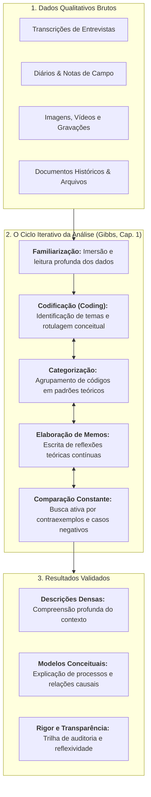
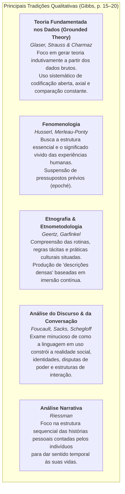
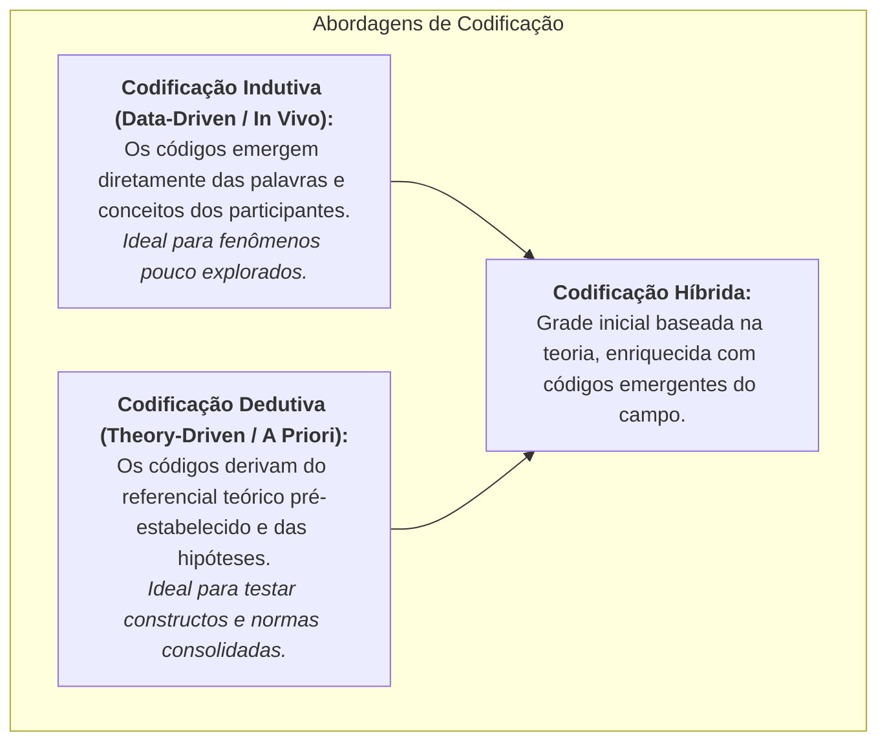
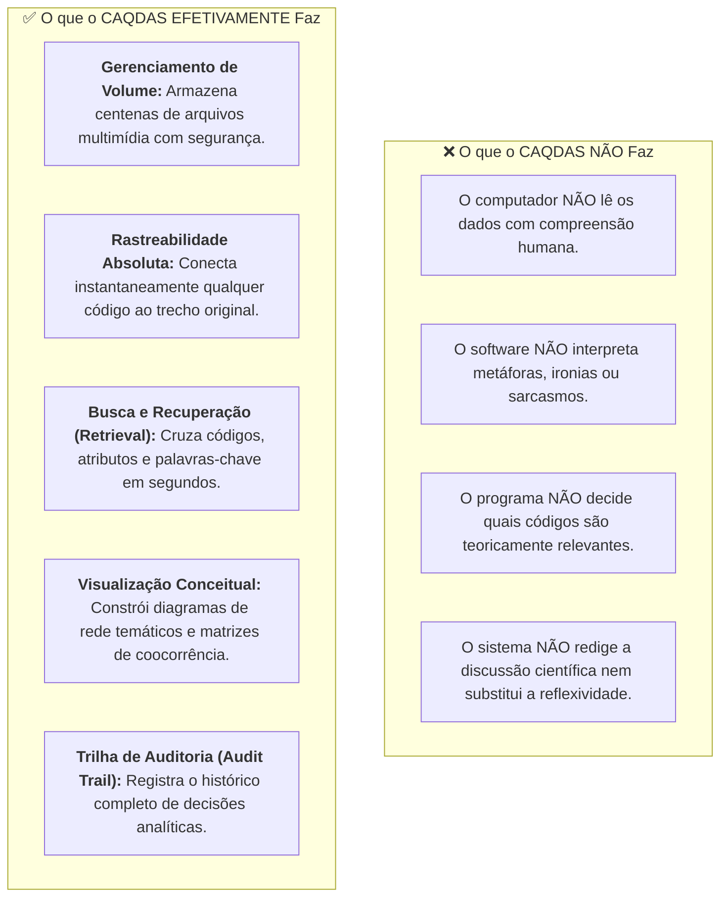
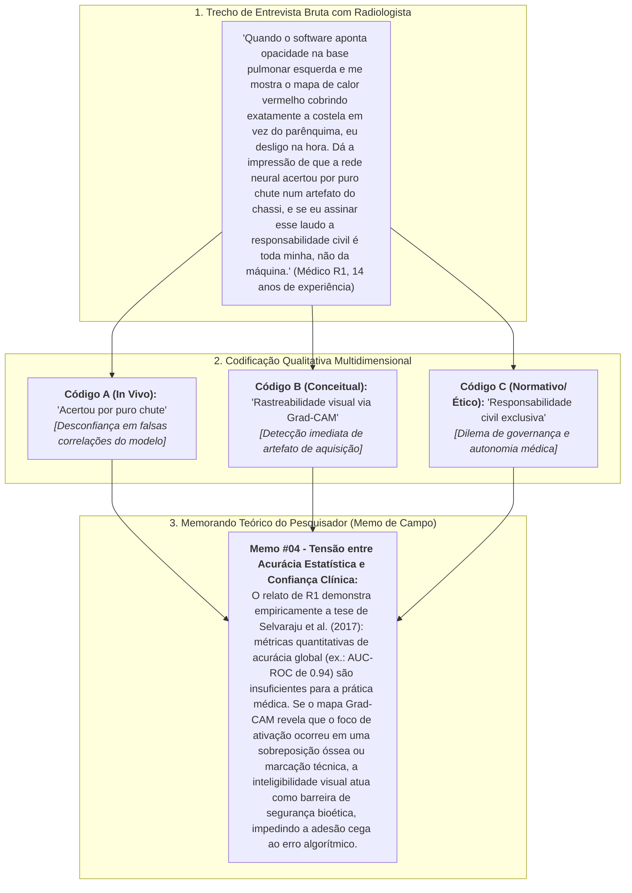

# 📖 Texto-base — A Natureza da Análise Qualitativa (Graham Gibbs, Cap. 1)

> **Disciplina:** Projetos e Métodos para a Produção do Conhecimento (`INT100-EC-2026S2B2-T001`)  
> **Tema da Semana 5:** Base de Dados Científicos: Características, Procedimentos e Fontes de Pesquisas Quantitativas e Qualitativas  
> **Obra de Referência:** GIBBS, Graham. **Análise de dados qualitativos**. Tradução: Roberto Cataldo Costa. Coleção Pesquisa Qualitativa (Coordenação de Uwe Flick). Porto Alegre: Artmed / Bookman, 2009. 198 p. ISBN: 978-85-363-2133-2.  
> **Capítulo Estudado:** Capítulo 1 — *A natureza da análise qualitativa* (p. 11–26 / reader p. 12)  
> **Acesso Digital:** [Minha Biblioteca UNIVESP](https://app.minhabiblioteca.com.br/reader/books/9788536321332/pageid/12)  
> **Período Acadêmico:** 26/10/2026 a 08/11/2026  
> **Status:** 🟢 **Síntese Epistemológica & Metodológica Completa**  

---

## 📌 Contextualização e Visão Geral da Obra

Na consagrada *Coleção Pesquisa Qualitativa* coordenada por **Uwe Flick**, o professor britânico **Graham Gibbs** (Universidade de Huddersfield) assume a tarefa de desmistificar um dos momentos mais desafiadores da investigação científica: o tratamento e a interpretação de dados não estruturados.

No **Capítulo 1 (*A Natureza da Análise Qualitativa*)**, Gibbs combate dois mitos extremos que frequentemente cercam a pesquisa qualitativa:
1. **O Mito do "Achismo Subjetivista":** A crença ingênua de que analisar dados qualitativos é simplesmente ler um punhado de entrevistas e expressar impressões pessoais sem método, critério ou rigor formal;
2. **O Mito da "Mágica do Software":** A ilusão tecnicista de que programas de computador (CAQDAS) realizam a interpretação e "extraem a teoria" automaticamente a partir do carregamento dos arquivos brutos.

Para Gibbs, a análise de dados qualitativos é um **ofício sistemático, artesanal e profundamente reflexivo**. Trata-se do processo rigoroso de transformar registros densos da realidade (discursos, notas etnográficas, gravações, documentos) em entendimentos conceituais fundamentados, padrões temáticos coerentes e teorias empiricamente sustentadas.

---

## 🔍 1. O que são Dados Qualitativos e em que Consiste a sua Análise?

De acordo com Gibbs (2009, p. 11–14), os dados qualitativos caracterizam-se primordialmente por **não serem intrinsecamente numéricos**. Eles manifestam-se em linguagem natural, imagens e práticas sociais situadas:

* **Natureza Textual e Multimodal:** Predominam transcrições literais de entrevistas, notas de observação participante registradas em diários de campo, relatórios institucionais, correspondências, fotografias, vídeos e gravações em áudio.
* **Volume e Não Estruturação:** Uma única hora de entrevista gravada pode gerar entre 20 e 30 páginas de texto transcrito em espaçamento simples. O pesquisador depara-se rapidamente com centenas de páginas desprovidas de formato padronizado ou tabelamento prévio.
* **Sensibilidade ao Contexto:** Diferente da variável quantitativa (que busca isolar o indicador do ruído ambiente), o dado qualitativo retira sua força explicativa exatamente da **relação indissociável com o contexto cultural, institucional e biográfico** no qual foi enunciado.

### O Que Significa "Analisar"?
Analisar dados qualitativos não se confunde com parafrasear ou recortar passagens pitorescas de entrevistados. Gibbs define a análise como um processo deliberado de:
1. **Decomposição Controlada:** Fragmentar o texto denso em unidades de sentido significativas;
2. **Reorganização Conceitual:** Agrupar fragmentos correlatos sob categorias e rótulos temáticos;
3. **Interpretação e Teorização:** Sintetizar como esses padrões respondem às perguntas de pesquisa, desvelando regularidades, contradições e lógicas implícitas de ação.

---

## 🏛️ 2. Tradições Epistemológicas na Análise Qualitativa

Gibbs esclarece que a forma como o pesquisador lida com seus dados depende diretamente da tradição teórica adotada:

### 📋 Quadro Sintético das Tradições

| Tradição | Questão Central | Unidade de Análise | Estratégia Analítica Típica |
| :--- | :--- | :--- | :--- |
| **Grounded Theory** | Qual teoria explica esse processo ou comportamento social? | Incidentes, ações e processos nos dados. | Codificação linha a linha, comparação constante e amostragem teórica. |
| **Fenomenologia** | Qual é o significado essencial desta experiência vivida? | Relatos descritivos de sentimentos e percepções. | Identificação de temas existenciais e redução fenomenológica. |
| **Etnografia** | Quais são os padrões culturais que regem esta comunidade? | Rituais, práticas cotidianas e artefatos. | Triangulação entre observação participante e diário de campo. |
| **Análise do Discurso** | Como este texto reforça ou desafia relações de poder? | Formações discursivas e enunciados. | Desconstrução ideológica e exame das posições de sujeito. |
| **Análise Narrativa** | Como o indivíduo organiza sua história para construir sentido? | Narrativas biográficas completas (enredos). | Análise da estrutura dramática (começo, clímax e desfecho). |

---

## 🔄 3. A Dinâmica da Análise: O Processo Iterativo em Espiral

Uma das lições metodológicas mais enfáticas de Graham Gibbs (2009, p. 20–22) é a **recusa da linearidade estrita**.

Enquanto a pesquisa quantitativa clássica segue um trajeto unidirecional rígido (*Hipótese $\rightarrow$ Desenho Amostral $\rightarrow$ Coleta Fechada $\rightarrow$ Tratamento Estatístico $\rightarrow$ Conclusão*), a análise qualitativa opera em um **movimento cíclico em espiral**:

### Princípios da Iteração Analítica:
1. **Coleta e Análise Simultâneas:** O pesquisador não deve aguardar a realização de todas as entrevistas para só então iniciar a análise. Analisar desde a primeira entrevista permite identificar temas emergentes inesperados e refinar o roteiro para os entrevistados subsequentes.
2. **Amostragem Teórica e Saturação:** A inclusão de novos participantes não é determinada por fórmulas matemáticas a priori, mas pela necessidade conceitual de aprofundar categorias teóricas até o ponto de **saturação** (momento em que novos dados deixam de agregar propriedades conceituais inéditas).

---

## 🏷️ 4. As Operações Centrais da Análise: Codificação e Memorandos

Gibbs consagra grande parte do capítulo àquela que considera a espinha dorsal de todo o procedimento analítico: a **codificação (*coding*)** e a escrita de **memorandos (*memos*)**.

### O que é Codificação?
> *"Codificar é a forma como você define sobre o que tratam os dados com os quais está lidando. Envolve identificar uma passagem no texto ou em outro dado, buscando e identificando conceitos e ideias nesses dados e destacando essa passagem com um nome ou código que a represente."*  
> — **Graham Gibbs (2009, p. 16)**

### O Valor Vital dos Memorandos (*Memos*)
Um dos alertas mais incisivos de Gibbs é que o pesquisador iniciante gasta energia excessiva apenas "colando etiquetas" (códigos) no texto e se esquece de registrar suas reflexões intelectuais.

* **O que é um Memo?** É uma anotação reflexiva, redigida pelo pesquisador para si mesmo, contendo reflexões teóricas, conjecturas, comparações entre casos, dúvidas conceituais e conexões entre diferentes códigos.
* **A Regra de Ouro:** *Nunca atrase a escrita de um memo*. Quando um insight surgir durante a codificação, o trabalho mecânico deve ser interrompido imediatamente para redigir o memorando analítico.

---

## 💻 5. O Papel dos Softwares CAQDAS (NVivo, ATLAS.ti, MAXQDA)

Graham Gibbs é internacionalmente reconhecido como pioneiro no estudo de **softwares de análise de dados qualitativos auxiliada por computador (CAQDAS)**. No Capítulo 1, ele estabelece com absoluta clareza o papel, os limites e os mitos dessas tecnologias:

> 💡 **Máxima de Gibbs:** O CAQDAS não é um algoritmo de *machine learning* não supervisionado; é uma potente bancada de trabalho digital. A inteligência, o julgamento hermenêutico e a responsabilidade ética permanecem 100% sob a autoridade do pesquisador humano.

---

## 🛡️ 6. Rigor, Validade e Ética na Análise Qualitativa

Para refutar a crítica positivista de que a análise qualitativa seria subjetiva demais e, portanto, frágil, Gibbs detalha os pilares do **rigor científico**:

1. **A Procura Ativa por Casos Negativos (*Deviant Cases*):**
   * O pesquisador rigoroso não busca apenas trechos que confirmem suas convicções prévias. Ele persegue intencionalmente passagens nos dados que contrariem o modelo emergente, ajustando as categorias para explicar a totalidade dos fatos.
2. **Triangulação Metodológica:**
   * Cruzamento de dados de fontes distintas (ex.: entrevistas com médicos, observação direta no hospital e relatórios de auditoria clínica).
3. **Trilha de Auditoria Transparente (*Audit Trail*):**
   * Manter registros detalhados de cada versão do livro de códigos (*codebook*), memos redigidos e critérios de categorização, permitindo que qualquer avaliador externo reconstitua os passos lógicos que conduziram às conclusões.
4. **Reflexividade Epistêmica:**
   * Reconhecimento aberto e honesto do pesquisador quanto à sua posição social, formação técnica e preferências teóricas, explicitando como essas características influenciaram a interação no campo e o olhar sobre os dados.

---

## 🏥 7. Articulação Prática: O Projeto de IA na Radiologia Médica

Aplicando a metodologia do Capítulo 1 de Graham Gibbs ao nosso projeto de Engenharia de Computação (*Visão Computacional, Grad-CAM e Bioética em Radiologia*):

### Síntese da Triangulação no Projeto:
* Os **dados quantitativos** (CheXpert, matrizes de confusão, sensibilidade) medem **o que** o algoritmo faz e com que taxa de acerto estatístico;
* A **análise qualitativa de Gibbs** (codificação, entrevistas e memorandos) compreende **por que e como** o radiologista confia, valida ou recusa a recomendação automatizada na dinâmica real da saúde pública.

---

## 🎯 Síntese Conceitual para Fixação (Matriz de Gibbs)

| Dimensão Analítica | Abordagem Tradicional Ingênua | Abordagem Rigorosa de Graham Gibbs |
| :--- | :--- | :--- |
| **Coleta e Análise** | Fases estanques e lineares (uma termina, a outra começa). | **Ciclo iterativo em espiral:** coleta e análise simultâneas com amostragem teórica. |
| **Papel da Codificação** | Mera indexação mecânica de palavras-chave. | **Conceituação ativa:** decomposição de sentidos e atribuição de rótulos interpretativos. |
| **Uso de Memorandos** | Anotações esporádicas e secundárias. | **Instrumento teórico central:** registro contínuo da reflexividade e insights analíticos. |
| **Papel do Computador** | Crença de que o software realiza a análise. | **Bancada de trabalho:** automação de recuperação e ordenação; a interpretação é estritamente humana. |
| **Validação da Pesquisa** | Confiar na subjetividade inquestionável do autor. | **Transparência metódica:** busca ativa de casos negativos, triangulação e trilha de auditoria. |
