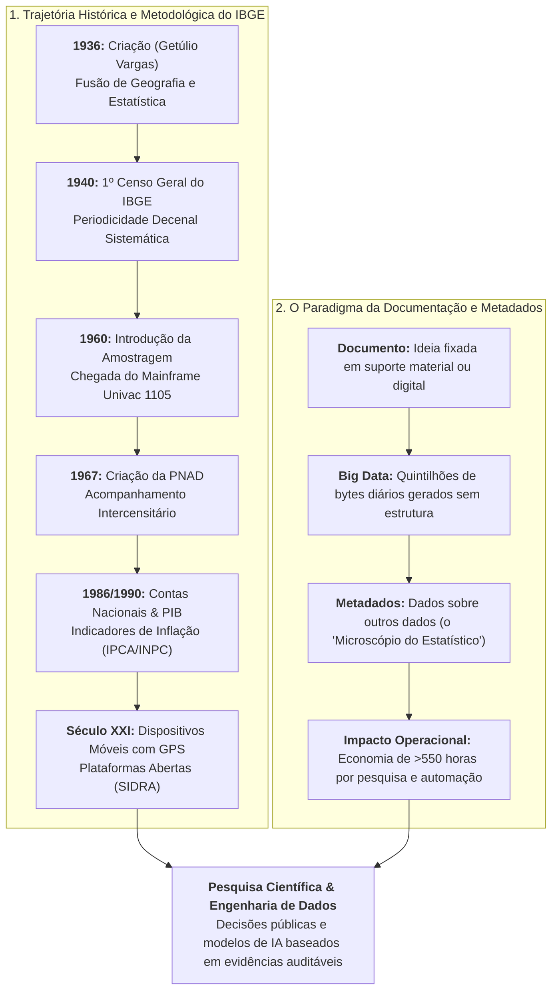
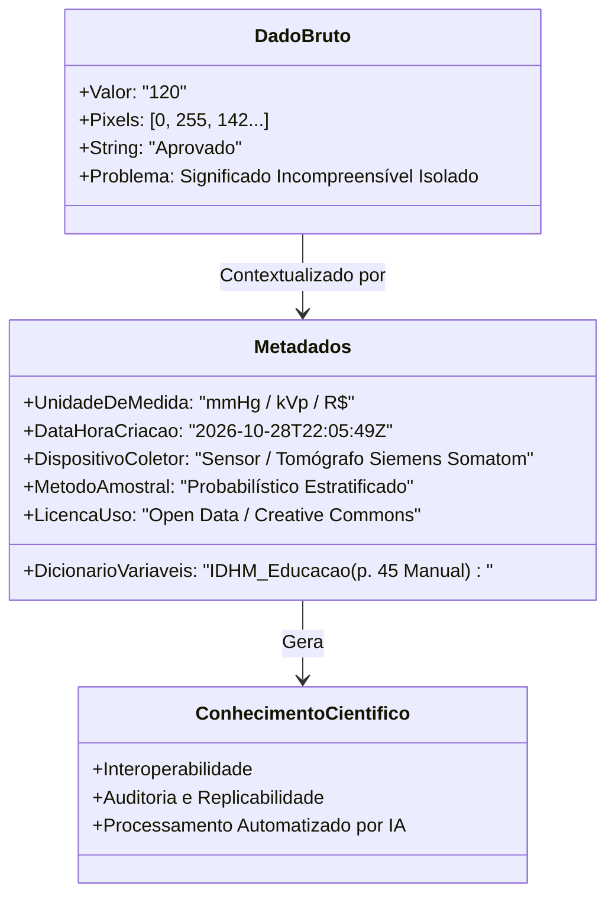
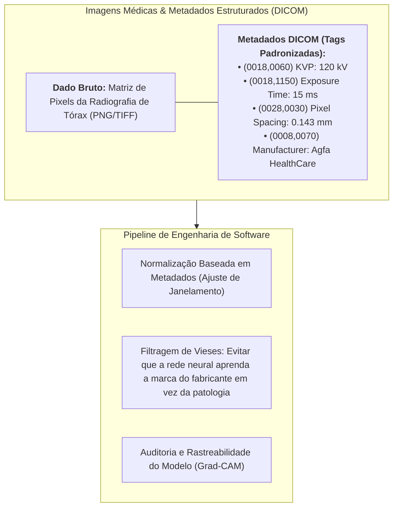

# 📊 Material-base — Fontes Estatísticas Públicas, Documentação e Metadados (IBGE)

> **Disciplina:** Projetos e Métodos para a Produção do Conhecimento (`INT100-EC-2026S2B2-T001`)  
> **Tema da Semana 5:** Base de Dados Científicos: Características, Procedimentos e Fontes de Pesquisas Quantitativas e Qualitativas  
> **Fontes Audiovisuais Oficiais:**  
> * Vídeo 1: *Muito prazer, sou o IBGE! (80 anos)* — [Assistir no YouTube](https://www.youtube.com/watch?v=6Q5DWTY34Bg)  
> * Vídeo 2: *IBGE Explica: A importância da documentação* — [Assistir no YouTube](https://www.youtube.com/watch?v=cpTFyhRShWQ)  
> **Instituição:** Instituto Brasileiro de Geografia e Estatística (IBGE)  
> **Período Acadêmico:** 26/10/2026 a 08/11/2026  
> **Status:** 🟢 **Síntese Analítica Completa & Aplicação em Engenharia de Dados**  

---

## 📌 Visão Geral e Relevância Metodológica

O estudo das bases de dados quantitativas públicas é indispensável para qualquer ramo da ciência moderna, incluindo a Engenharia de Computação. No Brasil, o **Instituto Brasileiro de Geografia e Estatística (IBGE)** é o órgão central de produção, consolidação e disseminação das informações geográficas, cartográficas, demográficas e socioeconômicas do país.

A análise articulada dos dois vídeos institucionais do IBGE revela dois pilares da pesquisa quantitativa em escala macro:
1. **A Evolução Histórica da Produção Estatística Nacional:** Como o Estado brasileiro passou da ausência de dados sistemáticos para um complexo ecossistema de dados estruturados (Censos Decenais, Amostragem Probabilística, PNAD, Contas Nacionais/PIB e Georreferenciamento);
2. **A Teoria da Documentação e a Centralidade dos Metadados:** Por que registrar dados brutos é inútil sem padronização, catalogação e dicionários de metadados legíveis por máquina (*machine-readable*).

---

## 🏛️ 1. O IBGE e a Construção da Identidade Quantitativa do Brasil

O vídeo comemorativo dos 80 anos do IBGE (*"Muito prazer, sou o IBGE!"*) expõe a biografia da instituição como um espelho da própria modernização científica do Brasil:

### Marcos Históricos e Rupturas Metodológicas:
* **Nascimento (1934–1936):** Concebido no início da Era Vargas como Instituto Nacional de Estatística (INE) e consolidado em 1938 com a integração do Conselho Nacional de Geografia (CNG), unificando pela primeira vez a cartografia territorial e o levantamento de dados populacionais.
* **O Recenseamento Geral de 1940:** Estreia do IBGE na condução do Censo Demográfico decenal, estabelecendo o padrão rigoroso de visitação domiciliar universal.
* **Divisão Regional Oficial (1942):** Criação do primeiro mapa de macrorregiões (Norte, Nordeste, Leste, Sul e Centro-Oeste), permitindo comparar estatísticas regionais e orientar o planejamento estatal de infraestrutura.
* **Criação da ENCE (1953):** Fundação da Escola Nacional de Ciências Estatísticas, primeira faculdade de estatística do Brasil, garantindo autonomia na formação de quadros de pesquisadores de alto nível.
* **A Revolução da Amostragem e da Computação (1960):**
  * Introdução da **teoria da amostragem probabilística**, demonstrando matematicamente que investigar uma fração representativa da população gera inferências confiáveis sobre o todo;
  * Instalação do pioneiro computador mainframe **UNIVAC 1105** ("o cérebro eletrônico"), marcando o ingresso definitivo da informática no processamento estatístico governamental.
* **Nascimento da PNAD (1967):** Reconhecimento de que os dados decenais do Censo eram lentos demais para o rápido crescimento econômico do país. A Pesquisa Nacional por Amostra de Domicílios (PNAD) passou a monitorar emprego, renda e condições de vida em intervalos curtos e contínuos.
* **ENDEF e a Integração Quanti-Quali (1974):** O Estudo Nacional da Despesa Familiar (antecessor da atual POF - Pesquisa de Orçamentos Familiares) enviou pesquisadores que pesaram as refeições de 50.000 lares por sete dias consecutivos, combinando medições nutricionais quantitativas com hábitos qualitativos de consumo.
* **Assunção do PIB e Contas Nacionais (1986–1990):** O IBGE assume o cálculo oficial do Produto Interno Bruto (PIB) e índices inflacionários oficiais (IPCA e INPC).
* **Geotecnologias no Século XXI:** Substituição do questionário em papel por computadores de mão equipados com GPS (PDAs e smartphones) a partir do Censo 2007/2010, inaugurando o georreferenciamento integral das coordenadas de cada domicílio brasileiro.

---

## 🗄️ 2. A Importância da Documentação e o Papel dos Metadados

O vídeo da série *IBGE Explica* examina a documentação não como mera rotina burocrática de arquivo, mas como **condição de existência do próprio conhecimento científico**:

### 1. O Conceito Antropológico de Documento:
* A palavra *recordar* tem raiz no latim *recordare*, que origina o vocábulo inglês *record* (registro);
* O documento nasce no instante em que o ser humano **fixa uma ideia ou constatação empírica em um suporte estável** (desde as tabuletas de argila cuneiformes dos sumérios em 3.500 a.C. até as bases distribuídas em nuvem modernas);
* **A Alegoria do Mapa do Tesouro:** De nada adianta navegar mares desconhecidos e acumular um tesouro empírico se o pesquisador não desenhar o mapa do local. Sem documentação, o dado perde sua origem, sua validade e desaparece para a comunidade científica.

### 2. O Desafio do Big Data e a Crise do Volume:
* Na sociedade global hiperconectada, o volume diário de dados alcança quintilhões de bytes;
* Acumular terabytes de dados brutos sem critérios catalográficos gera paralisia informacional, desorganização e perda de memória institucional.

### 3. A Centralidade Epistemológica dos Metadados:
> *"Metadados são dados sobre outros dados. Metadados estão para os estatísticos assim como o microscópio está para o biólogo."*  
> — **IBGE Explica (2015)**

### Por que os Metadados são Vitais na Engenharia e Ciência de Dados?
1. **Inteligibilidade por Máquina (*Machine-Readability*):** Sistemas de busca, pipelines em Python e motores de inteligência artificial conseguem indexar, filtrar e processar bilhões de registros automaticamente;
2. **Economia de Recursos:** Estudos indicam que bases científicas com metadados estruturados **economizam mais de 550 horas por projeto de pesquisa**, poupando os cientistas da tarefa ingrata de decifrar o formato de arquivos legados;
3. **Padronização e Comparabilidade Global:** Permite que dados coletados no interior do Brasil sejam comparados de forma consistente com indicadores da OCDE ou das Nações Unidas;
4. **Governança e Transparência:** Sustentam a cultura da transparência pública (*Open Data*), a gestão do conhecimento institucional e técnicas de *Data Mining*.

---

## 💻 3. Conexão Direta: Projeto de Engenharia de Computação (IA na Radiologia)

A lição dos vídeos do IBGE ilumina diretamente a gestão de dados do nosso projeto interdisciplinar (*Sistemas de Visão Computacional aplicados à Radiologia Médica*):

* **O Perigo do Dado sem Metadado:** Se alimentarmos uma Rede Neural Convolucional apenas com a matriz bruta de pixels sem inspecionar os metadados de aquisição, o modelo pode apresentar alta acurácia aparente porque aprendeu a correlacionar a marca do fabricante ou o tipo de aparelho de leito com a gravidade do paciente — um erro clássico de falso atalho (*shortcut learning*).
* **A Solução Inspirada no IBGE:** O rigor na documentação dos metadados e o desenho amostral equilibrado são os únicos escudos metodológicos capazes de blindar a inteligência artificial contra correlações espúrias.

---

## 🎯 Síntese para Fixação

| Conceito | Definição Metodológica | Impacto na Pesquisa Científica |
| :--- | :--- | :--- |
| **Censo Demográfico** | Levantamento universal exaustivo de toda a população de um território. | Fornece a base de referência absoluta e o denominador para todos os indicadores sociais. |
| **Amostragem Probabilística** | Seleção matemática de subconjunto representativo da população. | Permite pesquisas frequentes (ex.: PNAD, POF) com baixo custo e margem de erro controlada. |
| **Documentação** | Ato de registrar e perenizar achados em suporte físico ou digital. | Garante a memória científica, a repetibilidade experimental e a transparência pública. |
| **Metadados** | Estrutura descritiva que informa atributos, origem e regras de outros dados. | Atua como lente de precisão analítica e viabiliza a automação inteligente por computadores. |
