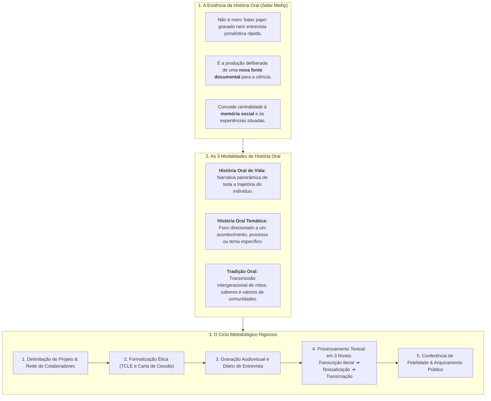
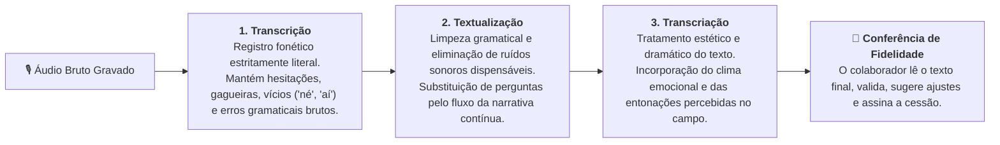
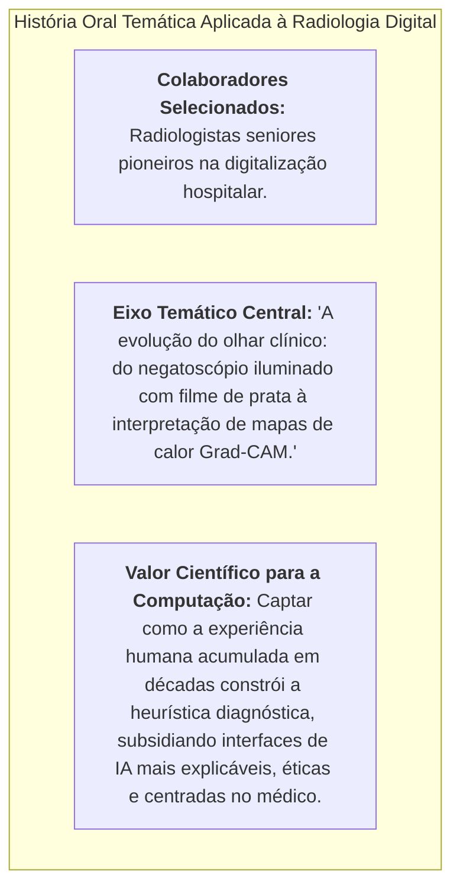

# 🎙️ Material-base — A Prática e o Conceito da História Oral (Prof. Dr. José Carlos Sebe Bom Meihy)

> **Disciplina:** Projetos e Métodos para a Produção do Conhecimento (`INT100-EC-2026S2B2-T001`)  
> **Tema da Semana 5:** Base de Dados Científicos: Características, Procedimentos e Fontes de Pesquisas Quantitativas e Qualitativas  
> **Fonte Audiovisual Oficial:** *O que é História Oral? Professor Sebe explica* — [Assistir no YouTube (Editora Contexto)](https://www.youtube.com/watch?v=rl8CDDXFmTE)  
> **Especialista Convidado:** Prof. Dr. José Carlos Sebe Bom Meihy (USP / Núcleo de Estudos em História Oral - NEHO)  
> **Obras de Referência do Autor:**  
> * MEIHY, José Carlos Sebe Bom; HOLANDA, Fabíola. **História oral: como fazer, como pensar**. 2. ed. São Paulo: Contexto, 2011.  
> * MEIHY, José Carlos Sebe Bom; RIBEIRO, Suzana L. Salgado. **Guia prático de história oral: para empresas, universidades, comunidades, famílias**. São Paulo: Contexto, 2011.  
> **Período Acadêmico:** 26/10/2026 a 08/11/2026  
> **Status:** 🟢 **Síntese Metodológica & Roteiro Operacional Completo**  

---

## 📌 Contextualização Epistemológica

Na investigação qualitativa contemporânea, a **História Oral** ocupa um papel de proeminência incontestável para o resgate de memórias, reconstituição de trajetórias sociais e compreensão da história vivida por atores que muitas vezes não deixaram registros escritos em arquivos formais.

No vídeo da Editora Contexto, o **Prof. Dr. José Carlos Sebe Bom Meihy** — um dos maiores expoentes da História Oral na América Latina e fundador do NEHO/USP — desmistifica o método, distinguindo-o com precisão de uma simples conversa informal ou entrevista jornalística circunstancial.

Para Sebe Meihy, a História Oral é um **conjunto metódico de procedimentos rigorosos que transforma relatos orais e narrativas de memórias em documentos de pesquisa consultáveis, auditáveis e com valor histórico indelével**.

---

## 👥 1. O Colaborador versus o "Objeto" de Pesquisa

Um dos princípios mais revolucionários da metodologia formulada por Sebe Meihy é a mudança radical no estatuto do entrevistado:
* **Recusa do termo "Informante" ou "Objeto":** O participante da pesquisa não é um mero repositório passivo de dados a ser explorado pelo cientista.
* **A Noção de "Colaborador":** O entrevistado é reconhecido como **coautor da memória registrada**. Há uma relação de confiança (*rapport*), compromisso ético e respeito intersubjetivo entre o pesquisador e o colaborador.
* **A "História Vista de Baixo":** A História Oral nasceu historicamente com a vocação democrática de dar voz a operários, minorias sociais, comunidades rurais e atores subalternos cujas experiências cotidianas eram sistematicamente ignoradas pela historiografia oficial dos grandes líderes políticos.

---

## 🏛️ 2. As Três Modalidades Clássicas de História Oral

Sebe Meihy sistematiza a técnica em três gêneros metodológicos bem delineados, escolhidos conforme a questão central da pesquisa:

| Modalidade | Foco Metodológico | Amplitude Temporal | Exemplo de Aplicação |
| :--- | :--- | :--- | :--- |
| **História Oral de Vida** | Biografia integral do colaborador, desde as primeiras lembranças de infância até o presente. | Ampla e longitudinal (décadas de trajetória). | Resgate da biografia do fundador de uma empresa ou de um líder comunitário. |
| **História Oral Temática** | Recorte circunscrito a um evento histórico, processo de trabalho ou fenômeno técnico delimitado. | Focalizada no tempo e no tema selecionado. | Percepção de radiologistas sobre a transição do filme físico para o diagnóstico por IA. |
| **Tradição Oral** | Saberes ancestrais transmitidos boca a boca ao longo das gerações sem autoria individual fixada. | Histórica e transgeracional. | Mitos, práticas de medicina tradicional de povos originários e causos ribeirinhos. |

---

## 📝 3. O Rigor do Processamento Textual: As 3 Etapas de Sebe

> ⚠️ **Ponto Metodológico Crucial:** Uma das contribuições teóricas mais cobradas de Sebe Meihy é a distinção entre as etapas de conversão do áudio bruto em texto publicado:

1. **Transcrição Literal:** Registro fiel de tudo o que foi gravado ("ao pé da letra"), incluindo repetições involuntárias, interrupções, risos e ruídos externos. É o documento bruto de arquivo.
2. **Textualização:** O pesquisador reorganiza o texto para torná-lo fluido e agradável à leitura, retirando cacoetes mecânicos da fala cotidiana, sem jamais alterar o sentido original do depoimento.
3. **Transcriação:** É o ápice da arte metodológica de Sebe. O pesquisador recria a atmosfera e a carga subjetiva da entrevista, inserindo notas de contextualização sobre o tom de voz, pausas reflexivas e expressões corporais do colaborador.
4. **Conferência de Fidelidade (*Audit Trail*):** O texto textualizado/transcriado é devolvido obrigatoriamente às mãos do colaborador. Ele confere se aquela narrativa representa com autenticidade o que quis dizer. Ao aprovar, o colaborador rubrica o documento e assina a cessão de direitos, garantindo **plena validade ética e jurídica ao material**.

---

## 🛡️ 4. Cuidados Éticos e Jurídicos em História Oral

* **Termo de Consentimento Livre e Esclarecido (TCLE):** O colaborador é formalmente esclarecido sobre os objetivos do projeto, a destinação dos áudios e a publicação científica das falas.
* **Carta de Cessão de Direitos Autorais / Depoimento:** Documento legal que autoriza a guarda e consulta pública do relato em acervos e bibliotecas universitárias.
* **Direito ao Anonimato ou Identificação:** O colaborador decide expressamente se deseja ter sua identidade revelada (comum em história oral para valorizar sua biografia) ou preservada sob pseudônimo (necessário em temas sensíveis de conflito social ou institucional).

---

## 🏥 5. Aplicação no Projeto de IA na Radiologia Médica

No nosso projeto de Engenharia de Computação, a metodologia de História Oral Temática proposta por Sebe Meihy resolve uma lacuna metodológica que métricas estatísticas de acurácia jamais preencheriam:

### O que a História Oral revela à Engenharia de Software:
* A transição cultural dos hospitais frente a novas tecnologias;
* O medo inicial de obsolescência profissional e a construção da simbiose humano-máquina;
* Os critérios tácitos que um médico sênior utiliza para validar ou desconfiar de uma imagem computadorizada.
