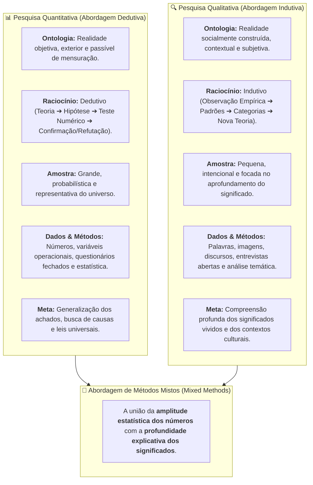
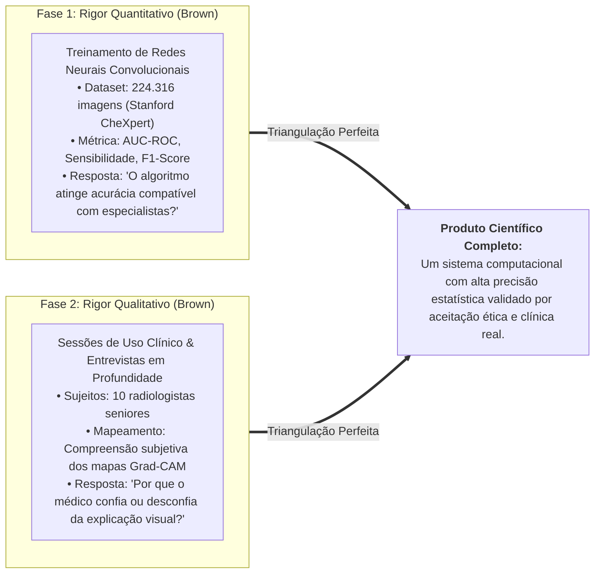

# 🔬 Material-base — Pesquisa Qualitativa versus Quantitativa (Prof. George Brown)

> **Disciplina:** Projetos e Métodos para a Produção do Conhecimento (`INT100-EC-2026S2B2-T001`)  
> **Tema da Semana 5:** Base de Dados Científicos: Características, Procedimentos e Fontes de Pesquisas Quantitativas e Qualitativas  
> **Fonte Audiovisual Oficial:** *Qualitative and Quantitative Research* — [Assistir no YouTube (Universidade de Nottingham)](https://www.youtube.com/watch?v=hVNdfBKBkTc)  
> **Docente Convidado:** Prof. George Brown (University of Nottingham)  
> **Período Acadêmico:** 26/10/2026 a 08/11/2026  
> **Status:** 🟢 **Síntese Epistemológica & Quadro Diferencial Completo**  

---

## 📌 Visão Geral da Exposição de George Brown

No clássico material instrucional da **Universidade de Nottingham**, o **Prof. George Brown** delineia os fundamentos que governam os dois maiores paradigmas da investigação empírica: a **pesquisa quantitativa** e a **pesquisa qualitativa**.

O professor Brown adverte que a escolha entre uma abordagem e outra não deve basear-se em preferências pessoais ou modismos acadêmicos, mas unicamente na **natureza da pergunta de pesquisa** (*research question*). Cada paradigma ancora-se em pressupostos filosóficos distintos sobre o que é a realidade (*ontologia*) e como podemos conhecê-la validamente (*epistemologia*).

---

## ⚖️ 1. O Confronto Epistemológico dos Dois Paradigmas

O Prof. George Brown sistematiza o contraste analítico em dimensões fundamentais da prática científica:

| Dimensão Metodológica | Pesquisa Quantitativa | Pesquisa Qualitativa |
| :--- | :--- | :--- |
| **Ponto de Partida** | Teorias e hipóteses previamente formuladas a serem testadas. | Fenômenos sociais ou comportamentais abertos a serem explorados. |
| **Lógica do Raciocínio** | **Dedutiva:** Do geral (teoria) para o particular (dados empíricos). | **Indutiva:** Do particular (dados de campo) para o geral (teoria emergente). |
| **Papel do Pesquisador** | Observador neutro e desvinculado; distância formal para evitar viés. | Instrumento participativo de escuta e interação; imersão no contexto. |
| **Conceito de Amostra** | Amostras grandes calculadas para poder estatístico e generalização. | Amostras reduzidas selecionadas intencionalmente por relevância temática. |
| **Instrumentos de Coleta** | Escalas Likert, testes de laboratório, sensores e questionários fechados. | Roteiros abertos, entrevistas em profundidade, observação e notas de campo. |
| **Natureza dos Dados** | Números contínuos e discretos, métricas e proporções percentuais. | Discursos, transcrições, relatos de experiência, fotografias e gestos. |
| **Abordagem da Análise** | Testes de significância ($p$-valor), ANOVA, regressões e correlações. | Análise temática, codificação de categorias, hermenêutica e narrativa. |

---

## 🔄 2. A Superação da Falsa Dicotomia: Métodos Mistos

George Brown adverte enfaticamente que **nenhum método é inerentemente superior ao outro**. O erro reside em aplicar uma ferramenta equivocada para responder a uma pergunta inadequada:

* Se a pergunta for: *"Qual a porcentagem de pacientes que apresentam melhora com a intervenção X?"* ou *"Qual a acurácia de uma CNN em 100.000 imagens?"*, **o paradigma deve ser estritamente quantitativo**.
* Se a pergunta for: *"Como os médicos vivenciam a incerteza durante o plantão e por que hesitam em confiar no laudo da máquina?"*, **o paradigma deve ser qualitativo**.
* **A Força dos Métodos Mistos (*Mixed Methods*):** Em problemas complexos contemporâneos — como saúde pública, inteligência artificial, impactos ambientais e sustentabilidade —, a integração de ambas as abordagens é o padrão ouro da pesquisa avançada, gerando **triangulação metodológica**.

---

## 💻 3. Aplicação no Projeto de Engenharia de Computação (IA na Radiologia)

Na visão exposta por George Brown, nosso projeto multidisciplinar de IA aplicada à detecção de patologias pulmonares com mapas de calor Grad-CAM ganha total robustez epistemológica:

### Por que a abordagem mista é indispensável?
* Uma IA com 98% de acurácia quantitativa é clinicamente inútil se os médicos a recusarem por opacidade explicativa (*caixa-preta*);
* Uma interface altamente amigável qualitativamente é perigosa se o modelo subjacente tiver baixo desempenho estatístico em testes cegos.
* A sinergia ensinada por George Brown fecha o elo entre a **exatidão da computação** e a **ética do cuidado médico**.
