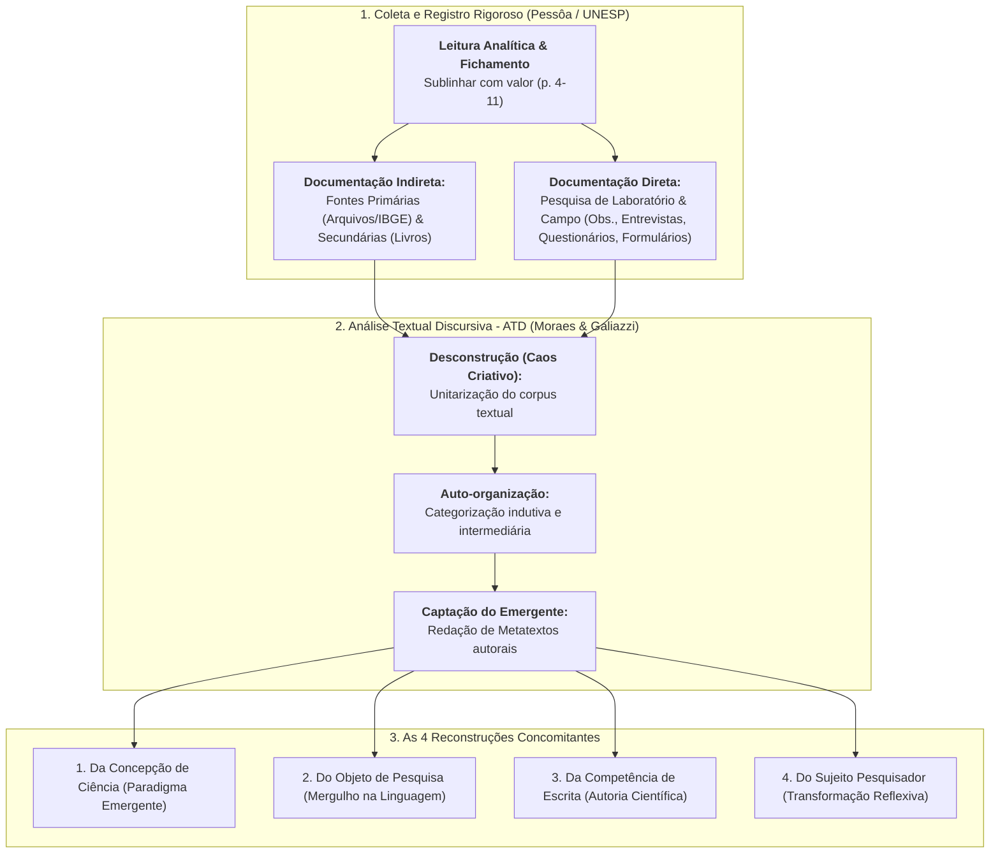
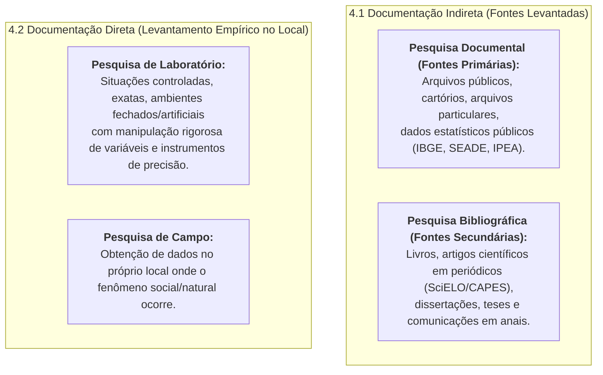
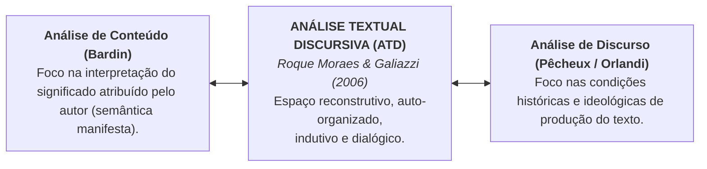
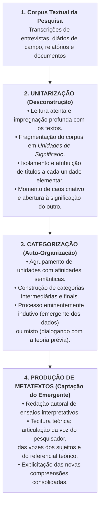
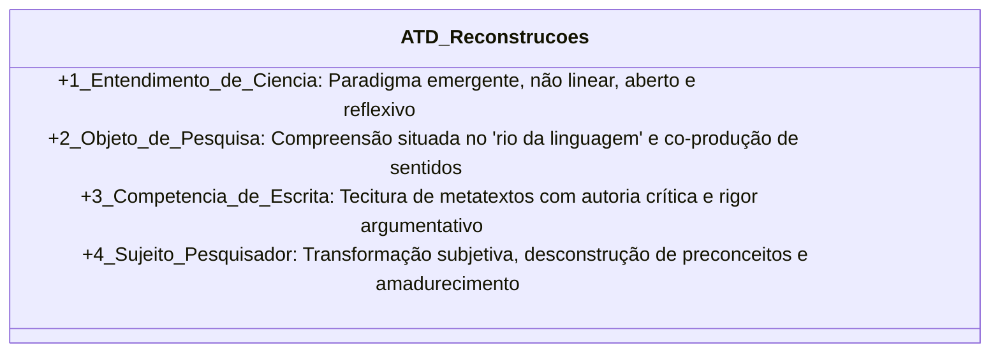
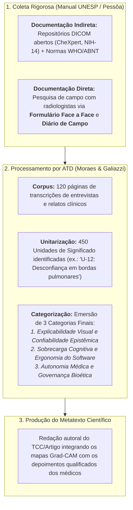

# 📚 Aprofundando o Tema — Técnicas de Pesquisa (Pessôa) & Análise Textual Discursiva (Moraes & Galiazzi)

> **Disciplina:** Projetos e Métodos para a Produção do Conhecimento (`INT100-EC-2026S2B2-T001`)  
> **Tema da Semana 5:** Base de Dados Científicos: Características, Procedimentos e Fontes de Pesquisas Quantitativas e Qualitativas  
> **Textos de Aprofundamento Estudados:**  
> 1. PESSÔA, Vera Lúcia Salazar. **Manual para elaboração de trabalhos acadêmicos: material para fins didáticos**. Rio Claro: UNESP, 2020. (Leitura das páginas 4 a 21).  
> 2. MORAES, Roque; GALIAZZI, Maria do Carmo. **Análise textual discursiva: processo reconstrutivo de múltiplas faces**. *Ciência & Educação*, Bauru, v. 12, n. 1, p. 117-128, 2006. DOI: 10.1590/S1516-73132006000100009.  
> **Arquivos Oficiais na Pasta:**  
> * [`s1_material_de_apoio_manual_para_elaboracao_de_trabalhos_academiscos_2020.pdf`](file:///home/henrique/Modelos/Univesp/2026S2B2/INT100-Projetos-e-Metodos-para-a-Producao-do-Conhecimento/Semana-5/s1_material_de_apoio_manual_para_elaboracao_de_trabalhos_academiscos_2020.pdf)  
> * [`s5_aprofundando_analise_textual.pdf`](file:///home/henrique/Modelos/Univesp/2026S2B2/INT100-Projetos-e-Metodos-para-a-Producao-do-Conhecimento/Semana-5/s5_aprofundando_analise_textual.pdf)  
> **Período Acadêmico:** 26/10/2026 a 08/11/2026  
> **Status:** 🟢 **Síntese Analítica Integrada & Roteiro Metodológico Completo**  

---

## 📌 Visão Geral da Articulação dos Textos

A seção *Aprofundando o Tema* da Semana 5 articula duas dimensões cruciais da prática investigativa:
* **Dimensão Operacional e Normativa (Vera Lúcia Salazar Pessôa, UNESP):** Estabelece o roteiro técnico que vai desde a atitude inicial diante da leitura e do fichamento até o arsenal clássico de coleta empírica (documentação indireta versus documentação direta em laboratório e campo: observação participante, pesquisa-ação, entrevistas, história oral, questionários e formulários).
* **Dimensão Hermenêutica e Analítica Avançada (Roque Moraes & Maria do Carmo Galiazzi, 2006):** Apresenta a **Análise Textual Discursiva (ATD)**, metodologia qualitativa brasileira de referência que transita criativamente entre a *Análise de Conteúdo* (Bardin) e a *Análise de Discurso*, demonstrando como a fragmentação do texto (*unitarização*), a auto-organização em categorias (*categorização*) e a emergência do novo (*metatextos*) operam quatro reconstruções concomitantes na ciência, no objeto, na escrita e no próprio sujeito pesquisador.

---

## 🏛️ PARTE 1 — O Manual de Trabalhos Acadêmicos da UNESP (Pessôa, p. 4–21)

Nas páginas 4 a 21 de seu manual didático, a Profa. Dra. **Vera Lúcia Salazar Pessôa** sistematiza o fluxo procedural que transforma impressões dispersas em dados documentados com rigor acadêmico.

### 1. A Leitura e a Técnica de Sublinhar com Valor (p. 4–6)
* **Finalidade e Postura Atenta:** Ler academicamente exige propósito claro. Deve-se captar o esboço da obra (sumário, introdução, capítulos, referências) e acompanhar o raciocínio do autor (se informa, demonstra, refuta ou compara).
* **As Cinco Questões Fundamentais da Leitura Crítica:**
  1. *O que é?* (O assunto e recorte temático);
  2. *Quem?* (Autoria e autoridade epistêmica);
  3. *Quando e Onde?* (Contexto temporal e geográfico do fenômeno);
  4. *Por quê?* (As razões que motivaram a escrita da obra);
  5. *Para quê?* (A contribuição original da pesquisa para a ciência).
* **Sublinhar sem valor versus Sublinhar com valor:**
  * *Sem valor:* Grifar o texto na primeira leitura de contato, poluindo o impresso sem triagem prévia;
  * *Com valor:* Ler o texto integralmente primeiro para apreender a visão de conjunto; na segunda leitura, sublinhar unicamente as **ideias centrais, conceitos estruturantes e termos técnicos**, mantendo a autonomia dos argumentos.

### 2. Resumo, Resenha e Sinopse — NBR 6028 (p. 7–10)
* **Resumo Indicativo:** Apenas aponta os tópicos principais abordados no documento, sem expor dados quantitativos ou resultados; não dispensa a leitura da obra completa.
* **Resumo Informativo:** Explicita objetivos, metodologia, principais resultados e conclusões; dispensa a consulta ao original para fins de triagem bibliográfica preliminar.
* **Resenha (Resumo Crítico):** Além do resumo informativo, expressa juízo de valor crítico e analítico fundamentado, avaliando o alcance e as limitações metodológicas da obra.
* **Regras de Extensão:** De 150 a 500 palavras para trabalhos acadêmicos (TCCs, teses e relatórios); de 100 a 250 palavras para artigos de periódicos; de 50 a 100 palavras para notas e comunicações breves. Redigido em parágrafo único, voz ativa e na terceira pessoa do singular.

### 3. Documentação e Fichamento (p. 11–13)
* Fichar é a técnica de registrar ordenadamente informações e dados do discurso para posterior recuperação ágil.
* **Tipos de Fichas:**
  * *Ficha Bibliográfica:* Descrição das obras consultadas;
  * *Ficha de Citação:* Transcrição literal de trechos com indicação exata de páginas;
  * *Ficha Temática / de Conteúdo:* Síntese das ideias do autor estruturadas por temas;
  * *Ficha de Resumo / Esboço:* Roteiro condensado da estrutura argumentativa.

### 4. Técnicas de Pesquisa: A Fronteira entre Indireta e Direta (p. 14–21)

#### Técnicas de Campo Detalhadas por Pessôa:
1. **Observação (Marconi & Lakatos / Gil):**
   * *Simples:* Pesquisador como espectador espontâneo, alheio ao grupo;
   * *Participante / Ativa:* O pesquisador integra-se ao grupo, vivenciando o cotidiano por dentro (Carlos Rodrigues Brandão);
   * *Sistemática:* Planejada formalmente com categorias pré-fixadas (ex.: categorias de interação social de R. F. Bales).
2. **Pesquisa-Ação (Michel Thiollent):** Não é mera pesquisa participante. Exige intervenção planejada, cooperativa e deliberada para a resolução concreta de um problema coletivo compartilhado.
3. **Entrevistas (Gil):** Diálogo assimétrico de coleta. Podem ser informais, focalizadas, orientadas por pautas (semiestruturadas) ou rigidamente estruturadas.
4. **História Oral (Sônia Maria de Freitas):** Sistematizada em *Tradição Oral*, *História de Vida* (biografia total do indivíduo) e *História Oral Temática* (conjunto de depoimentos sobre recorte factual delimitado).
5. **Estudo de Caso (Arilda Godoy / Gil):** Exame exaustivo de uma unidade social específica (empresa, hospital, projeto tecnológico), buscando responder a perguntas do tipo "como" e "por que".
6. **Diário de Campo (Débora Lopes):** Registro metódico do convívio e da territorialidade com os colaboradores.
7. **Questionário versus Formulário (Lakatos & Marconi / Ribas):**
   * *Questionário:* Instrumento impessoal enviado por escrito, preenchido **pelo próprio respondente** sem a presença do pesquisador (taxa média de devolução de cerca de 25%);
   * *Formulário:* Preenchido **pelo próprio pesquisador** em contato direto **face a face**, permitindo esclarecimento imediato de dúvidas e perguntas mais sofisticadas.

---

## 🧬 PARTE 2 — A Análise Textual Discursiva (Roque Moraes & Maria do Carmo Galiazzi, 2006)

O artigo de Roque Moraes e Maria do Carmo Galiazzi (*Ciência & Educação*, 2006) estabelece um marco na metodologia qualitativa ao propor a **Análise Textual Discursiva (ATD)** como uma abordagem hermenêutica integradora que transita no espaço intermediário entre a **Análise de Conteúdo** (de extração positivista/estruturalista) e a **Análise de Discurso** (de extração linguística e crítica).

### 🌪️ O Paradigma Emergente: Convívio com o Caos e Auto-Organização
Moraes e Galiazzi sustentam que a pesquisa qualitativa autêntica não pode ser aprisionada em modelos mecânicos lineares. A análise textual implica **mover deliberadamente o sistema de ideias para o caos criativo**, aceitando a incerteza inicial da fragmentação para permitir a emergência auto-organizada do novo.

---

### 🔄 O Ciclo Operacional Triádico da ATD

1. **Unitarização (Desconstrução do Corpus):**
   * O pesquisador decompõe o material bruto, recortando-o em **unidades de significado** (ideias elementares e autônomas de sentido);
   * Cada unidade recebe um código e um título expressivo. Esse momento gera insegurança inicial, pois pulveriza as certezas prévias e mergulha o pesquisador na multiplicidade de vozes dos colaboradores.
2. **Categorização (Auto-Organização Sintética):**
   * Por meio do método de comparação constante, as unidades semelhantes são reunidas sob categorias emergentes;
   * As categorias sintetizam os nós conceituais da pesquisa, organizando o caos inicial em uma estrutura lógica e coerente.
3. **Produção de Metatextos (A Nova Autoria Científica):**
   * O fechamento da ATD não é uma tabela fria de números, mas a **produção de metatextos**;
   * O metatexto é um ensaio teórico e interpretativo denso, no qual o pesquisador tece com rigor a sua autoria, articulando citações expressivas das unidades de significado com o referencial teórico consolidado da área.

---

### 🌟 As Quatro Reconstruções Concomitantes da ATD

Segundo Moraes e Galiazzi (2006, p. 117-126), ao praticar a ATD o pesquisador desencadeia **quatro transformações simultâneas e inseparáveis**:

1. **Reconstrução do Entendimento de Ciência:** Superação da visão positivista rígida. A ciência passa a ser compreendida como construção humana provisória, dialógica, contextualizada e socialmente situada;
2. **Reconstrução do Objeto de Pesquisa:** O objeto não é uma "coisa externa inerte", mas um fenômeno dinâmico compreendido pela linguagem (*"o humano e seu mundo estão engajados em relação circular de co-produção"*, citando Humberto Maturana);
3. **Reconstrução da Competência de Produção Escrita:** O pesquisador abandona o papel passivo de compilador de citações de outrem e assume a **autoria plena de seus metatextos**, tecendo argumentos sólidos com clareza conceitual;
4. **Reconstrução do Sujeito Pesquisador:** A pesquisa transforma quem a realiza. Ao escutar e codificar com sensibilidade as vozes dos participantes, o pesquisador amplia seus campos de consciência, revê seus preconceitos e amadurece eticamente.

---

## 💻 3. Articulação Prática: O Projeto de IA na Radiologia Médica

Integrando as lições de **Pessôa (2020)** e **Moraes & Galiazzi (2006)** ao nosso projeto interdisciplinar (*Sistemas de Visão Computacional, Grad-CAM e Bioética em Radiologia*):

* **Na Documentação:** O rigor do formulário presencial e do diário de campo previne dados enviesados;
* **Na Análise Textual:** A unitarização e categorização impedem que o engenheiro reduza a experiência dos médicos a números frios de aceitação percentual, permitindo reconstruir com precisão a lógica clínica e os dilemas bioéticos reais do ambiente hospitalar.

---

## 🎯 Quadro-Síntese Comparativo para Fixação

| Dimensão Metodológica | Manual UNESP (Vera Lúcia Pessôa) | Análise Textual Discursiva (Moraes & Galiazzi) |
| :--- | :--- | :--- |
| **Foco Principal** | Normas técnicas, instrumentos de coleta (direta/indireta) e padronização ABNT. | Processamento hermenêutico de dados textuais e emergência do novo. |
| **Conceito-Chave** | Instrumentos de coleta: Questionário (impessoal) vs. Formulário (face a face). | Ciclo triádico: Unitarização $\rightarrow$ Categorização $\rightarrow$ Metatextos. |
| **Postura do Pesquisador** | Observador metódico que documenta e controla variáveis com exatidão. | Sujeito imerso no rio da linguagem, co-produtor de sentidos e em constante transformação. |
| **Resultado Esperado** | Dados coletados com precisão empírica e fichas bibliográficas organizadas. | Produção de metatextos teóricos autorais que captam o novo emergente. |
