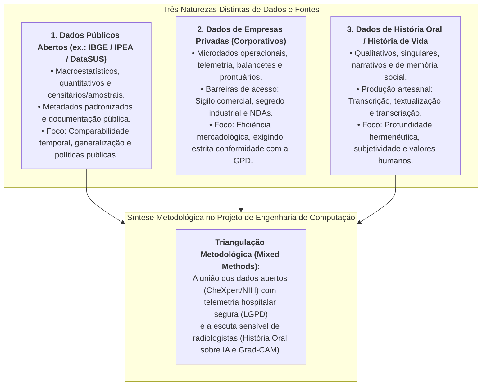

# 💬 Fórum Temático — Semana 5: A Coleta de Dados e suas Fontes
### Dados Estatísticos Públicos, Dados Corporativos Privados e História Oral

> **Disciplina:** Projetos e Métodos para a Produção do Conhecimento (`INT100-EC-2026S2B2-T001`)  
> **Tema da Semana 5:** Base de Dados Científicos: Características, Procedimentos e Fontes de Pesquisas Quantitativas e Qualitativas  
> **Docente Responsável:** Profª Dra. Graziella Ribeiro Soares Moura / Profª Darlene Ferreira  
> **Período de Interação:** 26/10/2026 a 08/11/2026  
> **Status:** 🟢 **Modelos Prontos para Postagem Principal e Réplicas no AVA**  

---

## 📌 Enunciado Oficial do Fórum

> *Os debates propostos em semanas anteriores têm levado você a refletir sobre o mundo da pesquisa científica. Vamos seguir nessa trajetória pensando agora nos dados que são passíveis de investigação e em suas fontes.*  
> 
> *O propósito é discutir se há diferença no uso de dados públicos de acesso livre na internet, como os dados estatísticos levantados pelo IBGE ou de dados de empresas privadas, ou ainda, de dados originados de história de vida ou história oral. Vamos manifestar nossas opiniões e observar qual é a diferença entre esses dados.*

---

## 💡 Roteiro de Fundamentação Epistemológica e Metodológica

Para responder ao fórum com excelência acadêmica, articulamos a análise comparativa em torno de quatro eixos fundamentais:

### 📋 Quadro Diferencial Comparativo

| Dimensão de Análise | Dados Públicos Abertos (IBGE) | Dados de Empresas Privadas | Dados de História Oral / Vida |
| :--- | :--- | :--- | :--- |
| **Natureza Epistemológica** | Quantitativa, censitária ou amostral probabilística. | Mista ou predominantemente quantitativa/operacional. | Rigorosamente qualitativa, discursiva e narrativa. |
| **Disponibilidade e Acesso** | Amplo, irrestrito e gratuito (*Open Data* via internet). | Restrito, condicionado a convênios, NDAs e sigilo. | Produzido diretamente no campo com o colaborador. |
| **Documentação e Metadados** | Dicionários formais consolidados (*machine-readable*). | Variável, dependente da maturidade de TI da empresa. | Registros em áudio/vídeo, diários de campo e notas. |
| **Marco Ético e Legal** | Anonimização primária e segredo estatístico (Lei 5.534/68). | Lei Geral de Proteção de Dados (LGPD - Lei 13.709/18). | Termo de Consentimento (TCLE) e Carta de Cessão. |
| **Alcance Científico** | Generalização macro e comparabilidade regional/global. | Otimização de processos e diagnósticos corporativos. | Profundidade de sentido, memórias e dinâmicas culturais. |

---

## 📝 Modelo de Postagem Principal (Pronto para Copiar e Colar no AVA)

**Título da Mensagem:** *A Tipologia das Fontes na Pesquisa Científica: Do Rigor Estatístico dos Dados Abertos à Densidade Humana da História Oral*

---

### 📄 Texto para Envio ao Fórum:

> Olá, professora Graziella, professora Darlene e caros colegas!
> 
> A reflexão sobre as fontes e tipologias de dados constitui um divisor de águas no planejamento da pesquisa científica, pois o dado não é um ente passivo pré-existente na natureza, mas uma construção metodológica delimitada pela pergunta investigativa e pela postura ontológica do pesquisador. Ao contrastarmos dados públicos de acesso aberto (como as bases estatísticas do IBGE), dados corporativos privados e dados derivados de relatos de história oral ou história de vida, deparamo-nos com diferenças profundas que abarcam desde a acessibilidade técnica até as exigências éticas e epistemológicas de cada modalidade.
> 
> Os **dados estatísticos públicos de acesso livre** — exemplificados pelos Censos e pela PNAD do IBGE — caracterizam-se pela representatividade amostral ampla, neutralidade metodológica e elevado padrão de documentação. Conforme destaca a série institucional do IBGE sobre a importância da documentação, os metadados funcionam para o cientista como o microscópio funciona para o biólogo: fornecem dicionários padronizados, inteligíveis por máquina (*machine-readable*), que asseguram a comparabilidade temporal, a transparência e a replicabilidade dos resultados em escala macro. O uso dessas bases é essencial para diagnosticar realidades estruturais, calcular indicadores universais (como o IDHM) e desenhar políticas públicas baseadas em evidências empíricas auditáveis.
> 
> Por outro lado, os **dados oriundos de empresas privadas** apresentam desafios operacionais e jurídicos substancialmente distintos. Embora ofereçam um nível de granularidade operacional indispensável para a análise econômica, tecnológica e gerencial (balancetes contábeis, telemetria de produção, registros de logística e prontuários institucionais), essas fontes estão frequentemente protegidas por sigilo comercial, segredo industrial e termos de confidencialidade (*NDAs*). Além disso, exigem rigorosa observância à Lei Geral de Proteção de Dados (LGPD - Lei nº 13.709/2018), demandando processos rigorosos de anonimização e salvaguardas contratuais. Há também o risco epistemológico de vieses de interesse corporativo, uma vez que dados mercadológicos raramente são coletados sob as premissas estritas do desinteresse acadêmico.
> 
> Em um polo metodológico qualitativo, os dados gerados pela **história oral e histórias de vida** rompem com a busca pela generalização estatística fria para mergulhar na profundidade dos significados, crenças, trajetórias e valores humanos. Como nos ensina o Prof. José Carlos Sebe Bom Meihy, a história oral não é uma simples gravação circunstancial, mas um procedimento metódico de criação de uma nova fonte documental, no qual o entrevistado atua como colaborador ativo e coautor da memória registrada. Exige um ciclo minucioso de transcrição, textualização e transcriação submetido à "conferência de fidelidade", além de formalização jurídica por meio do Termo de Consentimento Livre e Esclarecido (TCLE) e cartas de cessão de direitos. Seu valor reside em dar voz a experiências sociais tácitas, desvelando o "como" e o "porquê" que as matrizes numéricas isoladas são incapazes de captar.
> 
> No âmbito do nosso projeto na Engenharia de Computação — focado no desenvolvimento de redes neurais convolucionais com mapas explicativos (Grad-CAM) para diagnóstico radiológico pulmonar —, a sinergia entre essas três fontes revela-se indispensável: utilizamos **dados públicos abertos** (como os repositórios *Stanford CheXpert* e *NIH ChestX-ray14*) para o treinamento matemático e benchmarking do algoritmo; recorreríamos a **dados de sistemas hospitalares privados** para validar a latência e interoperabilidade técnica no fluxo real sob salvaguardas da LGPD; e aplicamos a **história oral temática** com médicos radiologistas para apreender, qualitativamente, como a explicabilidade visual afeta a confiança clínica, a autonomia profissional e as salvaguardas bioéticas. Em suma, longe de serem excludentes, essas três naturezas de dados complementam-se na chamada triangulação metodológica, unindo a amplitude e precisão dos números à sensibilidade e profundidade das vivências humanas.
> 
> **Referências Bibliográficas:**  
> • GIBBS, Graham. **Análise de dados qualitativos**. Porto Alegre: Artmed, 2009.  
> • INSTITUTO BRASILEIRO DE GEOGRAFIA E ESTATÍSTICA (IBGE). **A importância da documentação e da tecnologia da informação**. Rio de Janeiro: IBGE Explica, 2015.  
> • MEIHY, José Carlos Sebe Bom; HOLANDA, Fabíola. **História oral: como fazer, como pensar**. 2. ed. São Paulo: Contexto, 2011.  
> • MORAES, Roque; GALIAZZI, Maria do Carmo. Análise textual discursiva: processo reconstrutivo de múltiplas faces. **Ciência & Educação**, Bauru, v. 12, n. 1, p. 117-128, 2006.  
> • PESSÔA, Vera Lúcia Salazar. **Manual para elaboração de trabalhos acadêmicos: material para fins didáticos**. Rio Claro: UNESP, 2020. p. 14-21.  

---

## 👥 Modelos de Réplicas aos Colegas no Fórum

Para enriquecer a nota de engajamento no AVA, aqui estão dois modelos de intervenção dialógica para comentar postagens de outros estudantes:

### 💬 Opção 1 — Foco na Governança de Dados, LGPD e Bases Privadas
> *"Olá, [Nome do Colega]! Excelente sua reflexão sobre a diversidade das fontes de dados. Concordo plenamente quando você ressalta a importância dos dados públicos do IBGE pela facilidade de acesso. Gostaria de acrescentar ao seu comentário uma observação sobre os dados corporativos privados: além do sigilo comercial, hoje o pesquisador que lida com dados de empresas precisa demonstrar conformidade irrestrita com a Lei Geral de Proteção de Dados (LGPD). Mesmo ao estudar balancetes, históricos de atendimento ou fluxos de trabalho industriais, é indispensável adotar técnicas robustas de anonimização e pseudonimização para que segredos industriais ou dados sensíveis de pessoas físicas não sejam expostos. A disponibilidade do dado privado é riquíssima, mas a responsabilidade ética e jurídica sobre o seu uso é redobrada. Parabéns pela contribuição!"*

---

### 💬 Opção 2 — Foco na Sensibilidade e Rigor da História Oral
> *"Olá, [Nome do Colega]! Achei muito pertinente a forma como você abordou a complementaridade entre a pesquisa quantitativa e qualitativa. Gostaria de destacar um ponto sobre a História Oral mencionada nos materiais da semana pelo Prof. Sebe Meihy: muitas vezes, existe o preconceito de achar que relatos orais seriam menos rigorosos que tabelas estatísticas. No entanto, quando acompanhamos as fases metodológicas da História Oral — desde a formalização do TCLE até as etapas de transcrição, textualização e a rigorosa 'conferência de fidelidade' pelo colaborador —, percebemos que ela é tão sistemática quanto o cálculo de uma amostra. A História Oral tem a virtude única de registrar a memória e o sentido subjetivo que nenhum censo demográfico consegue capturar. Muito obrigado por compartilhar suas ideias!"*
