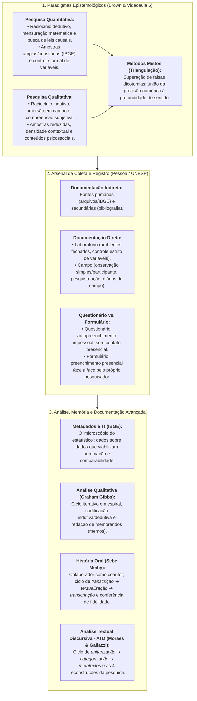

# 🎯 Semana 5 — Em Síntese: Consolidação de Competências
### Base de Dados Científicos: As Pesquisas Quantitativa e Qualitativa

> **Disciplina:** Projetos e Métodos para a Produção do Conhecimento (`INT100-EC-2026S2B2-T001`)  
> **Tema da Semana 5:** Base de Dados Científicos: Características, Procedimentos e Fontes de Pesquisas Quantitativas e Qualitativas  
> **Docente Responsável:** Profª Dra. Graziella Ribeiro Soares Moura / Profª Darlene Ferreira  
> **Período:** 26/10/2026 a 08/11/2026  
> **Status:** 🟢 **Semana 5 Concluída com Êxito (10,0 / 10,0)**  

---

## 👩‍🏫 Mensagem Oficial de Fechamento do AVA

> *"Ao terminar o conteúdo desta semana, depois de ler e refletir, você aprendeu que a coleta de dados é uma etapa importante da pesquisa que exige trabalho e tempo. É baseada em técnicas e instrumentos distintos que se adequam ao registro e leitura dos dados que são colhidos, por exemplo, nas atividades de campo.*  
> 
> *Parabéns! Você chegou ao fim do conteúdo desta semana.*  
> 
> *Na próxima semana, você estudará o desenvolvimento do projeto de pesquisa."*

---

## 🗺️ Arquitetura Metodológica da Semana 5

A Semana 5 consolidou a **segunda grande fase da investigação científica**: a transição do levantamento bibliográfico para a indagação empírica da realidade através da coleta, documentação e análise de dados.

---

## 📊 Matriz de Conceitos e Distinções Fundamentais

| Dimensão Metodológica | Polo Quantitativo | Polo Qualitativo | Síntese / Articulação Mista |
| :--- | :--- | :--- | :--- |
| **Lógica do Pensamento** | **Dedutiva:** Do universal para o particular (testa hipóteses a priori). | **Indutiva:** Do particular para o universal (gera teorias emergentes dos dados). | **Métodos Mistos:** Hipóteses testadas computacionalmente e validadas hermeneuticamente. |
| **Tratamento dos Dados** | Redução e condensação em médias, desvios e matrizes estatísticas. | Preservação da riqueza contextual, sem redução mecânica dos dados (Gibbs, p. 18). | Matrizes estatísticas descritivas complementadas por metatextos e categorizações. |
| **Coleta Impessoal vs. Direta** | **Questionário:** Autopreenchimento pelo respondente à distância (~25% de retorno). | **Formulário / Entrevista:** Contato presencial *face a face*, permitindo dúvidas e nuances. | Uso de formulários eletrônicos estruturados aliados a roteiros de entrevistas semiestruturadas. |
| **Tratamento de Relatos Orais** | Categorização em variáveis nominais/ordinais fechadas. | **História Oral:** Transcrição literal $\rightarrow$ Textualização $\rightarrow$ Transcriação autorizada. | Resgate da memória de pioneiros técnicos validada formalmente por TCLE e cessão. |
| **Governança e TI** | Metadados padronizados internacionais (*machine-readable* - IBGE). | Trilha de auditoria analítica (*audit trail*) e reflexividade do cientista. | Rastreabilidade total entre dados brutos (DICOM/áudios) e conclusões científicas. |

---

## ✅ Autoavaliação de Metas e Competências da Semana 5

Verifique o atingimento das metas oficiais estabelecidas para a Semana 5:

* [x] **Aprendi o que é coleta de dados.**  
  *(Compreensão da coleta como segunda fase do ciclo de pesquisa, onde o cientista indaga empiricamente a realidade e reúne evidências para corroborar ou refutar hipóteses).*
* [x] **Tomei conhecimento das técnicas e instrumentos de coleta de dados.**  
  *(Diferenciação clara entre pesquisa documental, bibliográfica, de laboratório e de campo; domínio da distinção entre questionários, formulários, observação participante, diário de campo e entrevistas).*
* [x] **Aprendi que há dois tipos de dados seja pela coleta ou forma de análise: quantitativos e qualitativos.**  
  *(Apreensão da objetividade e mensuração numérica versus a subjetividade e profundidade dos significados socioculturais e discursivos).*
* [x] **Compreendi o papel vital dos metadados e da documentação científica.**  
  *(Entendimento dos metadados como o 'microscópio do estatístico' no ecossistema do IBGE, permitindo automação por IA, interoperabilidade e economia de centenas de horas de trabalho).*
* [x] **Dominei os métodos avançados de tratamento qualitativo (Gibbs, Sebe e Moraes & Galiazzi).**  
  *(Codificação e memorandos teóricos de Gibbs; as três etapas de processamento da História Oral com Sebe Meihy; e o ciclo de unitarização, categorização e produção de metatextos da ATD).*
* [x] **Atingi nota máxima na avaliação semanal da disciplina.**  
  *(Desempenho perfeito de **10,00 / 10,00 pontos** na Atividade Avaliativa da Semana 5).*

---

## 🧭 Conexão com a Próxima Semana (Semana 6)

Na **Semana 6**, avançaremos para o **Desenvolvimento do Projeto de Pesquisa / Planejamento e Elaboração de Pesquisa**:
* Estruturação formal do anteprojeto e projeto de pesquisa conforme as normas da ABNT.
* Delimitação precisa de Tema, Problema de Pesquisa, Hipóteses, Justificativa e Objetivos (Geral e Específicos).
* Cronograma físico-financeiro, matriz orçamentária e plano de contingência metodológica.
* Integração final da revisão da literatura (Semana 4) com o plano de coleta e análise de dados (Semana 5) na Engenharia de Computação.
