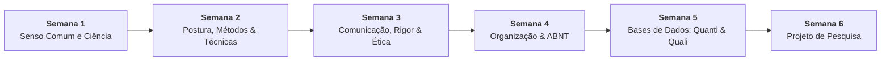

# 📚 Semana 5 — Base de Dados Científicos: Pesquisas Quantitativas e Qualitativas

> **Disciplina:** Projetos e Métodos para a Produção do Conhecimento (`INT100-EC-2026S2B2-T001`)  
> **Curso:** Bacharelado em Engenharia de Computação — Univesp  
> **Docente Responsável:** Profª Dra. Graziella Ribeiro Soares Moura  
> **Período da Semana 5:** 26/10/2026 a 08/11/2026  
> **Status:** 🟢 **100% CONCLUÍDO (Nota 10,0 / 10,0)**  

---

## 🗺️ Índice de Materiais e Atividades

| Arquivo | Descrição | Status |
| :--- | :--- | :---: |
| [**`0-Inicio.md`**](file:///home/henrique/Modelos/Univesp/2026S2B2/INT100-Projetos-e-Metodos-para-a-Producao-do-Conhecimento/Semana-5/0-Inicio.md) | Apresentação da semana, objetivos de aprendizagem, desafio estruturado (abordagem mista em IA/Radiologia) e análise dos casos práticos de apoio (FEEVALE e Atlas Brasil) | 🟢 Pronto |
| [**`1-Videoaulas.md`**](file:///home/henrique/Modelos/Univesp/2026S2B2/INT100-Projetos-e-Metodos-para-a-Producao-do-Conhecimento/Semana-5/1-Videoaulas.md) | Síntese analítica das videoaulas oficiais: características, procedimentos e fontes de dados quantitativos e qualitativos | 🟢 Pronto |
| [**`2-Texto-base-Analise-Dados-Qualitativos-Gibbs-Cap1.md`**](file:///home/henrique/Modelos/Univesp/2026S2B2/INT100-Projetos-e-Metodos-para-a-Producao-do-Conhecimento/Semana-5/2-Texto-base-Analise-Dados-Qualitativos-Gibbs-Cap1.md) | Síntese do texto-base de Graham Gibbs (*A Natureza da Análise Qualitativa*, Artmed, 2009): codificação, significado e interpretação | 🟢 Pronto |
| [**`3-Material-base-Fontes-Estatisticas-IBGE.md`**](file:///home/henrique/Modelos/Univesp/2026S2B2/INT100-Projetos-e-Metodos-para-a-Producao-do-Conhecimento/Semana-5/3-Material-base-Fontes-Estatisticas-IBGE.md) | A importância da documentação, tecnologia da informação, evolução das estatísticas públicas e metadados (IBGE 80 anos e IBGE Explica) | 🟢 Pronto |
| [**`4-Material-base-Historia-Oral-Sebe.md`**](file:///home/henrique/Modelos/Univesp/2026S2B2/INT100-Projetos-e-Metodos-para-a-Producao-do-Conhecimento/Semana-5/4-Material-base-Historia-Oral-Sebe.md) | Metodologia e práticas da História Oral (Prof. Dr. José Carlos Sebe Bom Meihy): colaborador, modalidades, transcrição/textualização/transcriação e ética | 🟢 Pronto |
| [**`4.1-Material-base-Pesquisa-Quanti-Quali-George-Brown.md`**](file:///home/henrique/Modelos/Univesp/2026S2B2/INT100-Projetos-e-Metodos-para-a-Producao-do-Conhecimento/Semana-5/4.1-Material-base-Pesquisa-Quanti-Quali-George-Brown.md) | Pesquisa Qualitativa versus Quantitativa (Prof. George Brown - Universidade de Nottingham): confronto dedutivo vs. indutivo e métodos mistos | 🟢 Pronto |
| [**`4.2-Aprofundando-o-tema.md`**](file:///home/henrique/Modelos/Univesp/2026S2B2/INT100-Projetos-e-Metodos-para-a-Producao-do-Conhecimento/Semana-5/4.2-Aprofundando-o-tema.md) | Aprofundando o tema: Técnicas de Coleta/Documentação (Vera Lúcia Pessôa, UNESP, p. 4–21) e Análise Textual Discursiva (Roque Moraes & Galiazzi, 2006) | 🟢 Pronto |
| [**`4.3-Forum-tematico.md`**](file:///home/henrique/Modelos/Univesp/2026S2B2/INT100-Projetos-e-Metodos-para-a-Producao-do-Conhecimento/Semana-5/4.3-Forum-tematico.md) | Resolução e modelos de postagem principal e réplicas para o fórum de discussão temática da Semana 5 no AVA | 🟢 Pronto |
| [**`5-Atividade-avaliativa.md`**](file:///home/henrique/Modelos/Univesp/2026S2B2/INT100-Projetos-e-Metodos-para-a-Producao-do-Conhecimento/Semana-5/5-Atividade-avaliativa.md) | Resolução analítica completa das 5 questões avaliativas com fundamentação teórica | 🟢 **Concluído (10,0 / 10,0)** |
| [**`6-Em-sintese.md`**](file:///home/henrique/Modelos/Univesp/2026S2B2/INT100-Projetos-e-Metodos-para-a-Producao-do-Conhecimento/Semana-5/6-Em-sintese.md) | Resumo executivo, mapa conceitual da triangulação quanti-quali e autoavaliação de competências | 🟢 Pronto |

---

## 🧭 Relação com as Demais Semanas

