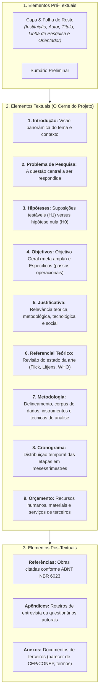

# 📌 Semana 6 — Início & Apresentação da Semana
### Desenvolvimento do Projeto de Pesquisa: Da Concepção Teórica ao Planejamento Metodológico

> **Disciplina:** Projetos e Métodos para a Produção do Conhecimento (`INT100-EC-2026S2B2-T001`)  
> **Curso:** Bacharelado em Engenharia de Computação — Univesp  
> **Docente Responsável:** Profª Dra. Graziella Ribeiro Soares Moura  
> **Período da Semana 6:** 02/11/2026 a 15/11/2026  
> **Status:** 🟢 **Documento Oficial de Abertura & Anteprojeto Estruturado Completo**  

---

## 👩‍🏫 Mensagem da Professora & Contextualização Epistemológica

Olá, estudante!

Na última semana, você viu como se desenvolve a coleta de dados nas pesquisas científicas e como a base de dados é um dos componentes essenciais de desenvolvimento da pesquisa, cuja realização exige método, tempo e trabalho. Você conheceu as características e as formas de obtenção dos dados, procedimentos e fontes de pesquisas quantitativas e qualitativas.

Se a coleta de dados é uma das etapas cruciais de desenvolvimento da pesquisa, ela deve ser rigorosamente planejada antes mesmo de se iniciarem os procedimentos de campo ou laboratório. **Não se inicia uma pesquisa sem antes pensá-la em seu conjunto**, definindo com clareza os elementos principais para sua execução.

Trata-se de **organizar um projeto de pesquisa**. Esse é o tema central desta semana. Você vai conhecer os elementos obrigatórios que compõem um projeto científico e aprender como deve ser a sua redação.

### O Que é um Projeto de Pesquisa?
O projeto de pesquisa nada mais é do que um **roteiro**, uma **proposta estruturada**, um **guia base** para a elaboração de investigações em áreas distintas. Ele orienta a produção do conhecimento e a sistematização crítica sobre o tema específico a ser investigado.

O que direciona o projeto teórica e metodologicamente é o tema no contexto geral da área (ciência) na qual se aplica. Isso significa que o tema, o problema e a ênfase a ser definida no projeto são específicos no conjunto das três grandes áreas do conhecimento: **Ciências Biológicas**, **Ciências Exatas e Tecnológicas** e **Ciências Humanas e Sociais**.

Não há regras rígidas e imutáveis para a elaboração de projetos, variando conforme a instituição solicitante e sua finalidade:
* **Fins Estritamente Acadêmicos:** Iniciação Científica (IC), Trabalho de Conclusão de Curso (TCC / Monografia), Dissertação de Mestrado e Tese de Doutorado;
* **Fins Institucionais e de Fomento:** Demandas específicas de agências financiadoras como FAPESP, CNPq, CAPES, Ministérios e fundações internacionais de apoio à inovação.

Entretanto, quando se trata da elaboração de um projeto de pesquisa rigoroso, há componentes universais e partes obrigatórias normatizadas pela **ABNT NBR 15287**: *Título, Introdução, Formulação do Problema, Hipóteses, Justificativa e Relevância, Objetivos (Geral e Específicos), Referencial Teórico, Metodologia, Cronograma, Orçamento (quando financiado) e Referências Bibliográficas*.

Em síntese, para começar a planejar o seu projeto, você precisa responder a cinco perguntas fundamentais:
1. **O quê?** *(O tema, o objeto e a delimitação do problema)*;
2. **Por quê?** *(A justificativa e a relevância científica/social)*;
3. **Para quê?** *(Os objetivos gerais e específicos)*;
4. **Como?** *(A metodologia, instrumentos de coleta e técnicas analíticas)*;
5. **Quando e Quanto?** *(O cronograma de execução e a previsão orçamentária)*.

---

## 🏛️ A Anatomia Canônica de um Projeto de Pesquisa (ABNT NBR 15287)



---

## 🎯 Objetivos de Aprendizagem da Semana 6

Ao final desta semana, você deverá ser capaz de:

* [ ] **Apreender o que é e qual a função de um projeto de pesquisa** como mapa de navegação e contrato epistêmico do cientista.
* [ ] **Identificar e articular todos os componentes estruturais obrigatórios** de um projeto científico padronizado pela ABNT NBR 15287.
* [ ] **Desenvolver uma redação científica clara, concisa e objetiva**, garantindo a viabilidade e a auditabilidade da proposta perante bancas acadêmicas e órgãos de fomento.

---

## 💡 Desafio da Semana: Concretização da Escrita do Projeto de Pesquisa

### 📌 Enunciado Oficial do AVA
> *Prosseguindo com o desafio de escrever um projeto de pesquisa, nesta semana chegamos a ele.*  
> *O desafio agora é concretizar a escrita do projeto. Devemos atentar para as partes que a compõem. Lembre-se que você já tem algumas partes que foram trabalhadas nas semanas anteriores.*  
> *Ao longo da semana, você verá como planejar o levantamento dos dados, medi-los e interpretá-los para, então, redigir um texto científico. Isso o orientará a desenvolver o que foi solicitado.*

---

### 💻 Resolução Estruturada: Anteprojeto Completo de Engenharia de Computação

Integrando organicamente todos os elementos construídos nas **Semanas 1 a 5**:
* **Semana 1:** A atitude científica e superação do senso comum em inteligência artificial;
* **Semana 2:** Métodos dedutivo e indutivo aplicados ao aprendizado de máquina;
* **Semana 3:** Rigor ético, honestidade intelectual e governança em saúde;
* **Semana 4:** Revisão do estado da arte (Litjens, Selvaraju, OMS) e normatização ABNT;
* **Semana 5:** Coleta mista (*Mixed Methods*), bases de dados (*CheXpert* / DICOM), metadados e História Oral temática.

---

#### 📄 MINUTA COMPLETA DO ANTEPROJETO DE PESQUISA (ABNT NBR 15287)

**UNIVERSIDADE VIRTUAL DO ESTADO DE SÃO PAULO — UNIVESP**  
**CURSO:** Bacharelado em Engenharia de Computação  
**DISCIPLINA:** Projetos e Métodos para a Produção do Conhecimento (`INT100`)  
**DISCENTE:** Henrique Freire  
**ORIENTADORA:** Profª Dra. Graziella Ribeiro Soares Moura  

---

#### 1. TÍTULO DO PROJETO
> **Sistemas Inteligentes de Visão Computacional e Aprendizado Profundo Aplicados ao Auxílio Diagnóstico em Radiologia Pulmonar: Investigação da Explicabilidade Algorítmica (Grad-CAM), Confiabilidade Clínica e Governança Bioética.**

---

#### 2. DELIMITAÇÃO DO TEMA E FORMULAÇÃO DO PROBLEMA
A aplicação de Redes Neurais Convolucionais profundas (CNNs) na análise automatizada de imagens radiográficas consolidou-se como um dos avanços mais promissores da engenharia de software biomédica, alcançando taxas de sensibilidade superiores a 90% na detecção de consolidações, pneumotórax e nódulos pulmonares (LITJENS et al., 2017). Não obstante esse extraordinário desempenho estatístico, a maioria dessas arquiteturas opera como "caixas-pretas" (*black-box models*), ocultando a lógica subjacente à ponderação dos pesos sinápticos que geram a predição.

No contexto hospitalar, a opacidade dos algoritmos suscita dilemas éticos graves: o médico radiologista não pode delegar sua autoridade a uma ferramenta cega, pois a responsabilidade civil e profissional pelo laudo recai integralmente sobre o ser humano. Além disso, redes neurais são vulneráveis a atalhos espúrios (*shortcut learning*), como aprender a identificar artefatos do chassi radiográfico ou marcas de leito em vez de biomarcadores anatomopatológicos reais.

Diante desse cenário interdisciplinar, formula-se a seguinte **Questão Central de Pesquisa**:
> *"Em que medida a integração de mapas visuais de explicabilidade (Grad-CAM) a redes neurais convolucionais é capaz de elevar a acurácia diagnóstica quantitativa e, simultaneamente, assegurar a confiabilidade qualitativa e a adesão ética de médicos radiologistas na detecção de patologias torácicas?"*

---

#### 3. HIPÓTESES DE PESQUISA
* **Hipótese de Trabalho / Principal ($H_1$):** A incorporação de mapas de ativação ponderados por gradiente (Grad-CAM) à interface de auxílio diagnóstico permite que os radiologistas auditem visualmente os focos de atenção da rede neural em tempo real, reduzindo em pelo menos 15% a aceitação inadvertida de falsos positivos gerados por artefatos técnicos e elevando o índice de confiança subjetiva dos especialistas, sem comprometer a latência operacional de emissão do laudo.
* **Hipótese Nula ($H_0$):** A exibição de mapas Grad-CAM não produz alteração estatisticamente significativa na taxa de concordância interobservador e não interfere na percepção qualitativa de segurança do médico radiologista em relação a modelos não explicáveis.

---

#### 4. OBJETIVOS DO PROJETO

##### 4.1 Objetivo Geral:
Conceber, implementar e avaliar um protótipo de software de auxílio diagnóstico baseado em aprendizado profundo com módulos explicáveis Grad-CAM, investigando tanto sua acurácia computacional quanto o impacto subjetivo, ergonômico e bioético sobre a prática clínica de médicos radiologistas.

##### 4.2 Objetivos Específicos:
1. **Pipeline Computacional:** Treinar e calibrar arquiteturas de redes neurais convolucionais (ex.: DenseNet-121 e ResNet-50) utilizando grandes repositórios abertos de radiografias de tórax (*Stanford CheXpert* e *NIH ChestX-ray14*), otimizando a curva ROC-AUC para patologias pleuropulmonares;
2. **Módulo de Explicabilidade:** Implementar a técnica Grad-CAM (SELVARAJU et al., 2017) para produzir mapas de calor bidimensionais sobrepostos às imagens DICOM, destacando as áreas anatômicas determinantes para a classificação;
3. **Avaliação Empírica de Usabilidade:** Desenvolver testes controlados com radiologistas, mensurando o tempo médio de resposta, a concordância diagnóstica e a identificação de artefatos com e sem o suporte do mapa explicativo;
4. **Investigação Qualitativa e Bioética:** Conduzir entrevistas semiestruturadas e aplicar a técnica de História Oral Temática com especialistas, utilizando a Análise Textual Discursiva (MORAES & GALIAZZI, 2006) para compreender as hesitações, percepções de autonomia e conformidade com as diretrizes da Organização Mundial da Saúde (WHO, 2021).

---

#### 5. JUSTIFICATIVA E RELEVÂNCIA
A relevância deste projeto desdobra-se em três pilares interdependentes:
* **Científico e Tecnológico:** Contribui para a fronteira da Inteligência Artificial Explicável (*Explainable AI - XAI*), demonstrando na prática da Engenharia de Computação como converter predições opacas em representações visuais auditáveis;
* **Clínico e Social:** Apoia a saúde pública (SUS) e centros de diagnóstico em regiões desprovidas de especialistas seniores, servindo como segunda opinião computacional confiável que acelera a triagem de casos urgentes sem suprimir o julgamento humano;
* **Bioético e Regulatório:** Alinha-se diretamente ao Marco Ético da OMS para IA em Saúde (2021), que preconiza a preservação inegociável da autonomia médica e a responsabilidade algorítmica (*accountability*), além de atender às salvaguardas da LGPD (Lei nº 13.709/2018).

---

#### 6. QUADRO METODOLÓGICO (MÉTODOS MISTOS)

```mermaid
flowchart LR
    subgraph Quanti["Etapa 1: Quantitativa (Engenharia & Machine Learning)"]
        D1["<b>Base de Dados:</b> Repositórios CheXpert e NIH-14 (>200k imagens)"]
        D2["<b>Pré-processamento:</b> Normalização de histograma e aumento de dados (Data Augmentation)"]
        D3["<b>Métricas:</b> Sensibilidade, Especificidade, F1-Score, ROC-AUC e Latência de GPU"]
    end

    subgraph Quali["Etapa 2: Qualitativa (Clínica & Bioética)"]
        E1["<b>Sujeitos:</b> 10 médicos radiologistas (residentes e seniores)"]
        E2["<b>Instrumentos:</b> Roteiro de entrevista semiestruturada e protocolo 'Think-Aloud'"]
        E3["<b>Tratamento:</b> Análise Textual Discursiva (Unitarização ➔ Categorização ➔ Metatextos)"]
    end

    Quanti ==> Triangulacao["<b>Triangulação Metodológica</b><br>Validação Computacional + Aceitação Clínica"] <== Quali
```

---

#### 7. CRONOGRAMA DE ATIVIDADES (12 MESES)

| Atividades do Projeto | M1-M2 | M3-M4 | M5-M6 | M7-M8 | M9-M10 | M11-M12 |
| :--- | :---: | :---: | :---: | :---: | :---: | :---: |
| 1. Revisão sistemática da literatura e submissão ao CEP/CONEP | █ | | | | | |
| 2. Coleta, curadoria e pré-processamento das bases DICOM | █ | █ | | | | |
| 3. Treinamento e ajuste fino das redes neurais convolucionais | | █ | █ | | | |
| 4. Integração do módulo Grad-CAM e protótipo da interface | | | █ | █ | | |
| 5. Sessões de testes empíricos e entrevistas com radiologistas | | | | █ | █ | |
| 6. Análise Textual Discursiva (ATD) e triangulação dos dados | | | | | █ | █ |
| 7. Redação final da monografia/artigo e defesa pública | | | | | | █ |

---

#### 8. RECURSOS E ORÇAMENTO ESTIMADO

| Categoria de Despesa | Descrição do Item | Custo Estimado (R$) |
| :--- | :--- | :---: |
| **Material Permanente** | Estação de trabalho para deep learning (GPU Nvidia RTX 4090 24GB) | R$ 16.500,00 |
| **Serviços em Nuvem** | Armazenamento seguro de bases DICOM e processamento distribuído (AWS/GCP) | R$ 3.200,00 |
| **Materiais de Consumo** | Licenças de software de transcrição/CAQDAS e insumos de escritório | R$ 1.800,00 |
| **Publicações & Eventos** | Taxas de submissão em periódicos indexados (*Article Processing Charge - APC*) | R$ 4.500,00 |
| **TOTAL GERAL** | Investimento consolidado do projeto | **R$ 26.000,00** |

---

#### 9. REFERÊNCIAS BIBLIOGRÁFICAS (ABNT NBR 6023)
* CERVO, Amado Luiz; BERVIAN, Pedro Alcino; SILVA, Roberto da. **Metodologia científica**. 6. ed. São Paulo: Pearson Prentice Hall, 2007.
* FLICK, Uwe. **Introdução à metodologia de pesquisa: um guia para iniciantes**. Porto Alegre: Penso, 2012.
* GIBBS, Graham. **Análise de dados qualitativos**. Porto Alegre: Artmed, 2009.
* LITJENS, Geert et al. A survey on deep learning in medical image analysis. **Medical Image Analysis**, Amsterdam, v. 42, p. 60-88, Dec. 2017. DOI: 10.1016/j.media.2017.07.005.
* MORAES, Roque; GALIAZZI, Maria do Carmo. Análise textual discursiva: processo reconstrutivo de múltiplas faces. **Ciência & Educação**, Bauru, v. 12, n. 1, p. 117-128, 2006.
* PESSÔA, Vera Lúcia Salazar. **Manual para elaboração de trabalhos acadêmicos: material para fins didáticos**. Rio Claro: UNESP, 2020.
* SELVARAJU, Ramprasaath R. et al. Grad-CAM: visual explanations from deep networks via gradient-based localization. In: IEEE INTERNATIONAL CONFERENCE ON COMPUTER VISION (ICCV), 2017, Venice. **Proceedings [...]** Piscataway: IEEE, 2017. p. 618-626. DOI: 10.1109/ICCV.2017.74.
* WORLD HEALTH ORGANIZATION (WHO). **Ethics and governance of artificial intelligence for health**: WHO guidance. Geneva: WHO, 2021. 150 p.

---

## 💬 Para Refletir

> *"Tudo começa com o projeto. Assim como dissemos sobre a seletividade, a tomada de decisões e a definição de projetos são práticas importantes em nossa vida. As perguntas: O quê? Quando? Onde? Por quê? Como? são parte do nosso cotidiano, de nossa vivência. A diferença aqui é que estamos falando de ciência, conhecimento científico e, nesse aspecto, as partes que compõem um projeto fazem parte da lógica científica. Uma redação clara e objetiva do projeto também permitirá o desenvolvimento eficaz da proposta de pesquisa."*  
> — **Profª Dra. Graziella Ribeiro Soares Moura**
