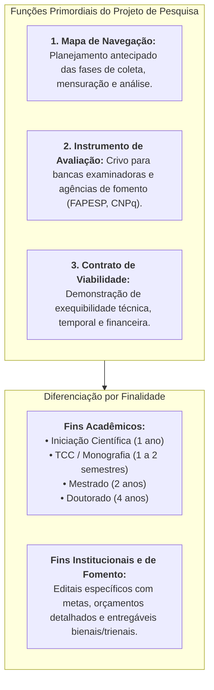
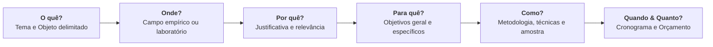
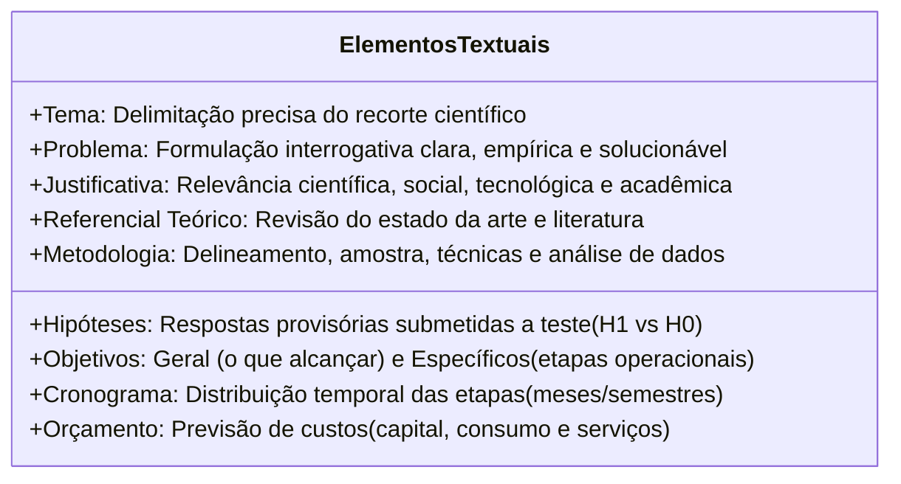
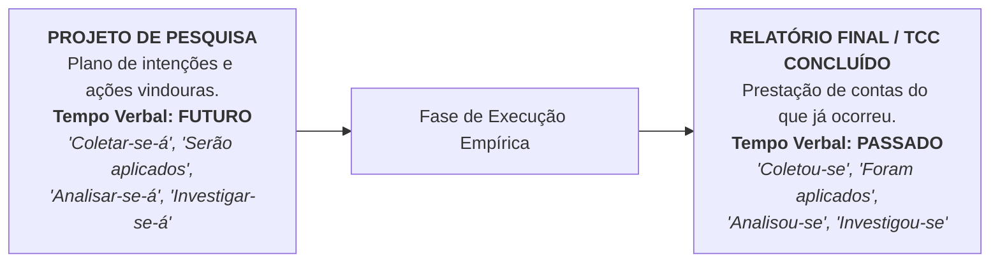

# 🎥 Videoaula 7 — Desenvolvimento do Projeto de Pesquisa

> **Disciplina:** Projetos e Métodos para a Produção do Conhecimento (`INT100-EC-2026S2B2-T001`)  
> **Tema da Semana 6:** Desenvolvimento e Planejamento do Projeto de Pesquisa  
> **Link Oficial:** [Assistir no YouTube (UNIVESP)](https://www.youtube.com/watch?v=YmcnJmwuM_Q)  
> **Docente da Aula:** Profª Darlene Ferreira  
> **Período Acadêmico:** 02/11/2026 a 15/11/2026  
> **Status:** 🟢 **Síntese Analítica Completa & Mapeamento Estrutural**  

---

## 📌 Visão Geral da Videoaula

Na Videoaula 7, a **Profª Darlene Ferreira** aborda o ponto de partida de toda investigação científica: a concepção, o planejamento e a redação formal do **projeto de pesquisa**.

A professora enfatiza que nada se realiza validamente em ciência sem planejamento prévio. Projetar significa **antever e metodizar** as etapas operacionais antes de qualquer ida a campo ou manipulação em laboratório.

A aula estrutura-se em quatro eixos centrais:
1. **O Conceito e a Função do Projeto:** O projeto como roteiro, guia e contrato epistêmico de trabalho em diferentes áreas do saber (Biológicas, Exatas e Humanas) e finalidades (acadêmicas versus agências de fomento como FAPESP e CNPq);
2. **As Questões Fundamentais do Planejamento:** As perguntas que direcionam a mente do pesquisador (*O quê? Onde? Por quê? Como? Com quais recursos? Em que período?*);
3. **A Estrutura Básica e Componentes Canônicos (ABNT NBR 15287):** Da capa aos elementos pós-textuais, com exame minucioso de Tema, Problema, Hipóteses, Objetivos, Justificativa, Referencial Teórico, Metodologia, Cronograma e Orçamento;
4. **Regras Gramaticais e Postura Científica:** O uso obrigatório do **tempo verbal no futuro** e a desmistificação do "medo da hipótese nula" (uma hipótese refutada possui alto valor científico).

---

## 🔄 1. O Conceito e a Função do Projeto de Pesquisa

> *"O projeto de pesquisa na realidade é um roteiro, uma proposta, um instrumento muito importante, um guia de base para a elaboração de uma pesquisa em áreas distintas [...] Projetar significa antever. Eu vou metodizar as etapas ou as fases de operacionalização de um trabalho."*  
> — **Profª Darlene Ferreira**

### O Projeto nas Três Grandes Áreas do Conhecimento:
O projeto de pesquisa não possui uma fórmula mecânica única; ele adapta-se à natureza ontológica do objeto investigado:
* **Ciências Exatas e Tecnológicas (Engenharias/Computação):** Foco em modelagem matemática, arquiteturas de sistemas, algoritmos, protótipos, *benchmarking*, testes de estresse e métricas de desempenho objetivo.
* **Ciências Biológicas e da Saúde:** Ênfase em protocolos experimentais controlados, ensaios clínicos, bioética estrita (comitês CEP/CONEP) e variáveis fisiológicas.
* **Ciências Humanas e Sociais:** Centralidade na contextualização histórica, discursos, relações de poder, trajetórias sociais e hermenêutica.

---

## ❓ 2. As Perguntas Estruturantes do Planejamento

Para estruturar um projeto consistente, o cientista deve responder a um conjunto articulado de perguntas orientadoras:

---

## 🏛️ 3. Componentes Estruturais de um Projeto (ABNT NBR 15287)

A professora detalha a anatomia dos elementos que integram o documento científico:

### 1. Elementos Externos e Pré-Textuais
* **Parte Externa:** Capa padronizada (instituição, autor, título claro, subtítulo se houver, local e ano) e lombada (para trabalhos encadernados).
* **Parte Interna Pré-Textual:** Folha de rosto (com a nota explicativa da natureza acadêmica ou do edital de fomento) e sumário preliminar.

### 2. Elementos Textuais (O Conteúdo da Investigação)

#### Aprofundamento nos Componentes Centrais:
* **Problema de Pesquisa:** É a pergunta-chave que a investigação se propõe a responder. Deve ser formulado de maneira interrogativa, clara, objetiva e delimitada, baseando-se na observação da realidade e no princípio da **seletividade**.
* **Hipótese(s):** Trata-se de uma resposta provisória e antecipada ao problema formulado.
  > ⚠️ **Ponto de Alto Impacto Conceitual:** *A hipótese refutada não invalida a pesquisa!* A professora desmistifica o medo comum de obter uma hipótese falsa. Na ciência, demonstrar empiricamente que determinada relação de causa e efeito **não ocorre** é um avanço epistemológico tão valioso quanto confirmá-la, poupando a comunidade científica de trilhar caminhos equivocados.
* **Objetivos:** 
  * *Geral:* Define o impacto amplo e o resultado final esperado da investigação;
  * *Específicos:* Ações operacionais intermediárias (expressas por verbos no infinitivo: *mapear, comparar, implementar, avaliar, categorizar*) necessárias para cumprir o objetivo geral.
* **Justificativa:** Demonstra o "porquê" de a pesquisa ser financiada ou aceita. Justifica-se a relevância sob três prismas: teórico (lacunas na literatura), prático/social (benefício à comunidade) e tecnológico/econômico.
* **Referencial Teórico:** Diálogo com as obras e autores consolidados da área, resgatando o estado da arte levantado na revisão bibliográfica.
* **Metodologia:** Descrição minuciosa dos caminhos de pesquisa. Define o delineamento (experimental, quase-experimental, estudo de caso, etnográfico), o universo e a amostra (probabilística ou intencional), os instrumentos de coleta (formulários, questionários, sensores) e os procedimentos analíticos (estatística ou análise de conteúdo/ATD).
* **Cronograma:** Distribuição temporal das fases de trabalho no tempo concedido pela universidade ou agência de fomento.
* **Orçamento:** Quando há solicitação de recursos financeiros, divide-se em material permanente (equipamentos/computadores), material de consumo e serviços de terceiros.

### 3. Elementos Pós-Textuais
* **Referências Bibliográficas:** Relação obrigatória de todas as obras citadas no projeto, formatadas estritamente segundo a ABNT NBR 6023.
* **Apêndices:** Documentos complementares elaborados pelo próprio autor (ex.: roteiro da entrevista, questionário piloto).
* **Anexos:** Documentos produzidos por terceiros incorporados para comprovação (ex.: autorizações institucionais, parecer do Comitê de Ética).

---

## ✍️ 4. A Regra Gramatical de Ouro: O Tempo Verbal no Futuro

Um dos alertas metodológicos mais enfáticos da Videoaula 7 reside na norma linguística de redação:

* Como o projeto de pesquisa é uma **proposta de trabalho a ser executada**, todos os procedimentos metodológicos devem ser redigidos obrigatoriamente no **tempo futuro** ou em locuções que indiquem ação prospectiva.

---

## 💻 5. Aplicação no Projeto de Engenharia de Computação (IA na Radiologia)

Na Videoaula 7, a professora enfatiza a conexão direta da metodologia com a elaboração de projetos reais. Aplicando essas diretrizes ao nosso tema interdisciplinar:

1. **Problema Claro:** *"Em que medida a explicabilidade Grad-CAM reduz o erro diagnóstico em radiografias pulmonares?"*
2. **Redação no Futuro:**
   * *"Treinar-se-ão arquiteturas convolucionais profundas (DenseNet-121) a partir do repositório CheXpert..."*
   * *"Realizar-se-ão entrevistas semiestruturadas com dez radiologistas credenciados..."*
   * *"Os dados textuais serão tratados por meio da Análise Textual Discursiva (ATD)..."*
3. **Mapeamento Orçamentário e Cronograma:** Detalhamento formal dos custos de estações com GPU de alto desempenho e planejamento mensal em 12 meses de execução.

---

## 🎯 Síntese dos Eixos da Aula para Fixação

| Componente do Projeto | Função Epistêmica | Erro Crítico a Evitar |
| :--- | :--- | :--- |
| **Problema** | Fio condutor e pergunta-chave da pesquisa. | Formular perguntas amplas demais que não comportam solução empírica delimitada. |
| **Hipótese** | Resposta provisória sujeita a teste empírico. | Abandonar o projeto caso a hipótese seja refutada (refutação é avanço da ciência). |
| **Objetivos** | Desdobramento das metas em ações concretas. | Confundir objetivo de pesquisa (*analisar, comparar*) com tarefa rotineira (*ler livros*). |
| **Metodologia** | O caminho metódico de coleta e análise dos dados. | Descrever métodos genéricos sem detalhar instrumentos, amostra e tratamento. |
| **Redação Verbal** | Expressão da temporalidade do documento. | Escrever o projeto no pretérito (o projeto é sempre redigido no **futuro**). |
